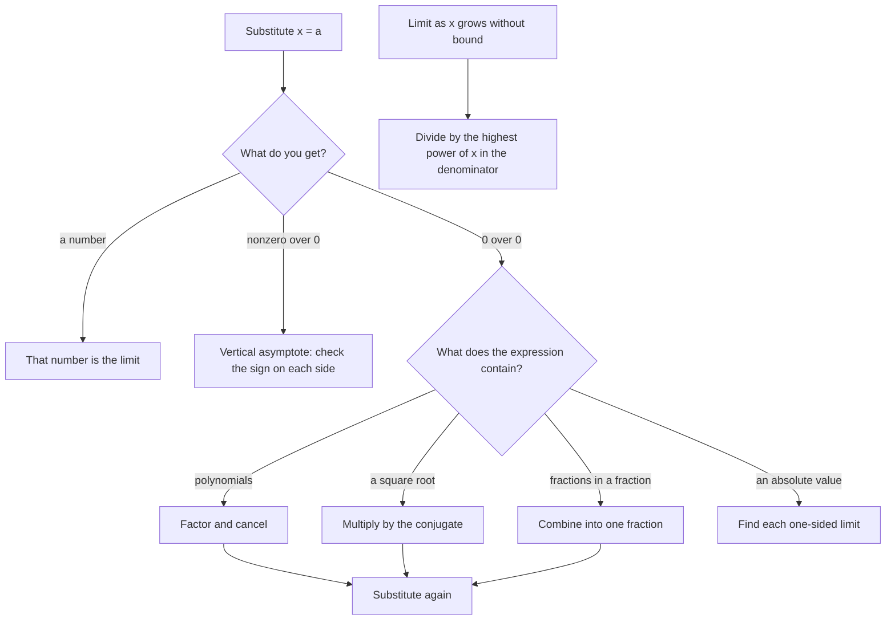

## From estimates to exact answers

Tables and graphs suggested limits in the last lesson. This lesson computes them exactly. The main tools are ones you already have: factoring and cancelling (Module 3), rationalizing, combining fractions, and comparing degrees for end behavior (rational functions again). Together with the limit laws below they handle almost every limit you'll meet before calculus, and they are exactly what the derivative in the next lesson requires.

## Limit laws and direct substitution

If $\lim_{x\to a} f(x)$ and $\lim_{x\to a} g(x)$ exist, then limits respect arithmetic:

| Law | Statement |
|---|---|
| Sum / difference | $\lim (f \pm g) = \lim f \pm \lim g$ |
| Constant multiple | $\lim cf = c\lim f$ |
| Product | $\lim fg = (\lim f)(\lim g)$ |
| Quotient | $\lim \frac fg = \frac{\lim f}{\lim g}$ if $\lim g \ne 0$ |
| Power / root | $\lim f^n = (\lim f)^n$, $\lim\sqrt[n]{f} = \sqrt[n]{\lim f}$ (when defined) |

Starting from $\lim_{x\to a} c = c$ and $\lim_{x\to a} x = a$, these laws show that for any polynomial $p$, $\lim_{x\to a} p(x) = p(a)$, and the same for rational functions where the denominator isn't 0. This is **direct substitution**: for continuous functions, just plug in.

### Example 1

$\displaystyle\lim_{x\to 3}(x^2 + 2x - 1) = 9 + 6 - 1 = 14$, and $\displaystyle\lim_{x\to 2}\frac{x + 4}{x^2 + 1} = \frac{6}{5}$.

## The indeterminate form $\frac00$

When substitution gives $\frac{0}{0}$, the expression is an **indeterminate form**: the limit could be any number, or not exist, and more work is needed. The fix is to rewrite the expression so the troublesome factor cancels. Cancelling is legal because the limit ignores the value at $x = a$ itself: two functions that agree everywhere except at $a$ have the same limit there.

(By contrast, $\frac{\text{nonzero}}{0}$ is not indeterminate: it signals a vertical asymptote, and the limit doesn't exist as a number.)

### Example 2: factor and cancel

Find $\displaystyle\lim_{x\to -2}\frac{x^2 + 5x + 6}{x + 2}$.

Substitution gives $\frac{4 - 10 + 6}{0} = \frac00$. Factor: $\frac{(x + 2)(x + 3)}{x + 2} = x + 3$ for $x \ne -2$. So the limit is $-2 + 3 = 1$.

### Example 3: rationalize

Find $\displaystyle\lim_{x\to 0}\frac{\sqrt{x + 9} - 3}{x}$.

Substitution gives $\frac00$. Multiply top and bottom by the conjugate $\sqrt{x + 9} + 3$:

$$\frac{(\sqrt{x + 9} - 3)(\sqrt{x + 9} + 3)}{x(\sqrt{x + 9} + 3)} = \frac{x + 9 - 9}{x(\sqrt{x + 9} + 3)} = \frac{1}{\sqrt{x + 9} + 3}.$$

Now substitute: $\frac{1}{3 + 3} = \frac16$. (A table near 0 gives about 0.1667.)

### Example 4: combine fractions

Find $\displaystyle\lim_{x\to 0}\frac{\frac{1}{x + 2} - \frac12}{x}$.

Combine the top over the common denominator $2(x + 2)$: $\frac{2 - (x + 2)}{2(x + 2)} = \frac{-x}{2(x + 2)}$. Dividing by $x$ gives $\frac{-1}{2(x + 2)}$, and substituting $x = 0$ gives $-\frac14$.

Notice that Examples 3 and 4 are difference quotients in disguise. That's no coincidence, as the next lesson shows.

### Example 5: absolute values need one-sided limits

Find $\displaystyle\lim_{x\to 2}\frac{|x - 2|}{x - 2}$.

Substitution gives $\frac00$, but no factoring cancels an absolute value. Split it piecewise, as in Lesson 2. For $x > 2$, $|x - 2| = x - 2$, so the expression equals 1. For $x < 2$, $|x - 2| = -(x - 2)$, so it equals $-1$. The right-hand limit is 1 and the left-hand limit is $-1$; they differ, so the limit does not exist. The graph is two horizontal rays with a jump at $x = 2$. Whenever an absolute value's inside is 0 at the point you approach, check each side separately.

## Limits at infinity

$\lim_{x\to\infty} f(x) = L$ means $f(x)$ gets close to $L$ as $x$ grows without bound: the graph has the horizontal asymptote $y = L$. The basic fact is

$$\lim_{x\to\pm\infty}\frac{1}{x^n} = 0 \quad (n > 0).$$

For a rational function, divide the numerator and denominator by the highest power of $x$ in the denominator. This reproduces the horizontal-asymptote rules of Lesson 12:

| Degrees | $\lim_{x\to\pm\infty}\frac{p(x)}{q(x)}$ |
|---|---|
| $\deg p < \deg q$ | $0$ |
| $\deg p = \deg q$ | ratio of leading coefficients |
| $\deg p > \deg q$ | $\pm\infty$ (no finite limit) |

### Example 6

Find $\displaystyle\lim_{x\to\infty}\frac{3x^2 - x}{5x^2 + 4}$, $\displaystyle\lim_{x\to\infty}\frac{2x + 1}{x^2 - 3}$ and $\displaystyle\lim_{x\to\infty}\frac{x^3}{x^2 + 1}$.

- Divide by $x^2$: $\frac{3 - \frac1x}{5 + \frac{4}{x^2}} \to \frac{3}{5}$.
- Divide by $x^2$: $\frac{\frac2x + \frac{1}{x^2}}{1 - \frac{3}{x^2}} \to \frac{0}{1} = 0$.
- The top's degree is larger; the quotient behaves like $x$, so it grows without bound: $\lim = \infty$.

Other functions from this course: $\lim_{x\to\infty}e^{-x} = 0$ (exponential decay), $\lim_{x\to\infty}\ln x = \infty$ (slowly), and $\lim_{x\to\infty}\sin x$ does not exist (it oscillates forever). The logistic model $\frac{C}{1 + Ae^{-kt}} \to C$ is a limit at infinity, and so is the sum of an infinite geometric series: $S = \lim_{n\to\infty}S_n$.

```plot
{"x": [-20, 20], "y": [-1, 2], "functions": [{"f": "(3x^2 - x)/(5x^2 + 4)", "label": "y = (3x² − x)/(5x² + 4)"}, {"f": "0.6", "dashed": true}], "caption": "The function approaches the dashed line y = 3/5 as x → ±∞."}
```

## Choosing a method

Every example in this lesson starts the same way: substitute, look at what you get, and let that decide the next step. The chart puts the whole lesson on one page.



## Common mistakes

- *Declaring $\frac00$ to be 0, 1 or undefined.* It's indeterminate: simplify first.
- *Cancelling terms instead of factors.* In $\frac{x^2 + 5x + 6}{x + 2}$ you must factor before cancelling.
- *Rationalizing and then expanding the conjugate in the denominator.* Leave it factored; that's where the cancellation happens.
- *Confusing $\frac{c}{0}$ with $\frac00$.* A nonzero numerator over 0 means an asymptote.
- *Using leading coefficients when the degrees differ.*

## Key points

- Direct substitution works for continuous functions (polynomials; rational functions with nonzero denominators).
- $\frac00$ is indeterminate: factor and cancel, rationalize, or combine fractions, then substitute.
- $\frac{\text{nonzero}}{0}$ signals a vertical asymptote: no finite limit.
- At infinity, divide by the highest power in the denominator; $\frac{1}{x^n} \to 0$.
- Limits at infinity give horizontal asymptotes; they also define infinite series sums.
