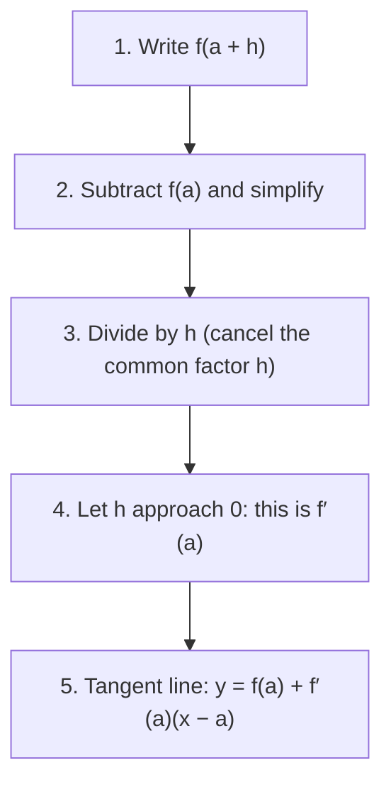

## The question that starts calculus

How steep is a curve at a single point? For a line, slope is rise over run between any two points. A curve's steepness changes from point to point, and "rise over run" needs two points. The fix combines two ideas from this course: the average rate of change (secant slope) from Module 1, and the limit from the last two lessons. Shrink the run to zero and the secant slopes approach the slope of the **tangent line**. That limit is the derivative, the central object of differential calculus. This lesson is your bridge into the Calculus course.

## From secant to tangent

Pick a point $P = (a, f(a))$ on the graph and a nearby point $Q = (a + h, f(a + h))$. The secant line through them has slope

$$m_{\text{sec}} = \frac{f(a + h) - f(a)}{h},$$

the difference quotient from Lesson 3. As $h \to 0$, $Q$ slides along the curve toward $P$, and the secant lines pivot toward a limiting position: the tangent line at $P$.


The secant's slope is the triangle's rise over its run. As $h$ shrinks, the triangle shrinks toward $P$ and the dashed secant swings down onto the green tangent.

```plot
{"x": [-0.5, 4.5], "y": [-2, 14], "functions": [{"f": "x^2"}, {"f": "5x - 6", "dashed": true}, {"f": "4x - 4"}], "points": [{"at": [2, 4], "label": "P (2, 4)"}, {"at": [3, 9], "label": "Q"}], "caption": "y = x² with the secant through P and Q (dashed, h = 1) and the tangent at P. As Q slides toward P, the secant slopes 5, 4.5, 4.1, … approach the tangent slope 4."}
```

## The derivative at a point

The **derivative** of $f$ at $a$ is

$$f'(a) = \lim_{h\to 0}\frac{f(a + h) - f(a)}{h},$$

provided the limit exists. It is the slope of the tangent line at $(a, f(a))$, and it measures the **instantaneous rate of change** of $f$ at $a$. Substituting $h = 0$ directly always gives $\frac00$, so these limits always need the algebra of the last lesson.

### Example 1

Find the slope of the tangent to $f(x) = x^2$ at $x = 3$, and the tangent line's equation.

$$\frac{f(3 + h) - f(3)}{h} = \frac{9 + 6h + h^2 - 9}{h} = \frac{6h + h^2}{h} = 6 + h \;\to\; 6.$$

So $f'(3) = 6$. The tangent passes through $(3, 9)$ with slope 6. In point-slope form, $y - 9 = 6(x - 3)$, i.e. $y = 6x - 9$.

The general tangent line at $a$ is

$$y = f(a) + f'(a)(x - a).$$

### Example 2: instantaneous velocity

A ball falls $s(t) = 16t^2$ feet in $t$ seconds. How fast is it falling at $t = 2$?

Average velocity on $[2, 2 + h]$: $\frac{16(2 + h)^2 - 64}{h} = \frac{64h + 16h^2}{h} = 64 + 16h$. As $h \to 0$ this approaches 64. The instantaneous velocity is 64 ft/s. Averages over shorter and shorter intervals (65.6, 64.16, 64.016 for $h = 0.1, 0.01, 0.001$) zero in on it.

### Example 3

Find $f'(4)$ for $f(x) = \sqrt{x}$.

$\frac{\sqrt{4 + h} - 2}{h}$: rationalize, as in the last lesson:

$$\frac{(\sqrt{4 + h} - 2)(\sqrt{4 + h} + 2)}{h(\sqrt{4 + h} + 2)} = \frac{h}{h(\sqrt{4 + h} + 2)} = \frac{1}{\sqrt{4 + h} + 2} \to \frac14.$$

## The derivative as a function

Keeping $x$ general instead of a specific number $a$ gives a new function, the **derivative function**:

$$f'(x) = \lim_{h\to 0}\frac{f(x + h) - f(x)}{h}.$$

Its output at each $x$ is the slope of $f$ there.

Every derivative in this lesson follows the same four algebra steps, and a tangent line takes one more:



### Example 4

Find $f'(x)$ for $f(x) = x^2 - 4x$, and where the tangent is horizontal.

$$\frac{(x + h)^2 - 4(x + h) - (x^2 - 4x)}{h} = \frac{2xh + h^2 - 4h}{h} = 2x + h - 4 \;\to\; 2x - 4.$$

So $f'(x) = 2x - 4$. A horizontal tangent has slope 0: $2x - 4 = 0$ at $x = 2$, which is the parabola's vertex, its minimum. That's the idea behind using derivatives to find maxima and minima: at a smooth peak or valley the tangent is flat.

### Example 5

Find $f'(x)$ for $f(x) = \dfrac1x$, and the tangent line at $x = 2$.

In Lesson 3 we simplified the difference quotient to $-\dfrac{1}{x(x + h)}$. Letting $h \to 0$ gives

$$f'(x) = -\frac{1}{x^2}.$$

At $x = 2$: the point is $\left(2, \frac12\right)$ and the slope is $-\frac14$, so the tangent is $y = \frac12 - \frac14(x - 2)$, i.e. $y = -\frac14x + 1$. The negative slope everywhere matches the graph of $\frac1x$, which falls on each branch.

## What the derivative tells you

| Sign of $f'(x)$ | Graph of $f$ |
|---|---|
| positive on an interval | increasing on that interval |
| negative on an interval | decreasing on that interval |
| zero at a point | horizontal tangent there (possible max or min) |

So the "increasing and decreasing" of Module 1 becomes a computation. A derivative may fail to exist where the graph has a corner (like $|x|$ at 0), a jump, or a vertical tangent. Calculus develops shortcut rules (the power rule turns out to give $\frac{d}{dx}x^n = nx^{n-1}$, consistent with $2x$ for $x^2$ and $-\frac{1}{x^2}$ for $x^{-1}$), but every one of them comes from this limit.

Here is the corner case. Secants through $(0, 0)$ from the right all have slope 1, and from the left all have slope $-1$, so the difference quotient has no single limit.

```plot
{"x": [-3, 3], "y": [-1, 3], "functions": [{"f": "abs(x)", "label": "y = |x|"}], "points": [{"at": [0, 0], "label": "corner: slope −1 on the left, 1 on the right"}], "caption": "y = |x| is continuous at 0 but has no tangent slope there: the secant slopes are −1 from the left and 1 from the right."}
```

## Common mistakes

- *Substituting $h = 0$ before simplifying.* That always gives $\frac00$.
- *Dropping $f(a)$ from the difference.* It's $f(a + h) - f(a)$, not $f(a + h) - a$.
- *Writing the tangent line with the wrong point.* Use $(a, f(a))$, not $(a, f'(a))$.
- *Confusing average and instantaneous rates.* Average uses an interval; instantaneous is the limit.
- *Expecting a derivative at a corner.* $|x|$ has no tangent slope at 0.

## Key points

- Secant slope $\frac{f(a + h) - f(a)}{h}$ approaches the tangent slope as $h \to 0$.
- $f'(a) = \lim_{h\to 0}\frac{f(a + h) - f(a)}{h}$: slope of the tangent, instantaneous rate of change.
- Tangent line: $y = f(a) + f'(a)(x - a)$.
- $f'(x)$ is the derivative function; e.g. $(x^2)' = 2x$, $\left(\frac1x\right)' = -\frac{1}{x^2}$, $(\sqrt x)' = \frac{1}{2\sqrt x}$.
- $f' > 0$: increasing; $f' < 0$: decreasing; $f' = 0$: horizontal tangent.
