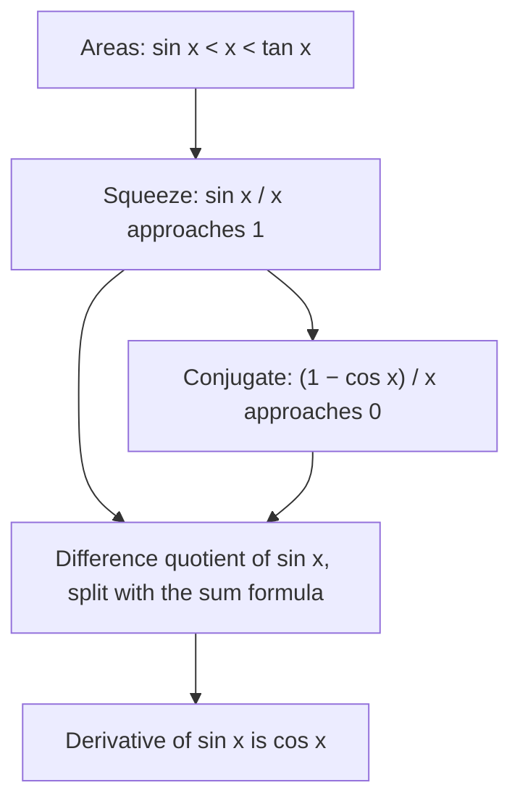

## A limit that algebra can't crack

In Lesson 41 a table suggested that $\dfrac{\sin x}{x} \to 1$ as $x \to 0$, and the lesson promised that calculus proves it "with geometry." This lesson keeps that promise. None of the tools from Lesson 42 work here: there is no factor to cancel, no conjugate to multiply by, and substitution gives $\frac00$. We need a new kind of argument, one that pins a function between two simpler functions whose limits we already know. That argument is the squeeze theorem, and with it we can prove the sine limit, find a whole family of related limits, and finally compute the derivative of $\sin x$ from the definition in Lesson 43.

All angles in this lesson are in radians. You'll see exactly where that matters.

## The squeeze theorem

The **squeeze theorem** (also called the sandwich theorem) says:

> Suppose $g(x) \le f(x) \le h(x)$ for every $x$ near $a$ (except possibly at $a$ itself), and $\displaystyle\lim_{x\to a} g(x) = \lim_{x\to a} h(x) = L$. Then $\displaystyle\lim_{x\to a} f(x) = L$.

Why it's true: close to $a$, both $g(x)$ and $h(x)$ are within any small distance you like of $L$. Since $f(x)$ sits between them, it has no room to be anywhere else, so it is within that distance of $L$ too. The same reasoning works for one-sided limits and for limits as $x \to \infty$.

Two things the theorem needs, and both are easy to forget: the inequalities must hold near $a$ (on both sides, for a two-sided limit), and the two outer limits must be *the same number*. If $g \to 0$ and $h \to 2$, the theorem tells you nothing.

### Example 1: a wild oscillation, tamed

Find $\displaystyle\lim_{x\to 0} x^2\sin\frac1x$.

The limit laws don't apply: the product law needs both factors to have limits, and $\sin\frac1x$ oscillates between $-1$ and $1$ infinitely often near 0 (Lesson 41), so it has none. But we know how big it can be:

$$-1 \le \sin\frac1x \le 1 \quad\text{for every } x \ne 0.$$

Multiply through by $x^2$, which is positive for $x \ne 0$, so the inequalities keep their direction:

$$-x^2 \le x^2\sin\frac1x \le x^2.$$

Both outer functions approach 0 as $x \to 0$. By the squeeze theorem, $\displaystyle\lim_{x\to 0} x^2\sin\frac1x = 0$.

```plot
{"x": [-0.5, 0.5], "y": [-0.25, 0.25], "functions": [{"f": "x^2", "dashed": true}, {"f": "-x^2", "dashed": true}, {"f": "x^2*sin(1/x)"}], "labels": [{"at": [-0.2, 0.09], "text": "y = x²"}, {"at": [0.2, -0.13], "text": "y = −x²"}], "caption": "The curve y = x² sin(1/x) wiggles faster and faster near 0, but it is trapped between the dashed parabolas y = x² and y = −x², which both close in on 0."}
```

### Example 2: a limit at infinity

Find $\displaystyle\lim_{x\to\infty}\frac{\sin x}{x}$.

For $x > 0$, divide $-1 \le \sin x \le 1$ by $x$: $-\dfrac1x \le \dfrac{\sin x}{x} \le \dfrac1x$. Both bounds go to 0 as $x \to \infty$, so the limit is 0. Compare this with the limit at 0, which is 1: the same function, a different place, a different answer.

## Proving that $\frac{\sin x}{x} \to 1$

Take $0 < x < \frac{\pi}{2}$ and draw the angle $x$ at the center $O$ of the unit circle. Let $A = (1, 0)$, let $P = (\cos x, \sin x)$ be the point on the circle at angle $x$, and let $T$ be where the line $OP$ meets the vertical line $x = 1$, so $T = (1, \tan x)$.


Three regions are nested inside each other: triangle $OAP$ inside sector $OAP$ inside triangle $OAT$. So their areas are in the same order.

| Region | Base | Height | Area |
|---|---|---|---|
| Triangle $OAP$ | $OA = 1$ | $PB = \sin x$ | $\tfrac12\sin x$ |
| Sector $OAP$ | radius 1 | angle $x$ | $\tfrac12 x$ |
| Triangle $OAT$ | $OA = 1$ | $AT = \tan x$ | $\tfrac12\tan x$ |

The sector's area is $\tfrac12 r^2\theta$ with $r = 1$ and $\theta = x$, and that formula holds only in radians. Comparing the areas and multiplying by 2:

$$\sin x < x < \tan x.$$

Now turn this into a squeeze on $\frac{\sin x}{x}$:

1. Divide by $\sin x$, which is positive here: $1 < \dfrac{x}{\sin x} < \dfrac{1}{\cos x}$.
2. Take reciprocals of these positive numbers, which reverses the inequalities: $\cos x < \dfrac{\sin x}{x} < 1$.
3. Let $x \to 0^+$. Cosine is continuous, so $\cos x \to \cos 0 = 1$, and the constant 1 stays 1. By the squeeze theorem, $\displaystyle\lim_{x\to 0^+}\frac{\sin x}{x} = 1$.
4. For the left side, $\frac{\sin x}{x}$ is even: $\frac{\sin(-x)}{-x} = \frac{-\sin x}{-x} = \frac{\sin x}{x}$. So the left-hand limit is also 1.

Therefore $\displaystyle\lim_{x\to 0}\frac{\sin x}{x} = 1$.

The table from Lesson 41 fits the inequality: at $x = 0.5$, $\cos 0.5 \approx 0.8776 < 0.9589 < 1$, and at $x = 0.1$, $0.99500 < 0.99833 < 1$.

A note on rigor: this is the standard textbook argument, and it is convincing, but it leans on facts about arc length and the area of a sector that a full proof (in a real analysis course) would build more carefully from definitions. Treat it as a geometric proof, not a proof from axioms.

### Why radians

In degrees, the sector's area is not $\frac12 x$, and the limit changes. Since $x^\circ = \frac{\pi x}{180}$ radians,

$$\lim_{x\to 0}\frac{\sin(x^\circ)}{x} = \frac{\pi}{180} \approx 0.01745.$$

Radians are the unit that makes this limit exactly 1, and that is why calculus always uses them.

## A family of trigonometric limits

Once $\frac{\sin x}{x} \to 1$ is known, many other limits follow by rewriting.

**Scaling.** For a constant $k \ne 0$, let $u = kx$. As $x \to 0$, $u \to 0$, and

$$\frac{\sin(kx)}{x} = k\cdot\frac{\sin u}{u} \to k.$$

**Tangent.** $\dfrac{\tan x}{x} = \dfrac{\sin x}{x}\cdot\dfrac{1}{\cos x} \to 1\cdot 1 = 1$.

**One minus cosine.** Multiply by the conjugate $1 + \cos x$ and use $1 - \cos^2 x = \sin^2 x$:

$$\frac{1 - \cos x}{x} = \frac{\sin^2 x}{x(1 + \cos x)} = \frac{\sin x}{x}\cdot\frac{\sin x}{1 + \cos x} \to 1\cdot\frac{0}{2} = 0.$$

### Example 3

Find $\displaystyle\lim_{x\to 0}\frac{\sin 5x}{\sin 3x}$.

Create the pattern $\frac{\sin u}{u}$ twice by multiplying and dividing:

$$\frac{\sin 5x}{\sin 3x} = \frac{\sin 5x}{5x}\cdot\frac{3x}{\sin 3x}\cdot\frac{5x}{3x}.$$

The first factor approaches 1, the second approaches 1 (it is the reciprocal of something approaching 1), and the third equals $\frac53$ for every $x \ne 0$. The limit is $\frac53$. A quick check: at $x = 0.01$ the quotient is about $1.6662$.

### Example 4

Find $\displaystyle\lim_{x\to 0}\frac{1 - \cos x}{x^2}$.

Use the same conjugate trick, but now divide by $x^2$:

$$\frac{1 - \cos x}{x^2} = \frac{\sin^2 x}{x^2(1 + \cos x)} = \left(\frac{\sin x}{x}\right)^2\cdot\frac{1}{1 + \cos x} \to 1^2\cdot\frac{1}{2} = \frac12.$$

So near 0, $1 - \cos x \approx \frac12x^2$, or $\cos x \approx 1 - \frac{x^2}{2}$. At $x = 0.01$ the quotient is $0.49999\ldots$, as promised.

## The derivative of sine

Now the payoff. Use the definition of the derivative from Lesson 43 and the sum formula $\sin(x + h) = \sin x\cos h + \cos x\sin h$:

$$\frac{\sin(x + h) - \sin x}{h} = \sin x\cdot\frac{\cos h - 1}{h} + \cos x\cdot\frac{\sin h}{h}.$$

As $h \to 0$, the first fraction approaches 0 (it is the negative of $\frac{1 - \cos h}{h}$) and the second approaches 1. So

$$\frac{d}{dx}\sin x = \cos x.$$

Both special limits are exactly what the derivative needs, which is why they matter so much. The same method with $\cos(x + h) = \cos x\cos h - \sin x\sin h$ gives $\frac{d}{dx}\cos x = -\sin x$. In degrees the answers would carry an extra factor $\frac{\pi}{180}$, another reason calculus works in radians.

### Example 5

Find the tangent lines to $y = \sin x$ at $x = 0$ and at $x = \frac{\pi}{3}$.

- At $x = 0$: the point is $(0, 0)$ and the slope is $\cos 0 = 1$, so the tangent is $y = x$. That is the picture behind $\frac{\sin x}{x} \to 1$: near 0, the sine curve is almost the line $y = x$.
- At $x = \frac{\pi}{3}$: the point is $\left(\frac{\pi}{3}, \frac{\sqrt3}{2}\right)$ and the slope is $\cos\frac{\pi}{3} = \frac12$, so the tangent is $y = \frac{\sqrt3}{2} + \frac12\left(x - \frac{\pi}{3}\right)$.

```plot
{"x": [-1.5, 3.5], "y": [-1.5, 1.8], "functions": [{"f": "sin(x)"}, {"f": "x", "dashed": true, "label": "y = x"}], "tangents": [{"f": "sin(x)", "at": 1.0472}], "points": [{"at": [0, 0]}, {"at": [1.0472, 0.866]}], "labels": [{"at": [2.7, 1.0], "text": "y = sin x"}, {"at": [1.6, 0.55], "text": "(π/3, √3/2)"}], "caption": "The sine curve with its tangent y = x at the origin (dashed) and its tangent of slope 1/2 at x = π/3."}
```



## Common mistakes

- *Using outer bounds with different limits.* $0 \le f(x) \le 2$ near $a$ does not determine the limit; the two bounds must approach the same number.
- *Multiplying an inequality by a negative quantity without flipping it.* In Example 1, $x^2 > 0$ keeps the direction; multiplying by $x$ (which can be negative) would not.
- *Using the product law on $x^2\sin\frac1x$.* That law needs both limits to exist; here one doesn't.
- *Writing $\frac{\sin 5x}{\sin 3x} \to \frac{5x}{3x}$ "by cancelling sin."* Sine isn't a factor; the answer $\frac53$ is right only because of the $\frac{\sin u}{u}$ argument.
- *Mixing up the two special limits.* $\frac{\sin x}{x} \to 1$, but $\frac{1 - \cos x}{x} \to 0$ and $\frac{1 - \cos x}{x^2} \to \frac12$.
- *Degree mode.* In degrees, $\frac{\sin x}{x} \to \frac{\pi}{180}$, not 1.
- *Confusing $x \to 0$ with $x \to \infty$.* $\frac{\sin x}{x}$ approaches 1 at 0 but 0 at infinity.

## Key points

- Squeeze theorem: if $g \le f \le h$ near $a$ and $g, h \to L$, then $f \to L$.
- Bounded times something going to 0 goes to 0: $x^2\sin\frac1x \to 0$ as $x \to 0$, $\frac{\sin x}{x} \to 0$ as $x \to \infty$.
- Areas in the unit circle give $\sin x < x < \tan x$ for $0 < x < \frac{\pi}{2}$, so $\cos x < \frac{\sin x}{x} < 1$ and $\frac{\sin x}{x} \to 1$ (radians).
- Consequences: $\frac{\sin kx}{x} \to k$, $\frac{\tan x}{x} \to 1$, $\frac{1 - \cos x}{x} \to 0$, $\frac{1 - \cos x}{x^2} \to \frac12$.
- $\frac{d}{dx}\sin x = \cos x$ and $\frac{d}{dx}\cos x = -\sin x$, in radians.
