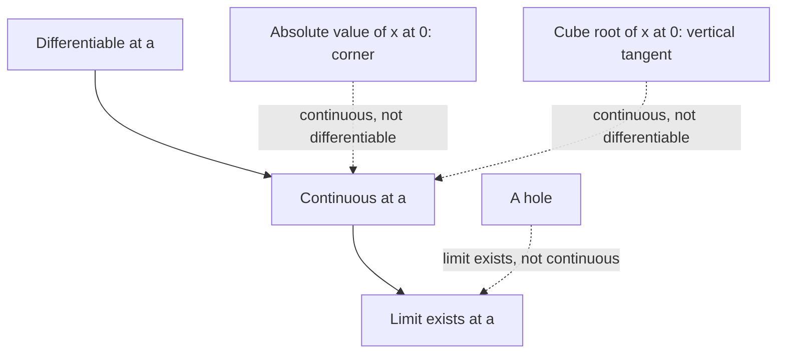
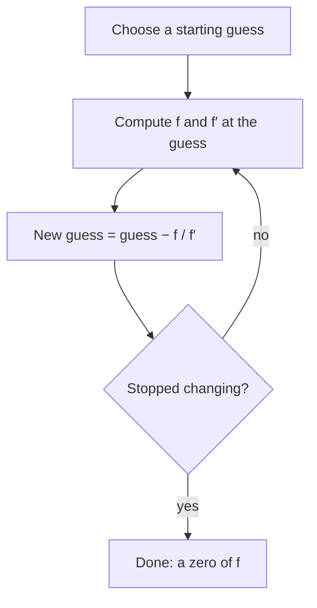

## From one limit at a time to rules

In Lesson 43 every derivative was a separate limit computation: $(x^2)' = 2x$, $\left(\frac1x\right)' = -\frac{1}{x^2}$, $(\sqrt x)' = \frac{1}{2\sqrt x}$, and $(ax^3 + bx + c)' = 3ax^2 + b$ in the drills. Patterns are already visible. This lesson proves the first few rules of calculus, so that a polynomial's derivative takes seconds instead of a page of algebra. Then it asks two deeper questions: exactly when does a derivative exist, and what is it good for? The answers are a theorem connecting derivatives to continuity, and two tools you can use right away: linear approximation and Newton's method.

## The power rule

The **power rule** says that for every positive integer $n$,

$$\frac{d}{dx}x^n = nx^{n-1}.$$

**Proof.** The difference quotient needs $(x + h)^n$, and the binomial theorem from Module 9 expands it:

$$(x + h)^n = x^n + nx^{n-1}h + \binom{n}{2}x^{n-2}h^2 + \cdots + h^n.$$

Subtract $x^n$: the first term cancels, and every remaining term contains at least one factor of $h$. Divide by $h$:

$$\frac{(x + h)^n - x^n}{h} = nx^{n-1} + \binom{n}{2}x^{n-2}h + \cdots + h^{n-1}.$$

Every term after the first still contains a factor of $h$, so each one goes to 0 as $h \to 0$. What's left is $nx^{n-1}$. $\blacksquare$

The rule also holds for negative and fractional exponents. Lesson 43 already found two cases: $x^{-1}$ gives $-x^{-2}$, and $x^{1/2}$ gives $\frac12x^{-1/2} = \frac{1}{2\sqrt x}$. The general proof of those cases belongs to calculus; here we have proved the positive-integer case only.

### Example 1

Find the slope of $y = x^5$ at $x = 2$.

By the power rule, $\frac{d}{dx}x^5 = 5x^4$, so the slope at 2 is $5 \cdot 2^4 = 80$. (From the definition, you would have needed to expand $(2 + h)^5$ by hand.)

## Sums and constant multiples

Two more rules come straight from the limit laws of Lesson 42.

- **Constant multiple rule**: $(cf)' = cf'$. The difference quotient of $cf$ is $c$ times the difference quotient of $f$, and a constant factor passes through a limit.
- **Sum rule**: $(f + g)' = f' + g'$ (and likewise for differences). The difference quotient of $f + g$ splits into the two separate difference quotients, and the limit of a sum is the sum of the limits, as long as both derivatives exist.

Add the facts that a constant has derivative 0 (its graph is a horizontal line) and that $x$ has derivative 1, and you can differentiate any polynomial term by term.

A warning: there is no equally simple product rule. $(fg)'$ is *not* $f'g'$. Try $f = g = x$: then $fg = x^2$ with derivative $2x$, but $f'g' = 1 \cdot 1 = 1$. The correct product rule is a calculus topic.

### Example 2

Let $f(x) = 2x^3 - 5x^2 + 4x - 7$. Find $f'(x)$ and the points where the tangent is horizontal.

Term by term: $f'(x) = 6x^2 - 10x + 4$. A horizontal tangent needs $f'(x) = 0$:

$$6x^2 - 10x + 4 = 0 \;\Longrightarrow\; 3x^2 - 5x + 2 = 0 \;\Longrightarrow\; (3x - 2)(x - 1) = 0,$$

so $x = \frac23$ or $x = 1$. The points are $\left(\frac23, -\frac{161}{27}\right)$ and $(1, -6)$. Because $f'$ is a parabola opening up, it is positive outside $\left[\frac23, 1\right]$ and negative between: $f$ rises, falls, then rises again. So $x = \frac23$ is a local maximum and $x = 1$ a local minimum, found with no graphing calculator at all.

## Differentiable functions are continuous

A function is **differentiable** at $a$ when $f'(a)$ exists, that is, when the difference quotient has a (finite) limit as $h \to 0$.

**Theorem.** If $f$ is differentiable at $a$, then $f$ is continuous at $a$.

**Proof.** For $h \ne 0$, write the change in $f$ as a quotient times $h$:

$$f(a + h) - f(a) = \frac{f(a + h) - f(a)}{h}\cdot h.$$

As $h \to 0$ the quotient approaches $f'(a)$ and $h$ approaches 0, so by the product law the right side approaches $f'(a)\cdot 0 = 0$. Thus $f(a + h) \to f(a)$, which says $\lim_{x\to a}f(x) = f(a)$. $\blacksquare$

The converse is false: a function can be continuous without being differentiable.

- **Corner.** $|x|$ is continuous at 0, but the difference quotient $\frac{|h|}{h}$ is $1$ for $h > 0$ and $-1$ for $h < 0$ (the same split as Lesson 42, Example 5). No limit, no derivative.
- **Vertical tangent.** $\sqrt[3]{x}$ is continuous at 0, but $\frac{\sqrt[3]{h} - 0}{h} = \frac{1}{h^{2/3}}$ grows without bound from both sides. The tangent line at the origin is vertical, and a vertical line has no slope. This is a **vertical tangent**.

```plot
{"x": [-3, 3], "y": [-2, 2], "functions": [{"f": "cbrt(x)", "label": "y = ∛x"}], "segments": [{"from": [0, -2], "to": [0, 2], "dashed": true}], "points": [{"at": [0, 0]}], "caption": "y = ∛x is continuous at 0 but its tangent there is vertical (dashed), so it has no derivative at 0."}
```



### Example 3

Is $f(x) = \begin{cases} x^2 & x < 1 \\ 2x - 1 & x \ge 1 \end{cases}$ differentiable at $x = 1$? What about $g(x) = \begin{cases} x^2 & x < 1 \\ 3x - 2 & x \ge 1 \end{cases}$?

Both are continuous at 1: each piece gives the value 1 there. Differentiability needs the one-sided difference quotients to agree. For $f$, with $f(1) = 1$:

- Right ($h > 0$): $\dfrac{2(1 + h) - 1 - 1}{h} = \dfrac{2h}{h} = 2$.
- Left ($h < 0$): $\dfrac{(1 + h)^2 - 1}{h} = \dfrac{2h + h^2}{h} = 2 + h \to 2$.

They agree, so $f'(1) = 2$: the line continues the parabola smoothly (it is the parabola's tangent at 1). For $g$ the left side is the same, 2, but the right side is $\frac{3h}{h} = 3$. The slopes disagree, so $g$ has a corner at 1 and is not differentiable there, even though it is continuous.

## Linear approximation

Zoom in far enough on a differentiable function and its graph looks straight: it looks like its own tangent line. So near $x = a$,

$$f(x) \approx L(x) = f(a) + f'(a)(x - a).$$

$L$ is the **linear approximation** (or tangent line approximation) of $f$ at $a$. How good is it? Write $x = a + h$. The error is

$$f(a + h) - L(a + h) = h\left[\frac{f(a + h) - f(a)}{h} - f'(a)\right].$$

The bracket goes to 0 by the definition of the derivative, so the error shrinks faster than $h$ itself: the error divided by $h$ goes to 0. For most functions you'll meet (polynomials, roots, sine) the error is roughly proportional to $h^2$, so halving the step cuts the error to about a quarter; Examples 4 and 5 show this numerically if you redo them with half the step. That is what makes the tangent line the *best* straight-line approximation near $a$.

### Example 4

Estimate $\sqrt{4.1}$ without a calculator.

Use $f(x) = \sqrt x$ at $a = 4$, where everything is easy: $f(4) = 2$ and $f'(4) = \frac{1}{2\sqrt4} = \frac14$. Then

$$\sqrt{4.1} \approx 2 + \frac14(0.1) = 2.025.$$

The true value is $2.024846\ldots$, so the error is about $0.00015$. The estimate is a little too big: the graph of $\sqrt x$ bends downward, below its tangent line.

### Example 5

Estimate $(1.02)^{10}$.

Use $f(x) = x^{10}$ at $a = 1$: $f(1) = 1$ and $f'(1) = 10$. So $(1.02)^{10} \approx 1 + 10(0.02) = 1.2$. The true value is about $1.2190$. This estimate is too small, because $x^{10}$ bends upward, above its tangent. (It is the compound-interest shortcut "2% a year for 10 years is about 20%," which always underestimates.)

## Newton's method

The tangent line can also find zeros. To solve $f(x) = 0$, start with a guess $x_0$. Replace the curve by its tangent at $x_0$, which is easy to solve: set $f(x_0) + f'(x_0)(x - x_0) = 0$. Its solution is the next guess,

$$x_1 = x_0 - \frac{f(x_0)}{f'(x_0)},$$

and repeating this is **Newton's method**. Isaac Newton described a version of it around 1669 and Joseph Raphson published another in 1690, which is why it is also called the Newton–Raphson method.



### Example 6

Use Newton's method on $f(x) = x^2 - 2$ to approximate $\sqrt2$, starting at $x_0 = 1$.

Here $f'(x) = 2x$, so the step is

$$x_{n+1} = x_n - \frac{x_n^2 - 2}{2x_n} = \frac12\left(x_n + \frac{2}{x_n}\right).$$

| $n$ | $x_n$ |
|---|---|
| 0 | 1 |
| 1 | 1.5 |
| 2 | $\frac{17}{12} \approx 1.416667$ |
| 3 | $\frac{577}{408} \approx 1.414216$ |
| 4 | $1.41421356237469\ldots$ |

The true value is $\sqrt2 = 1.41421356237310\ldots$. The number of correct decimal places goes roughly 0, 2, 5, 11: it about doubles each step once the guess is close. The step formula "average the guess with 2 divided by the guess" is much older than calculus: Heron of Alexandria used it in the first century CE.

```plot
{"x": [0.5, 2.2], "y": [-1.5, 2.5], "functions": [{"f": "x^2 - 2", "label": "y = x² − 2"}], "tangents": [{"f": "x^2 - 2", "at": 1}], "points": [{"at": [1, -1]}, {"at": [1.5, 0]}, {"at": [1.4142, 0], "open": true}], "labels": [{"at": [0.75, -0.75], "text": "(1, −1)"}, {"at": [1.63, -0.55], "text": "x₁ = 1.5"}], "caption": "The tangent to y = x² − 2 at x₀ = 1 crosses the x-axis at x₁ = 1.5, already close to √2 ≈ 1.414 (open dot)."}
```

Newton's method can fail: if $f'(x_n) = 0$ the tangent is horizontal and never crosses the axis, and a poor starting guess can send the iterates to a different zero or make them wander. In practice, start near the zero you want (a graph or a sign change from the intermediate value theorem helps).

## Common mistakes

- *Using the power rule on $a^x$ or a constant base.* The rule is for $x^n$ with the variable in the base; $2^x$ is an exponential and needs a different rule.
- *Multiplying derivatives for a product.* $(fg)' \ne f'g'$; check with $f = g = x$.
- *Forgetting a constant term's derivative is 0,* or keeping it in $f'$.
- *Assuming continuous means differentiable.* Corners and vertical tangents are continuous but have no derivative.
- *Checking only one side* of a piecewise function's junction. Both one-sided difference quotients must agree, and the function must be continuous there.
- *Linearizing far from $a$.* The approximation is good only near $a$; $\sqrt{9}$ from $a = 4$ gives $3.25$, not 3.
- *Sign slip in Newton's method.* It is $x_0 - \frac{f(x_0)}{f'(x_0)}$, not plus.

## Key points

- Power rule (proved here for positive integers $n$): $(x^n)' = nx^{n-1}$. Constant multiple and sum rules let you differentiate polynomials term by term.
- Differentiable at $a$ implies continuous at $a$; the converse fails at corners ($|x|$) and vertical tangents ($\sqrt[3]{x}$).
- Linear approximation: $f(x) \approx f(a) + f'(a)(x - a)$ near $a$, with an error that shrinks faster than $x - a$.
- Newton's method: $x_{n+1} = x_n - \dfrac{f(x_n)}{f'(x_n)}$; near a zero, correct digits roughly double each step.
