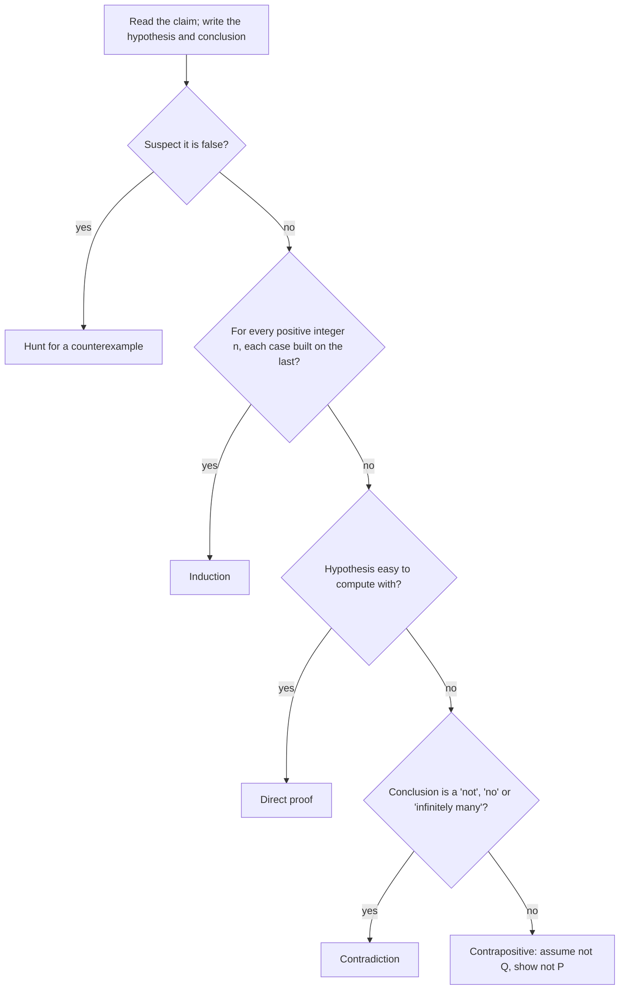

This course has stated many facts as theorems: the factor theorem, the rational zero theorem, "every repeating decimal is a rational number". In the induction lesson you wrote your first complete proofs, and you saw why checking examples isn't enough: $n^2 + n + 41$ is prime for $n = 0$ to $39$ and then fails. Induction is one tool, built for statements about every positive integer. This lesson collects the other basic tools every proof uses: reading an if-then statement correctly, the direct proof, the proof by contrapositive, the proof by contradiction and the counterexample. The rest of this honors module leans on them. The next lesson uses them to compare sizes of infinite sets, and the last two to make sense of infinite sums and areas.

## If-then statements

A **proof** is a chain of logical steps that shows a statement must be true, starting from definitions and facts already established. Most theorems have the form of a **conditional statement**: "If $P$, then $Q$", written $P \Rightarrow Q$. Here $P$ is the **hypothesis** and $Q$ is the **conclusion**.

A conditional makes a promise: whenever $P$ is true, $Q$ is true too. It is broken in only one situation, when $P$ is true and $Q$ is false.

| $P$ | $Q$ | If $P$, then $Q$ |
|---|---|---|
| true | true | true |
| true | false | false (the promise is broken) |
| false | true | true |
| false | false | true |

The last two rows surprise people. "If a number is divisible by 6, then it is divisible by 3" is a true statement, and the number 9 (not divisible by 6) doesn't break it: the promise says nothing about numbers outside the hypothesis. A statement about all numbers is true only if *no* example breaks it.

## Converse, inverse and contrapositive

Start from "If $P$, then $Q$" and rearrange the parts. Swapping them gives the **converse**, "If $Q$, then $P$". Negating both gives the inverse, "If not $P$, then not $Q$". Doing both gives the **contrapositive**, "If not $Q$, then not $P$".

The key fact: *a statement and its contrapositive are always both true or both false.* Both are broken by exactly the same situation, $P$ true and $Q$ false. (In the contrapositive, "not $Q$" is true and "not $P$" is false: the same case.) The converse is a different promise. It can be false when the statement is true:

- Statement: if $x = 2$, then $x^2 = 4$. True.
- Converse: if $x^2 = 4$, then $x = 2$. False: $x = -2$ breaks it.
- Contrapositive: if $x^2 \ne 4$, then $x \ne 2$. True, like the statement.

Assuming the converse is one of the most common errors in all of mathematics. The horizontal line test is a good reminder: "if $a = b$, then $f(a) = f(b)$" holds for every function, but its converse, "if $f(a) = f(b)$, then $a = b$", is exactly the extra condition that makes a function one-to-one. When both a statement and its converse are true, we say "$P$ if and only if $Q$", written $P \Leftrightarrow Q$.

## Direct proof

In a **direct proof** you assume the hypothesis, then use definitions and known facts, step by step, until you reach the conclusion. Most proofs about whole numbers start by turning words into algebra:

- $n$ is even means $n = 2k$ for some integer $k$;
- $n$ is odd means $n = 2k + 1$ for some integer $k$.

### Example 1

Prove: the product of two odd integers is odd.

1. *Assume the hypothesis.* Let $m$ and $n$ be odd. Then $m = 2a + 1$ and $n = 2b + 1$ for some integers $a$ and $b$. Use two different letters: the two numbers need not be equal.
2. *Compute.* $mn = (2a + 1)(2b + 1) = 4ab + 2a + 2b + 1 = 2(2ab + a + b) + 1$.
3. *Match the definition.* $2ab + a + b$ is an integer, so $mn$ has the form $2(\text{integer}) + 1$. It is odd.

Checking $3 \cdot 5 = 15$ and $7 \cdot 9 = 63$ only illustrates the claim. The algebra covers every pair of odd integers at once, which is what makes it a proof.

## Proof by contrapositive

Because a statement and its contrapositive stand or fall together, you can prove "if not $Q$, then not $P$" instead of "if $P$, then $Q$". This is a **proof by contrapositive**. It helps when "not $Q$" gives you something concrete to compute with and $P$ doesn't.

### Example 2

Prove: for an integer $n$, if $n^2$ is even, then $n$ is even.

A direct start is awkward: knowing $n^2 = 2k$ tells you little about $n$ itself. The contrapositive is "if $n$ is not even, then $n^2$ is not even", that is, "if $n$ is odd, then $n^2$ is odd". That one is easy.

1. Let $n$ be odd: $n = 2k + 1$.
2. $n^2 = 4k^2 + 4k + 1 = 2(2k^2 + 2k) + 1$, which is odd.
3. The contrapositive is proved, so the original statement is true.

## Proof by contradiction

In a **proof by contradiction** you assume the statement you want is false and reason until you reach something impossible, a **contradiction** such as "$1 = 0$" or "this fraction is and isn't in lowest terms". Since correct reasoning from a true assumption can't produce an impossibility, the assumption was false, so the statement is true.

A **rational number** can be written as $\frac{a}{b}$ with integers $a$ and $b$, $b \ne 0$; an **irrational number** is a real number that can't.

### Example 3

Prove: $\sqrt{2}$ is irrational.

1. *Assume the opposite.* Suppose $\sqrt2 = \frac{a}{b}$ for integers $a$ and $b$, $b \ne 0$. Reduce the fraction first, so $a$ and $b$ have no common factor other than 1.
2. Square: $2 = \frac{a^2}{b^2}$, so $a^2 = 2b^2$. Then $a^2$ is even, and by Example 2, $a$ is even: $a = 2c$.
3. Substitute: $4c^2 = 2b^2$, so $b^2 = 2c^2$. Now $b^2$ is even, so $b$ is even too.
4. *Contradiction.* $a$ and $b$ are both even, so they share the factor 2, but we reduced the fraction.
5. The assumption was false: $\sqrt2$ is irrational.

So a number line full of fractions still has gaps: $\sqrt2$ is a limit of fractions ($1.4, 1.41, 1.414, \dots$) without being one. That fact will matter later in this module, where infinite sums and areas are defined as limits, and those limits need the real numbers, not just the fractions.

### Example 4

Prove: there are infinitely many prime numbers.

This argument goes back to Euclid's *Elements*, around 300 BC. (Euclid phrased it a little differently; the version below is the usual modern one.)

1. *Assume the opposite.* Suppose there are only finitely many primes, $p_1, p_2, \dots, p_n$.
2. Build $N = p_1 p_2 \cdots p_n + 1$. Every integer greater than 1 has at least one prime factor, so some prime $p$ divides $N$.
3. That $p$ must be on the list. But dividing $N$ by any $p_i$ leaves remainder 1, because $p_i$ divides the product exactly. So $p$ can't be on the list.
4. *Contradiction*, so the list can't be complete: there are infinitely many primes.

A common misreading is that $N$ itself must be prime. It need not be: $2 \cdot 3 \cdot 5 \cdot 7 \cdot 11 \cdot 13 + 1 = 30{,}031 = 59 \cdot 509$. The proof only needs a prime factor that is missing from the list.

## Counterexamples

To show that a "for all" statement is false, one example is enough: a **counterexample**, a case where the hypothesis holds and the conclusion fails. Many patterns hold for a while and then break.

### Example 5

$2^2 - 1 = 3$, $2^3 - 1 = 7$, $2^5 - 1 = 31$ and $2^7 - 1 = 127$ are all prime. Is $2^p - 1$ prime for every prime $p$?

Try the next prime, $p = 11$: $2^{11} - 1 = 2047 = 23 \cdot 89$. That single counterexample settles it: the statement is false. (Primes of the form $2^p - 1$ are called Mersenne primes; nobody knows whether there are infinitely many.)

History has a famous case. Pierre de Fermat suggested in the 1600s that every number $2^{2^n} + 1$ is prime. It works for $n = 0$ to $4$ (3, 5, 17, 257, 65537). In 1732 Leonhard Euler found that $2^{32} + 1 = 4{,}294{,}967{,}297 = 641 \cdot 6{,}700{,}417$.

Keep the two directions apart. Examples can never prove a "for all" statement, and one counterexample always disproves it. To negate "every $x$ has property $Q$" you need only "some $x$ fails $Q$", not "every $x$ fails $Q$".

## Choosing a method

These are rules of thumb, not laws. Many proofs mix methods: Example 3 is a contradiction proof that uses the contrapositive result of Example 2 in the middle.

## Common mistakes

- *Proving the converse.* To prove "if $P$ then $Q$", you start from $P$. Starting from $Q$ and arriving at $P$ proves the converse, a different statement.
- *Proof by examples.* Ten, or ten million, cases that work are evidence, not proof. Only a counterexample settles a "for all" claim by one case.
- *Reusing a letter.* Writing both odd numbers as $2k + 1$ secretly assumes they're equal.
- *Negating carelessly.* The opposite of "all primes are odd" is "some prime is even" (2 is), not "all primes are even".
- *Assuming what you want to prove.* In a contradiction proof you assume the *negation* of the claim; using the claim itself along the way is circular.
- *Overreading Euclid.* The product of the first $n$ primes plus 1 isn't always prime.

## Key points

- "If $P$, then $Q$" is false only when $P$ is true and $Q$ is false.
- A statement and its contrapositive are equivalent; the converse is not.
- Direct proof: assume $P$, reach $Q$ by definitions and algebra.
- Contrapositive: prove "if not $Q$, then not $P$" instead.
- Contradiction: assume the claim is false and reach an impossibility ($\sqrt2$ irrational; infinitely many primes).
- One counterexample disproves a "for all" claim; no number of examples proves one.
