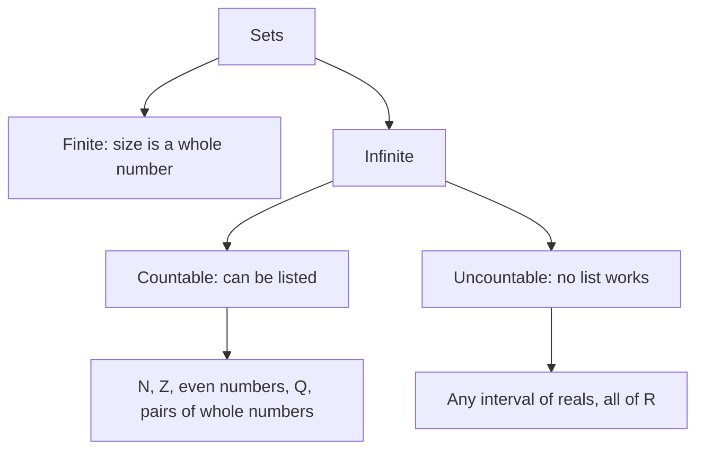

Infinity has been in this course since the first lesson: domains like $(-\infty, \infty)$, limits as $x \to \infty$, sums of infinitely many terms. So far "infinite" has meant "doesn't stop". This lesson asks a sharper question: can one infinite set be *bigger* than another? The answer, found by Georg Cantor in the 1870s, is yes, and the tools are ones you already have. One is the one-to-one function and its inverse from the inverse-functions lesson. The other is proof by contradiction, from the last lesson.

Throughout, $\mathbb{N} = \{1, 2, 3, \dots\}$ is the set of positive integers (some books start $\mathbb{N}$ at 0), $\mathbb{Z}$ is all integers and $\mathbb{Q}$ is all rational numbers.

## Counting by matching

How do you know a theater has exactly as many seats as people, without counting either? Ask everyone to sit down. If every person has a seat and no seat is empty, the two sets are the same size. Matching comes before counting: counting a finite set *is* matching it with $\{1, 2, \dots, n\}$.

A **one-to-one correspondence** (also called a **bijection**) between sets $A$ and $B$ pairs every element of $A$ with exactly one element of $B$, so that every element of $B$ is used exactly once. In function language it is a function $f: A \to B$ that is one-to-one (no two inputs share an output) and whose range is all of $B$. Those are exactly the functions with an inverse $f^{-1}: B \to A$. Two sets have the same **cardinality** (the same size) when there is a one-to-one correspondence between them. This definition works for infinite sets, where "count them and compare the numbers" doesn't.

## Hilbert's hotel

The mathematician David Hilbert told a story in a 1924–25 lecture on infinity, and George Gamow made it famous in a 1947 book; it is now called Hilbert's hotel. A hotel has rooms numbered $1, 2, 3, \dots$, one for every positive integer, and every room is full. A new guest arrives. In a finite full hotel she would be turned away. Here the manager asks the guest in room $n$ to move to room $n + 1$. Everyone still has a room, and room 1 is free.

Then a bus arrives with infinitely many new guests. The manager moves the guest in room $n$ to room $2n$. The current guests now fill the even rooms, and the infinitely many odd rooms are free.

### Example 1

Show that $\mathbb{N}$ and the set $E = \{2, 4, 6, \dots\}$ of even positive integers have the same cardinality.

1. Use the bus move: $f(n) = 2n$.
2. *One-to-one:* if $2m = 2n$ then $m = n$.
3. *Every even number is used:* the even number $e$ comes from $n = \frac{e}{2}$, a positive integer. So the inverse is $f^{-1}(e) = \frac e2$.

So a set can have the same cardinality as part of itself. That is impossible for finite sets, and it's the signature of an infinite one. Galileo noticed a version of this in 1638 (the perfect squares $1, 4, 9, \dots$ match the positive integers through $n \mapsto n^2$) and concluded that "equal", "greater" and "less" don't apply to infinite quantities. Cantor's answer, about 250 years later, was to keep the matching definition and accept the strange consequence.

## Countable sets

A set is **countable** if it is finite or can be put in one-to-one correspondence with $\mathbb{N}$. A countable infinite set can be written as a list $a_1, a_2, a_3, \dots$ in which every element appears (exactly once): you can count it, even if the count never ends.

### Example 2

Show that $\mathbb{Z}$ is countable.

Listing $0, 1, 2, 3, \dots$ never reaches the negatives. Alternate instead: $0, 1, -1, 2, -2, 3, -3, \dots$ The function behind the list is

$$f(n) = \begin{cases} \dfrac{n}{2} & n \text{ even} \\[2mm] -\dfrac{n - 1}{2} & n \text{ odd} \end{cases}$$

so $f(1) = 0$, $f(2) = 1$, $f(3) = -1$, $f(4) = 2$, $f(5) = -2$. Every integer appears exactly once. You can check by writing the inverse: $f^{-1}(z) = 2z$ for $z > 0$ and $f^{-1}(z) = 1 - 2z$ for $z \le 0$. For instance $-7$ is in position $1 - 2(-7) = 15$, and indeed $f(15) = -\frac{14}{2} = -7$.

### Example 3: pairs of whole numbers

The pairs $(a, b)$ of whole numbers ($a, b \ge 0$) fill an infinite grid. Listing row by row fails, since the first row never ends. Instead, list by diagonals: first the pairs with $a + b = 0$, then $a + b = 1$, then $a + b = 2$, and so on. Each diagonal is finite, so every pair is reached.

Where does $(a, b)$ land? Let $s = a + b$. The diagonals before it hold $1 + 2 + \dots + s = \frac{s(s + 1)}{2}$ pairs, by the sum formula you proved by induction. Inside its own diagonal, order the pairs by $b$ ($b = 0$ first), so $(a, b)$ comes $b$ places after the diagonal's start. Numbering positions from 0, the position is

$$\pi(a, b) = \frac{(a + b)(a + b + 1)}{2} + b,$$

the **Cantor pairing function**. For $(2, 3)$: $s = 5$, so $\pi(2, 3) = \frac{5 \cdot 6}{2} + 3 = 18$. Going backwards, position 12: the triangular numbers are $0, 1, 3, 6, 10, 15$, and $10 \le 12 < 15$, so $s = 4$ and $b = 12 - 10 = 2$, $a = s - b = 2$. Position 12 is $(2, 2)$.

## The rational numbers are countable

The same diagonal trick lists the positive fractions. Put $\frac pq$ in column $p$, row $q$, then walk the diagonals. A fraction like $\frac24$ that isn't in lowest terms names a number already listed ($\frac12$), so skip it.


The list begins $1, \frac12, 2, 3, \frac13, \frac14, \frac23, \frac32, 4, 5, \frac15, \dots$ Every positive rational is in some diagonal, so it appears. Then alternate signs as in Example 2 ($0$, the first fraction, its negative, the second fraction, its negative, ...) to list all of $\mathbb{Q}$. So $\mathbb{Q}$ is countable, even though between any two rationals there are infinitely many more.

## Cantor's diagonal argument: the reals are not countable

A set that is infinite but not countable is **uncountable**. In 1891 Cantor published a short proof that the real numbers between 0 and 1 form such a set. (He had proved it in 1874 by a different method.) It is a proof by contradiction, and the method is called the **diagonal argument**.

1. *Assume the opposite.* Suppose the numbers in $(0, 1)$ could be listed as $r_1, r_2, r_3, \dots$, each written as a decimal.
2. Build a new number $x = 0.d_1d_2d_3\ldots$ one digit at a time. Look at the $n$th digit of $r_n$, the digit on the diagonal. If it isn't 5, let $d_n = 5$; if it is 5, let $d_n = 4$.
3. $x$ is a number in $(0, 1)$. But $x \ne r_1$, because they differ in digit 1. And $x \ne r_2$, because they differ in digit 2. In general $x$ differs from $r_n$ in digit $n$, so $x$ is on nobody's line of the list.
4. *Contradiction:* the list was supposed to contain every number in $(0, 1)$. So no such list exists: $(0, 1)$ is uncountable.


### Example 4

The first five numbers on a proposed list are $r_1 = 0.31415\ldots$, $r_2 = 0.75000\ldots$, $r_3 = 0.14159\ldots$, $r_4 = 0.50000\ldots$ and $r_5 = 0.99938\ldots$ What are the first five digits of $x$?

The diagonal digits are 3, 5, 1, 0, 8. Each one that isn't 5 becomes 5, and the 5 becomes 4: $x = 0.54555\ldots$ Compare: $x$ differs from $r_2$ in the second digit, from $r_4$ in the fourth, and so on.

Why only the digits 4 and 5? A few numbers have two decimal forms: $0.5000\ldots = 0.4999\ldots$ (the next lesson explains why). Building $x$ from 0s and 9s could accidentally produce the other name of a number on the list. Since $x$ uses only 4s and 5s, it has just one decimal form, and that gap in the argument is closed.

## Every interval is as big as the whole line

Length doesn't decide cardinality. The function $f(x) = 2x$ matches $(0, 1)$ with $(0, 2)$, though one interval is twice as long. More surprisingly, a short interval matches the entire real line.

### Example 5

Show that $f(x) = \dfrac{x}{1 - |x|}$ is a one-to-one correspondence from $(-1, 1)$ to $\mathbb{R}$.

1. *Find the inverse.* For $x \ge 0$, set $y = \frac{x}{1 - x}$ and solve: $y - yx = x$, so $x = \frac{y}{1 + y}$, with $y \ge 0$. The function is odd, so the negative side mirrors this. Together: $f^{-1}(y) = \dfrac{y}{1 + |y|}$.
2. *Check the domains.* For any real $y$, $|y| < 1 + |y|$, so $f^{-1}(y)$ is in $(-1, 1)$. Every real number is an output of $f$.
3. Because $f$ has an inverse defined on all of $\mathbb{R}$, it is a one-to-one correspondence. For instance $f(0.75) = \frac{0.75}{0.25} = 3$ and $f^{-1}(3) = \frac34$.

```plot
{"x": [-1.2, 1.2], "y": [-5, 5], "functions": [{"f": "x/(1 - abs(x))", "from": -0.94, "to": 0.94}], "points": [{"at": [0.75, 3]}], "segments": [{"from": [-1, -5], "to": [-1, -0.8], "dashed": true}, {"from": [-1, 0], "to": [-1, 5], "dashed": true}, {"from": [1, -5], "to": [1, -0.8], "dashed": true}, {"from": [1, 0], "to": [1, 5], "dashed": true}], "caption": "f(x) = x/(1 − |x|) stretches (−1, 1) over the whole real line. The dashed lines x = ±1 are vertical asymptotes.", "labels": [{"at": [0.45, 3.6], "text": "(0.75, 3)"}]}
```

So $(-1, 1)$, $(0, 1)$ and $\mathbb{R}$ all have the same, uncountable cardinality.

## A ladder of infinities



Cantor went further. He proved that for every set $A$, the set of all subsets of $A$ is strictly bigger than $A$, so there is no largest infinity. He also asked whether any set is bigger than $\mathbb{N}$ but smaller than $\mathbb{R}$; the guess that none is, is called the continuum hypothesis. Work by Kurt Gödel (1940) and Paul Cohen (1963) showed that the standard axioms of set theory can neither prove nor disprove it. These results are stated here without proof.

## Common mistakes

- *Judging size by containment.* $E$ is a proper part of $\mathbb{N}$, yet they have the same cardinality. For infinite sets, only matchings count.
- *Judging size by density or length.* The rationals are packed densely on the line but are countable; the interval $(0, 1)$ is short but uncountable.
- *Listing in a way that never finishes a first stage.* "All positive integers, then all negatives" never reaches the negatives. A valid list reaches every element after finitely many steps.
- *Thinking the diagonal argument just finds one missing number.* Adding $x$ to the list doesn't help: the argument applies to *any* list, including the new one.
- *Forgetting that some decimals have two names.* That's why the construction uses 4s and 5s.

## Key points

- Two sets have the same cardinality when a one-to-one correspondence (a function with an inverse) matches them.
- An infinite set can match a proper subset of itself (Hilbert's hotel; $n \mapsto 2n$).
- Countable: can be listed. $\mathbb{N}$, $\mathbb{Z}$, $\mathbb{Q}$ and pairs of whole numbers are countable; the Cantor pairing function $\pi(a, b) = \frac{(a + b)(a + b + 1)}{2} + b$ lists the pairs.
- Cantor's diagonal argument proves $(0, 1)$ is uncountable, so $\mathbb{R}$ is a bigger infinity than $\mathbb{N}$.
- Every interval of positive length has the same cardinality as $\mathbb{R}$.
