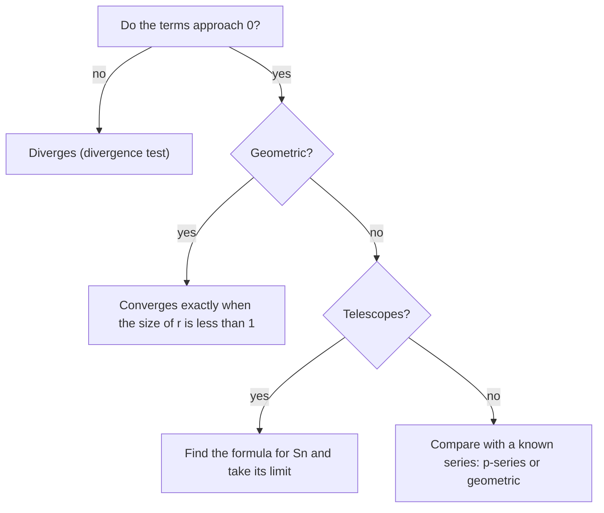

The geometric series lesson gave the first infinite sum with a finite answer: $1 + \frac12 + \frac14 + \dots = 2$, and in general $\frac{a_1}{1 - r}$ when $|r| < 1$. The partial fractions lesson previewed a second kind, the telescoping sum. This lesson asks the general question: when does adding infinitely many numbers make sense, and how can you tell? The answers are full of surprises. Terms that shrink to zero are not enough. Some sums can be bounded without being computed. And for some series, changing the order of the terms changes the total.

## What an infinite sum means

The Greek philosopher Zeno argued that you can never cross a room: first you must cover half the distance, then half of what's left, then half of that, forever. Infinitely many steps, he said, can't be finished. The modern reply is to define the infinite sum carefully.

For a series $a_1 + a_2 + a_3 + \dots$, the $n$th **partial sum** is the finite sum of the first $n$ terms,

$$S_n = a_1 + a_2 + \dots + a_n.$$

The series converges to $S$ if $\displaystyle\lim_{n \to \infty} S_n = S$, the limit at infinity from the limits lessons. Otherwise it diverges. The infinite sum is never "computed" by doing infinitely many additions; it is a limit of finite sums. Zeno's distances $\frac12, \frac14, \frac18, \dots$ have partial sums $1 - \frac{1}{2^n}$, which approach 1: the whole room.

### Example 1

Explain why $0.999\ldots = 1$.

The decimal $0.999\ldots$ means the series $\frac{9}{10} + \frac{9}{100} + \frac{9}{1000} + \dots$, geometric with $a_1 = \frac{9}{10}$ and $r = \frac{1}{10}$. Its sum is $\dfrac{9/10}{1 - 1/10} = \dfrac{9/10}{9/10} = 1$. The partial sums $0.9, 0.99, 0.999, \dots$ are all less than 1, but the series *is* their limit, and their limit is exactly 1. That's why some numbers have two decimal names, the fact the diagonal argument in the last lesson had to work around.

## The divergence test

If a series converges, its terms must approach 0. The reason is a short argument: $a_n = S_n - S_{n-1}$, and if $S_n \to S$ then $S_{n-1} \to S$ as well, so $a_n \to S - S = 0$.

Read as a contrapositive, this becomes a test, the **divergence test** (also called the $n$th-term test): *if the terms do not approach 0, the series diverges.* For example, $\frac12 + \frac23 + \frac34 + \frac45 + \dots$ diverges, because its terms $\frac{n}{n+1}$ approach 1. Every partial sum adds almost 1 more.

The test only works in one direction. Terms approaching 0 does *not* prove convergence. Assuming it does is assuming the converse, and the next series is the classic counterexample.

## The harmonic series diverges

The **harmonic series** is

$$\sum_{k=1}^{\infty} \frac1k = 1 + \frac12 + \frac13 + \frac14 + \dots$$

Its terms shrink to 0, and its partial sums grow very slowly: $S_{1000} \approx 7.49$. Still, they grow without bound. The proof, by the French scholar Nicole Oresme in the 14th century, groups the terms in blocks that double in length:

$$1 + \frac12 + \left(\frac13 + \frac14\right) + \left(\frac15 + \frac16 + \frac17 + \frac18\right) + \left(\frac19 + \dots + \frac1{16}\right) + \dots$$

In each block every term is at least the block's last term, so each block is at least (number of terms) × (last term): $\frac13 + \frac14 \ge 2 \cdot \frac14 = \frac12$, then $4 \cdot \frac18 = \frac12$, then $8 \cdot \frac1{16} = \frac12$, and so on.


So after $2^m$ terms, $S_{2^m} \ge 1 + \frac{m}{2}$. Taking $m$ large makes this as big as you like, so the partial sums are unbounded and the series diverges.

### Example 2

According to Oresme's bound, how many terms of the harmonic series are enough to make the partial sum at least 6?

We need $1 + \frac{m}{2} \ge 6$, so $m \ge 10$, and $2^{10} = 1024$ terms are enough. The bound is generous. The partial sums actually pass 6 after only 227 terms, but they grow so slowly that they don't pass 10 until the 12,367th term. Growth this slow is why a calculator table of partial sums can't tell you whether a series converges; you need an argument.

## Telescoping series

The partial fractions lesson split $\frac{1}{k(k+1)}$ into $\frac1k - \frac{1}{k+1}$, so that a sum of these terms collapses:

$$S_n = \left(1 - \tfrac12\right) + \left(\tfrac12 - \tfrac13\right) + \dots + \left(\tfrac1n - \tfrac{1}{n+1}\right) = 1 - \frac{1}{n+1}.$$

Now let $n \to \infty$: $\frac{1}{n+1} \to 0$, so $\displaystyle\sum_{k=1}^{\infty}\frac{1}{k(k+1)} = 1$. A telescoping series is one of the few kinds, along with geometric series, whose partial sums have a simple formula, so its sum can be found exactly.

### Example 3

Find $\displaystyle\sum_{k=1}^{\infty} \frac{1}{k(k+2)}$.

1. *Partial fractions.* $\frac{1}{k(k+2)} = \frac{A}{k} + \frac{B}{k+2}$ gives $1 = A(k + 2) + Bk$. Setting $k = 0$ gives $A = \frac12$, and $k = -2$ gives $B = -\frac12$. So the term is $\frac12\left(\frac1k - \frac{1}{k+2}\right)$.
2. *Write out the partial sum.* Each $-\frac{1}{k+2}$ cancels the $+\frac1{k+2}$ two terms later:
$$S_n = \frac12\left[\left(1 - \tfrac13\right) + \left(\tfrac12 - \tfrac14\right) + \left(\tfrac13 - \tfrac15\right) + \dots + \left(\tfrac1n - \tfrac{1}{n+2}\right)\right] = \frac12\left[1 + \frac12 - \frac{1}{n+1} - \frac{1}{n+2}\right].$$
3. *Take the limit.* The last two fractions go to 0, so the sum is $\frac12 \cdot \frac32 = \frac34$.

Check: the partial sum of the first 1,000 terms is about 0.7490, closing in on 0.75.

## Bounding a sum you can't compute

What about $\displaystyle\sum_{k=1}^{\infty}\frac{1}{k^2} = 1 + \frac14 + \frac19 + \frac1{16} + \dots$? It is neither geometric nor telescoping. But it can be compared with a telescoping series. For $k \ge 2$,

$$\frac{1}{k^2} < \frac{1}{k(k-1)} = \frac{1}{k-1} - \frac1k,$$

so

$$S_n < 1 + \left(1 - \tfrac12\right) + \left(\tfrac12 - \tfrac13\right) + \dots + \left(\tfrac{1}{n-1} - \tfrac1n\right) = 2 - \frac1n < 2.$$

The partial sums increase (every term is positive) and never pass 2. A basic property of the real numbers, called completeness, says that increasing partial sums that stay below a fixed bound must approach a limit. (We accept completeness here; it is studied in a first course in real analysis.) So the series converges, to some number below 2.

This is the idea of the **comparison test**: for series of positive terms, if each term is at most the corresponding term of a convergent series, your series converges too; if each term is at least the corresponding term of a divergent series, yours diverges. The exact value of this sum was a famous open problem until Leonhard Euler showed in the 1730s that it equals $\frac{\pi^2}{6} \approx 1.645$.

```plot
{"x": [0, 21], "y": [0, 4], "xLabel": "n", "yLabel": "Sₙ", "points": [{"at": [1, 1.0], "color": "steelblue"}, {"at": [2, 1.5], "color": "steelblue"}, {"at": [3, 1.833], "color": "steelblue"}, {"at": [4, 2.083], "color": "steelblue"}, {"at": [5, 2.283], "color": "steelblue"}, {"at": [6, 2.45], "color": "steelblue"}, {"at": [7, 2.593], "color": "steelblue"}, {"at": [8, 2.718], "color": "steelblue"}, {"at": [9, 2.829], "color": "steelblue"}, {"at": [10, 2.929], "color": "steelblue"}, {"at": [11, 3.02], "color": "steelblue"}, {"at": [12, 3.103], "color": "steelblue"}, {"at": [13, 3.18], "color": "steelblue"}, {"at": [14, 3.252], "color": "steelblue"}, {"at": [15, 3.318], "color": "steelblue"}, {"at": [16, 3.381], "color": "steelblue"}, {"at": [17, 3.44], "color": "steelblue"}, {"at": [18, 3.495], "color": "steelblue"}, {"at": [19, 3.548], "color": "steelblue"}, {"at": [20, 3.598], "color": "steelblue"}, {"at": [2, 1.25], "color": "darkorange"}, {"at": [3, 1.361], "color": "darkorange"}, {"at": [4, 1.424], "color": "darkorange"}, {"at": [5, 1.464], "color": "darkorange"}, {"at": [6, 1.491], "color": "darkorange"}, {"at": [7, 1.512], "color": "darkorange"}, {"at": [8, 1.527], "color": "darkorange"}, {"at": [9, 1.54], "color": "darkorange"}, {"at": [10, 1.55], "color": "darkorange"}, {"at": [11, 1.558], "color": "darkorange"}, {"at": [12, 1.565], "color": "darkorange"}, {"at": [13, 1.571], "color": "darkorange"}, {"at": [14, 1.576], "color": "darkorange"}, {"at": [15, 1.58], "color": "darkorange"}, {"at": [16, 1.584], "color": "darkorange"}, {"at": [17, 1.588], "color": "darkorange"}, {"at": [18, 1.591], "color": "darkorange"}, {"at": [19, 1.594], "color": "darkorange"}, {"at": [20, 1.596], "color": "darkorange"}], "functions": [{"f": "1.6449", "dashed": true}], "labels": [{"at": [15.5, 3.75], "text": "1 + 1/2 + … + 1/n"}, {"at": [15.5, 1.3], "text": "1 + 1/4 + … + 1/n²"}, {"at": [7, 1.85], "text": "π²/6 ≈ 1.645"}], "caption": "Partial sums of the harmonic series keep climbing; those of the sum of 1/k² level off below π²/6."}
```

Together the two examples show a useful family. The **p-series** $\sum \frac{1}{k^p}$ converges when $p > 1$ and diverges when $p \le 1$. You have seen the cases $p = 1$ and $p = 2$; the general rule is proved in calculus, with integrals.

## Order can matter

Finite sums can be added in any order. Infinite sums usually can too, but not always. The **alternating harmonic series**

$$1 - \frac12 + \frac13 - \frac14 + \frac15 - \dots$$

converges, to $\ln 2 \approx 0.693$ (a fact proved in calculus). Its terms shrink and alternate in sign, so the partial sums swing back and forth by less each time.

### Example 4

Rearrange the same terms: one positive term, then two negative ones.

$$1 - \frac12 - \frac14 + \frac13 - \frac16 - \frac18 + \frac15 - \frac1{10} - \frac1{12} + \dots$$

Every term of the original series still appears exactly once. Now group each positive term with the negative term just after it: $\left(1 - \frac12\right) = \frac12$, $\left(\frac13 - \frac16\right) = \frac16$, $\left(\frac15 - \frac1{10}\right) = \frac1{10}$. The series becomes

$$\frac12 - \frac14 + \frac16 - \frac18 + \frac1{10} - \frac1{12} + \dots = \frac12\left(1 - \frac12 + \frac13 - \frac14 + \dots\right) = \frac{\ln 2}{2}.$$

Same terms, half the sum. The series converges only because its positive and negative terms cancel; the positive terms alone ($1 + \frac13 + \frac15 + \dots$) diverge, and so do the negative ones. A series like that is called **conditionally convergent**, and Bernhard Riemann proved that its terms can be rearranged to add up to *any* number you choose. A series whose absolute values $\sum |a_k|$ converge is **absolutely convergent**, and those can be rearranged freely without changing the sum. Geometric series with $|r| < 1$ and $\sum \frac{1}{k^2}$ are of this safe kind. (Both theorems are stated here without proof.)

## Testing a series



## Common mistakes

- *Using the divergence test backwards.* Terms approaching 0 don't prove convergence: the harmonic series is the counterexample.
- *Trusting a table of partial sums.* The harmonic series looks like it might level off near 7 or 8; it never does.
- *Cancelling too much in a telescoping sum.* In Example 3 two terms survive at each end, not one. Write out the first few and last few terms.
- *Comparing in the wrong direction.* Being smaller than a *divergent* series, or larger than a convergent one, proves nothing.
- *Rearranging a conditionally convergent series* as if it were a finite sum.

## Key points

- A series converges to $S$ when its partial sums $S_n$ approach $S$; the infinite sum is a limit.
- Divergence test: if $a_n \not\to 0$, the series diverges. The converse is false.
- The harmonic series $\sum \frac1k$ diverges (Oresme's grouping), very slowly.
- Telescoping series: find $S_n$ in closed form, then take the limit; $\sum \frac{1}{k(k+1)} = 1$ and $\sum \frac{1}{k(k+2)} = \frac34$.
- Comparison with a telescoping series shows $\sum \frac1{k^2}$ converges (to $\frac{\pi^2}{6}$); $\sum \frac1{k^p}$ converges exactly when $p > 1$.
- Rearranging a conditionally convergent series can change its sum.
