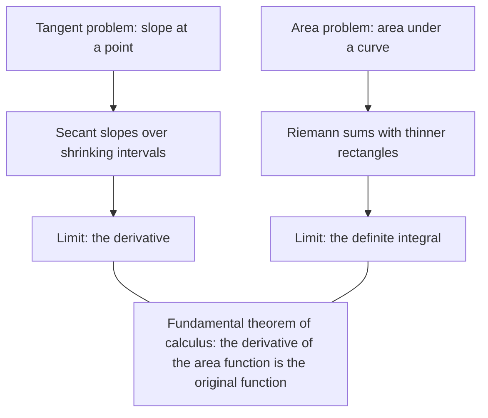

The last lesson of the core course ended with the derivative: the slope of a curve at a point, found as a limit of secant slopes. That is one of the two founding problems of calculus. The other is area: how much space lies under a curved graph? Polygons are easy, because they cut into triangles. A curved edge can't be cut into finitely many straight pieces. This capstone lesson attacks the area problem with tools from across the course: infinite geometric series, the sum-of-squares formula you proved by induction, and limits. It ends with the surprise that joins the two problems into one subject.

## Archimedes and the parabola

In the third century BC, Archimedes found the area of a parabolic segment, the region between a parabola and a chord across it. Take $y = 1 - x^2$ above the $x$-axis, from $x = -1$ to $x = 1$.

1. Inscribe the triangle with vertices $(-1, 0)$, $(1, 0)$ and $(0, 1)$. Its area is $\frac12 \cdot 2 \cdot 1 = 1$.
2. Two curved gaps remain. In each, inscribe a triangle whose third vertex is on the parabola halfway across: $(-\frac12, \frac34)$ and $(\frac12, \frac34)$. Each of these triangles has area $\frac18$, so this stage adds $\frac14$.
3. Four gaps remain, and four triangles of area $\frac1{64}$ fill them, adding $\frac1{16}$. Each stage adds $\frac14$ of the stage before. (Archimedes proved this ratio holds at every stage, for every parabola.)

The triangles fill more and more of the segment, so its area is the infinite geometric series

$$1 + \frac14 + \frac1{16} + \frac1{64} + \dots = \frac{1}{1 - \frac14} = \frac43.$$

In general, the area of a parabolic segment is $\frac43$ of the inscribed triangle with the same base, whose third vertex is the point of the parabola where the tangent line is parallel to the chord. (For a horizontal chord under a parabola like $y = 1 - x^2$, that point is the vertex.) Archimedes didn't add infinitely many terms; Greek mathematics avoided completed infinities. He used the **method of exhaustion**: he showed the area could be neither more than $\frac43$ nor less than $\frac43$, since either assumption led to a contradiction. That is the proof-by-contradiction pattern from the first lesson of this module, used some 2,000 years before limits were defined.

### Example 1

Find the area of the region between $y = 9 - x^2$ and the $x$-axis.

1. The parabola meets the axis where $9 - x^2 = 0$, at $x = \pm 3$. The chord is the segment from $(-3, 0)$ to $(3, 0)$.
2. The inscribed triangle has base 6 and its third vertex at the top, $(0, 9)$, so its area is $\frac12 \cdot 6 \cdot 9 = 27$.
3. By Archimedes, the segment has area $\frac43 \cdot 27 = 36$.

Archimedes' triangles only work for parabolas. The next method works for almost any curve.

## Riemann sums

Cover the region with thin rectangles and add their areas. Take $y = x^2$ from $x = 0$ to $x = 1$, cut $[0, 1]$ into $n$ equal pieces of width $\Delta x = \frac1n$, and make each rectangle as tall as the curve at the right end of its piece. With $n = 4$ the right endpoints are $\frac14, \frac12, \frac34, 1$:

$$R_4 = \frac14\left[\left(\tfrac14\right)^2 + \left(\tfrac12\right)^2 + \left(\tfrac34\right)^2 + 1^2\right] = \frac14 \cdot \frac{1 + 4 + 9 + 16}{16} = \frac{30}{64} = 0.46875.$$

A sum like this, rectangle widths times heights read off the function, is a **Riemann sum**, after Bernhard Riemann, who made the definition of area by such sums precise in the 1850s. Because $x^2$ is increasing on $[0, 1]$, right-endpoint rectangles stick out above the curve, so $R_4$ overestimates the area. Left endpoints would underestimate it: $L_4 = \frac14 \cdot \frac{0 + 1 + 4 + 9}{16} = \frac{14}{64} \approx 0.219$. The true area is somewhere between.

More rectangles fit the curve better. For $n$ rectangles the right endpoints are $\frac in$, $i = 1, \dots, n$, and

$$R_n = \sum_{i=1}^{n} \frac1n\left(\frac in\right)^2 = \frac{1}{n^3}\sum_{i=1}^{n} i^2 = \frac{1}{n^3} \cdot \frac{n(n+1)(2n+1)}{6} = \frac{(n+1)(2n+1)}{6n^2}.$$

That's where the induction lesson's formula for $\sum i^2$ pays off: it turns a sum of $n$ terms into one expression. Now the limit at infinity:

$$\lim_{n\to\infty}\frac{(n+1)(2n+1)}{6n^2} = \lim_{n\to\infty}\frac{2n^2 + 3n + 1}{6n^2} = \frac{2}{6} = \frac13.$$

| $n$ | 4 | 10 | 100 | 1000 |
|---|---|---|---|---|
| $R_n$ | 0.46875 | 0.385 | 0.33835 | 0.33383 |

The area under $y = x^2$ from 0 to 1 is exactly $\frac13$. The limit of Riemann sums is called the **definite integral**, written

$$\int_0^1 x^2\,dx = \frac13.$$

The symbol $\int$ is a stretched S, for "sum", and $dx$ recalls the width $\Delta x$. (For simplicity this lesson uses equal widths and right endpoints. The full definition in calculus allows any widths and any sample points, and for continuous functions the limit comes out the same.)

### Example 2

Find the area under $y = x^2$ from $x = 0$ to $x = b$, for any $b > 0$.

1. Now $\Delta x = \frac bn$ and the right endpoints are $\frac{ib}{n}$.
2. $R_n = \displaystyle\sum_{i=1}^{n} \frac bn \cdot \frac{i^2b^2}{n^2} = \frac{b^3}{n^3}\sum_{i=1}^{n} i^2 = b^3 \cdot \frac{(n+1)(2n+1)}{6n^2}$.
3. The fraction approaches $\frac13$, as before, so $\displaystyle\int_0^b x^2\,dx = \frac{b^3}{3}$.

Areas over other intervals follow by subtraction. Under $y = x^2$ from $x = 1$ to $x = 3$: $\frac{27}{3} - \frac13 = \frac{26}{3} \approx 8.67$.

A sanity check on a shape you already know: the same method with $y = x$ uses $\sum i = \frac{n(n+1)}{2}$ and gives $\int_0^b x\,dx = \frac{b^2}{2}$, the area of a right triangle with legs $b$ and $b$.

## The surprise: area and slope are inverse problems

Collect the results so far as an area function: the area under $y = x^2$ from 0 to $x$ is $A(x) = \frac{x^3}{3}$. Now find the derivative of $A$ with the difference quotient from the core lessons:

$$\frac{A(x + h) - A(x)}{h} = \frac{(x + h)^3 - x^3}{3h} = \frac{3x^2h + 3xh^2 + h^3}{3h} = x^2 + xh + \frac{h^2}{3} \;\to\; x^2.$$

The derivative of the area function is the original curve, $x^2$. That isn't a coincidence. $A(x + h) - A(x)$ is the thin strip of area between $x$ and $x + h$, which is close to a rectangle of width $h$ and height $f(x)$. Dividing by $h$ leaves about $f(x)$.

This is the **fundamental theorem of calculus** (FTC): for a continuous function $f$, the rate at which the area under $f$ grows is $f$ itself. Turned around, to find an area you can look for a function whose derivative is $f$, and skip the Riemann sums entirely. Isaac Newton and Gottfried Leibniz each developed calculus around this connection in the later 1600s, independently; Isaac Barrow, Newton's predecessor as a professor at Cambridge, published a geometric form of it around 1670. The theorem is previewed here, not proved; it is the centerpiece of a first calculus course.

### Example 3

A car's velocity is $v(t) = 3t^2$ meters per second. How far does it go from $t = 0$ to $t = 2$?

1. At a constant velocity, distance is velocity × time, the area of a rectangle under a flat velocity graph. For a changing velocity, Riemann sums add up "velocity × short time" on small intervals, so the distance is the area under the velocity graph: $3 \displaystyle\int_0^2 t^2\,dt$.
2. By Example 2 with $b = 2$, $\int_0^2 t^2\,dt = \frac83$, so the distance is $3 \cdot \frac83 = 8$ meters.
3. Check with the FTC: the position $s(t) = t^3$ has derivative $3t^2 = v(t)$, and $s(2) - s(0) = 8$. ✓

## The two problems of calculus

Both problems are solved by the same move: approximate with something straight (a secant line, a rectangle), then take a limit. Underneath both is everything this module has built: proof, so that "the pattern seems to hold" becomes "it must hold"; infinite processes handled as limits; and sums of infinitely many shrinking pieces that add up to something finite.

## Common mistakes

- *Using left endpoints when right were asked for* (or the reverse). Write the list of sample points before computing.
- *Forgetting the width.* A Riemann sum is $\sum f(x_i)\,\Delta x$, not $\sum f(x_i)$.
- *Treating $R_n$ as exact.* For any finite $n$ it is an estimate; only the limit is the area.
- *Mixing up Archimedes' ratio.* The segment is $\frac43$ of the inscribed *triangle*. Compared with the bounding rectangle (area 2 for $y = 1 - x^2$), the segment is only $\frac23$ of it.
- *Thinking the FTC says area equals slope.* It says the *rate of change* of the area function equals the height of the curve.

## Key points

- Archimedes: a parabolic segment has $\frac43$ the area of its inscribed triangle, found by an infinite geometric series ($1 + \frac14 + \frac1{16} + \dots$) and proved by the method of exhaustion.
- A Riemann sum adds rectangle areas $f(x_i)\,\Delta x$; with right endpoints on $[0, b]$, $x_i = \frac{ib}{n}$ and $\Delta x = \frac bn$.
- The definite integral is the limit of Riemann sums: $\int_0^1 x^2\,dx = \frac13$ and $\int_0^b x^2\,dx = \frac{b^3}{3}$.
- The sum formulas proved by induction turn Riemann sums into expressions whose limits you can take.
- Fundamental theorem of calculus (preview): the area function's derivative is the original function, so derivatives and areas are inverse problems.
