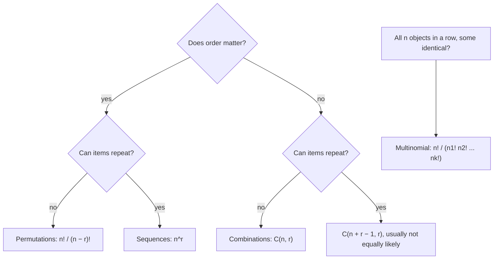

## Probability as counting

The last lesson ended with the rule $P(A) = |A|/|S|$ for a finite sample space of equally
likely outcomes. The rule is simple; the work is in counting $|A|$ and $|S|$ without listing
millions of outcomes. This lesson builds the counting toolkit — the multiplication
principle, permutations, combinations and multinomial coefficients — and then uses it on two
classic problems whose answers surprise almost everyone: the birthday problem and the
matching problem.

## The multiplication principle

If a procedure has $k$ stages, with $n_1$ ways to do the first stage, then (whatever happened
first) $n_2$ ways to do the second, and so on, the whole procedure can be done in

$$n_1 \times n_2 \times \cdots \times n_k$$

ways. This is the **multiplication principle**. A 4-character code with each character one
of 36 letters or digits has $36^4 = 1{,}679{,}616$ possibilities. The key requirement is that
the *number* of choices at each stage does not depend on the earlier choices, even if the
choices themselves do.

## Permutations: order matters

An arrangement of objects in a definite order is a **permutation**. Lining up all $n$
distinct objects can be done in $n(n-1)\cdots 1 = n!$ ways: $n$ choices for the first
position, $n - 1$ for the second, and so on (with $0! = 1$). Filling only $r$ ordered positions
from $n$ objects, without repeats, gives

$$P(n, r) = n(n-1)\cdots(n - r + 1) = \frac{n!}{(n - r)!}.$$

If repeats are allowed (sampling *with replacement*), each of the $r$ positions has all $n$
options, giving $n^r$.

## Combinations: order does not matter

A **combination** is an unordered selection — a committee, a hand of cards, a sample of
items. The number of $r$-element subsets of an $n$-element set is the
**binomial coefficient**

$$\binom{n}{r} = \frac{n!}{r!\,(n - r)!}.$$

**Why:** count ordered selections two ways. Directly there are $n!/(n-r)!$. Alternatively,
first choose the unordered subset (in $\binom{n}{r}$ ways) and then order it (in $r!$ ways). So
$\binom{n}{r} r! = n!/(n-r)!$, which rearranges to the formula.

Here is that argument for $n = 3$ and $r = 2$: each of the 3 subsets can be put in order in
$2! = 2$ ways, giving all $3 \cdot 2 = 6$ ordered pairs, each exactly once.


Two identities have one-line counting proofs:

- $\binom{n}{r} = \binom{n}{n-r}$: choosing who is *in* the committee is the same as choosing
  who is *out*.
- $\binom{n}{r} = \binom{n-1}{r-1} + \binom{n-1}{r}$ (Pascal's rule): fix one person; committees
  either include them (choose the other $r - 1$ from $n - 1$) or do not (choose all $r$ from
  $n - 1$).

The name comes from the **binomial theorem**, $(x + y)^n = \sum_{r=0}^n \binom{n}{r} x^r y^{n-r}$:
expanding the product, the term $x^r y^{n-r}$ arises once for each choice of which $r$ of
the $n$ factors contribute an $x$.

### Example 1: a committee

A project team of 5 is chosen at random from 8 engineers and 6 analysts. What is the
probability the team has exactly 3 engineers?

1. Sample space: all teams of 5 from 14 people, $|S| = \binom{14}{5} = 2002$, each equally
   likely.
2. Favorable teams: choose 3 of the 8 engineers *and* 2 of the 6 analysts. By the
   multiplication principle, $\binom{8}{3}\binom{6}{2} = 56 \times 15 = 840$.
3. $P = 840/2002 \approx 0.4196$.

This "choose from each group, multiply, divide by the total" pattern is the hypergeometric
distribution, which returns in lesson 6.

## Multinomial coefficients

How many ways can $n$ objects be divided into groups of sizes $n_1, n_2, \ldots, n_k$
(with $n_1 + \cdots + n_k = n$), when the groups are labeled? Choose the first group, then
the second from what is left, and so on:

$$\binom{n}{n_1}\binom{n - n_1}{n_2}\cdots = \frac{n!}{n_1!\,(n-n_1)!}\cdot\frac{(n-n_1)!}{n_2!\,(n-n_1-n_2)!}\cdots = \frac{n!}{n_1!\,n_2!\cdots n_k!}.$$

The factorials telescope, leaving the **multinomial coefficient**
$\binom{n}{n_1, n_2, \ldots, n_k} = \dfrac{n!}{n_1!\,n_2!\cdots n_k!}$.
The same number counts arrangements of $n$ objects in a row when $n_1$ are identical of one
kind, $n_2$ of another, and so on: assigning positions to the kinds *is* dividing the $n$
positions into labeled groups.

### Example 2: signal flags

Nine flags — 4 red, 3 blue, 2 green, identical within each color — are hung in a row in
random order. How many distinct displays are there, and what is the probability that the
four red flags are all next to one another?

1. Distinct displays: $\dfrac{9!}{4!\,3!\,2!} = \dfrac{362880}{24 \cdot 6 \cdot 2} = 1260$.
   Because each display corresponds to the same number of orderings of labeled flags
   ($4!\,3!\,2!$), the displays are equally likely.
2. Glue the red flags into one block. Now arrange 6 items: the block, 3 blue, 2 green:
   $\dfrac{6!}{1!\,3!\,2!} = 60$ displays.
3. $P = 60/1260 = 1/21 \approx 0.048$.

## The birthday problem

In a room of $n$ people with birthdays independent and uniform over 365 days (ignore leap
years), what is the chance that at least two share a birthday?

The complement is easier. Ordered lists of $n$ birthdays: $365^n$, all equally likely. Lists
with no repeats: $365 \cdot 364 \cdots (365 - n + 1)$. So

$$P(\text{no shared birthday}) = \frac{365 \cdot 364 \cdots (365 - n + 1)}{365^n} = \prod_{i=0}^{n-1}\left(1 - \frac{i}{365}\right),$$

and $P(\text{at least one match}) = 1$ minus that. At $n = 23$ the product is about $0.4927$,
so a match is *more* likely than not ($0.5073$). By $n = 50$ the chance of a match is about
$0.970$.

```plot
{"x": [0, 60], "y": [0, 1.05], "xLabel": "n", "yLabel": "P(match)", "functions": [{"f": "1 - exp(lgamma(366) - lgamma(366 - x) - x*ln(365))", "from": 1, "to": 60}], "segments": [{"from": [23, 0], "to": [23, 0.5073], "dashed": true}, {"from": [0, 0.5], "to": [23, 0.5], "dashed": true}], "points": [{"at": [23, 0.5073], "label": "n = 23"}], "caption": "Probability of at least one shared birthday among n people"}
```

The intuition fails because we think about *our own* birthday. The relevant count is the
number of *pairs* of people, $\binom{23}{2} = 253$, and each pair has a $1/365$ chance of
matching. The same arithmetic governs "collisions" in hashing and in randomly assigned ID
codes.

## The matching problem

$n$ letters are put into $n$ addressed envelopes at random. What is the chance that at least
one letter lands in its own envelope?

Let $A_i$ be "letter $i$ is in the right envelope." All $n!$ assignments are equally likely.
If $k$ particular letters are correct, the other $n - k$ can be anything, so
$P(A_{i_1} \cap \cdots \cap A_{i_k}) = (n-k)!/n!$. There are $\binom{n}{k}$ such groups of $k$, so
the $k$-th inclusion–exclusion term is

$$\binom{n}{k}\frac{(n-k)!}{n!} = \frac{1}{k!}.$$

Therefore

$$P(\text{at least one match}) = 1 - \frac{1}{2!} + \frac{1}{3!} - \cdots + (-1)^{n+1}\frac{1}{n!}.$$

Recalling $e^{-1} = \sum_{k \ge 0} (-1)^k/k!$, this is $1 - \sum_{k=0}^{n} (-1)^k/k!$, which
approaches $1 - e^{-1} \approx 0.632$ extremely quickly. For $n = 4$ it is
$1 - \tfrac12 + \tfrac16 - \tfrac{1}{24} = \tfrac{15}{24} = 0.625$; for 10 or 10,000 letters it is
0.632 to three decimals. The number of letters barely matters.

## Choosing the right count

Ask two questions: *does order matter?* and *can items repeat?*

| | Without replacement | With replacement |
|---|---|---|
| Ordered | $\dfrac{n!}{(n-r)!}$ | $n^r$ |
| Unordered | $\dbinom{n}{r}$ | $\dbinom{n + r - 1}{r}$ |

The last entry (unordered with repetition, e.g. choosing 3 scoops from 5 flavors) is less
common in probability because those selections are usually *not* equally likely. Whatever you
count, count the numerator and denominator the same way — both ordered or both unordered.

The same two questions as a decision chart:



## Common mistakes

- Mixing ordered and unordered counts in one fraction (an ordered numerator over $\binom{n}{r}$).
- Using combinations when roles are distinct: choosing a president, treasurer and secretary
  from 10 people is $10 \cdot 9 \cdot 8$, not $\binom{10}{3}$.
- Forgetting to divide by the factorials of identical objects in arrangements.
- Assuming outcomes counted by a formula are equally likely when they are not.
- In the birthday problem, computing $1 - (364/365)^n$, which is the chance that someone
  shares *your* birthday.

## Key points

- Multiplication principle: multiply the number of choices at each stage.
- Ordered without repeats: $n!/(n-r)!$; with repeats: $n^r$.
- Unordered: $\binom{n}{r} = n!/(r!(n-r)!)$, because each subset has $r!$ orderings.
- Multinomial: $n!/(n_1!\cdots n_k!)$ ways to split $n$ objects into labeled groups.
- Birthday: $P(\text{no match}) = \prod_{i<n}(1 - i/365)$; above 50% match at $n = 23$.
- Matching: $P(\text{some match}) = \sum_{k=1}^n (-1)^{k+1}/k! \to 1 - 1/e$.
