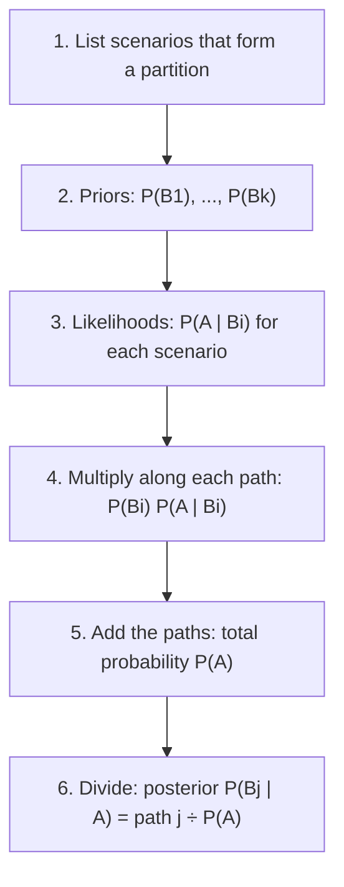

## Updating on information

Probabilities depend on what you know. The chance that a passenger train is late is one
number; the chance it is late *given* that a freight train is blocking the junction is
another. Conditional probability makes "given that" precise. From one definition come three
tools that solve most multi-stage problems: the multiplication rule, the law of total
probability, and Bayes' theorem.

## The definition

For events $A$ and $B$ with $P(B) > 0$, the **conditional probability** of $A$ given $B$ is

$$P(A \mid B) = \frac{P(A \cap B)}{P(B)}.$$

**Why this formula?** Learning that $B$ occurred shrinks the sample space to $B$. Outcomes
outside $B$ are now impossible, and outcomes inside $B$ should keep their *relative*
likelihoods. Dividing by $P(B)$ rescales so the new total is 1. With equally likely outcomes,
this is just $|A \cap B| / |B|$: count the favorable outcomes among those still possible.


For a fixed $B$, the function $A \mapsto P(A \mid B)$ satisfies all three axioms
(nonnegative, $P(S \mid B) = 1$, additive over disjoint events), so it *is* a probability
measure. Every rule from lesson 1 holds conditionally, for example
$P(A^c \mid B) = 1 - P(A \mid B)$.

**Dice check.** Roll two fair dice. Given that the first die is even, what is the chance the
sum is 8? The condition leaves 18 equally likely outcomes; of these, $(2,6), (4,4), (6,2)$
give a sum of 8. So $P = 3/18 = 1/6$. Unconditionally $P(\text{sum} = 8) = 5/36$, a bit less:
the information changed the probability.

Note the asymmetry: $P(A \mid B)$ and $P(B \mid A)$ have the same numerator but different
denominators, and they can be wildly different. Mixing them up is the "prosecutor's fallacy."

## The multiplication rule

Rearranging the definition gives the **multiplication rule**

$$P(A \cap B) = P(B)\,P(A \mid B) = P(A)\,P(B \mid A).$$

Applied repeatedly, it gives the **chain rule** for several events:

$$P(A_1 \cap A_2 \cap \cdots \cap A_n) = P(A_1)\,P(A_2 \mid A_1)\,P(A_3 \mid A_1 \cap A_2)\cdots P(A_n \mid A_1 \cap \cdots \cap A_{n-1}).$$

This is how to handle sequential draws without replacement: each factor reflects what is
left after the earlier draws.

### Example 1: drawing without replacement

A bin holds 20 fasteners, 5 of them defective. Three are drawn one at a time without
replacement. Let $D_i$ be "draw $i$ is defective."

1. $P(D_1 \cap D_2 \cap D_3) = \dfrac{5}{20}\cdot\dfrac{4}{19}\cdot\dfrac{3}{18} = \dfrac{60}{6840} \approx 0.00877$.
2. Check by counting: $\binom{5}{3}/\binom{20}{3} = 10/1140 \approx 0.00877$. ✓
3. What is $P(D_2)$ by itself? Split on the first draw:
   $P(D_2) = \tfrac{5}{20}\cdot\tfrac{4}{19} + \tfrac{15}{20}\cdot\tfrac{5}{19} = \tfrac{20 + 75}{380} = \tfrac14$.
   By symmetry, *every* draw is defective with probability $5/20$ — draws without
   replacement are dependent, but each one alone has the original proportion.

Step 3 used the next tool.

## The law of total probability

Let $B_1, \ldots, B_k$ be a partition of $S$ with each $P(B_i) > 0$. Then

$$P(A) = \sum_{i=1}^{k} P(B_i)\,P(A \mid B_i).$$

**Proof:** the events $A \cap B_i$ are disjoint (the $B_i$ are) and their union is $A$ (the
$B_i$ cover $S$). By additivity $P(A) = \sum P(A \cap B_i)$, and each term is
$P(B_i)P(A \mid B_i)$ by the multiplication rule.

This is the **law of total probability**: an overall probability is a weighted average of
conditional probabilities, weighted by how likely each scenario is. It is "conditioning on
the first stage," and in a tree diagram it is "add up the paths that end in $A$."

The picture names the parts of such a tree. First-stage branches carry the probabilities of the
scenarios, second-stage branches carry conditional probabilities given the branch they leave,
and the product along a path is the probability of that whole path:


## Bayes' theorem

Often we know $P(A \mid B_i)$ — how likely the evidence is under each scenario — but want
$P(B_j \mid A)$, how likely each scenario is in light of the evidence. Apply the definition,
then the multiplication rule on top and total probability below:

$$P(B_j \mid A) = \frac{P(B_j)\,P(A \mid B_j)}{\sum_{i=1}^{k} P(B_i)\,P(A \mid B_i)}.$$

This is **Bayes' theorem**. $P(B_j)$ is the **prior probability** of scenario $B_j$ and
$P(B_j \mid A)$ is its **posterior probability**. The factors $P(A \mid B_i)$ are called
**likelihoods**.

In practice Bayes' theorem is a fixed sequence of steps:



For two scenarios $B$ and $B^c$ there is a compact **odds** form. Dividing Bayes' theorem for
$B$ by the one for $B^c$, the denominators cancel:

$$\frac{P(B \mid A)}{P(B^c \mid A)} = \frac{P(B)}{P(B^c)} \times \frac{P(A \mid B)}{P(A \mid B^c)}.$$

Posterior odds = prior odds × **likelihood ratio**. Evidence that is 20 times as likely under
$B$ as under $B^c$ multiplies the odds on $B$ by 20, whatever they were.

### Example 2: a diagnostic test

A defect affects 1% of turbine blades. An ultrasonic test flags 98% of defective blades
(sensitivity) and wrongly flags 5% of good ones (so its specificity is 95%). A blade is
flagged. How likely is it to be defective?

```shape
{"x": [-0.3, 10.8], "y": [-0.5, 8.5], "segments": [{"from": [0, 4], "to": [3, 6.5], "label": "0.01"}, {"from": [0, 4], "to": [3, 1.5], "label": "0.99"}, {"from": [3.9, 6.5], "to": [6.6, 7.8], "label": "0.98"}, {"from": [3.9, 6.5], "to": [6.6, 5.2], "label": "0.02"}, {"from": [3.9, 1.5], "to": [6.6, 2.8], "label": "0.05"}, {"from": [3.9, 1.5], "to": [6.6, 0.2], "label": "0.95"}], "labels": [{"at": [3.2, 6.4], "text": "D"}, {"at": [3.2, 1.4], "text": "Dᶜ"}, {"at": [6.9, 7.7], "text": "+"}, {"at": [6.9, 5.1], "text": "−"}, {"at": [6.9, 2.7], "text": "+"}, {"at": [6.9, 0.1], "text": "−"}, {"at": [8.2, 7.7], "text": "0.0098"}, {"at": [8.2, 5.1], "text": "0.0002"}, {"at": [8.2, 2.7], "text": "0.0495"}, {"at": [8.2, 0.1], "text": "0.9405"}], "caption": "Tree for the blade test: multiply along each path"}
```

1. Paths ending in "+": $P(D)P(+ \mid D) = 0.01 \times 0.98 = 0.0098$ and
   $P(D^c)P(+ \mid D^c) = 0.99 \times 0.05 = 0.0495$.
2. Total probability: $P(+) = 0.0098 + 0.0495 = 0.0593$.
3. Bayes: $P(D \mid +) = 0.0098 / 0.0593 \approx 0.165$.

Only about one flagged blade in six is actually defective, because good blades vastly
outnumber bad ones and 5% of a large group is many false alarms. The odds form gives the same
answer: prior odds $1/99$, likelihood ratio $0.98/0.05 = 19.6$, posterior odds
$19.6/99 \approx 0.198$, so $P(D \mid +) = 0.198/1.198 \approx 0.165$.

A negative result is far more decisive: $P(D \mid -) = \dfrac{0.0002}{0.0002 + 0.9405} \approx 0.0002$.

### Example 3: the three-door game

A prize is behind one of three doors, equally likely. You pick door 1. The host, who knows
where the prize is, always opens a door you did not pick that hides nothing; if both of the
other doors are empty, he chooses between them at random. He opens door 3. Should you switch
to door 2?

Let $C_i$ be "prize behind door $i$" and $H$ be "host opens door 3." The likelihoods are
$P(H \mid C_1) = \tfrac12$ (he could open 2 or 3), $P(H \mid C_2) = 1$ (door 3 is his only
choice), $P(H \mid C_3) = 0$. With priors $\tfrac13$ each,

$$P(C_2 \mid H) = \frac{\tfrac13 \cdot 1}{\tfrac13 \cdot \tfrac12 + \tfrac13 \cdot 1 + \tfrac13 \cdot 0} = \frac{1/3}{1/2} = \frac23.$$

Switching wins with probability $\tfrac23$. The host's choice carries information because he
was *constrained* when the prize was behind door 2. If he opened a door at random and it
happened to be empty, the likelihoods would change and so would the answer (it becomes
$\tfrac12$) — Bayes' theorem makes you state exactly how the evidence arose.

## Common mistakes

- Confusing $P(A \mid B)$ with $P(B \mid A)$, e.g. sensitivity $P(+ \mid D)$ with $P(D \mid +)$.
- Ignoring the base rate (prior) when the condition is rare.
- Dividing by the wrong event: the denominator is the probability of what you *know*
  happened.
- Using unconditional probabilities on the second-stage branches of a tree.
- Applying total probability with events that do not form a partition (overlapping or
  incomplete scenarios).

## Key points

- $P(A \mid B) = P(A \cap B)/P(B)$; conditioning restricts the sample space to $B$.
- Multiplication rule $P(A \cap B) = P(B)P(A \mid B)$; chain rule for sequences.
- Total probability: $P(A) = \sum_i P(B_i)P(A \mid B_i)$ over a partition.
- Bayes: $P(B_j \mid A) = P(B_j)P(A \mid B_j) / \sum_i P(B_i)P(A \mid B_i)$.
- Odds form: posterior odds = prior odds × likelihood ratio.
