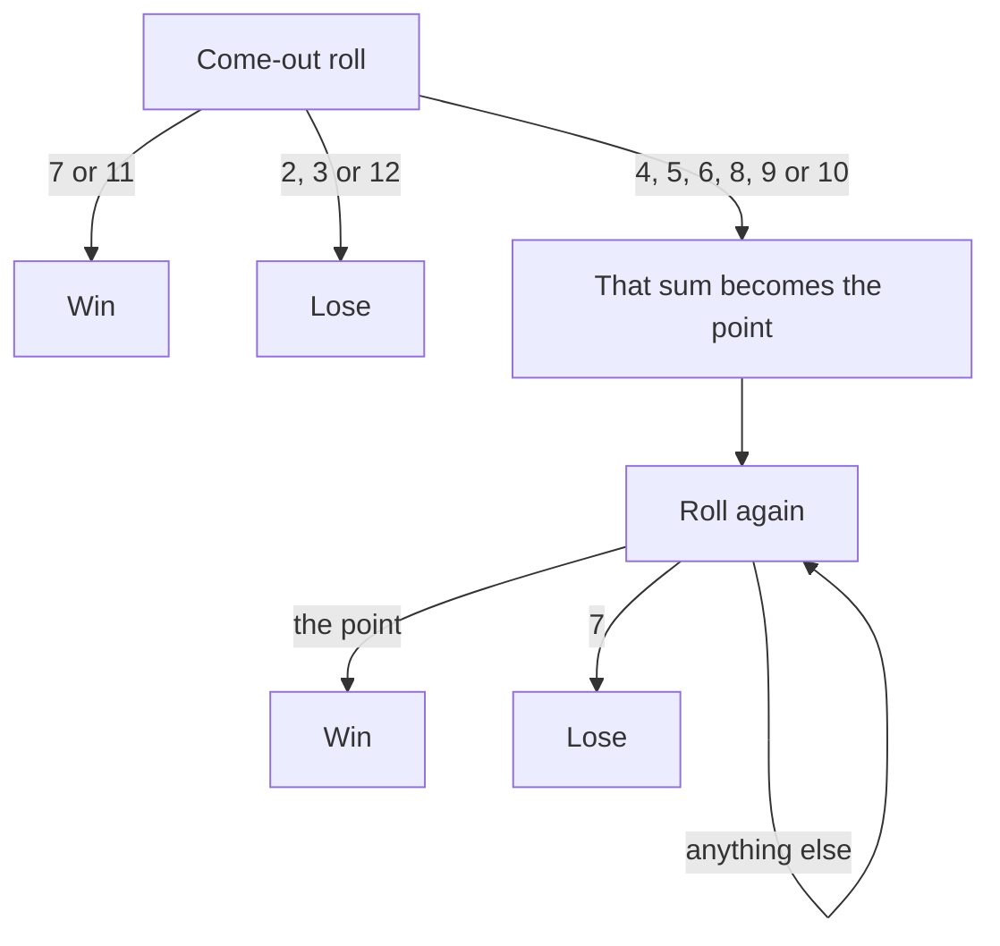

## Conditioning on what happens first

Lesson 3 used the law of total probability to split a problem by its first stage, and lesson 4
showed that independent trials let you multiply. Many games and processes, though, have no fixed
number of stages: a player keeps rolling until something happens, a gambler keeps betting until
broke or rich. Listing every possible sequence is hopeless, because there are infinitely many.

**First-step analysis** conditions on the first step instead, and then notices that after that
step the situation is a copy of the original problem, or of a closely related one. The unknown
probability then appears on both sides of the law of total probability, and the problem becomes
an equation (or a system of equations) to solve. This lesson develops the method on a turn-taking
game, on craps, on the classic gambler's ruin, and on the problem of points, the 1654 question
whose solution is often taken as the start of probability theory.

## A race between two players

### Example 1: first six wins

Ann and Ben take turns rolling a fair die, Ann first. The first person to roll a six wins. What
is the probability that Ann wins?

**Method 1: add up the ways.** Ann wins on her $k$-th roll if the first $2(k-1)$ rolls all miss
and her next roll is a six. By independence that has probability $(5/6)^{2(k-1)} \cdot \tfrac16$.
These are disjoint events, so

$$P(\text{Ann wins}) = \sum_{k=1}^{\infty} \frac16 \left(\frac{25}{36}\right)^{k-1} = \frac{1/6}{1 - 25/36} = \frac{1}{6} \cdot \frac{36}{11} = \frac{6}{11}.$$

**Method 2: first-step analysis.** Let $a = P(\text{Ann wins})$ and condition on the first
round (Ann's roll, then Ben's):

1. Ann rolls a six (probability $\tfrac16$): Ann has won.
2. Ann misses and Ben rolls a six (probability $\tfrac56 \cdot \tfrac16$): Ann has lost.
3. Both miss (probability $\tfrac{25}{36}$): the game is back exactly where it started, with
   Ann to roll, so from here Ann wins with probability $a$.

Total probability gives $a = \tfrac16 \cdot 1 + \tfrac{5}{36} \cdot 0 + \tfrac{25}{36}\,a$, so
$\tfrac{11}{36}\,a = \tfrac16$ and $a = \tfrac{6}{11} \approx 0.545$.

Method 2 needed no series. The phrase "back exactly where it started" is where independence does
its work: earlier misses do not change the chances on later rolls, so the future after a missed
round looks just like the future at the start.

The same argument works for any per-turn success probabilities, $p$ for Ann and $r$ for Ben:

$$a = p + (1-p)(1-r)\,a \quad\Longrightarrow\quad a = \frac{p}{1 - (1-p)(1-r)} = \frac{p}{p + r - pr}.$$

**Does the game end?** Method 2 quietly assumed that someone eventually wins. The event "nobody
has rolled a six in the first $2n$ rolls" contains the event "the game never ends," so by
monotonicity $P(\text{never ends}) \le (5/6)^{2n}$ for every $n$. The right side goes to 0, so the
game ends with probability 1, and $P(\text{Ben wins}) = 1 - \tfrac{6}{11} = \tfrac{5}{11}$.

## Craps: a race against seven

In the dice game craps, the shooter's first roll of two dice (the come-out roll) can end the game
at once or set a **point**:



Once the point is $k$, let $w_k$ be the chance of winning. Condition on the next roll: it is $k$
(win), 7 (lose), or something else (the situation is unchanged). So
$w_k = P(k) + \bigl(1 - P(k) - P(7)\bigr) w_k$, which gives

$$w_k = \frac{P(k)}{P(k) + P(7)}.$$

The rolls that are neither $k$ nor 7 do not matter at all; only the race between $k$ and 7 does.
In other words, $w_k$ is the conditional probability that a roll is $k$ *given* that it is $k$
or 7. With $P(7) = \tfrac{6}{36}$:

| Point $k$ | $P(k)$ | $w_k$ |
|---|---|---|
| 4 or 10 | $3/36$ | $3/9 = 1/3$ |
| 5 or 9 | $4/36$ | $4/10 = 2/5$ |
| 6 or 8 | $5/36$ | $5/11$ |

### Example 2: the probability of winning at craps

Condition on the come-out roll (total probability over its eleven possible sums):

1. Win at once: $P(7) + P(11) = \tfrac{6}{36} + \tfrac{2}{36} = \tfrac{8}{36}$.
2. Win through a point: each point contributes $P(k)\,w_k$, and the points come in equal pairs,
   so this part is
   $2\left(\tfrac{3}{36}\cdot\tfrac13 + \tfrac{4}{36}\cdot\tfrac25 + \tfrac{5}{36}\cdot\tfrac{5}{11}\right) = 2\left(\tfrac{1}{36} + \tfrac{2}{45} + \tfrac{25}{396}\right) = \tfrac{134}{495}$.
3. Total: $\tfrac{8}{36} + \tfrac{134}{495} = \tfrac{110}{495} + \tfrac{134}{495} = \tfrac{244}{495} \approx 0.4929$.

The shooter wins a little less than half the time, which is the casino's edge on this bet.

## The gambler's ruin

A gambler starts with $i$ dollars and bets \$1 at a time. Each bet is won with probability $p$
and lost with probability $q = 1 - p$, independently. She stops when she reaches a target of $N$
dollars or goes broke. Her fortune moves up or down one step at a time, a **random walk** on
$0, 1, \ldots, N$. The ends are **absorbing states**: once the walk reaches 0 or $N$, it stays
there.


The problem of the **gambler's ruin** asks for $P_i$, the probability of reaching $N$ before 0
when starting from $i$. Condition on the first bet: a win moves the walk to $i + 1$ and a loss to
$i - 1$, and from there the game is the same game started at a new place. So

$$P_i = p\,P_{i+1} + q\,P_{i-1} \quad (1 \le i \le N - 1), \qquad P_0 = 0,\quad P_N = 1.$$

The values at the two ends are the **boundary conditions**. They are essential: the recursion
alone has many solutions (in the fair case every linear function $P_i = c_1 + c_2 i$ satisfies
it), and the boundary conditions pick out the right one.

**Solving the recursion.** Since $p + q = 1$, write the left side as $pP_i + qP_i$ and
rearrange:

$$p\,(P_{i+1} - P_i) = q\,(P_i - P_{i-1}).$$

So the step sizes $d_i = P_i - P_{i-1}$ satisfy $d_{i+1} = \rho\, d_i$ with $\rho = q/p$, giving
$d_i = \rho^{i-1} d_1$. Because $P_0 = 0$, the value $P_i$ is the sum of the first $i$ steps:
$P_i = d_1(1 + \rho + \cdots + \rho^{i-1})$.

- **Fair game** ($p = q = \tfrac12$, so $\rho = 1$): $P_i = i\,d_1$, and $P_N = 1$ forces
  $d_1 = 1/N$. So $P_i = \dfrac{i}{N}$.
- **Unfair game** ($\rho \ne 1$): the geometric sum gives $P_i = d_1 \dfrac{1 - \rho^i}{1 - \rho}$,
  and $P_N = 1$ gives
  $$P_i = \frac{1 - \rho^{\,i}}{1 - \rho^{N}}, \qquad \rho = \frac{q}{p}.$$

```plot
{"x": [0, 20], "y": [0, 1.05], "xLabel": "starting fortune i", "yLabel": "P(reach 20 first)", "functions": [{"f": "x/20", "label": "p = 0.5"}, {"f": "(1 - (11/9)^x)/(1 - (11/9)^20)", "label": "p = 0.45", "dashed": true}], "points": [{"at": [10, 0.5]}, {"at": [10, 0.1185], "label": "(10, 0.12)"}], "caption": "Chance of reaching 20 before 0 (only whole-number i are possible)"}
```

The graph shows how much a small edge matters. In a fair game, a gambler who starts halfway to
the target reaches it half the time. With $p = 0.45$ she reaches it only about 12% of the time.

### Example 3: a fair game

A gambler with \$20 makes fair \$1 bets, aiming to reach \$100. Her chance of success is
$P_{20} = 20/100 = 0.2$, and she is ruined with probability 0.8. The answer $i/N$ has a natural
reading that later lessons on expectation make precise: in a fair game her average final fortune,
$100 \times 0.2 + 0 \times 0.8 = 20$, equals what she started with.

### Example 4: an unfavorable game, timid versus bold

An American roulette wheel has 18 red, 18 black and 2 green pockets, so a bet on red wins with
probability $p = 18/38$. A gambler has \$20 and wants \$40.

1. **Timid play**, \$1 at a time: $\rho = \dfrac{20/38}{18/38} = \dfrac{10}{9}$, so
   $P_{20} = \dfrac{1 - (10/9)^{20}}{1 - (10/9)^{40}} \approx 0.108$.
2. **Bold play**, all \$20 on one spin: she reaches \$40 with probability
   $18/38 \approx 0.474$.

Betting boldly is more than four times as good. Each bet loses a little on average, and many
small bets give that small edge many chances to act. A classical result of Dubins and Savage
(1965) shows that, for reaching a fixed goal in a game like this one, bold play is in fact optimal.
No strategy makes an unfavorable game favorable, but some lose much faster than others.

**An endless game.** Let the target $N$ grow without bound, as if the opponent had unlimited
money. If $p \le \tfrac12$, then $P_i \to 0$ for every $i$ (for $p = \tfrac12$, $i/N \to 0$; for
$p < \tfrac12$, $\rho > 1$ and $\rho^N$ blows up), so ruin is certain. If $p > \tfrac12$, then
$\rho < 1$, $\rho^N \to 0$, and a limit argument (using the continuity of probability, which we do
not prove here) gives $P(\text{never ruined}) = 1 - (q/p)^i$.

## The problem of points

Two players play a series of rounds, and whoever first wins a set number of rounds takes the
whole stake. The match is interrupted when player A still needs $a$ more wins and player B needs
$b$. How should the stake be divided? The **problem of points** was already old when Luca Pacioli
discussed it in 1494, but it was solved in the 1654 letters between Blaise Pascal and Pierre de
Fermat: divide the stake in proportion to each player's chance of winning had play continued.

If A wins each round with probability $p$, let $W(a, b)$ be A's chance of winning the match.
First-step analysis on the next round gives

$$W(a, b) = p\,W(a - 1, b) + q\,W(a, b - 1), \qquad W(0, b) = 1, \quad W(a, 0) = 0.$$

### Example 5: A needs 2 wins, B needs 3, fair rounds

Build the table from the boundary inward, with $p = q = \tfrac12$:

1. $W(1, 1) = \tfrac12$.
2. $W(1, 2) = \tfrac12 \cdot 1 + \tfrac12 \cdot \tfrac12 = \tfrac34$, and
   $W(1, 3) = \tfrac12 + \tfrac12 \cdot \tfrac34 = \tfrac78$.
3. $W(2, 1) = \tfrac12 \cdot \tfrac12 + \tfrac12 \cdot 0 = \tfrac14$, and
   $W(2, 2) = \tfrac12 \cdot \tfrac34 + \tfrac12 \cdot \tfrac14 = \tfrac12$.
4. $W(2, 3) = \tfrac12 W(1, 3) + \tfrac12 W(2, 2) = \tfrac{7}{16} + \tfrac{4}{16} = \tfrac{11}{16}$.

Fermat's shortcut gives the same answer with less work. The match is surely decided within
$a + b - 1 = 4$ more rounds, and playing all 4 (even after the match is settled) does not change
who reaches the target first. A wins the match exactly when she wins at least 2 of the 4 rounds:
$\bigl[\binom42 + \binom43 + \binom44\bigr]/2^4 = 11/16$. So the stake should be split 11 to 5
in A's favor. In general, A's chance is the probability of at least $a$ successes in $a + b - 1$
independent rounds.

## Common mistakes

- Writing the first-step equation but forgetting the boundary conditions. The recursion alone
  does not determine the answer.
- Claiming the process "starts over" when it does not. After Ann misses in Example 1 it is Ben's
  turn, which is not the starting position; condition on a full round, or give Ben's turn its own
  unknown.
- In craps, thinking that other sums after the point is set change the odds. Only the race
  between the point and 7 matters.
- Using $i/N$ for an unfair game. Even a small edge changes the answer a lot when $N$ is large.
- Expecting many small bets to "average out" in an unfavorable game. They do the opposite: they
  let the house edge act many times.

## Key points

- First-step analysis: condition on the first step, recognize the same problem afterward, and
  solve the resulting equation together with its boundary conditions.
- Alternating race with success probabilities $p$ (first player) and $r$: the first player wins
  with probability $p/(p + r - pr)$.
- Craps: from point $k$, $P(\text{win}) = P(k)/(P(k) + P(7))$; overall $244/495 \approx 0.493$.
- Gambler's ruin, from $i$ with target $N$: $P_i = i/N$ if fair, and
  $(1 - \rho^i)/(1 - \rho^N)$ with $\rho = q/p$ otherwise.
- In an unfavorable game, bold play reaches a fixed goal more often than timid play.
- Problem of points: A's share is the probability of at least $a$ wins in $a + b - 1$ rounds.
