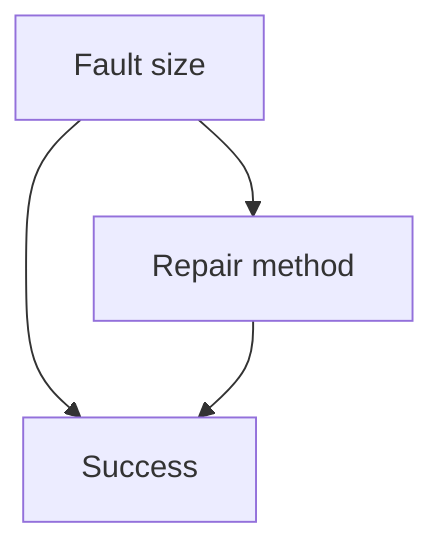
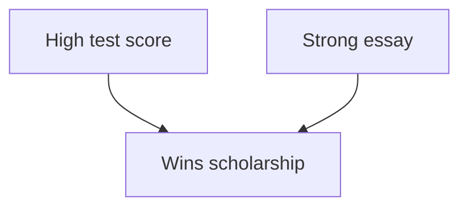

## When correct arithmetic gives a surprising answer

Lesson 3 ended the three-door game with a warning: Bayes' theorem makes you state exactly how the
evidence arose. Lesson 4 showed that an unknown common cause can make two tosses dependent even
though each coin's tosses are independent. This lesson collects famous puzzles in which
conditioning gives answers that feel wrong. None of them is a flaw in probability theory. Each one
teaches a lesson about *what* you are conditioning on:

- **averaging over groups** can reverse a comparison (Simpson's paradox);
- **looking only at a selected group** can create an association that is not there in the whole
  population (Berkson's paradox);
- the **same words** can describe different ways of getting information, with different answers
  (the two-child problem and Bertrand's box).

## Simpson's paradox

### Example 1: two repair methods

A depot records how often two repair methods fix a fault on the first try, split by fault size:

| | Small faults | Large faults | All faults |
|---|---|---|---|
| Method A | $90/100 = 90\%$ | $150/300 = 50\%$ | $240/400 = 60\%$ |
| Method B | $240/300 = 80\%$ | $40/100 = 40\%$ | $280/400 = 70\%$ |

Method A does better on small faults *and* on large faults, yet Method B does better overall. A
comparison that holds in every group but reverses when the groups are combined is called
**Simpson's paradox**. Edward Simpson described it in 1951; Karl Pearson and Udny Yule had noted
similar effects around 1900.

**Why it happens.** Write $S$ for success. By the law of total probability, each method's overall
rate is a weighted average of its two group rates, weighted by that method's mix of faults:

$$P(S \mid A) = P(\text{small} \mid A)\,P(S \mid A, \text{small}) + P(\text{large} \mid A)\,P(S \mid A, \text{large}) = 0.25(0.90) + 0.75(0.50) = 0.60,$$

$$P(S \mid B) = 0.75(0.80) + 0.25(0.40) = 0.70.$$

Method A was mostly used on large faults, which are hard to fix; Method B was mostly used on small
ones. Each overall bar must lie between its own method's two group bars, but nothing forces the
two weighted averages to keep the order of the groups when the weights differ.

**When it cannot happen.** If both methods see the same mix, say a fraction $w$ of small faults
each, then

$$P(S \mid A) - P(S \mid B) = w\,[\text{difference on small}] + (1 - w)\,[\text{difference on large}],$$

and if both differences are positive, so is the total. That is one reason careful experiments
assign treatments at random: randomization makes the groups' mixes alike on average, so a
reversal like this one becomes unlikely.

**Which comparison should you believe?** The table alone cannot say. It depends on how the
groups arose. Here fault size affects both which method gets used and how likely success is, so it
is a **confounding variable**:

Comparing the methods within each fault size holds the confounder fixed, so (if nothing else
differs between the jobs) Method A is the better method. But if the splitting variable were
instead a *result* of the method, for example how long the repair took, splitting on it could
mislead, and the combined table would be the fair comparison. This is a simplified summary of
what the theory of causal inference says; the point to remember is that the numbers alone do not
decide.

A real case: in fall 1973, about 44% of men and 35% of women who applied for graduate study at the
University of California, Berkeley were admitted. A 1975 study by Bickel, Hammel and O'Connell
found little evidence of bias against women within departments. Women had more often applied to
departments that admitted a small share of all their applicants, which pulled their overall rate
down.

## Berkson's paradox

### Example 2: a scholarship committee

A committee awards a scholarship to every applicant with a high test score ($H$) *or* a strong
essay ($E$). Among all applicants, $P(H) = 0.3$, $P(E) = 0.2$, and $H$ and $E$ are independent.
Look only at the winners, $W = H \cup E$.

1. $P(W) = 0.3 + 0.2 - 0.3 \times 0.2 = 0.44$.
2. Since $H \subseteq W$, $P(H \mid W) = \dfrac{P(H)}{P(W)} = \dfrac{0.3}{0.44} \approx 0.682$.
3. Among winners with a strong essay: every strong essay wins, so $E \subseteq W$ and
   $P(H \mid W \cap E) = P(H \mid E) = 0.3$, by independence.
4. Among winners with a weak essay: they must have won on the test, so
   $P(H \mid W \cap E^c) = 1$.

Among the winners, a strong essay makes a high score *less* likely (0.3 instead of 1), even though
the two traits are unrelated in the applicant pool. Someone who studied only winners would
conclude that good writers test poorly.

This is **Berkson's paradox**, named for Joseph Berkson, who pointed out in 1946 that two
diseases can appear associated among hospital patients simply because either one can put a person
in the hospital. It is a kind of **selection bias**: the way the observed group was selected
distorts the relationships inside it.

Compare lesson 4. There, two tosses depended on a common *cause* (the coin), and conditioning on
the cause made them independent. Here, two independent traits share a common *effect*, and
conditioning on the effect makes them dependent. Conditioning can remove a dependence or create
one, depending on where the conditioning event sits.

## How the information arose

### Example 3: the two-child problem

A family has two children. Model each child as a boy or a girl with probability $\tfrac12$,
independently (a simplification: real birth records show slightly more boys than girls). With the
older child listed first, the outcomes $BB$, $BG$, $GB$, $GG$ are equally likely. In each case
below we learn that "one of the children is a boy." What is the probability that both are?

1. *You ask the parent "Do you have at least one son?" and the answer is yes.* The condition is
   $\{BB, BG, GB\}$, so $P(BB \mid \text{at least one boy}) = \dfrac{1/4}{3/4} = \dfrac13$.
2. *You learn that the older child is a boy.* The condition is $\{BB, BG\}$, and the answer is
   $\tfrac12$.
3. *You meet the parent walking with one of the two children, chosen at random, and it is a
   boy.* Now use Bayes' theorem with the likelihood of seeing a boy: 1 for $BB$, $\tfrac12$ for
   $BG$ and $GB$, 0 for $GG$:
   $$P(BB \mid \text{see a boy}) = \frac{\tfrac14 \cdot 1}{\tfrac14 \cdot 1 + \tfrac14 \cdot \tfrac12 + \tfrac14 \cdot \tfrac12 + \tfrac14 \cdot 0} = \frac{1/4}{1/2} = \frac12.$$

The sentence "one of them is a boy" is true in all three cases, but the answers differ because the
*process* that produced the information differs, just as in the three-door game.

A stranger variation: you learn that at least one child is a boy born on a Tuesday. Treat each
child as one of 14 equally likely types (sex and weekday), so there are $14^2 = 196$ equally
likely ordered pairs. Pairs with no Tuesday boy number $13^2 = 169$, so 27 pairs qualify. Among
them, both children are boys in $7^2 - 6^2 = 13$ pairs (all boy pairs minus those with no Tuesday
boy). The answer is $13/27 \approx 0.48$, close to $\tfrac12$. The extra detail makes the
condition nearly pick out one particular child, which moves the answer from $\tfrac13$ toward
$\tfrac12$.

### Example 4: Bertrand's box

Joseph Bertrand posed this in 1889. Three boxes hold two gold coins, two silver coins, and one of
each. You pick a box at random, then a coin from it at random, and the coin is gold. What is the
probability that the other coin in that box is gold too?

The tempting answer is $\tfrac12$: the box is either gold–gold or gold–silver. But those two boxes
were not equally likely to *produce* a gold coin. The likelihoods are 1 for gold–gold, $\tfrac12$
for gold–silver and 0 for silver–silver, so

$$P(\text{gold–gold} \mid \text{gold drawn}) = \frac{\tfrac13 \cdot 1}{\tfrac13 \cdot 1 + \tfrac13 \cdot \tfrac12 + \tfrac13 \cdot 0} = \frac23.$$

A quick check by counting: the three gold coins were equally likely to be drawn, and two of them
sit in the gold–gold box.

## Common mistakes

- Concluding that a comparison in the combined data holds in every group, or the other way round.
  Check whether the groups have different mixes.
- Splitting data on a variable without asking whether it is a cause of both things compared (a
  confounder) or a result of them.
- Drawing conclusions about a whole population from a selected group (hospital patients,
  scholarship winners, successful companies) without asking how the selection worked.
- Treating "at least one is a boy" and "this particular child is a boy" as the same information.
- Treating the possible scenarios as equally likely *after* the evidence, instead of weighting
  each by how likely it was to produce that evidence.

## Key points

- An overall rate is a weighted average of group rates; different weights can reverse a
  comparison (Simpson's paradox). With equal mixes, no reversal is possible.
- Which comparison is fair depends on how the groups arose: hold a confounder fixed, but do not
  split on a result of the treatment.
- Selecting on a common effect makes independent causes dependent (Berkson's paradox).
- Conditioning on a common cause can remove a dependence; conditioning on a common effect can
  create one.
- The answer to a conditional probability question depends on how the information was obtained:
  model the process and use its likelihoods.
