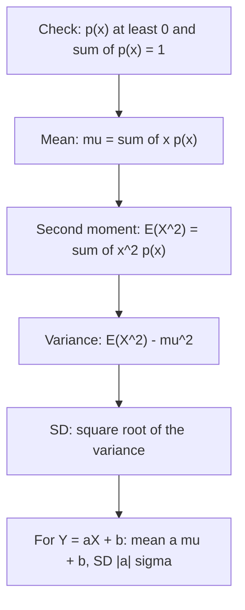

## From events to numbers

Module 1 worked with events: did something happen or not? Most questions in practice are
about *quantities*: how many defects, how long a wait, how much profit. A random variable
attaches a number to each outcome, and its distribution summarizes everything probability
can say about that number. This lesson introduces the two ways to describe a discrete
distribution (pmf and cdf) and the two most important summaries (expected value and
variance), with derivations of the rules you will use for the rest of the course.

## Random variables

A **random variable** is a function $X : S \to \mathbb{R}$ that assigns a real number to
each outcome. For two dice, $X(i, j) = i + j$ (the sum) is a random variable, and so is
$Y(i, j) = \max(i, j)$. Events about $X$ are events in $S$: "$X = 7$" is the set of
outcomes whose sum is 7.

$X$ is a **discrete random variable** if it takes a finite or countably infinite list of
values $x_1, x_2, \ldots$. (Continuous random variables, which take a whole interval of
values, are the subject of Module 3.)

A simple but powerful example is the **indicator variable** of an event $A$:
$I_A = 1$ if $A$ occurs and $0$ otherwise. Counting variables are sums of indicators — the
number of defective items is the sum of one indicator per item — and that observation will
make several later derivations nearly effortless.

## The pmf and the cdf

The **probability mass function** (pmf) of $X$ is

$$p(x) = P(X = x).$$

A function is a valid pmf exactly when $p(x) \ge 0$ for every $x$ and $\sum_x p(x) = 1$ (the
events $\{X = x_i\}$ partition $S$). Probabilities of sets of values are sums:
$P(X \in B) = \sum_{x \in B} p(x)$.

The **cumulative distribution function** (cdf) is

$$F(x) = P(X \le x) = \sum_{t \le x} p(t), \qquad -\infty < x < \infty.$$

Every cdf is nondecreasing, tends to 0 as $x \to -\infty$ and to 1 as $x \to \infty$, and is
right-continuous. For a discrete variable it is a **step function** that jumps by $p(x_i)$ at
each value $x_i$ and is flat in between. Two facts get used constantly:

$$P(a < X \le b) = F(b) - F(a), \qquad p(x_i) = F(x_i) - F(x_i^-) \text{ (the jump size)}.$$

For integer-valued $X$, watch the endpoints: $P(X < 5) = F(4)$ and $P(X \ge 5) = 1 - F(4)$.

The picture shows these features on the cdf of the defect count in Example 1 below, which takes the
values 0, 1, 2, 3 with probabilities 0.4, 0.3, 0.2, 0.1.


```plot
{"x": [1, 13], "y": [0, 0.2], "xLabel": "sum", "yLabel": "p(x)", "bars": [{"x": 2, "height": 0.02778, "width": 0.7}, {"x": 3, "height": 0.05556, "width": 0.7}, {"x": 4, "height": 0.08333, "width": 0.7}, {"x": 5, "height": 0.11111, "width": 0.7}, {"x": 6, "height": 0.13889, "width": 0.7}, {"x": 7, "height": 0.16667, "width": 0.7}, {"x": 8, "height": 0.13889, "width": 0.7}, {"x": 9, "height": 0.11111, "width": 0.7}, {"x": 10, "height": 0.08333, "width": 0.7}, {"x": 11, "height": 0.05556, "width": 0.7}, {"x": 12, "height": 0.02778, "width": 0.7}], "caption": "pmf of the sum of two fair dice: p(x) = (6 − |x − 7|)/36"}
```

## Expected value

The **expected value** (mean) of a discrete $X$ is the probability-weighted average of its
values:

$$E(X) = \mu = \sum_x x\,p(x),$$

provided the sum converges absolutely (otherwise $E(X)$ does not exist). Physically, it is the
balance point of the pmf viewed as masses $p(x)$ placed at positions $x$. Statistically, it is
the long-run average of many independent observations of $X$ — a fact made precise by the
law of large numbers in Module 5.

For an indicator, $E(I_A) = 1 \cdot P(A) + 0 \cdot P(A^c) = P(A)$: the expected value of an
indicator is the probability of its event.

## The law of the unconscious statistician

To find the mean of $Y = g(X)$, you do not need the pmf of $Y$:

$$E[g(X)] = \sum_x g(x)\,p(x).$$

**Why:** $E(Y) = \sum_y y\,P(Y = y)$. The event $\{Y = y\}$ is the disjoint union of
$\{X = x\}$ over all $x$ with $g(x) = y$, so $y\,P(Y = y) = \sum_{x : g(x) = y} g(x)\,p(x)$. Adding
over $y$ regroups the sum over all $x$. The rule is called the
**law of the unconscious statistician** (LOTUS) because people use it without noticing it needs a proof.

A key special case is the linear function $g(x) = ax + b$:

$$E(aX + b) = \sum (ax + b)p(x) = a\sum x\,p(x) + b\sum p(x) = aE(X) + b.$$

But for nonlinear $g$, in general $E[g(X)] \ne g(E(X))$. For example $E(X^2) \ne (EX)^2$ and
$E(1/X) \ne 1/E(X)$.

## Variance and standard deviation

The **variance** measures spread around the mean:

$$\operatorname{Var}(X) = \sigma^2 = E\big[(X - \mu)^2\big] = \sum_x (x - \mu)^2 p(x).$$

The **standard deviation** $\sigma = \sqrt{\operatorname{Var}(X)}$ is in the units of $X$. Expanding
the square and using linearity gives the **computing formula**:

$$E[(X - \mu)^2] = E(X^2) - 2\mu E(X) + \mu^2 = E(X^2) - \mu^2.$$

The second **moment** $E(X^2)$ is found with LOTUS. Since a variance is an expectation of a
square, it is never negative, so $E(X^2) \ge (EX)^2$ always.

For a linear function, the shift $b$ moves every value and the mean together, so it cannot
change spread; the scale $a$ multiplies every deviation:

$$\operatorname{Var}(aX + b) = E\big[(aX + b - a\mu - b)^2\big] = a^2\operatorname{Var}(X), \qquad \operatorname{SD}(aX + b) = |a|\,\sigma.$$

The steps for any pmf given as a table or formula:



### Example 1: defects in a lot

The number of defective units $X$ in a lot has pmf

| $x$ | 0 | 1 | 2 | 3 |
|---|---|---|---|---|
| $p(x)$ | 0.4 | 0.3 | 0.2 | 0.1 |

1. Valid: all entries are nonnegative and $0.4 + 0.3 + 0.2 + 0.1 = 1$.
2. cdf: $F(0) = 0.4$, $F(1) = 0.7$, $F(2) = 0.9$, $F(3) = 1$ (and flat in between).
   So $P(X \ge 2) = 1 - F(1) = 0.3$.
3. Mean: $\mu = 0(0.4) + 1(0.3) + 2(0.2) + 3(0.1) = 1.0$.
4. Second moment: $E(X^2) = 0 + 1(0.3) + 4(0.2) + 9(0.1) = 2.0$.
5. Variance: $2.0 - 1.0^2 = 1.0$, so $\sigma = 1.0$.

Each defective unit costs \$50 to fix and each lot has a fixed \$20 handling cost, so the
cost is $C = 50X + 20$. Then $E(C) = 50(1.0) + 20 = 70$ dollars and
$\operatorname{SD}(C) = 50(1.0) = 50$ dollars; the fixed \$20 does not affect the spread.

### Example 2: a pmf with a constant

Let $p(x) = cx$ for $x = 1, 2, 3, 4$.

1. Normalize: $c(1 + 2 + 3 + 4) = 10c = 1$, so $c = \tfrac{1}{10}$.
2. $E(X) = \sum x \cdot \tfrac{x}{10} = \tfrac{1 + 4 + 9 + 16}{10} = 3$.
3. $E(X^2) = \sum x^2 \cdot \tfrac{x}{10} = \tfrac{1 + 8 + 27 + 64}{10} = 10$, so
   $\operatorname{Var}(X) = 10 - 9 = 1$.
4. LOTUS with $g(x) = 1/x$: $E(1/X) = \sum \tfrac{1}{x} \cdot \tfrac{x}{10} = \tfrac{4}{10} = 0.4$,
   while $1/E(X) = \tfrac13 \approx 0.333$. The two differ, as expected for a nonlinear $g$.

### Example 3: the mean of a count via indicators

Ten passengers each independently miss a connection with probability 0.15. Let $N$ be the
number who miss. Write $N = I_1 + \cdots + I_{10}$, where $I_k$ indicates that passenger $k$
misses. Expected values add (a fact proved for sums in Module 4, and visible here because each
outcome's value of $N$ is the sum of its indicator values), so
$E(N) = 10 \times 0.15 = 1.5$ — no pmf of $N$ required. Lesson 6 finds that pmf.

## Common mistakes

- Treating $p(x)$ values that do not sum to 1 as a distribution.
- Off-by-one errors with the cdf of an integer variable: $P(X < k) = F(k - 1)$.
- Computing $\operatorname{Var}(X)$ as $E(X^2)$, forgetting to subtract $\mu^2$.
- Writing $\operatorname{Var}(aX + b) = a\operatorname{Var}(X) + b$; the shift drops out and the
  scale is squared.
- Assuming $E[g(X)] = g(E(X))$ for nonlinear $g$.

## Key points

- A random variable is a function on $S$; its pmf $p(x) = P(X = x)$ is nonnegative and sums to 1.
- The cdf $F(x) = P(X \le x)$ is a nondecreasing step function; $P(a < X \le b) = F(b) - F(a)$.
- $E(X) = \sum x\,p(x)$; LOTUS: $E[g(X)] = \sum g(x)p(x)$; $E(I_A) = P(A)$.
- $E(aX + b) = aE(X) + b$.
- $\operatorname{Var}(X) = E[(X - \mu)^2] = E(X^2) - \mu^2$; $\operatorname{Var}(aX + b) = a^2\operatorname{Var}(X)$.
