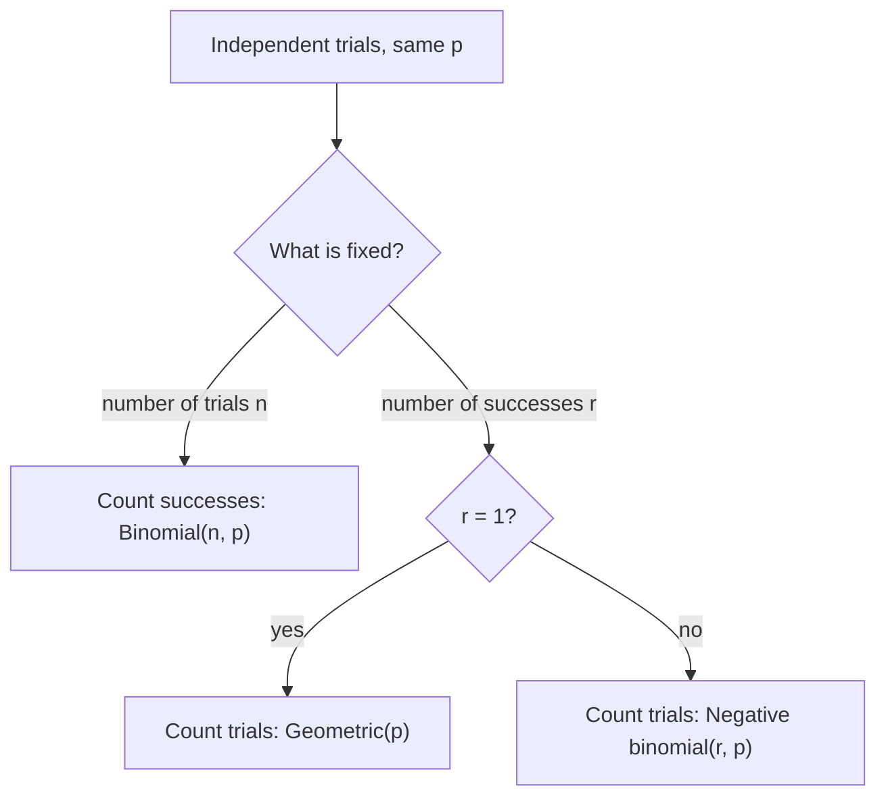

## Waiting for success

The binomial distribution fixes the number of trials and counts successes. Turn the question
around: fix the number of successes you need and count the trials it takes. How many scans
until a sensor first detects a signal? How many chips must be tested to find three that work?
These waiting-time variables have the geometric and negative binomial distributions. The
geometric distribution also has a striking property — it has no memory — that returns in its
continuous form (the exponential) in Module 3.

## The geometric distribution

Run independent Bernoulli$(p)$ trials until the first success, and let $X$ be the number of
trials needed (including the success). Then $X$ has the **geometric distribution**:

$$p(k) = (1 - p)^{k - 1} p, \qquad k = 1, 2, 3, \ldots$$

The first $k - 1$ trials must fail and the $k$-th must succeed; independence multiplies the
probabilities. Writing $q = 1 - p$, the probabilities form a geometric series, which sums to
$p/(1 - q) = 1$. Each bar of the pmf is $q$ times the previous one.

```plot
{"bars": [{"x": 1, "height": 0.3, "width": 0.7}, {"x": 2, "height": 0.21, "width": 0.7}, {"x": 3, "height": 0.147, "width": 0.7}, {"x": 4, "height": 0.1029, "width": 0.7}, {"x": 5, "height": 0.072, "width": 0.7}, {"x": 6, "height": 0.0504, "width": 0.7}, {"x": 7, "height": 0.0353, "width": 0.7}, {"x": 8, "height": 0.0247, "width": 0.7}, {"x": 9, "height": 0.0173, "width": 0.7}, {"x": 10, "height": 0.0121, "width": 0.7}, {"x": 11, "height": 0.0085, "width": 0.7}, {"x": 12, "height": 0.0059, "width": 0.7}, {"x": 13, "height": 0.0042, "width": 0.7}, {"x": 14, "height": 0.0029, "width": 0.7}], "x": [0, 15], "y": [0, 0.35], "xLabel": "k", "yLabel": "P(X = k)", "caption": "Geometric(0.3): each bar is 0.7 times the one before"}
```

**Tail probabilities.** "More than $k$ trials are needed" means "the first $k$ trials all fail," so

$$P(X > k) = q^k, \qquad F(k) = P(X \le k) = 1 - q^k.$$

This is usually quicker than summing the pmf.

**A second convention.** Some books count the failures *before* the first success,
$Y = X - 1 \in \{0, 1, 2, \ldots\}$, with $P(Y = k) = q^k p$. The two versions differ by a shift of
1, so $E(Y) = E(X) - 1$ and the variances agree. Always check which one a formula or calculator
uses; this course uses trials $X$.

## Mean and variance

**Mean.** For a variable with values in $\{1, 2, \ldots\}$, there is a useful **tail-sum formula**:
$E(X) = \sum_{k=0}^{\infty} P(X > k)$. (Each value $j$ is counted once for each $k = 0, \ldots, j - 1$,
that is, $j$ times.) For the geometric,

$$E(X) = \sum_{k=0}^{\infty} q^k = \frac{1}{1 - q} = \frac{1}{p}.$$

If each trial succeeds with probability 0.2, you wait 5 trials on average — intuitive.

**Variance.** Differentiate the geometric series $\sum_{k \ge 0} q^k = (1 - q)^{-1}$ twice:
$\sum_{k \ge 2} k(k-1)q^{k-2} = 2(1 - q)^{-3}$. So the factorial moment is

$$E[X(X-1)] = \sum_{k} k(k-1)q^{k-1}p = pq \cdot \frac{2}{p^3} = \frac{2q}{p^2},$$

and $\operatorname{Var}(X) = E[X(X-1)] + E(X) - (EX)^2 = \dfrac{2q}{p^2} + \dfrac{1}{p} - \dfrac{1}{p^2} = \dfrac{q}{p^2}$
(using $2q + p - 1 = q$). So $\sigma = \sqrt{q}/p$.

## Memorylessness

Suppose the first $m$ trials have failed. The chance that you need more than $n$ *additional*
trials is

$$P(X > m + n \mid X > m) = \frac{P(X > m + n)}{P(X > m)} = \frac{q^{m+n}}{q^m} = q^n = P(X > n).$$

The process "starts over" after every failure: past failures neither make success overdue nor
less likely. This **memoryless property** characterizes the geometric among distributions on
the positive integers: if $P(X > m + n) = P(X > m)P(X > n)$ for all $m, n$, then setting
$q = P(X > 1)$ gives $P(X > n) = q^n$ by induction. The belief that a long losing streak makes a
win "due" — the gambler's fallacy — is exactly a denial of memorylessness for independent
trials.

### Example 1: detecting a signal

On each scan a sensor detects a faint signal with probability 0.15, independently. Let $X$ be
the scan on which it is first detected.

1. $P(X = 4) = 0.85^3(0.15) \approx 0.0921$.
2. $P(X > 10) = 0.85^{10} \approx 0.1969$: about one time in five, ten scans are not enough.
3. $E(X) = 1/0.15 \approx 6.67$ scans, and $\sigma = \sqrt{0.85}/0.15 \approx 6.15$ scans. The SD is
   nearly as large as the mean — waiting times are highly variable.
4. After 10 failed scans, the chance of needing more than 5 more is
   $P(X > 15 \mid X > 10) = 0.85^5 \approx 0.444$, the same as for a fresh start.

## The negative binomial distribution

Now wait for the $r$-th success. Let $X$ be the number of trials needed. $X = k$ means the
$k$-th trial is a success *and* exactly $r - 1$ of the first $k - 1$ trials are successes. These
two events involve different trials, so they are independent, and the second is a binomial
probability. Hence $X$ has the **negative binomial distribution**:

$$p(k) = \binom{k - 1}{r - 1} p^r q^{k - r}, \qquad k = r, r + 1, \ldots$$

With $r = 1$ this is the geometric distribution.

**Mean and variance.** The trials until the first success, then the additional trials until
the second, and so on, are $r$ independent geometric waiting times (each restart is fresh, by
memorylessness). So $X = G_1 + \cdots + G_r$, and

$$E(X) = \frac{r}{p}, \qquad \operatorname{Var}(X) = \frac{rq}{p^2}.$$

(The mean uses only additivity of expectation; the variance uses the additivity of variances for
independent variables, proved in Module 4.)

For example, with $r = 3$ the run of trials F F S F S F F F S splits into waits of 3, 2 and 4 trials:


**Link to the binomial.** Needing more than $n$ trials for $r$ successes is the same event as
having fewer than $r$ successes in the first $n$ trials:

$$P(X > n) = P(\text{Bin}(n, p) \le r - 1).$$

### Example 2: testing chips

Each chip off a line works with probability 0.7, independently. A technician tests chips until
she has 3 that work. Let $X$ be the number tested.

1. $P(X = 5) = \binom{4}{2}(0.7)^3(0.3)^2 = 6 \times 0.343 \times 0.09 \approx 0.1852$.
   (Of the first 4 chips exactly 2 work, and the 5th works.)
2. $E(X) = 3/0.7 \approx 4.29$ chips; $\operatorname{Var}(X) = 3(0.3)/0.49 \approx 1.84$.
3. $P(X > 6) = P(\text{at most 2 working among the first 6}) = \sum_{j=0}^{2}\binom{6}{j}0.7^j 0.3^{6-j} \approx 0.0705$.

### Example 3: collecting a full set

Cereal boxes each contain one of 5 toys, equally likely and independently. How many boxes
must you buy, on average, to collect all 5? After you have $j$ distinct toys, each new box is
"new" with probability $(5 - j)/5$, so the wait for the next new toy is geometric with mean
$5/(5 - j)$. Adding the five waiting times,

$$E(\text{boxes}) = \frac55 + \frac54 + \frac53 + \frac52 + \frac51 = 5\left(1 + \tfrac12 + \tfrac13 + \tfrac14 + \tfrac15\right) \approx 11.42.$$

The last toy is the expensive one: its wait alone averages 5 boxes.

## Fixed trials or fixed successes?

The binomial and the negative binomial describe the same kind of independent trials and differ
only in what is fixed and what is counted:



## Common mistakes

- Mixing the "trials" and "failures" versions of the geometric (mean $1/p$ versus $q/p$).
- Using $P(X > k) = q^{k-1}$; more than $k$ trials means the first $k$ failed: $q^k$.
- Treating a long run of failures as making success more likely (the gambler's fallacy).
- In the negative binomial, using $\binom{k}{r}$ instead of $\binom{k-1}{r-1}$; the last trial is
  forced to be a success.

## Key points

- Geometric (trials to first success): $p(k) = q^{k-1}p$, $P(X > k) = q^k$, mean $1/p$, variance $q/p^2$.
- Memoryless: $P(X > m + n \mid X > m) = P(X > n)$.
- Negative binomial (trials to $r$-th success): $p(k) = \binom{k-1}{r-1}p^rq^{k-r}$, mean $r/p$,
  variance $rq/p^2$; it is a sum of $r$ independent geometrics.
- $P(\text{more than } n \text{ trials for } r \text{ successes}) = P(\text{Bin}(n, p) \le r - 1)$.
