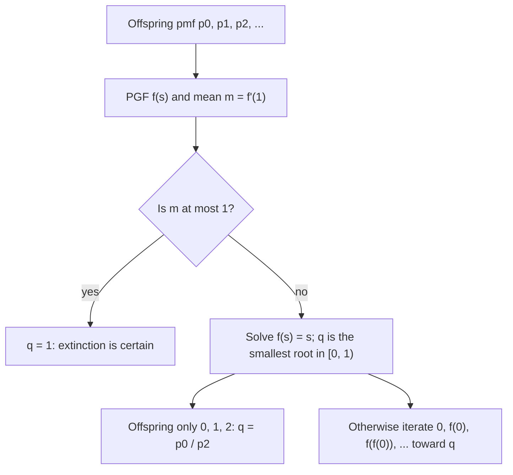

## A transform built for counts

Lesson 9 packed every moment of a distribution into the moment generating function $E(e^{tX})$
and used it to identify sums of independent variables. For variables that count things (values
$0, 1, 2, \ldots$) there is a close relative that is often easier to handle: replace $e^t$ by a
plain variable $s$. The result is a power series whose coefficients *are* the pmf. This lesson
develops that tool and then uses it on a problem that MGFs handle badly: a population in which
every individual has a random number of children. Will the family line survive forever, or die
out? The answer comes from solving one equation.

## The probability generating function

For a random variable $X$ with values in $\{0, 1, 2, \ldots\}$, the
**probability generating function** (PGF) is

$$G_X(s) = E\left(s^X\right) = \sum_{k=0}^{\infty} p(k)\,s^k = p(0) + p(1)s + p(2)s^2 + \cdots$$

The series converges at least for $|s| \le 1$, because its coefficients are probabilities that add
to 1. So, unlike an MGF, a PGF always exists on $[-1, 1]$. For $s > 0$, $G_X(s) = M_X(\ln s)$; the two
transforms carry the same information.

**Reading off the pmf.** $G_X$ is a power series, and the coefficient of $s^k$ in a power series is
its $k$-th derivative at 0 divided by $k!$:

$$p(k) = \frac{G_X^{(k)}(0)}{k!}, \qquad \text{in particular } G_X(0) = p(0).$$

So the PGF determines the distribution, and the proof of this uniqueness is just the uniqueness of
power series coefficients (no complex analysis needed).

**Reading off moments.** Differentiate term by term and set $s = 1$:

$$G_X(1) = 1, \qquad G_X'(1) = \sum k\,p(k) = E(X), \qquad G_X''(1) = \sum k(k-1)\,p(k) = E[X(X-1)].$$

Derivatives at 1 give the factorial moments of lessons 6 to 8, so

$$\operatorname{Var}(X) = G_X''(1) + G_X'(1) - [G_X'(1)]^2.$$

(If $E(X)$ is infinite, $G_X'(s) \to \infty$ as $s \to 1^-$; the formula needs finite moments.)

| Distribution | PGF $G(s)$ |
|---|---|
| Bernoulli$(p)$ | $q + ps$ |
| Binomial$(n, p)$ | $(q + ps)^n$ |
| Poisson$(\lambda)$ | $e^{\lambda(s - 1)}$ |
| Geometric$(p)$, trials | $\dfrac{ps}{1 - qs}$ |

Each entry is the matching MGF from lesson 9 with $e^t$ replaced by $s$.

**Sums.** If $X$ and $Y$ are independent, $G_{X+Y}(s) = E(s^X s^Y) = G_X(s)\,G_Y(s)$, for the same
reason as with MGFs. Multiplying PGFs is multiplying polynomials, which is exactly how the
probabilities of a sum are assembled: the coefficient of $s^k$ in the product collects every way
of splitting $k$ between $X$ and $Y$.

### Example 1: three dice

What is the probability that three fair dice total 10? One die has PGF
$\tfrac16(s + s^2 + \cdots + s^6) = \dfrac{s(1 - s^6)}{6(1 - s)}$, so the total $T$ has

$$G_T(s) = \frac{s^3(1 - s^6)^3}{216\,(1 - s)^3}.$$

We need the coefficient of $s^{10}$, that is, the coefficient of $s^7$ in $(1 - s^6)^3(1 - s)^{-3}$.

1. Expand $(1 - s^6)^3 = 1 - 3s^6 + 3s^{12} - s^{18}$; only $1$ and $-3s^6$ can contribute to $s^7$.
2. The series $(1 - s)^{-3} = \sum_{j \ge 0}\binom{j + 2}{2}s^j$ (differentiate the geometric series twice).
3. Coefficient of $s^7$: $\binom{9}{2} - 3\binom{3}{2} = 36 - 9 = 27$.

So $P(T = 10) = \tfrac{27}{216} = \tfrac18$. Listing all 216 outcomes gives the same count; the PGF
did the bookkeeping, and the same three steps work for 10 dice, where listing is hopeless.

## Random sums

Lesson 19 will treat sums whose *number of terms* is random. PGFs give their whole distribution
in one line. Let $N$ be a count, and let $X_1, X_2, \ldots$ be independent with common PGF $G_X$,
independent of $N$. Put $S = X_1 + \cdots + X_N$ (with $S = 0$ when $N = 0$). Conditioning on $N$
with the law of total probability,

$$G_S(s) = \sum_{n} P(N = n)\,E\left(s^{X_1 + \cdots + X_n}\right) = \sum_n P(N = n)\,[G_X(s)]^n = G_N\big(G_X(s)\big).$$

The PGF of a **random sum** is a *composition*. Differentiating with the chain rule at $s = 1$
gives $E(S) = G_N'(1)\,G_X'(1) = E(N)\,E(X)$, which is what intuition suggests.

### Example 2: thinning a Poisson count

Raw signals reach a detector as Poisson(6) per minute, and each one is recorded with probability
0.7, independently. Let $S$ be the number recorded in a minute. Each signal contributes a
Bernoulli(0.7) indicator, so

$$G_S(s) = G_N(0.3 + 0.7s) = e^{6(0.3 + 0.7s - 1)} = e^{4.2(s - 1)}.$$

That is the Poisson(4.2) PGF, so by uniqueness $S \sim \text{Poisson}(4.2)$, and for example
$P(S = 0) = e^{-4.2} \approx 0.0150$. Keeping each event of a Poisson count independently with
probability $p$ is called **thinning**; it always gives Poisson$(\lambda p)$. (One can also show that
the kept and discarded counts are independent of each other, a less obvious fact.)

## Branching processes

In 1873 Francis Galton asked in *The Educational Times* how likely a family surname is to die out.
Model it like this. Generation 0 is one individual. Each individual, independently of all others,
has a random number of children with pmf $p_0, p_1, p_2, \ldots$, the **offspring distribution**,
whose PGF we call $f(s)$ and whose mean is $m = f'(1)$. Let $Z_n$ be the size of generation $n$. This
is a **branching process** (a Galton–Watson process).


Generation $n + 1$ is the total offspring of the $Z_n$ individuals in generation $n$: a random sum.
By the composition rule, $G_{Z_{n+1}}(s) = G_{Z_n}(f(s))$, and since $G_{Z_1} = f$,

$$G_{Z_n} = f \circ f \circ \cdots \circ f \quad (n \text{ times}), \qquad E(Z_n) = m^n.$$

(The mean follows from the chain rule, or from $E(S) = E(N)E(X)$ applied generation by
generation.) The mean grows geometrically if $m > 1$ and shrinks to 0 if $m < 1$. Those cases are
called **supercritical** and **subcritical**; $m = 1$ is **critical**.

## The extinction probability

Write $f_n = f \circ \cdots \circ f$. Then $P(Z_n = 0) = f_n(0)$. Once the line dies it stays dead,
so these probabilities increase with $n$, and their limit is the
**extinction probability** $q = P(Z_n = 0 \text{ for some } n)$. Two facts pin $q$ down.

**$q$ is a fixed point of $f$.** Since $f_{n+1}(0) = f(f_n(0))$, letting $n \to \infty$ (with $f$
continuous) gives $q = f(q)$. Intuitively: the line dies out exactly when each of the first
generation's lines dies out, and given $Z_1 = k$ that has probability $q^k$; averaging over $k$ gives
$\sum p_k q^k = f(q)$.

**$q$ is the smallest fixed point in $[0, 1]$.** $f$ is increasing on $[0, 1]$. If $r = f(r)$ with
$0 \le r \le 1$, then $f(0) \le f(r) = r$, and if $f_n(0) \le r$ then
$f_{n+1}(0) = f(f_n(0)) \le f(r) = r$. So every $f_n(0) \le r$, and so $q \le r$.

Since $f(1) = 1$, the value $s = 1$ is always a fixed point. Whether there is a smaller one is
decided by the mean.


**Extinction theorem.** Exclude the trivial case $p_1 = 1$ (everyone has exactly one child, so the
line never changes). Then $q = 1$ if $m \le 1$, and $q < 1$ if $m > 1$.

*Why.* $f$ is convex on $[0, 1]$ (its second derivative $\sum k(k-1)p_k s^{k-2}$ is never negative),
so its graph lies above its tangent line at $s = 1$, which is $y = 1 - m(1 - s)$.

- If $m \le 1$: $f(s) \ge 1 - m(1 - s) \ge 1 - (1 - s) = s$ on $[0, 1]$, and the inequality is
  strict for $s < 1$ (strict convexity when some $p_k > 0$ with $k \ge 2$; otherwise
  $f(s) - s = p_0(1 - s)$ with $p_0 > 0$). The curve stays above the line, so 1 is the only fixed point.
- If $m > 1$: just below $s = 1$ the curve has slope bigger than 1, so it dips below the line,
  while at $s = 0$ it starts at $f(0) = p_0 \ge 0$, on or above the line. The curve must cross the
  line somewhere in $[0, 1)$, and the smallest crossing is $q$.

The critical case is striking: with $m = 1$, $E(Z_n) = 1$ for every $n$, yet extinction is
certain. The mean stays at 1 because the rare lines that survive become large.



### Example 3: a three-outcome offspring law

Each individual has 0, 1 or 2 children with probabilities $\tfrac14, \tfrac14, \tfrac12$.

1. $f(s) = \tfrac14 + \tfrac14 s + \tfrac12 s^2$ and $m = f'(1) = \tfrac14 + 1 = 1.25 > 1$, so survival is possible.
2. Fixed points: $\tfrac12 s^2 + \tfrac14 s + \tfrac14 = s$ gives $2s^2 - 3s + 1 = 0$, so
   $(2s - 1)(s - 1) = 0$ and $s = \tfrac12$ or $1$. The smallest is $q = \tfrac12$.
3. Check by iteration: $P(Z_1 = 0) = f(0) = 0.25$, $P(Z_2 = 0) = f(0.25) = 0.34375$,
   $P(Z_3 = 0) \approx 0.3950$, $P(Z_4 = 0) \approx 0.4268$, climbing toward 0.5.
4. Starting from 3 unrelated ancestors, the three lines evolve independently, so all die out with
   probability $q^3 = \tfrac18$ and at least one survives with probability $\tfrac78$.

A shortcut for offspring on $\{0, 1, 2\}$: the equation $p_2 s^2 + (p_1 - 1)s + p_0 = 0$ has roots
whose product is $p_0/p_2$, and one root is 1, so the other is $p_0/p_2$. Here
$0.25/0.5 = 0.5$. (Also $m - 1 = p_2 - p_0$, so $m > 1$ exactly when $p_0 < p_2$.)

```plot
{"x": [0, 1], "y": [0, 1], "equal": true, "xLabel": "s", "yLabel": "y", "functions": [{"f": "0.25 + 0.25*x + 0.5*x^2"}, {"f": "x", "dashed": true}], "segments": [{"from": [0, 0], "to": [0, 0.25], "dashed": true}, {"from": [0, 0.25], "to": [0.25, 0.25], "dashed": true}, {"from": [0.25, 0.25], "to": [0.25, 0.34375], "dashed": true}, {"from": [0.25, 0.34375], "to": [0.34375, 0.34375], "dashed": true}, {"from": [0.34375, 0.34375], "to": [0.34375, 0.39502], "dashed": true}, {"from": [0.34375, 0.39502], "to": [0.39502, 0.39502], "dashed": true}, {"from": [0.39502, 0.39502], "to": [0.39502, 0.42678], "dashed": true}], "points": [{"at": [0.5, 0.5]}, {"at": [1, 1]}], "labels": [{"at": [0.2, 0.37], "text": "f(s)"}, {"at": [0.7, 0.5], "text": "y = s"}, {"at": [0.4, 0.56], "text": "q = 0.5"}], "caption": "Iterating f from 0: the staircase climbs toward the smallest fixed point q = 0.5"}
```

### Example 4: a simplified outbreak model

Early in an outbreak, when almost everyone is susceptible, the number of people each case infects
is sometimes modeled as Poisson$(R)$, independently from case to case. This is a simplification:
it ignores the depletion of susceptible people, and real transmission is often far more variable
than Poisson. With $R = 1.5$, $f(s) = e^{1.5(s - 1)}$ and $q$ solves $q = e^{1.5(q - 1)}$, which
has no closed form. Iterate from 0:

$$0 \to 0.2231 \to 0.3118 \to 0.3562 \to 0.3807 \to 0.3950 \to \cdots \to q \approx 0.417.$$

So in this model a single introduced case fizzles out with probability about 0.42 even though
$R > 1$, and starts a large outbreak with probability about 0.58. With $R = 0.9$, $q = 1$.

Variability matters as well as the mean. If the offspring distribution keeps mean 1.5 but is
much more spread out (a few cases infect many, most infect none), the extinction probability goes
up; with a negative binomial offspring distribution of mean 1.5 and dispersion parameter 0.5 (a
common choice for such data, written in a mean-and-dispersion form rather than the trials form of
lesson 7) it is about 0.77. Lloyd-Smith and colleagues (2005) used this idea to
study "superspreading".

## A note on history

Galton's question was answered in the same journal by Henry William Watson, and the two published
a joint paper in 1875. Watson correctly found that the generation-$n$ PGF is the $n$-fold
composition of $f$, but he concluded that every surname dies out with probability 1, missing the
smaller root when $m > 1$. Irénée-Jules Bienaymé had stated the correct criterion in 1845 without a
surviving proof, and a full solution was published by J. F. Steffensen in 1930. The theory now
underlies models of nuclear chain reactions, cell populations, and the spread of mutations and
infections.

## Common mistakes

- Taking the root $s = 1$ as the answer when $m > 1$ (Watson's error); $q$ is the *smallest*
  root in $[0, 1]$.
- Reading $E(X)$ from $G_X'(0)$; that is $p(1)$. Moments come from derivatives at $s = 1$,
  probabilities from derivatives at $s = 0$.
- Using $G_X''(1)$ as the variance; it is $E[X(X - 1)]$, so add $G'(1)$ and subtract $G'(1)^2$.
- Writing the PGF of a random sum as $G_X(G_N(s))$; the count goes outside: $G_N(G_X(s))$.
- Concluding that $m = 1$ means the population holds steady; it dies out with probability 1.

## Key points

- $G_X(s) = E(s^X) = \sum p(k)s^k$; $p(k) = G^{(k)}(0)/k!$; $G'(1) = E(X)$; $G''(1) = E[X(X-1)]$.
- Independent sums multiply PGFs; a random sum composes them: $G_S = G_N \circ G_X$.
- Thinning a Poisson$(\lambda)$ count with probability $p$ gives Poisson$(\lambda p)$.
- In a branching process $G_{Z_n} = f \circ \cdots \circ f$ and $E(Z_n) = m^n$.
- The extinction probability is the smallest root of $f(s) = s$ in $[0, 1]$: it is 1 when $m \le 1$
  (unless $p_1 = 1$) and less than 1 when $m > 1$.
