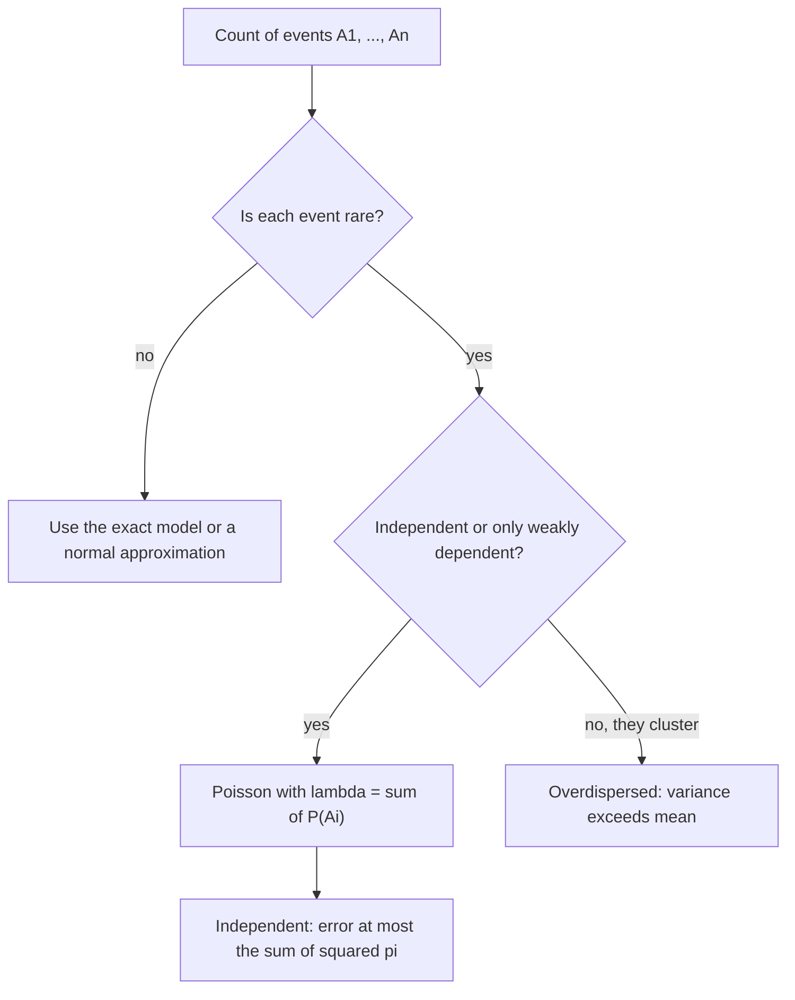

## Why rare events look Poisson

Lesson 8 derived the Poisson distribution as the limit of $\text{Bin}(n, \lambda/n)$ and gave a rule
of thumb for when $\text{Bin}(n, p) \approx \text{Poisson}(np)$. Real counts rarely fit that
mold exactly. The chance that a bridge needs emergency repair this year differs from bridge to
bridge; whether two people share a birthday is not independent of whether a third shares one with
either. Yet counts like these are very often close to Poisson. This lesson makes that precise in
three steps: a way to measure how far apart two distributions are, a theorem that bounds the
error of the Poisson approximation with unequal probabilities, and a rule of thumb for weakly
dependent events, tested on one of the most famous small data sets in statistics.

## Measuring the error: total variation distance

To say "approximately Poisson" honestly, we need a number for the error. For two random variables
$X$ and $Y$ with values in $\{0, 1, 2, \ldots\}$, the **total variation distance** is the largest
amount by which they can disagree about the probability of any event:

$$d_{TV}(X, Y) = \max_{A}\,\big|P(X \in A) - P(Y \in A)\big| = \frac12\sum_{k}\big|P(X = k) - P(Y = k)\big|.$$

**Why the two forms agree.** Let $B$ be the set of $k$ where $P(X = k) > P(Y = k)$. Taking $A = B$
collects every positive difference, and no other set does better. Because both pmfs add to 1, the
positive differences and the negative differences have the same total size, so the positive part
is exactly half of the full sum of absolute differences.

The meaning is practical: if $d_{TV} \le 0.01$, then *every* probability computed from the
approximation (a single value, a tail, an interval) is within 0.01 of the truth. Note that this is
an absolute error. A probability of 0.008 approximated by 0.010 is within 0.01 but off by 25%.

## Le Cam's inequality

Let $I_1, \ldots, I_n$ be independent indicators with $P(I_i = 1) = p_i$, possibly all different,
and let $S = I_1 + \cdots + I_n$. The distribution of $S$ is called the
**Poisson binomial distribution**; its pmf has no simple formula. Put $\lambda = \sum p_i = E(S)$.
**Le Cam's inequality** (Lucien Le Cam, 1960) says

$$d_{TV}\big(S, \text{Poisson}(\lambda)\big) \le \sum_{i=1}^{n} p_i^2.$$

For the binomial, every $p_i = p$, and the bound is $np^2 = \lambda p$. The message: the error is
controlled by how small the *individual* probabilities are, not by how large $n$ is. With
$\lambda = 2$, the bound is $2p$ whether $n$ is 40 or 4,000, so it shrinks only as $p$ does.

**Why it is true: a coupling.** The proof is a pleasing trick: build $S$ and a Poisson variable
$T$ on the same sample space so that they are usually *equal*. Such a joint construction is
called a **coupling**. Two facts make it work.

1. If $S$ and $T$ live on the same sample space, then for any set $A$,
   $P(S \in A) - P(T \in A) = P(S \in A, T \notin A) - P(T \in A, S \notin A) \le P(S \ne T)$,
   and the same holds with $S$ and $T$ swapped. So $d_{TV}(S, T) \le P(S \ne T)$.
2. For one indicator with success probability $p$, take a random number $U$ spread evenly over
   $(0, 1)$ (the uniform distribution of Module 3). Set $I = 1$ when $U > 1 - p$, and let $Y$ be
   the Poisson$(p)$ value read off from $U$: $Y = 0$ when $U \le e^{-p}$, $Y = 1$ when
   $e^{-p} < U \le e^{-p}(1 + p)$, and so on. Since $1 - p \le e^{-p}$, the two agree when
   $U \le 1 - p$ (both 0) and when $e^{-p} < U \le e^{-p}(1 + p)$ (both 1). They disagree with
   probability $[e^{-p} - (1 - p)] + [1 - e^{-p}(1 + p)] = p(1 - e^{-p}) \le p^2$.

Do this independently for each $i$ and let $T = Y_1 + \cdots + Y_n$. By lesson 9, a sum of
independent Poissons is Poisson$(\sum p_i) = \text{Poisson}(\lambda)$. The sums can differ only if
some pair $(I_i, Y_i)$ differs, so by Boole's inequality $P(S \ne T) \le \sum p_i^2$. Fact 1 finishes
the proof.

Sharper results exist. Barbour and Hall (1984), using a method of Louis Chen built on ideas of
Charles Stein, showed that the bound can be multiplied by $(1 - e^{-\lambda})/\lambda$, which is
much smaller than 1 when $\lambda$ is large.

### Example 1: the welds of lesson 8

$X \sim \text{Bin}(500, 0.004)$, approximated by Poisson(2).

1. Le Cam: $d_{TV} \le 500(0.004)^2 = 0.008$.
2. Barbour–Hall: $0.008 \times (1 - e^{-2})/2 \approx 0.0035$.
3. The actual distance, computed from both pmfs, is about 0.0009, consistent with the table in
   lesson 8 where the probabilities agreed to about three decimals.

The bounds are cautious, but they are guarantees. Compare $\text{Bin}(12, 0.25)$ against Poisson(3):
Le Cam gives only $12(0.25)^2 = 0.75$, which says nothing useful, and the true distance is about
0.07. With $p = 0.25$ the individual events are not rare, and the Poisson is a poor fit.

### Example 2: unequal probabilities

Five structures on a line have independent chances 0.02, 0.05, 0.01, 0.03 and 0.04 of needing
emergency repair in a year. Let $S$ be the number that do.

1. $\lambda = 0.02 + 0.05 + 0.01 + 0.03 + 0.04 = 0.15$ and $\sum p_i^2 = 0.0055$.
2. $P(S = 0)$ exactly is $0.98 \times 0.95 \times 0.99 \times 0.97 \times 0.96 \approx 0.8583$;
   the approximation gives $e^{-0.15} \approx 0.8607$.
3. $P(S \ge 2)$ exactly is about 0.0081; Poisson gives $1 - e^{-0.15}(1.15) \approx 0.0102$.

Both errors are below 0.0055, as promised. The second is small in absolute terms but about 26% in
relative terms: total variation protects absolute error only.

## The Poisson paradigm

Now drop independence. Suppose $A_1, \ldots, A_n$ are events, each with small probability, and most
pairs are independent or nearly so. Let $X$ be the number that occur and $\lambda = \sum P(A_i)$.
The **Poisson paradigm** is the rule of thumb that

$$X \approx \text{Poisson}(\lambda), \qquad \text{in particular} \quad P(\text{none occur}) \approx e^{-\lambda}.$$

This is a heuristic, not a theorem. Louis Chen (1975) turned it into theorems with explicit error
bounds that include terms for the dependence; those bounds are beyond this course.

**A check you can compute.** $X(X - 1)$ counts the *ordered pairs* $(i, j)$, $i \ne j$, with both $A_i$
and $A_j$ occurring. Taking expectations of indicators,

$$E[X(X - 1)] = \sum_{i \ne j} P(A_i \cap A_j).$$

For a Poisson$(\lambda)$ variable, $E[X(X - 1)] = \lambda^2$ (lesson 8). So compare the pair sum with
$\lambda^2$. If it is close, the second moment agrees with Poisson. If it is much larger, the events
cluster (one tends to bring others), and since $\operatorname{Var}(X) = E[X(X-1)] + \lambda - \lambda^2$,
the variance exceeds the mean: the overdispersion of lesson 8.



### Example 3: matches in a shuffle

Ten letters are put into their ten addressed envelopes at random. Let $X$ be the number that land in
the right envelope, with $A_i$ = "letter $i$ is in its own envelope". Lesson 2 found that
$P(X = 0) \to e^{-1}$ as $n$ grows; the paradigm predicts the whole distribution.

1. $P(A_i) = \tfrac{1}{10}$, so $\lambda = 1$.
2. The events are dependent, but only mildly: $P(A_i \cap A_j) = \tfrac{1}{10} \cdot \tfrac19$, against
   $\tfrac{1}{100}$ for independent events.
3. Pair check: $E[X(X - 1)] = 10 \cdot 9 \cdot \tfrac{1}{90} = 1 = \lambda^2$, so
   $\operatorname{Var}(X) = 1 + 1 - 1 = 1$, exactly the Poisson(1) value.

| $k$ | 0 | 1 | 2 | 3 | 4 |
|---|---|---|---|---|---|
| exact, $n = 10$ | 0.3679 | 0.3679 | 0.1839 | 0.0613 | 0.0153 |
| Poisson(1) | 0.3679 | 0.3679 | 0.1839 | 0.0613 | 0.0153 |

The two agree to four decimals.

### Example 4: shared birthdays

Among 23 people with birthdays independent and equally likely over 365 days (ignoring February 29),
let $X$ be the number of *pairs* sharing a birthday. There are $\binom{23}{2} = 253$ pairs, each
sharing with probability $\tfrac{1}{365}$, so $\lambda = 253/365 \approx 0.693$.

The pair events are weakly dependent. Two pairs with no person in common are independent; two that
share a person, such as $\{1, 2\}$ and $\{1, 3\}$, are also independent (each has probability
$\tfrac{1}{365}$ and both happen with probability $\tfrac{1}{365^2}$). But the three pairs of a triangle
are not jointly independent: if 1 matches 2 and 1 matches 3, then 2 matches 3. The paradigm gives
$P(\text{no shared birthday}) \approx e^{-0.693} \approx 0.500$; the exact value from lesson 2 is
0.4927. The approximation also explains *why* 23 is the break-even size: $\binom{n}{2}/365$ first
exceeds $\ln 2 \approx 0.693$ at $n = 23$.

## The law of small numbers

In 1898 Ladislaus von Bortkiewicz published a book titled *Das Gesetz der kleinen Zahlen* (*The Law of
Small Numbers*), arguing that counts of rare events in large populations follow the Poisson
distribution. His best-known data are deaths from horse kicks in Prussian army corps. In the
commonly quoted subset of 10 corps over the 20 years 1875–1894 (200 corps-years), there were 122
deaths:

| deaths in a corps-year | 0 | 1 | 2 | 3 | 4 |
|---|---|---|---|---|---|
| observed corps-years | 109 | 65 | 22 | 3 | 1 |
| expected from Poisson(0.61) | 108.7 | 66.3 | 20.2 | 4.1 | 0.6 |

The mean is $122/200 = 0.61$, and the sample variance is also about 0.61, as a Poisson count
requires. Each soldier had a tiny chance of such a death, and deaths were roughly independent: the
setting of Le Cam's inequality.

```plot
{"x": [-0.7, 4.7], "y": [0, 120], "xLabel": "deaths in a corps-year", "yLabel": "corps-years", "bars": [{"x": -0.18, "height": 109, "width": 0.34, "color": "#2f6fa8"}, {"x": 0.18, "height": 108.7, "width": 0.34, "color": "#c05621"}, {"x": 0.82, "height": 65, "width": 0.34, "color": "#2f6fa8"}, {"x": 1.18, "height": 66.3, "width": 0.34, "color": "#c05621"}, {"x": 1.82, "height": 22, "width": 0.34, "color": "#2f6fa8"}, {"x": 2.18, "height": 20.2, "width": 0.34, "color": "#c05621"}, {"x": 2.82, "height": 3, "width": 0.34, "color": "#2f6fa8"}, {"x": 3.18, "height": 4.1, "width": 0.34, "color": "#c05621"}, {"x": 3.82, "height": 1, "width": 0.34, "color": "#2f6fa8"}, {"x": 4.18, "height": 0.6, "width": 0.34, "color": "#c05621"}], "caption": "Horse-kick deaths: observed corps-years (blue, left of each pair) and Poisson(0.61) expected counts (orange, right)"}
```

A good fit is evidence, not proof, that the events behave like independent rare events; other
mechanisms can produce similar counts. Lesson 33's goodness-of-fit test measures how well a model
fits such a table.

## Common mistakes

- Applying the Poisson approximation because $n$ is large, when the individual $p_i$ are not small;
  the error bound is $\sum p_i^2$, not something that shrinks with $n$.
- Reading a total variation bound as a relative error; tiny tail probabilities can be off by a
  large percentage.
- Treating the paradigm as exact. It is a rule of thumb; only for independent indicators does Le
  Cam's inequality give a guaranteed error bound.
- Applying the paradigm to clustered events (outbreaks, crashes caused by one storm); positive
  dependence makes the variance larger than the mean.
- Counting unordered pairs in $E[X(X - 1)]$; it sums over ordered pairs $i \ne j$.

## Key points

- $d_{TV}(X, Y) = \max_A |P(X \in A) - P(Y \in A)| = \tfrac12\sum_k |P(X = k) - P(Y = k)|$.
- Le Cam: a sum of independent Bernoulli$(p_i)$ is within $\sum p_i^2$ of Poisson$(\sum p_i)$ in total variation.
- Coupling: $d_{TV}(S, T) \le P(S \ne T)$ for variables built on one sample space.
- Poisson paradigm (heuristic): many rare, weakly dependent events give a count near Poisson$(\lambda)$
  with $\lambda = \sum P(A_i)$, so $P(\text{none}) \approx e^{-\lambda}$.
- Check: $E[X(X-1)] = \sum_{i \ne j} P(A_i \cap A_j)$ should be close to $\lambda^2$.
