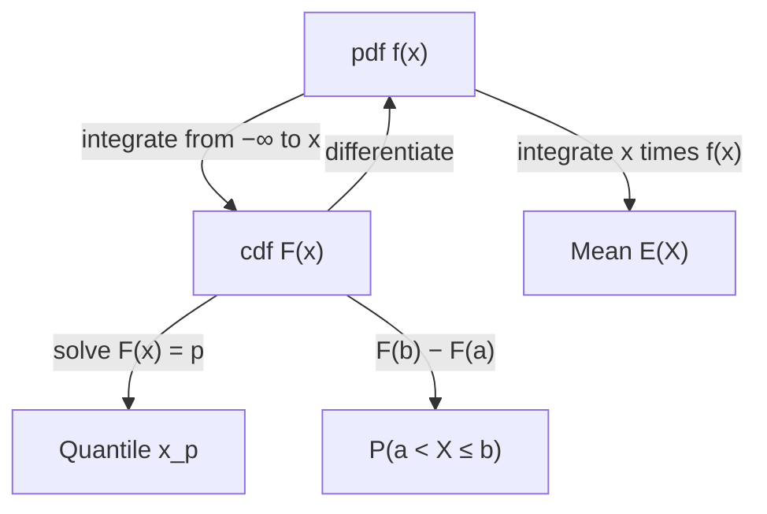

## From sums to integrals

A waiting time, a voltage or the strength of a steel bar can take any value in an interval.
For such variables, the probability of any single exact value is zero — there are too many
values for each to carry positive mass — so a pmf is useless. Instead, probability is spread
continuously along the line with a *density*, and probabilities become areas. Every idea from
Module 2 carries over with sums replaced by integrals: pmf becomes pdf, $\sum x\,p(x)$ becomes
$\int x f(x)\,dx$. This lesson sets up that machinery carefully, including what happens when an
integral fails to converge.

## Probability density functions

A random variable $X$ is a **continuous random variable** if there is a function $f$ such
that for all $a \le b$,

$$P(a \le X \le b) = \int_a^b f(x)\,dx.$$

The function $f$ is the **probability density function** (pdf) of $X$. A function is a valid
pdf exactly when

$$f(x) \ge 0 \text{ for all } x \qquad\text{and}\qquad \int_{-\infty}^{\infty} f(x)\,dx = 1.$$

Three consequences matter constantly:

- $P(X = a) = \int_a^a f = 0$, so $P(a < X < b) = P(a \le X \le b)$: strict and non-strict
  inequalities give the same probability.
- A density value is *not* a probability, and it can exceed 1 (uniform on $[0, 0.5]$ has height 2).
- What $f(x)$ does measure is probability per unit length near $x$:
  $P(x \le X \le x + \Delta x) \approx f(x)\,\Delta x$ for small $\Delta x$. That approximation is how
  densities are used in derivations, including the change-of-variables formula in lesson 14.

The picture below gathers the parts of a density picture. Probabilities are areas under the curve;
the height of the curve at a point is a density, not a probability; and the median is the point that
splits the total area of 1 into two halves.


## The cdf

The cdf is defined exactly as before, $F(x) = P(X \le x)$, and for a continuous variable

$$F(x) = \int_{-\infty}^{x} f(t)\,dt.$$

$F$ is continuous, nondecreasing, and goes from 0 to 1. By the Fundamental Theorem of Calculus,
$F'(x) = f(x)$ wherever $f$ is continuous, so you can go back and forth: integrate the pdf to get
the cdf, differentiate the cdf to get the pdf. Probabilities of intervals are
$P(a < X \le b) = F(b) - F(a)$.

The **quantile** of order $p$ (the $100p$-th **percentile**) is the value $x_p$ with $F(x_p) = p$.
The **median** is $x_{0.5}$, the point that splits the area in half. When $F$ has a closed form,
quantiles come from solving $F(x) = p$ algebraically.

This diagram summarizes how the pdf, the cdf and the quantities computed from them are linked.



## Expectation and variance

The definitions mirror the discrete ones:

$$E(X) = \int_{-\infty}^{\infty} x f(x)\,dx, \qquad E[g(X)] = \int_{-\infty}^{\infty} g(x) f(x)\,dx,$$

the second being the continuous LOTUS. The mean exists only if $\int |x| f(x)\,dx < \infty$.
Linearity, $E(aX + b) = aE(X) + b$, follows from linearity of the integral, and so do

$$\operatorname{Var}(X) = E[(X - \mu)^2] = E(X^2) - \mu^2, \qquad \operatorname{Var}(aX + b) = a^2\operatorname{Var}(X).$$

**Tail formula.** For a nonnegative continuous $X$,

$$E(X) = \int_0^{\infty} P(X > x)\,dx.$$

*Why:* write $t = \int_0^t 1\,dx$, so $E(X) = \int_0^\infty \left(\int_0^t dx\right) f(t)\,dt$. Swapping the
order of integration (the region is $0 \le x \le t$) gives $\int_0^\infty \left(\int_x^\infty f(t)\,dt\right)dx = \int_0^\infty P(X > x)\,dx$.
It is the continuous version of the tail-sum formula from lesson 7, and it is often the
quickest route when the cdf is simple.

### Example 1: a power density

Let $f(x) = cx^2$ for $0 \le x \le 3$ and 0 elsewhere.

1. Normalize: $\int_0^3 cx^2\,dx = c \cdot \dfrac{27}{3} = 9c = 1$, so $c = \tfrac19$.
2. $P(X < 2) = \int_0^2 \tfrac{x^2}{9}\,dx = \dfrac{8}{27} \approx 0.296$.
3. Mean: $E(X) = \int_0^3 x \cdot \tfrac{x^2}{9}\,dx = \dfrac{1}{9}\cdot\dfrac{81}{4} = 2.25$.
4. $E(X^2) = \int_0^3 \tfrac{x^4}{9}\,dx = \dfrac{243}{45} = 5.4$, so $\operatorname{Var}(X) = 5.4 - 2.25^2 = 0.3375$
   and $\sigma \approx 0.581$.
5. cdf: $F(x) = x^3/27$ on $[0, 3]$ (0 to the left, 1 to the right). Median: $m^3/27 = \tfrac12$
   gives $m = 3 \cdot 2^{-1/3} \approx 2.381$.

```plot
{"x": [-0.3, 3.5], "y": [-0.05, 1.1], "xLabel": "x", "yLabel": "f(x)", "functions": [{"f": "x^2/9", "from": 0, "to": 3}], "shade": [{"f": "x^2/9", "from": 0, "to": 2}], "segments": [{"from": [3, 0], "to": [3, 1], "dashed": true}], "caption": "f(x) = x²/9 on [0, 3]; the shaded area is P(X < 2) = 8/27"}
```

The median (2.381) exceeds the mean (2.25): the density piles up on the right with a long
thin tail to the left, a left-skewed shape.

### Example 2: a triangular density

Let $f(x) = x$ on $[0, 1]$, $f(x) = 2 - x$ on $[1, 2]$, and 0 elsewhere — a triangle with base 2
and height 1, so its area is 1.

1. cdf: for $0 \le x \le 1$, $F(x) = x^2/2$. For $1 \le x \le 2$, $F(x) = \tfrac12 + \int_1^x (2 - t)\,dt = 1 - \dfrac{(2 - x)^2}{2}$.
2. $P(X \le 1.5) = 1 - \dfrac{0.5^2}{2} = 0.875$. (Geometrically: the unshaded corner is a
   triangle of area $\tfrac12 \cdot 0.5 \cdot 0.5$.)
3. The density is symmetric about 1, so $E(X) = 1$.
4. $E(X^2) = \int_0^1 x^3\,dx + \int_1^2 x^2(2 - x)\,dx = \tfrac14 + \left(\tfrac{14}{3} - \tfrac{15}{4}\right) = \tfrac76$,
   so $\operatorname{Var}(X) = \tfrac76 - 1 = \tfrac16$.

```plot
{"x": [-0.3, 2.4], "y": [-0.05, 1.2], "xLabel": "x", "yLabel": "f(x)", "functions": [{"f": "x", "from": 0, "to": 1}, {"f": "2 - x", "from": 1, "to": 2, "color": "#2c5e8f"}], "shade": [{"f": "x", "from": 0, "to": 1}, {"f": "2 - x", "from": 1, "to": 1.5, "color": "#2c5e8f"}], "caption": "Triangular density on [0, 2]; shaded area P(X ≤ 1.5) = 0.875"}
```

This is the density of the sum of two independent uniform$(0, 1)$ variables — a fact you will
be able to derive in Module 4.

### Example 3: a heavy tail

Suppose $F(x) = 1 - x^{-2}$ for $x \ge 1$ (and 0 for $x < 1$), a Pareto distribution used for
sizes of files, losses and floods.

1. pdf: $f(x) = F'(x) = 2x^{-3}$ for $x \ge 1$.
2. Median: $1 - m^{-2} = \tfrac12$ gives $m = \sqrt2 \approx 1.414$.
3. Mean by the tail formula: $P(X > x) = 1$ for $x < 1$ and $x^{-2}$ for $x \ge 1$, so
   $E(X) = \int_0^1 1\,dx + \int_1^\infty x^{-2}\,dx = 1 + 1 = 2$.
4. But $E(X^2) = \int_1^\infty x^2 \cdot 2x^{-3}\,dx = \int_1^\infty \tfrac{2}{x}\,dx = \infty$. The
   variance is infinite.

A finite mean with an infinite variance is not a curiosity: sample averages from such
distributions settle down very slowly, and they are typical of quantities dominated by rare
huge values. A density can also have *no* mean at all, such as $f(x) = \dfrac{1}{\pi(1 + x^2)}$
(the Cauchy distribution), for which $\int |x| f(x)\,dx$ diverges.

## Common mistakes

- Treating $f(x)$ as a probability, or expecting $f(x) \le 1$.
- Forgetting that a pdf must integrate to 1 when solving for a constant.
- Integrating a piecewise density with a single formula over the whole range.
- Computing $\operatorname{Var}(X)$ as $\int x^2 f(x)\,dx$ without subtracting $\mu^2$.
- Writing down $\int x f(x)\,dx$ without checking that it converges.

## Key points

- pdf: $f \ge 0$, $\int f = 1$, $P(a \le X \le b) = \int_a^b f$; $P(X = a) = 0$.
- cdf $F(x) = \int_{-\infty}^{x} f$; $F' = f$; quantile $x_p$ solves $F(x_p) = p$.
- $E(X) = \int x f$, $E[g(X)] = \int g f$, $\operatorname{Var}(X) = E(X^2) - \mu^2$, when the integrals converge.
- For $X \ge 0$: $E(X) = \int_0^\infty P(X > x)\,dx$.
- Heavy tails can make the variance, or even the mean, infinite.
