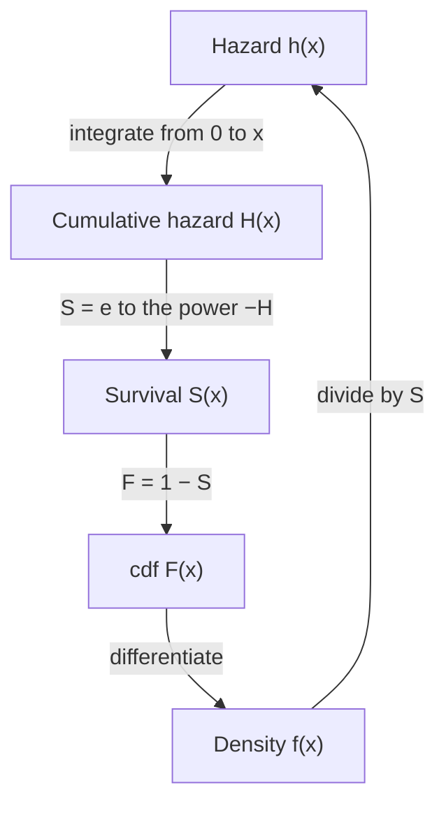

## Beyond "no aging"

Lesson 11 showed that the exponential distribution is memoryless: a used item is as good as a new
one, because its **hazard rate** $h(x) = f(x)/P(X > x)$ is the constant $\lambda$. That is a fine model
for a fuse that fails only from random surges, and a poor one for a bearing, a tire or a person,
whose risk of failing changes with age. Reliability engineers, actuaries and medical researchers
therefore describe a lifetime by *how its hazard changes over time*, and they often start from
the hazard rather than from the density. This lesson develops that point of view: how the
hazard determines the whole distribution, the Weibull family that the hazard view leads to
naturally, what happens to the hazard of a system built from several parts, and how much life a
survivor has left.

Throughout, $X \ge 0$ is a continuous lifetime with density $f$, cdf $F$ and survival function
$S(x) = P(X > x) = 1 - F(x)$.

## The hazard function determines the distribution

The hazard is a *conditional* failure rate. For a small $\Delta x$,

$$P(x < X \le x + \Delta x \mid X > x) = \frac{F(x + \Delta x) - F(x)}{S(x)} \approx \frac{f(x)\,\Delta x}{S(x)} = h(x)\,\Delta x.$$

So $h(x)\,\Delta x$ is the chance that an item that has survived to age $x$ fails in the next short
time $\Delta x$. Compare $f(x)\,\Delta x$, the chance that a *new* item fails in that window. A hazard
can exceed 1 (it is a rate per unit time, not a probability), and units matter: a hazard of
0.002 per hour is 0.048 per day.

Because $S'(x) = -f(x)$,

$$h(x) = \frac{f(x)}{S(x)} = -\frac{S'(x)}{S(x)} = -\frac{d}{dx}\ln S(x).$$

Integrate from 0 to $x$, using $S(0) = 1$. The **cumulative hazard function**
$H(x) = \int_0^x h(t)\,dt$ satisfies $H(x) = -\ln S(x)$, so

$$S(x) = e^{-H(x)}, \qquad f(x) = h(x)\,e^{-H(x)}.$$

Any one of $f$, $F$, $S$, $h$ and $H$ gives all the others:



Not every nonnegative function is a hazard. Since $S(x) = e^{-H(x)}$ must fall to 0 as $x \to \infty$,
a hazard needs $\int_0^\infty h(t)\,dt = \infty$. A hazard such as $h(x) = 1/(1 + x)^2$ has a finite
total, $H(\infty) = 1$, and would leave $e^{-1} \approx 37\%$ of items alive forever. (Medical
"cure models" use exactly such defective distributions on purpose, for a fraction of patients who
never relapse.)

### Example 1: from a hazard to a distribution

A part's hazard grows in proportion to its age: $h(x) = 0.02x$ per year.

1. Cumulative hazard: $H(x) = \int_0^x 0.02t\,dt = 0.01x^2$.
2. Survival: $S(x) = e^{-0.01x^2} = e^{-(x/10)^2}$. So $P(X > 5) = e^{-0.25} \approx 0.779$ and
   $P(X > 10) = e^{-1} \approx 0.368$.
3. Median: $e^{-(m/10)^2} = \tfrac12$ gives $m = 10\sqrt{\ln 2} \approx 8.33$ years.
4. Density: $f(x) = h(x)S(x) = 0.02x\,e^{-0.01x^2}$.

This is a Weibull distribution with shape 2, as the next section shows.

## The Weibull distribution

Take the cumulative hazard to be a power of $x$, $H(x) = (x/s)^k$ with $k, s > 0$. Then

$$S(x) = e^{-(x/s)^k}, \qquad h(x) = \frac{k}{s}\left(\frac{x}{s}\right)^{k - 1}, \qquad f(x) = \frac{k}{s}\left(\frac{x}{s}\right)^{k - 1}e^{-(x/s)^k}, \qquad x \ge 0.$$

This is the **Weibull distribution** with **shape parameter** $k$ and **scale parameter** $s$. The
shape decides how risk changes with age:

- $k < 1$: decreasing hazard. Weak units fail early and the survivors are the strong ones.
- $k = 1$: constant hazard $1/s$, the exponential distribution with mean $s$.
- $k > 1$: increasing hazard, that is, wear-out. With $k = 2$ the hazard is linear, as in Example 1;
  this case is the **Rayleigh distribution**.

```plot
{"x": [0, 2.5], "y": [0, 4], "xLabel": "x", "yLabel": "h(x)", "functions": [{"f": "0.5*x^(-0.5)", "from": 0.015, "to": 2.5, "label": "k = 0.5"}, {"f": "1", "label": "k = 1"}, {"f": "2*x", "label": "k = 2"}, {"f": "3*x^2", "label": "k = 3"}], "caption": "Weibull hazards with scale s = 1: decreasing for k = 0.5, constant for k = 1, increasing for k = 2 and k = 3"}
```

The scale $s$ is called the **characteristic life**: at $x = s$, $F(s) = 1 - e^{-1} \approx 0.632$ for
*every* shape, so about 63% of units have failed by age $s$. Changing $s$ only stretches the time
axis.

**Mean and variance.** By the tail formula of lesson 10, $E(X) = \int_0^\infty e^{-(x/s)^k}\,dx$.
Substitute $u = (x/s)^k$, so $x = s\,u^{1/k}$ and $dx = \tfrac{s}{k}u^{1/k - 1}\,du$:

$$E(X) = \frac{s}{k}\int_0^\infty u^{1/k - 1}e^{-u}\,du = \frac{s}{k}\,\Gamma\!\left(\frac1k\right) = s\,\Gamma\!\left(1 + \frac1k\right),$$

using $\Gamma(\alpha + 1) = \alpha\Gamma(\alpha)$ from lesson 13. The same substitution gives
$E(X^2) = s^2\,\Gamma(1 + 2/k)$, so $\operatorname{Var}(X) = s^2\left[\Gamma(1 + 2/k) - \Gamma(1 + 1/k)^2\right]$.
For Example 1 ($k = 2$, $s = 10$) the mean is $10\,\Gamma(1.5) = 5\sqrt\pi \approx 8.86$ years.

**Percentiles.** Solving $1 - e^{-(x/s)^k} = p$ gives $x_p = s\,[-\ln(1 - p)]^{1/k}$. Engineers quote
the **B10 life**, the age by which 10% of units have failed: $x_{0.10} = s\,(-\ln 0.9)^{1/k}$.

**Where the name comes from.** The Swedish engineer Waloddi Weibull used this family in the
late 1930s for the breaking strength of materials and promoted it widely in a 1951 paper. His
reasoning was "weakest link": a chain breaks when its weakest link does, and the minimum of many
independent Weibull variables with the same shape is again Weibull (shown below). Today it is one
of the standard lifetime models for bearings, fatigue cracks, insulation and electronic parts.

### Example 2: a wearing bearing

A bearing's life in hours is Weibull with $k = 1.5$ and $s = 2000$.

1. $P(X > 1000) = e^{-(0.5)^{1.5}} = e^{-0.3536} \approx 0.702$.
2. A bearing that has run 1000 hours survives another 1000 with probability
   $\dfrac{S(2000)}{S(1000)} = \dfrac{e^{-1}}{e^{-0.3536}} = e^{-0.6464} \approx 0.524$, well below the 0.702 for a
   new bearing. Unlike the exponential, a used bearing is *worse* than a new one.
3. The hazard at 1000 hours is $\tfrac{1.5}{2000}(0.5)^{0.5} \approx 0.00053$ per hour; at 2000 hours it is
   $0.00075$ per hour.
4. B10 life: $2000\,(-\ln 0.9)^{1/1.5} = 2000\,(0.10536)^{2/3} \approx 446$ hours.
5. Mean life: $2000\,\Gamma(1 + \tfrac{1}{1.5}) = 2000\,\Gamma(\tfrac53) \approx 1805$ hours.

## Systems: hazards add in series

Lesson 4 treated a **series system**, which works only while every component works. If the
components have independent lifetimes $X_1, \dots, X_n$, the system lifetime is $T = \min(X_1, \dots, X_n)$ and

$$S_T(x) = P(\text{all } X_i > x) = \prod_{i=1}^{n} S_i(x) = e^{-\sum H_i(x)}.$$

So the cumulative hazards add, and differentiating, so do the hazards: $h_T(x) = \sum_i h_i(x)$. A
system of 50 parts each with a small hazard can have a large one.

For $n$ independent Weibull components with the same shape $k$ and scale $s$, $\sum H_i(x) = n(x/s)^k = (x/s')^k$
with $s' = s\,n^{-1/k}$. The system is Weibull with the same shape and a smaller scale, which is the
weakest-link property.

### Example 3: four parts in series

A unit has 4 independent parts in series, each Weibull with $k = 2$ and $s = 1000$ hours.

1. System scale: $s' = 1000 \cdot 4^{-1/2} = 500$ hours, shape still 2.
2. $P(T > 300) = e^{-(300/500)^2} = e^{-0.36} \approx 0.698$, against $e^{-0.09} \approx 0.914$ for one part.
3. Mean system life: $500\,\Gamma(1.5) \approx 443$ hours, half the single-part mean of about 886.

## The bathtub curve

Many manufactured products show three phases in the hazard over their life: a falling hazard
early on (defective units fail and drop out), a long flat stretch of chance failures, and a rising
hazard as wear sets in. This shape is called the **bathtub curve**.


It is an idealization, not a law: many items show only one or two of the phases, and software does
not wear out physically at all. Still, it explains common practice. When the early hazard is falling,
manufacturers run new units for a while before shipping them, called **burn-in**, so that the
weak ones fail in the factory. Once the hazard is rising, scheduled replacement makes sense; while
it is flat (exponential lifetimes), replacing a working part early buys nothing.

Human mortality has a bathtub shape too. In adulthood it is roughly described by the
**Gompertz distribution**, $h(x) = a\,e^{bx}$, proposed by Benjamin Gompertz in 1825: in many
populations the adult death rate roughly doubles every 8 years or so, which means $b \approx \ln 2/8$
per year. (Treat the 8 as a rough, population-dependent figure.)

## Mean residual life

For an item that has survived to age $t$, the expected remaining life is the **mean residual life**

$$m(t) = E(X - t \mid X > t) = \frac{1}{S(t)}\int_t^\infty S(x)\,dx,$$

which is the tail formula applied to the conditional survival function $S(t + y)/S(t)$. At $t = 0$ it
is just $E(X)$.

### Example 4: three kinds of aging

1. Exponential with rate $\lambda$: $m(t) = \dfrac{e^{-\lambda t}/\lambda}{e^{-\lambda t}} = \dfrac1\lambda$ for every $t$. No aging.
2. Uniform on $(0, 10)$: $S(x) = (10 - x)/10$, $\int_t^{10} S = (10 - t)^2/20$, so $m(t) = \dfrac{10 - t}{2}$. The
   remaining life shrinks steadily: at $t = 6$ it is 2.
3. The Rayleigh lifetime of Example 1 has $m(0) \approx 8.86$ years but $m(10) \approx 3.79$ years (computed
   numerically). An increasing hazard makes the mean residual life fall.

A decreasing hazard does the opposite: survivors of a weak-start population expect *more* remaining
life than new units.

## Common mistakes

- Reading the hazard as a probability. It is a rate; only $h(x)\,\Delta x$ for a short $\Delta x$ is a
  (conditional) probability.
- Confusing $f(x)$, the failure density of a new item, with $h(x)$, the failure rate of a survivor.
- Writing $S(x) = e^{-h(x)}$. The exponent is the *cumulative* hazard $H(x)$.
- Taking the Weibull mean to be $s$. The mean is $s\,\Gamma(1 + 1/k)$; $s$ is the 63rd percentile.
- Adding survival probabilities, or multiplying hazards, for a series system. Survival
  probabilities multiply and hazards add.

## Key points

- $h = f/S = -(\ln S)'$; $H(x) = \int_0^x h$; $S = e^{-H}$; any one of $f, F, S, h, H$ determines the rest.
- Weibull$(k, s)$: $S = e^{-(x/s)^k}$, $h = \tfrac{k}{s}(x/s)^{k-1}$; $k < 1$ decreasing, $k = 1$ exponential, $k > 1$ increasing.
- Weibull mean $s\,\Gamma(1 + 1/k)$; $x_p = s[-\ln(1 - p)]^{1/k}$; $F(s) \approx 0.632$ for every $k$.
- Independent components in series: hazards add; $n$ identical Weibulls give scale $s\,n^{-1/k}$.
- Mean residual life $m(t) = \int_t^\infty S/S(t)$: constant for the exponential, falling under wear-out.
