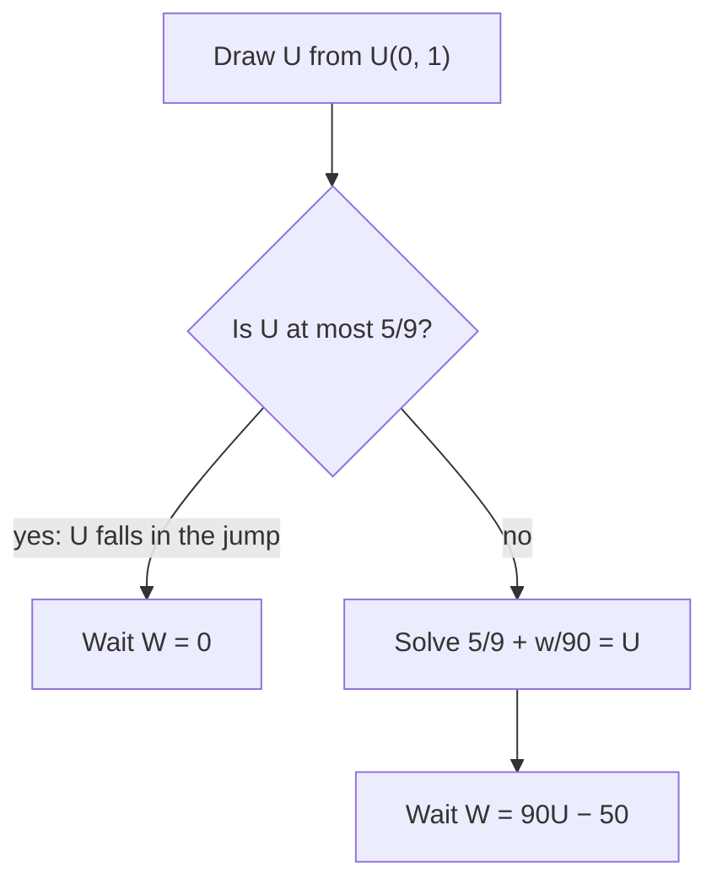

## Neither discrete nor continuous

Modules 2 and 3 split random variables into two kinds: discrete ones with a pmf and continuous
ones with a pdf. Many real quantities are neither. Your wait at a traffic light is exactly 0
whenever the light is green, and otherwise any length of time. The amount an insurer pays on a
policy with a deductible is exactly 0 for small losses and continuous above. Daily rainfall is 0 on
dry days. A component on a 500-hour life test either fails at some continuous time or is still
running when the test stops, and then all you record is "more than 500." This lesson handles all
of these with one tool, the cdf, which every random variable has. It also shows how to take
quantiles and simulate draws when the cdf has jumps or flat stretches, which completes the
inverse transform method of lesson 14.

## What every cdf looks like

For *any* random variable, $F(x) = P(X \le x)$ is nondecreasing, tends to 0 at $-\infty$ and to 1 at
$+\infty$, and is **right-continuous**: $F(x) = \lim_{t \downarrow x} F(t)$. (Right-continuity comes from
the $\le$ in the definition: the events $\{X \le x + 1/n\}$ shrink down to $\{X \le x\}$.)

A cdf may jump. The size of the jump at $a$ is the probability of that exact value:

$$P(X = a) = F(a) - F(a^-), \qquad F(a^-) = \lim_{t \uparrow a} F(t).$$

A value with $P(X = a) > 0$ is a **point mass** (or atom). A discrete variable's cdf is all jumps; a
continuous variable's cdf has none. A **mixed random variable** has both: some point masses, plus
probability spread out with a density between them. Its cdf can be written as a weighted average
$F = p\,F_d + (1 - p)\,F_c$ of a discrete cdf $F_d$ and a continuous one $F_c$, where $p$ is the total
probability sitting in the point masses.

(For completeness: measure theory allows a third, "singular" kind of distribution, whose cdf is
continuous but has no density, such as the Cantor distribution. It does not arise in applied work
and is not needed here.)

## Probabilities and expectations

Compute probabilities straight from $F$, watching the endpoints, since $\le$ and $<$ now differ at a
point mass:

$$P(a < X \le b) = F(b) - F(a), \qquad P(a \le X \le b) = F(b) - F(a^-).$$

For expectations, add the two parts: the point masses as in a discrete sum, the rest as an integral of
$x$ times the *unnormalized* density $F'(x)$ where $F$ is differentiable:

$$E(X) = \sum_{\text{atoms } a} a\,P(X = a) + \int x\,F'(x)\,dx.$$

For a nonnegative $X$ there is a cleaner route that needs no splitting at all. The tail formula
holds for every nonnegative random variable:

$$E(X) = \int_0^\infty P(X > x)\,dx = \int_0^\infty \big(1 - F(x)\big)\,dx.$$

### Example 1: the traffic light

A light is red for 40 seconds and green for 50 seconds, in a 90-second cycle (ignore amber). You
arrive at a time uniform over the cycle. Your wait $W$ is 0 if the light is green; if it is red, the
remaining red time is uniform on $(0, 40)$.

1. Point mass: $P(W = 0) = \tfrac{50}{90} = \tfrac59$.
2. cdf: for $0 \le w \le 40$, $F(w) = \tfrac59 + \tfrac49\cdot\tfrac{w}{40}$; $F(w) = 0$ for $w < 0$ and 1 for $w \ge 40$.
3. $P(W > 30) = \tfrac49\cdot\tfrac{10}{40} = \tfrac19$.
4. Mean, by the split formula: $0\cdot\tfrac59 + \int_0^{40} w\cdot\tfrac{1}{90}\,dw = \tfrac{800}{90} \approx 8.89$ seconds. By the tail
   formula: $\int_0^{40}\tfrac49\left(1 - \tfrac{w}{40}\right)dw = \tfrac49 \cdot 20$, the same.
5. Median: $F(0) = \tfrac59 > \tfrac12$, so the median wait is 0. Most drivers do not wait, yet the mean
   wait is almost 9 seconds.

```plot
{"x": [-8, 50], "y": [0, 1.1], "xLabel": "w (seconds)", "yLabel": "F(w)", "functions": [{"f": "0", "from": -8, "to": 0}, {"f": "5/9 + x/90", "from": 0, "to": 40}, {"f": "1", "from": 40, "to": 50}], "points": [{"at": [0, 0], "open": true}, {"at": [0, 0.5556], "label": "jump of 5/9"}], "segments": [{"from": [0, 0], "to": [0, 0.5556], "dashed": true}], "caption": "cdf of the wait W: a jump of 5/9 at w = 0 (the point mass), then a straight climb to 1 at w = 40"}
```

## Censoring, limits and deductibles

Mixed variables arise whenever a continuous quantity is cut off. Let $X \ge 0$ be continuous with
survival function $S(x) = P(X > x)$.

**Capping.** $Y = \min(X, c)$ equals $X$ below $c$ and has a point mass $P(Y = c) = S(c)$. Since
$P(Y > y) = S(y)$ for $y < c$ and 0 after, the tail formula gives the **limited expected value**

$$E[\min(X, c)] = \int_0^c S(x)\,dx.$$

This is the setting of **censoring** in a life test: an item still running when the test stops at
time $c$ is recorded as "survived past $c$," not as a failure time. Treating such censored times as
failures at $c$ biases the estimated mean life downward; survival analysis has special methods (such
as the Kaplan–Meier estimator) to use them correctly.

**Deductibles.** With a deductible $d$, the insurer pays $(X - d)^+ = \max(X - d, 0)$. It has a point
mass at 0 of size $F(d)$, and $P\big((X - d)^+ > y\big) = S(d + y)$, so

$$E[(X - d)^+] = \int_d^\infty S(x)\,dx.$$

Note $\min(X, d) + (X - d)^+ = X$, so the two expectations add up to $E(X)$: the deductible splits each
loss between policyholder and insurer.

### Example 2: insurance claims

Losses are exponential with mean 2000 dollars, and the policy has a deductible of 500.

1. No payment: $P(X \le 500) = 1 - e^{-0.25} \approx 0.221$.
2. Expected payment per loss: $\int_{500}^\infty e^{-x/2000}\,dx = 2000\,e^{-0.25} \approx 1557.60$ dollars.
3. Expected payment *given* a payment is made: $1557.60/e^{-0.25} = 2000$. By memorylessness, the
   excess over the deductible is again exponential with mean 2000.
4. Add a cap so the insurer pays at most 4000 (losses above 4500 pay 4000). The payment is
   $\min\big((X - 500)^+, 4000\big)$, with expectation $\int_{500}^{4500} e^{-x/2000}\,dx = 2000(e^{-0.25} - e^{-2.25}) \approx 1346.80$.
   This variable has two point masses, at 0 and at 4000.

### Example 3: a censored life test

Component lives are exponential with mean 1000 hours, and a test stops at 500 hours. The recorded
time is $T = \min(X, 500)$.

1. $P(\text{censored}) = P(X > 500) = e^{-0.5} \approx 0.607$: most items outlast the test.
2. $E(T) = \int_0^{500} e^{-x/1000}\,dx = 1000(1 - e^{-0.5}) \approx 393.5$ hours, far below the true mean of 1000.
   That gap is the bias you get by averaging censored times as if they were failures.

## The general quantile function

Lesson 10 defined the $p$-quantile as the solution of $F(x) = p$. With a jump, there may be no
solution (in Example 1, $F(w) = 0.3$ has none); on a flat stretch there are infinitely many. The fix
works for every distribution. The **quantile function** (or generalized inverse) is

$$F^{-1}(u) = \min\{x : F(x) \ge u\}, \qquad 0 < u < 1.$$

The minimum exists because $F$ is right-continuous. Where $F$ is continuous and strictly increasing,
this is the ordinary inverse. At a jump, every $u$ inside the jump goes to the jump point; on a flat
stretch, $F^{-1}$ picks the left end.

With this definition, *inverse transform sampling works for every distribution*: if $U \sim \text{U}(0, 1)$,
then $X = F^{-1}(U)$ has cdf $F$, because $F^{-1}(u) \le x \iff u \le F(x)$ (a consequence of
right-continuity), so $P(F^{-1}(U) \le x) = P(U \le F(x)) = F(x)$.



### Example 4: simulating from jumps

1. Traffic light: with $U = 0.8$, $U > \tfrac59$, so $W = 90(0.8) - 50 = 22$ seconds. With $U = 0.3$, $W = 0$.
2. A fair die: $F$ jumps by $\tfrac16$ at 1, 2, …, 6, and $F^{-1}(u) = \lceil 6u \rceil$. With $U = 0.52$,
   $\lceil 3.12 \rceil = 4$.
3. Bernoulli$(p)$: $F^{-1}(u) = 0$ for $u \le 1 - p$ and 1 otherwise.

One part of lesson 14 does *not* extend: $F(X)$ is uniform only when $F$ is continuous. For a
Bernoulli$(0.3)$ variable, $F(X)$ takes just the two values 0.7 and 1.

## Common mistakes

- Looking for a pdf of a mixed variable and forcing it to integrate to 1. The continuous part
  integrates to $1 - p$, not 1; the rest sits in point masses.
- Ignoring the endpoint at a point mass: $P(W \ge 0) = 1$ but $P(W > 0) = \tfrac49$ in Example 1.
- Averaging censored times as if they were failure times, which underestimates the mean.
- Solving $F(x) = u$ when $F$ jumps. Use $\min\{x : F(x) \ge u\}$.
- Claiming $F(X)$ is uniform for a discrete or mixed $X$.

## Key points

- Every cdf is nondecreasing and right-continuous with limits 0 and 1; a jump of size $F(a) - F(a^-)$ is a point mass $P(X = a)$.
- Mixed variable: point masses plus a density part; $E(X) = \sum a\,P(X = a) + \int x\,F'(x)\,dx$.
- For $X \ge 0$: $E(X) = \int_0^\infty P(X > x)\,dx$ always; $E[\min(X, c)] = \int_0^c S$; $E[(X - d)^+] = \int_d^\infty S$.
- Censored observations are "longer than $c$," not failures at $c$.
- $F^{-1}(u) = \min\{x : F(x) \ge u\}$; $F^{-1}(U)$ has cdf $F$ for every distribution.
