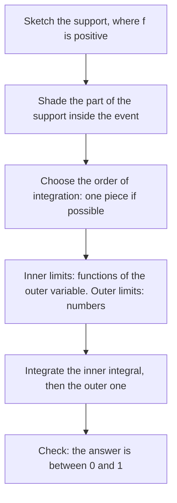

## Two random variables at once

So far every random variable has been studied on its own. Real questions usually involve
several at once: the delay of a train *and* the number of passengers waiting, the height
*and* the weight of a person, the measured gauge of a rail at two points a metre apart.
To answer "what is the chance the delay is long *and* the platform is crowded?" we need a
single description of both variables together. That description is a **joint distribution**. This lesson builds it for discrete and continuous pairs, shows how to
recover each variable's own distribution from it, and practices the skill that makes or
breaks continuous problems: setting up a double integral over the right region.

## Discrete pairs: the joint pmf

For discrete random variables $X$ and $Y$, the **joint probability mass function** is

$$p(x, y) = P(X = x,\; Y = y).$$

It must satisfy $p(x, y) \ge 0$ and $\sum_x \sum_y p(x, y) = 1$, and for any set $A$ of pairs,
$P\big((X, Y) \in A\big) = \sum_{(x, y) \in A} p(x, y)$. With few values the joint pmf is just a
table.

Suppose an inspector checks one bogie and records $X$, the number of worn brake pads (0, 1
or 2), and $Y$, whether a wheel flat is present (0 or 1). Long-run records give

$$\begin{array}{c|cc|c} & y = 0 & y = 1 & p_X(x) \\ \hline x = 0 & 0.30 & 0.10 & 0.40 \\ x = 1 & 0.20 & 0.15 & 0.35 \\ x = 2 & 0.10 & 0.15 & 0.25 \\ \hline p_Y(y) & 0.60 & 0.40 & 1 \end{array}$$

The row and column totals in the margins are the **marginal distributions** of $X$ and $Y$.
They come from the law of total probability: the event $\{X = x\}$ splits into the disjoint
pieces $\{X = x, Y = y\}$ over all $y$, so

$$p_X(x) = \sum_y p(x, y), \qquad p_Y(y) = \sum_x p(x, y).$$

### Example 1

Using the table, find $P(X > Y)$ and $P(X + Y \le 1)$.

1. List the cells where $x > y$: $(1, 0)$, $(2, 0)$ and $(2, 1)$. Add them:
   $P(X > Y) = 0.20 + 0.10 + 0.15 = 0.45$.
2. Cells with $x + y \le 1$: $(0, 0)$, $(0, 1)$, $(1, 0)$. So
   $P(X + Y \le 1) = 0.30 + 0.10 + 0.20 = 0.60$.

Every probability about the pair is a sum over the cells of an event, exactly as with a single
variable, only now the "sample space" is a grid.

## Continuous pairs: the joint pdf

For continuous $X$ and $Y$, probabilities are volumes. A **joint probability density function** $f(x, y)$ satisfies $f(x, y) \ge 0$, $\iint_{\mathbb{R}^2} f(x, y)\,dA = 1$, and for every
(reasonable) region $A$ in the plane

$$P\big((X, Y) \in A\big) = \iint_A f(x, y)\,dA.$$

Think of the density as a surface over the plane: the probability of a region is the volume
under the surface above that region. A density value is *not* a probability; for a tiny
rectangle, $P(x < X < x + \Delta x,\; y < Y < y + \Delta y) \approx f(x, y)\,\Delta x\,\Delta y$.

The set where $f > 0$ is the **support**. Most of the work in continuous problems is drawing
the support and the event, intersecting them, and reading off the limits of integration.

The same five steps work for every such problem:



The **joint cumulative distribution function** is $F(x, y) = P(X \le x,\, Y \le y)$. For
continuous pairs $F(x, y) = \int_{-\infty}^{x}\int_{-\infty}^{y} f(s, t)\,dt\,ds$, and differentiating
gives back $f = \partial^2 F / \partial x\,\partial y$.

## Marginal densities

Why does integrating out $y$ give the density of $X$? Write
$P(X \le a) = P(X \le a,\; -\infty < Y < \infty) = \int_{-\infty}^{a} \left[\int_{-\infty}^{\infty} f(x, y)\,dy\right] dx.$
The bracket is a function of $x$ whose integral up to $a$ is the cdf of $X$, so by the
Fundamental Theorem of Calculus it is the density of $X$:

$$f_X(x) = \int_{-\infty}^{\infty} f(x, y)\,dy, \qquad f_Y(y) = \int_{-\infty}^{\infty} f(x, y)\,dx.$$

This is the continuous version of adding across a row. In practice the integral runs only
over the part of the support above the fixed $x$, and those limits can depend on $x$.

### Example 2

Let $f(x, y) = c\,xy$ on the triangle $0 < y < x < 1$ (zero elsewhere).
(a) Find $c$. (b) Find both marginal densities. (c) Find $P(X + Y < 1)$.

```plot
{"x": [-0.1, 1.15], "y": [-0.1, 1.15], "equal": true, "xLabel": "x", "yLabel": "y", "polygons": [{"points": [[0, 0], [1, 0], [1, 1]]}, {"points": [[0, 0], [1, 0], [0.5, 0.5]], "fill": true}], "functions": [{"f": "1 - x", "dashed": true, "from": 0, "to": 1}], "labels": [{"at": [0.82, 0.62], "text": "support: 0 < y < x < 1"}, {"at": [0.5, 0.15], "text": "x + y < 1"}], "caption": "The triangular support and the part of it where x + y < 1"}
```

(a) For a fixed $x$ in $(0, 1)$, $y$ runs from 0 up to the diagonal $y = x$. So

$$1 = \int_0^1 \int_0^x c\,xy\,dy\,dx = \int_0^1 c\,x \cdot \frac{x^2}{2}\,dx = \frac{c}{8},$$

giving $c = 8$.

(b) For $X$: fix $x \in (0, 1)$ and integrate over $0 < y < x$:
$f_X(x) = \int_0^x 8xy\,dy = 4x^3$ for $0 < x < 1$.
For $Y$: fix $y \in (0, 1)$; now $x$ runs from the diagonal $x = y$ to 1:
$f_Y(y) = \int_y^1 8xy\,dx = 4y(1 - y^2)$ for $0 < y < 1$.
Check: $\int_0^1 4x^3\,dx = 1$ and $\int_0^1 (4y - 4y^3)\,dy = 2 - 1 = 1$.

(c) The shaded region is the part of the triangle below the line $x + y = 1$. The two lines
$y = x$ and $y = 1 - x$ meet at $(\tfrac12, \tfrac12)$. It is easiest to integrate $x$ first: for each
$y \in (0, \tfrac12)$, $x$ runs from $y$ to $1 - y$.

$$P(X + Y < 1) = \int_0^{1/2} \int_y^{1-y} 8xy\,dx\,dy = \int_0^{1/2} 4y\big[(1-y)^2 - y^2\big]\,dy = \int_0^{1/2} (4y - 8y^2)\,dy = \frac12 - \frac13 = \frac16.$$

Integrating $y$ first would split the region at $x = \tfrac12$ into two pieces; choosing the order
that keeps one piece saves work.

### Example 3: uniform on a region

If $(X, Y)$ is **uniformly distributed on a region** $R$ of area $|R|$, the density is the
constant $1/|R|$ on $R$. Then every probability is an area ratio:
$P((X, Y) \in A) = |A \cap R| / |R|$.

Two maintenance crews each arrive at a random time in a one-hour window, so the point
$(X, Y)$ is uniform on the unit square. What is the chance the second crew arrives more than
40 minutes after the first? The event $Y - X > \tfrac23$ is the triangle with vertices
$(0, \tfrac23)$, $(0, 1)$, $(\tfrac13, 1)$, whose area is $\tfrac12 \cdot \tfrac13 \cdot \tfrac13 = \tfrac1{18}$.
Since the square has area 1, the probability is $\tfrac{1}{18} \approx 0.056$.

## Marginals do not determine the joint

Knowing both marginals is *not* enough to recover the joint distribution. In the inspection
table, the margins $(0.40, 0.35, 0.25)$ and $(0.60, 0.40)$ would also be consistent with a table
whose cells are the products of the margins (that table is $0.24, 0.16; 0.21, 0.14; 0.15, 0.10$).
The two tables describe different worlds: in the original, flats are more common when pads
are worn. The joint distribution carries information about how the variables move
together, which is exactly what the next lessons (independence, covariance, conditioning)
extract.

## Common mistakes

- *Constant limits on a non-rectangular support.* On the triangle $0 < y < x < 1$, the inner
  limits depend on the outer variable. Writing $\int_0^1\int_0^1$ integrates over a square and
  gives the wrong answer.
- *Forgetting where the marginal is zero.* Always state the range: $f_X(x) = 4x^3$ *for
  $0 < x < 1$*, and 0 otherwise.
- *Integrating out the wrong variable.* To get $f_X$, integrate with respect to $y$; the
  answer must be a function of $x$ only.
- *Treating $f(x, y)$ as a probability.* Densities can exceed 1 (here $f(0.9, 0.8) = 5.76$);
  only integrals of $f$ are probabilities.
- *Assuming the joint is the product of the marginals.* That holds only under independence
  (next lesson).

## Key points

- Discrete: $p(x, y) = P(X = x, Y = y)$; probabilities are sums over cells.
- Continuous: $P((X, Y) \in A) = \iint_A f\,dA$; $f \ge 0$ and integrates to 1.
- Marginals: sum or integrate out the other variable, e.g. $f_X(x) = \int f(x, y)\,dy$.
- Sketch the support and the event; their intersection sets the limits.
- Uniform on a region: probability = area of event ÷ area of region.
- Marginals alone don't determine the joint distribution.
