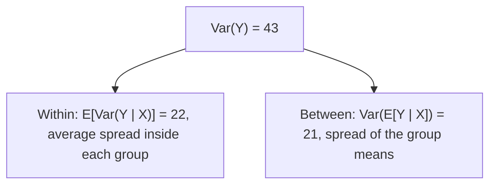

## Averages that depend on what you know

A conditional distribution describes $Y$ once $X$ is known. Its mean, the conditional
expectation, is the best single guess for $Y$ given $X$, and it is one of the most useful tools
in probability. Many hard expectations become easy when you first condition on the right
variable, compute an inner average, then average that. This lesson makes "condition, then
average" precise for means (the law of total expectation) and for variances (the law of total
variance).

## Conditional expectation

The **conditional expectation** of $Y$ given $X = x$ is the mean of the conditional
distribution:

$$E[Y \mid X = x] = \sum_y y\,p_{Y \mid X}(y \mid x) \quad\text{or}\quad E[Y \mid X = x] = \int_{-\infty}^{\infty} y\,f_{Y \mid X}(y \mid x)\,dy.$$

For each $x$ this is a number, so as $x$ varies it is a function $g(x)$; its graph is the
**regression function** of $Y$ on $X$. Plugging in the random $X$ gives a *random variable*,
written $E[Y \mid X] = g(X)$. It is random because it depends on which value of $X$ occurs.

Similarly, the **conditional variance** is the variance of the conditional distribution,

$$\operatorname{Var}(Y \mid X = x) = E[Y^2 \mid X = x] - \big(E[Y \mid X = x]\big)^2,$$

and $\operatorname{Var}(Y \mid X)$ is the random variable obtained by plugging in $X$.

### Example 1

For $f(x, y) = 8xy$ on $0 < y < x < 1$ we found $f_{Y \mid X}(y \mid x) = 2y/x^2$ on $0 < y < x$. Then

$$E[Y \mid X = x] = \int_0^x y \cdot \frac{2y}{x^2}\,dy = \frac{2}{x^2}\cdot\frac{x^3}{3} = \frac{2x}{3},$$

so $E[Y \mid X] = \tfrac23 X$: on average $Y$ sits two-thirds of the way up its allowed range. Likewise
$E[Y^2 \mid X = x] = \int_0^x 2y^3/x^2\,dy = x^2/2$, so $\operatorname{Var}(Y \mid X = x) = \tfrac{x^2}{2} - \tfrac{4x^2}{9} = \tfrac{x^2}{18}$.

```plot
{"x": [-0.1, 1.15], "y": [-0.1, 1.15], "equal": true, "xLabel": "x", "yLabel": "y", "polygons": [{"points": [[0, 0], [1, 0], [1, 1]], "fill": true}], "functions": [{"f": "2x/3", "from": 0, "to": 1, "label": "E[Y | X = x] = 2x/3"}], "caption": "The regression function runs through the triangular support at two-thirds of its height"}
```

## The law of total expectation

$$E\big[E[Y \mid X]\big] = E[Y].$$

*Why.* In the continuous case, $E[E[Y \mid X]] = \int g(x) f_X(x)\,dx$ with
$g(x) = \int y\,f(x, y)/f_X(x)\,dy$. The $f_X(x)$ cancels:

$$\int\!\!\int y\,\frac{f(x, y)}{f_X(x)}\,dy\; f_X(x)\,dx = \iint y\,f(x, y)\,dy\,dx = E[Y].$$

In words: average the conditional averages, weighting each by how likely its condition is. In
the discrete case this is the familiar $E[Y] = \sum_x E[Y \mid X = x]\,P(X = x)$, the law of total
probability for means. Check with Example 1: $E[Y] = E[\tfrac23 X] = \tfrac23 \cdot \tfrac45 = \tfrac8{15}$, matching the
direct calculation in the covariance lesson.

## The law of total variance

$$\operatorname{Var}(Y) = E\big[\operatorname{Var}(Y \mid X)\big] + \operatorname{Var}\big(E[Y \mid X]\big).$$

*Why.* Write $g(X) = E[Y \mid X]$. Since $\operatorname{Var}(Y \mid X) = E[Y^2 \mid X] - g(X)^2$, the law of total
expectation gives $E[\operatorname{Var}(Y \mid X)] = E[Y^2] - E[g(X)^2]$. Also
$\operatorname{Var}(g(X)) = E[g(X)^2] - (E[g(X)])^2 = E[g(X)^2] - (E[Y])^2$. Add the two lines: the $E[g(X)^2]$ terms
cancel and leave $E[Y^2] - (E[Y])^2 = \operatorname{Var}(Y)$.

The two terms have a clean meaning. Total variation in $Y$ = the *average variation within*
each condition + the *variation between* the conditional means. This is the same split
that analysis of variance (Module 8) is built on.

### Example 2: a mixture of two suppliers

Brake blocks come from supplier A (70% of stock) with wear life mean 50 and SD 4 (thousand km),
or supplier B (30%) with mean 60 and SD 6. A block is picked at random. Find the mean and SD of
its life $Y$.

Let $X$ indicate the supplier.

1. $E[Y] = 0.7(50) + 0.3(60) = 53$.
2. Within-supplier part: $E[\operatorname{Var}(Y \mid X)] = 0.7(16) + 0.3(36) = 22$.
3. Between-supplier part: $E[Y \mid X]$ is 50 or 60, so
   $\operatorname{Var}(E[Y \mid X]) = 0.7(50 - 53)^2 + 0.3(60 - 53)^2 = 6.3 + 14.7 = 21$.
4. $\operatorname{Var}(Y) = 22 + 21 = 43$ and $\operatorname{SD}(Y) \approx 6.56$.

Averaging the two SDs (or variances) would miss the 21 units that come from the suppliers
having different means.



The density of $Y$ is the mixture $0.7f_A + 0.3f_B$. If each supplier's life is roughly normal, it looks like this: one wide hump with a shoulder on the right, wider than either supplier's own curve.

```plot
{"x": [35, 80], "y": [0, 0.11], "xLabel": "life (thousand km)", "yLabel": "density", "functions": [{"f": "0.7*exp(-(x-50)^2/32)/sqrt(32*pi) + 0.3*exp(-(x-60)^2/72)/sqrt(72*pi)"}, {"f": "exp(-(x-50)^2/32)/sqrt(32*pi)", "dashed": true}, {"f": "exp(-(x-60)^2/72)/sqrt(72*pi)", "dashed": true}], "caption": "Dashed: supplier A (taller, left) and supplier B (right), normal shapes assumed. Solid: the mixture 0.7 A + 0.3 B, mean 53, SD 6.56"}
```

### Example 3: a random sum

The number of trains $N$ through a junction in an hour is Poisson with mean 12. Train $i$
carries $X_i$ passengers, with mean $\mu = 150$ and SD $\sigma = 40$, independent of each other and of
$N$. Find the mean and SD of the total $T = X_1 + \cdots + X_N$.

Condition on $N$. Given $N = n$, $T$ is a sum of $n$ independent terms, so
$E[T \mid N] = N\mu$ and $\operatorname{Var}(T \mid N) = N\sigma^2$.

1. $E[T] = E[N\mu] = \mu E[N] = 150 \times 12 = 1800$.
2. $\operatorname{Var}(T) = E[N\sigma^2] + \operatorname{Var}(N\mu) = \sigma^2 E[N] + \mu^2\operatorname{Var}(N) = 1600(12) + 22500(12) = 289{,}200$.
3. $\operatorname{SD}(T) \approx 538$ passengers.

Most of the variability comes from not knowing how many trains arrive ($\mu^2\operatorname{Var}N$), not
from train-to-train loads. The formulas $E[T] = \mu E[N]$ and
$\operatorname{Var}(T) = \sigma^2E[N] + \mu^2\operatorname{Var}(N)$ hold for any such **random sum**.

### Example 4: a hierarchical model

In the cable example of the conditional-distributions lesson, $X \sim \text{Uniform}(0, 1)$ and
$Y \mid X \sim \text{Uniform}(0, X)$. Then $E[Y \mid X] = X/2$ and $\operatorname{Var}(Y \mid X) = X^2/12$ (the uniform
variance formula on an interval of length $X$). So

$$E[Y] = E[X/2] = \tfrac14, \qquad \operatorname{Var}(Y) = E\Big[\frac{X^2}{12}\Big] + \operatorname{Var}\Big(\frac{X}{2}\Big) = \frac{1/3}{12} + \frac{1/12}{4} = \frac{7}{144}.$$

No integral of the awkward marginal $-\ln y$ was needed.

## The best predictor

Why is $E[Y \mid X]$ called a prediction? Among all functions $h(X)$, it minimizes the mean
squared error $E[(Y - h(X))^2]$. The reason mirrors the one-variable fact that $c = E[Y]$
minimizes $E[(Y - c)^2]$: within each slice $X = x$, the constant that minimizes squared error is
the conditional mean. For the bivariate normal (next lesson) the best predictor turns out to be
a straight line, which is where linear regression gets its justification.

## Common mistakes

- *Treating $E[Y \mid X]$ as a number.* It is a function of $X$, hence a random variable; only
  $E[Y \mid X = x]$ for a specific $x$ is a number.
- *Dropping a term of total variance.* Both the within part $E[\operatorname{Var}(Y \mid X)]$ and the
  between part $\operatorname{Var}(E[Y \mid X])$ are needed.
- *Writing $\operatorname{Var}(T) = \sigma^2 E[N]$ for a random sum.* That ignores randomness in $N$.
- *Averaging SDs in a mixture.* Combine variances with the law of total variance instead.

## Key points

- $E[Y \mid X = x]$ is the mean of the conditional distribution; $E[Y \mid X]$ is a random variable.
- Total expectation: $E[Y] = E[E[Y \mid X]]$.
- Total variance: $\operatorname{Var}(Y) = E[\operatorname{Var}(Y \mid X)] + \operatorname{Var}(E[Y \mid X])$ (within + between).
- Random sum: $E[T] = \mu E[N]$, $\operatorname{Var}(T) = \sigma^2E[N] + \mu^2\operatorname{Var}(N)$.
- $E[Y \mid X]$ is the mean-squared-error-best predictor of $Y$ from $X$.
