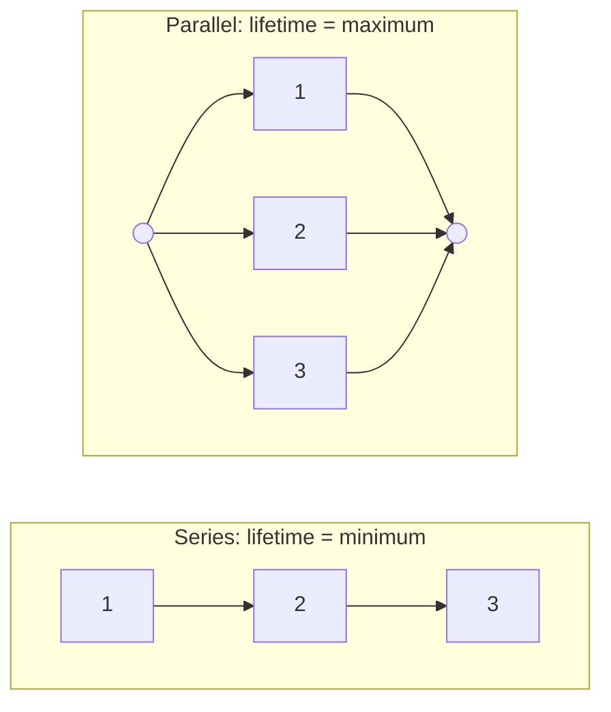

## Two special joint models

This lesson closes the module with two joint models that appear constantly in statistics.
The bivariate normal is the standard model for two measurements that are each roughly
normal and linearly related, such as midterm and final scores; it explains why regression
lines are straight. Order statistics (the minimum, the maximum and everything between) answer
questions such as "when does the first of five components fail?" and will give us
estimators in Module 6.

## The bivariate normal distribution

$(X, Y)$ has a **bivariate normal distribution** with means $\mu_X, \mu_Y$, standard deviations
$\sigma_X, \sigma_Y > 0$ and correlation $\rho$ ($-1 < \rho < 1$) if its joint density is

$$f(x, y) = \frac{1}{2\pi\sigma_X\sigma_Y\sqrt{1 - \rho^2}}\exp\!\left(-\frac{z_x^2 - 2\rho z_x z_y + z_y^2}{2(1 - \rho^2)}\right),$$

where $z_x = (x - \mu_X)/\sigma_X$ and $z_y = (y - \mu_Y)/\sigma_Y$. The density is a bell-shaped hill whose
level curves are ellipses centred at $(\mu_X, \mu_Y)$, tilted up when $\rho > 0$ and down when $\rho < 0$.

The formula is easier to understand through a construction. Take independent standard
normals $Z_1, Z_2$ and set

$$X = \mu_X + \sigma_X Z_1, \qquad Y = \mu_Y + \sigma_Y\big(\rho Z_1 + \sqrt{1 - \rho^2}\,Z_2\big).$$

Each of $X$ and $Y$ is a linear combination of independent normals, so each is normal (previous
lesson). $\operatorname{Var}(\rho Z_1 + \sqrt{1-\rho^2}Z_2) = \rho^2 + 1 - \rho^2 = 1$, so $Y$ has SD $\sigma_Y$, and
$\operatorname{Cov}(X, Y) = \sigma_X\sigma_Y\operatorname{Cov}(Z_1, \rho Z_1) = \rho\sigma_X\sigma_Y$, so the correlation is $\rho$. (A change of
variables shows this pair has exactly the density above.) The construction makes the key
properties transparent:

1. *Marginals are normal*: $X \sim N(\mu_X, \sigma_X^2)$ and $Y \sim N(\mu_Y, \sigma_Y^2)$ (mean, variance).
2. *Conditionals are normal with a linear mean.* Knowing $X = x$ fixes $Z_1 = z_x$; the only
   randomness left is $\sigma_Y\sqrt{1-\rho^2}\,Z_2$. Hence

$$Y \mid X = x \;\sim\; N\!\left(\mu_Y + \rho\frac{\sigma_Y}{\sigma_X}(x - \mu_X),\;\; \sigma_Y^2(1 - \rho^2)\right).$$

3. *Uncorrelated means independent.* If $\rho = 0$, $Y$ depends on $Z_2$ alone, which is independent
   of $Z_1$. For general distributions zero correlation does *not* imply independence; for a
   bivariate normal pair it does.
4. *Linear combinations are normal*: $aX + bY$ is a linear combination of $Z_1, Z_2$, so
   $aX + bY \sim N\big(a\mu_X + b\mu_Y,\; a^2\sigma_X^2 + b^2\sigma_Y^2 + 2ab\rho\sigma_X\sigma_Y\big)$.

The conditional mean is a straight line with slope $\rho\sigma_Y/\sigma_X$, the population **regression line**, and the conditional SD $\sigma_Y\sqrt{1 - \rho^2}$ is the same for every $x$. Because $|\rho| < 1$,
a value $k$ SDs above average in $X$ predicts a value only $\rho k$ SDs above average in $Y$:
this is **regression to the mean**.

The next picture shows a density contour (an ellipse) in standard units with $\rho = 0.6$ and three lines through its centre. The dashed SD line (slope $\sigma_Y/\sigma_X$) is the ellipse's long axis, but it is *not* the best prediction: the line of conditional means $E[Y \mid X = x]$ is flatter, with slope $\rho\sigma_Y/\sigma_X$. Predicting $X$ from $Y$ uses a third, steeper line, $E[X \mid Y = y]$. The two regression lines differ unless $|\rho| = 1$.

![An ellipse tilted up to the right with its centre marked; a dashed line along its long axis labeled SD line, a flatter solid line labeled E[Y given X = x], and a steeper dotted line labeled E[X given Y = y], all through the centre](images/ps-m4-bvn-lines.svg)

```plot
{"x": [40, 100], "y": [40, 105], "xLabel": "midterm x", "yLabel": "final y", "points": [[85.7, 86.9], [77.4, 76.8], [60.3, 79.3], [67.9, 77.5], [67.1, 91.1], [93.6, 94.0], [60.6, 58.2], [83.8, 76.6], [71.2, 87.7], [80.2, 73.3], [70.0, 76.8], [73.9, 98.8], [74.9, 78.9], [71.1, 67.7], [76.5, 88.4], [73.5, 81.6], [82.3, 72.9], [88.1, 95.8], [69.1, 76.6], [68.1, 80.9], [74.1, 72.2], [53.4, 74.4], [73.1, 72.8], [64.8, 83.6], [61.8, 58.8], [54.2, 67.0], [67.8, 77.1], [75.1, 66.7], [64.7, 53.3], [60.9, 62.1], [64.4, 63.7], [68.5, 68.0], [58.4, 65.5], [64.7, 93.0], [59.2, 69.4], [68.7, 90.0], [87.4, 91.5], [71.7, 87.3], [89.9, 95.3], [63.1, 71.1], [58.6, 72.0], [67.2, 94.4], [70.9, 60.4], [73.7, 80.6], [73.9, 84.3], [66.8, 61.5], [78.9, 87.0], [69.1, 76.6], [77.0, 92.4], [74.5, 84.7], [72.5, 77.1], [72.2, 79.7], [62.8, 49.4], [75.4, 98.6], [75.8, 81.8], [65.2, 58.4], [95.4, 84.1], [71.7, 74.2], [57.2, 60.3], [54.3, 65.4], [61.5, 62.3], [48.1, 64.1], [74.1, 73.4], [59.4, 66.4], [73.9, 64.3], [56.2, 57.6], [72.2, 75.0], [80.8, 73.3], [75.9, 76.4], [52.6, 58.9]], "functions": [{"f": "75 + 0.72*(x - 70)", "label": "E[Y | X = x]"}], "caption": "70 simulated pairs from a bivariate normal with ρ = 0.6, and the line of conditional means"}
```

### Example 1

Midterm and final scores are bivariate normal with $\mu_X = 70$, $\sigma_X = 10$, $\mu_Y = 75$,
$\sigma_Y = 12$, $\rho = 0.6$. A student scored 85 on the midterm. Find the distribution of her final
score and the probability it exceeds 90.

1. $z_x = (85 - 70)/10 = 1.5$.
2. Conditional mean: $75 + 0.6 \times 12 \times 1.5 = 75 + 10.8 = 85.8$. (She is 1.5 SDs above
   average on the midterm but predicted to be only $0.6 \times 1.5 = 0.9$ SDs above on the final.)
3. Conditional SD: $12\sqrt{1 - 0.36} = 12 \times 0.8 = 9.6$.
4. $P(Y > 90 \mid X = 85) = P\big(Z > \tfrac{90 - 85.8}{9.6}\big) = P(Z > 0.4375) \approx 0.331$.

Compare the unconditional $P(Y > 90) = P(Z > 1.25) \approx 0.106$: the midterm score is real information.

*A warning.* Two normal marginals do not make a bivariate normal. If $X \sim N(0, 1)$ and
$Y = SX$ with an independent random sign $S = \pm 1$, then $Y$ is also $N(0, 1)$ but $X + Y$ equals 0
half the time, so it is certainly not normal. Joint normality is an assumption about the pair.

## Order statistics

Let $X_1, \dots, X_n$ be iid with cdf $F$ and density $f$. Sorting them gives the **order statistics**
$X_{(1)} \le X_{(2)} \le \cdots \le X_{(n)}$; in particular $X_{(1)} = \min X_i$ and $X_{(n)} = \max X_i$.

*The maximum.* The largest value is at most $x$ exactly when *every* value is at most $x$. By
independence,

$$F_{\max}(x) = P(X_1 \le x, \dots, X_n \le x) = F(x)^n, \qquad f_{\max}(x) = nF(x)^{n-1}f(x).$$

*The minimum.* The smallest value exceeds $x$ exactly when every value exceeds $x$:

$$P(X_{(1)} > x) = \big(1 - F(x)\big)^n, \qquad f_{\min}(x) = n\big(1 - F(x)\big)^{n-1}f(x).$$

*General $k$.* For $X_{(k)}$ to land in a tiny interval near $x$, one observation must fall in the
interval, $k - 1$ below it and $n - k$ above. Counting the arrangements gives

$$f_{(k)}(x) = \frac{n!}{(k-1)!\,(n-k)!}\,F(x)^{k-1}\big(1 - F(x)\big)^{n-k}f(x).$$

For Uniform(0, 1) samples this is a beta density with parameters $k$ and $n - k + 1$, with mean
$k/(n+1)$: the $n$ points split $(0, 1)$ into $n + 1$ gaps of equal average length.

```plot
{"x": [0, 1.05], "y": [0, 5.3], "xLabel": "x", "yLabel": "density", "functions": [{"f": "1", "from": 0, "to": 1, "label": "n = 1"}, {"f": "3x^2", "from": 0, "to": 1, "label": "n = 3"}, {"f": "5x^4", "from": 0, "to": 1, "label": "n = 5"}], "caption": "Density nx^(n−1) of the maximum of n Uniform(0, 1) values: it piles up near 1 as n grows"}
```

### Example 2: series and parallel systems

Five components have iid exponential lifetimes with mean 1000 hours (rate $\lambda = 0.001$).



(a) *Series system* (fails when the first component fails): lifetime $X_{(1)}$.
$P(X_{(1)} > x) = (e^{-\lambda x})^5 = e^{-5\lambda x}$, so the minimum is exponential with rate $5\lambda$, mean
$1000/5 = 200$ hours. In general, *the minimum of independent exponentials is exponential with the sum of the rates*. The chance a series system lasts 100 hours is $e^{-0.5} \approx 0.607$.

(b) *Parallel system* (works until the last component fails): lifetime $X_{(5)}$.
$P(X_{(5)} \le 1500) = (1 - e^{-1.5})^5 \approx 0.283$, so it survives 1500 hours with probability
about 0.717.

### Example 3: the largest of uniform readings

A sensor returns values uniform on $(0, \theta)$ for an unknown upper limit $\theta$. With $n$ readings,
$F(x) = x/\theta$ on $(0, \theta)$, so $f_{\max}(x) = nx^{n-1}/\theta^n$ and

$$E[X_{(n)}] = \int_0^\theta x \cdot \frac{nx^{n-1}}{\theta^n}\,dx = \frac{n}{n+1}\theta.$$

The maximum always falls short of $\theta$, but $\tfrac{n+1}{n}X_{(n)}$ has mean exactly $\theta$, a fact we use when
judging estimators in Module 6. With $n = 9$ readings whose maximum is 4.5, that gives the
estimate $\tfrac{10}{9}(4.5) = 5$.

## Common mistakes

- *Using $\sigma_Y$ as the conditional SD.* Given $X$, the SD shrinks to $\sigma_Y\sqrt{1-\rho^2}$.
- *Forgetting $\rho$ in the conditional mean slope* ($\rho\sigma_Y/\sigma_X$, not $\sigma_Y/\sigma_X$).
- *Assuming normal marginals imply a bivariate normal*, or that $\rho = 0$ implies independence
  outside the bivariate normal.
- *Mixing up the min and max formulas.* The max uses $F(x)^n$ (all below $x$); the min uses
  $(1 - F(x))^n$ (all above $x$).
- *Writing $F_{\min}(x) = 1 - F(x)^n$.* The correct form is $1 - (1 - F(x))^n$.

## Key points

- Bivariate normal: normal marginals, normal conditionals, linear regression function.
- $Y \mid X = x \sim N\big(\mu_Y + \rho\tfrac{\sigma_Y}{\sigma_X}(x - \mu_X),\; \sigma_Y^2(1 - \rho^2)\big)$.
- For bivariate normal pairs, $\rho = 0 \iff$ independent.
- Max: $F(x)^n$; min: $1 - (1 - F(x))^n$; densities by differentiating.
- Min of independent exponentials is exponential with summed rates.
- Uniform(0, $\theta$): $E[X_{(n)}] = n\theta/(n+1)$.
