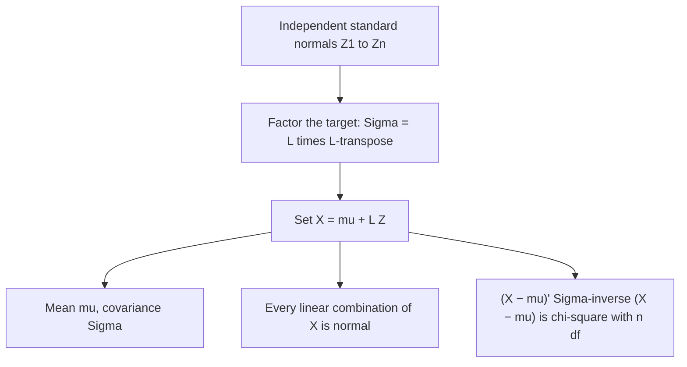

## From two variables to many

The covariance lesson gave the variance of $aX + bY$, and the bivariate normal lesson built a
correlated normal pair out of two independent standard normals. Real problems rarely stop at
two variables. A train's journey time is the sum of a dozen section times that share weather
and congestion; an investment portfolio mixes many correlated assets; a measuring rig records
three strains on the same rail at once. Writing out every pairwise covariance by hand quickly
becomes unmanageable. Matrices do the bookkeeping, and once the bookkeeping is in place the
bivariate normal extends to any number of variables with almost no extra work.

This lesson assumes you can multiply matrices and know what a transpose, a determinant and an
inverse are. We write vectors as columns and $\top$ for the transpose.

## Random vectors, mean vectors and covariance matrices

A **random vector** $\mathbf{X} = (X_1, \dots, X_n)^\top$ is a list of random variables on the same
sample space. Its **mean vector** is the list of means, $\boldsymbol{\mu} = E[\mathbf{X}] = (\mu_1, \dots, \mu_n)^\top$,
and its **covariance matrix** is the $n \times n$ matrix

$$\Sigma = \operatorname{Cov}(\mathbf{X}) = E\big[(\mathbf{X} - \boldsymbol{\mu})(\mathbf{X} - \boldsymbol{\mu})^\top\big], \qquad \Sigma_{ij} = \operatorname{Cov}(X_i, X_j).$$

The outer product $(\mathbf{X} - \boldsymbol{\mu})(\mathbf{X} - \boldsymbol{\mu})^\top$ is the matrix whose $(i, j)$ entry is
$(X_i - \mu_i)(X_j - \mu_j)$, and taking expectations entry by entry gives the covariances. So the
diagonal holds the variances $\Sigma_{ii} = \operatorname{Var}(X_i)$, and $\Sigma$ is symmetric because
$\operatorname{Cov}(X_i, X_j) = \operatorname{Cov}(X_j, X_i)$. Dividing each entry by $\sigma_i\sigma_j$ gives the
**correlation matrix**, which has 1s on the diagonal and the correlations $\rho_{ij}$ off it.

## Linear transformations

Every rule from the covariance lesson becomes one matrix identity. If $A$ is a fixed $m \times n$
matrix and $\mathbf{b}$ a fixed vector, then

$$E[A\mathbf{X} + \mathbf{b}] = A\boldsymbol{\mu} + \mathbf{b}, \qquad \operatorname{Cov}(A\mathbf{X} + \mathbf{b}) = A\,\Sigma\,A^\top.$$

*Why.* The first is linearity of expectation applied to each row. For the second,
$A\mathbf{X} + \mathbf{b}$ minus its mean is $A(\mathbf{X} - \boldsymbol{\mu})$, so its covariance matrix is
$E\big[A(\mathbf{X} - \boldsymbol{\mu})(\mathbf{X} - \boldsymbol{\mu})^\top A^\top\big] = A\,E\big[(\mathbf{X} - \boldsymbol{\mu})(\mathbf{X} - \boldsymbol{\mu})^\top\big]A^\top = A\Sigma A^\top$.
The constant matrices come out of the expectation because expectation is linear.

The most used special case has a single row $\mathbf{a}^\top = (a_1, \dots, a_n)$:

$$\operatorname{Var}(\mathbf{a}^\top\mathbf{X}) = \mathbf{a}^\top\Sigma\,\mathbf{a} = \sum_i\sum_j a_i a_j \Sigma_{ij}, \qquad \operatorname{Cov}(\mathbf{a}^\top\mathbf{X},\, \mathbf{c}^\top\mathbf{X}) = \mathbf{a}^\top\Sigma\,\mathbf{c}.$$

The double sum is exactly the variance-of-a-sum formula: the diagonal terms give $\sum a_i^2\operatorname{Var}(X_i)$
and each off-diagonal pair appears twice, giving $2\sum_{i<j}a_ia_j\operatorname{Cov}(X_i, X_j)$. An expression
$\mathbf{a}^\top\Sigma\,\mathbf{a}$ is called a quadratic form.

### Example 1: three section delays

Delays (minutes) on three consecutive sections have SDs 2, 3 and 4. Sections 1 and 2 have
correlation $\tfrac13$; sections 2 and 3 have correlation $-\tfrac14$ (a late arrival at section 3
means a quieter, faster path); sections 1 and 3 are uncorrelated. Find the SD of the total delay
$T = X_1 + X_2 + X_3$, and the correlation between $T$ and $D = X_3 - X_1$.

1. Covariances: $\Sigma_{12} = \tfrac13 \cdot 2 \cdot 3 = 2$, $\Sigma_{23} = -\tfrac14 \cdot 3 \cdot 4 = -3$, $\Sigma_{13} = 0$. So
$$\Sigma = \begin{pmatrix} 4 & 2 & 0 \\ 2 & 9 & -3 \\ 0 & -3 & 16 \end{pmatrix}.$$
2. $T = \mathbf{a}^\top\mathbf{X}$ with $\mathbf{a} = (1, 1, 1)^\top$, and $\mathbf{a}^\top\Sigma\mathbf{a}$ is the sum of all nine entries:
   $4 + 9 + 16 + 2(2 + 0 - 3) = 27$. The SD is $\sqrt{27} \approx 5.20$ minutes.
3. $D = \mathbf{c}^\top\mathbf{X}$ with $\mathbf{c} = (-1, 0, 1)^\top$. First $\Sigma\mathbf{c} = (-4, -5, 16)^\top$. Then
   $\operatorname{Var}(D) = \mathbf{c}^\top\Sigma\mathbf{c} = 4 + 0 + 16 = 20$ and $\operatorname{Cov}(T, D) = \mathbf{a}^\top\Sigma\mathbf{c} = -4 - 5 + 16 = 7$.
4. $\operatorname{Corr}(T, D) = 7/\sqrt{27 \times 20} \approx 0.301$.

In one step, with $A$ the $2 \times 3$ matrix whose rows are $\mathbf{a}^\top$ and $\mathbf{c}^\top$,
$A\Sigma A^\top = \begin{pmatrix} 27 & 7 \\ 7 & 20 \end{pmatrix}$, which holds both variances and the covariance.

## Not every symmetric matrix is a covariance matrix

A variance can never be negative, so for *every* vector $\mathbf{a}$,

$$\mathbf{a}^\top\Sigma\,\mathbf{a} = \operatorname{Var}(\mathbf{a}^\top\mathbf{X}) \ge 0.$$

A symmetric matrix with this property is called **positive semidefinite**. Every covariance
matrix is one, and conversely every symmetric positive semidefinite matrix is the covariance
matrix of some random vector (the construction below produces one). Equivalently, all the
eigenvalues of $\Sigma$ are $\ge 0$. This is a real restriction: correlations cannot be chosen freely.

### Example 2: an impossible set of correlations

A report claims that a strain gauge $X_1$ has correlation 0.9 with each of two other gauges $X_2$ and
$X_3$, while $X_2$ and $X_3$ are uncorrelated. Can that be right?

Standardize, so the covariance matrix is the claimed correlation matrix, and try $\mathbf{a} = (1, -1, -1)^\top$:

$$\operatorname{Var}(Z_1 - Z_2 - Z_3) = 1 + 1 + 1 - 2(0.9) - 2(0.9) + 2(0) = -0.6 < 0.$$

A negative variance is impossible, so no three random variables have these correlations. The
intuition: if $X_1$ is nearly a copy of $X_2$ and nearly a copy of $X_3$, then $X_2$ and $X_3$ must be
fairly similar to each other. In the same way, $n$ variables that all share a common correlation
$\rho$ need $\mathbf{1}^\top\Sigma\mathbf{1} = n + n(n - 1)\rho \ge 0$, that is $\rho \ge -1/(n - 1)$: three variables cannot all be
negatively correlated at $-0.6$.

## The multivariate normal distribution

The bivariate normal lesson built a correlated pair from independent standard normals. The
same idea works in any dimension. Let $\mathbf{Z} = (Z_1, \dots, Z_n)^\top$ have iid $N(0, 1)$ entries, so
$E[\mathbf{Z}] = \mathbf{0}$ and $\operatorname{Cov}(\mathbf{Z}) = I$. For a fixed vector $\boldsymbol{\mu}$ and matrix $A$, set

$$\mathbf{X} = \boldsymbol{\mu} + A\mathbf{Z}.$$

By the transformation rule, $E[\mathbf{X}] = \boldsymbol{\mu}$ and $\operatorname{Cov}(\mathbf{X}) = AIA^\top = AA^\top$. We say $\mathbf{X}$ has
a **multivariate normal distribution**, $\mathbf{X} \sim N_n(\boldsymbol{\mu}, \Sigma)$ with $\Sigma = AA^\top$. An equivalent
definition, often taken as the official one: $\mathbf{X}$ is multivariate normal exactly when every
linear combination $\mathbf{a}^\top\mathbf{X}$ has a (possibly degenerate) normal distribution.

*The density.* When $\Sigma$ is invertible (take $A$ square and invertible), solve for
$\mathbf{z} = A^{-1}(\mathbf{x} - \boldsymbol{\mu})$. The change-of-variables rule from the sums lesson, extended to $n$
variables, multiplies the density of $\mathbf{Z}$, which is $(2\pi)^{-n/2}e^{-\mathbf{z}^\top\mathbf{z}/2}$, by
$|\det A^{-1}| = 1/\sqrt{\det\Sigma}$ (because $\det\Sigma = (\det A)^2$). Since
$\mathbf{z}^\top\mathbf{z} = (\mathbf{x} - \boldsymbol{\mu})^\top (A^{-1})^\top A^{-1}(\mathbf{x} - \boldsymbol{\mu}) = (\mathbf{x} - \boldsymbol{\mu})^\top\Sigma^{-1}(\mathbf{x} - \boldsymbol{\mu})$,

$$f(\mathbf{x}) = \frac{1}{(2\pi)^{n/2}\sqrt{\det\Sigma}}\exp\!\Big(-\tfrac12(\mathbf{x} - \boldsymbol{\mu})^\top\Sigma^{-1}(\mathbf{x} - \boldsymbol{\mu})\Big).$$

With $n = 2$, $\det\Sigma = \sigma_X^2\sigma_Y^2(1 - \rho^2)$, and multiplying out $\Sigma^{-1}$ gives back the bivariate
formula from the core lesson. If $\Sigma$ is singular, some combination $\mathbf{a}^\top\mathbf{X}$ has variance 0 and is
a constant, so $\mathbf{X}$ lives on a lower-dimensional flat and has no density in $n$ dimensions.

*Properties.* All follow from the construction:

1. *Linear maps stay normal:* $B\mathbf{X} + \mathbf{b} = (B\boldsymbol{\mu} + \mathbf{b}) + (BA)\mathbf{Z} \sim N(B\boldsymbol{\mu} + \mathbf{b},\; B\Sigma B^\top)$.
2. *Marginals are normal:* any sub-vector, such as $(X_1, X_3)$, is a linear map of $\mathbf{X}$; its mean and
   covariance are just the matching entries of $\boldsymbol{\mu}$ and $\Sigma$.
3. *Uncorrelated means independent:* if $\Sigma$ is diagonal, so is $\Sigma^{-1}$, the quadratic form splits
   into $\sum(x_i - \mu_i)^2/\sigma_i^2$, and the density factors into $n$ normal densities. More generally, two
   blocks of a multivariate normal vector with zero cross-covariance are independent.
4. *Conditionals are normal with linear means* (stated without proof): splitting $\mathbf{X}$ into blocks
   $\mathbf{X}_1, \mathbf{X}_2$, the distribution of $\mathbf{X}_1$ given $\mathbf{X}_2 = \mathbf{x}_2$ is normal with mean
   $\boldsymbol{\mu}_1 + \Sigma_{12}\Sigma_{22}^{-1}(\mathbf{x}_2 - \boldsymbol{\mu}_2)$ and covariance $\Sigma_{11} - \Sigma_{12}\Sigma_{22}^{-1}\Sigma_{21}$. With one variable in each block
   this is the core lesson's $\mu_Y + \rho\tfrac{\sigma_Y}{\sigma_X}(x - \mu_X)$ and $\sigma_Y^2(1 - \rho^2)$.

The warning from the core lesson still applies: normal marginals alone do not make a vector
multivariate normal. Joint normality is a property of the whole vector.



## Generating correlated normals: the Cholesky factor

To simulate $N_n(\boldsymbol{\mu}, \Sigma)$, or simply to understand it, we need some $A$ with $AA^\top = \Sigma$.
For a positive definite $\Sigma$ there is exactly one lower-triangular $L$ with positive diagonal
such that $\Sigma = LL^\top$: the **Cholesky factorization**. For a $2 \times 2$ matrix it can be found by hand:

$$\begin{pmatrix} \sigma_1^2 & c \\ c & \sigma_2^2 \end{pmatrix} = \begin{pmatrix} \ell_{11} & 0 \\ \ell_{21} & \ell_{22} \end{pmatrix}\begin{pmatrix} \ell_{11} & \ell_{21} \\ 0 & \ell_{22} \end{pmatrix} \;\Longrightarrow\; \ell_{11} = \sigma_1,\quad \ell_{21} = \frac{c}{\sigma_1},\quad \ell_{22} = \sqrt{\sigma_2^2 - \ell_{21}^2}.$$

### Example 3

Factor $\Sigma = \begin{pmatrix} 4 & 6 \\ 6 & 25 \end{pmatrix}$ and describe how to generate $(X_1, X_2) \sim N_2(\boldsymbol{\mu}, \Sigma)$.

1. $\ell_{11} = \sqrt4 = 2$; $\ell_{21} = 6/2 = 3$; $\ell_{22} = \sqrt{25 - 9} = 4$. Check: $LL^\top$ has entries $4$, $2 \cdot 3 = 6$
   and $9 + 16 = 25$.
2. So $X_1 = \mu_1 + 2Z_1$ and $X_2 = \mu_2 + 3Z_1 + 4Z_2$, with $Z_1, Z_2$ independent standard normals.

Here $\rho = 6/(2 \times 5) = 0.6$, and the recipe is exactly the core lesson's construction: $\sigma_2\rho = 3$
and $\sigma_2\sqrt{1 - \rho^2} = 4$. In higher dimensions software computes $L$ (the factorization fails
precisely when $\Sigma$ is not positive definite, which makes it a handy validity test).

## Mahalanobis distance and probability ellipses

How unusual is an observation $\mathbf{x}$? Measuring each coordinate in its own SDs ignores the
correlations. The **Mahalanobis distance** does not: its square is

$$Q(\mathbf{x}) = (\mathbf{x} - \boldsymbol{\mu})^\top\Sigma^{-1}(\mathbf{x} - \boldsymbol{\mu}).$$

For $\mathbf{X} = \boldsymbol{\mu} + A\mathbf{Z}$ this is $\mathbf{Z}^\top\mathbf{Z} = Z_1^2 + \cdots + Z_n^2$, a sum of $n$ squared independent standard
normals, so $Q(\mathbf{X}) \sim \chi^2_n$. The density is constant on the sets $Q = c$, which are ellipses
(ellipsoids for $n \ge 3$), and $P(Q(\mathbf{X}) \le c)$ is a chi-square probability. In two dimensions
$\chi^2_2$ is the exponential distribution with mean 2, so $P(Q \le c) = 1 - e^{-c/2}$: the 95% ellipse is
$Q = -2\ln 0.05 \approx 5.99$. For two variables, $Q = \dfrac{z_x^2 - 2\rho z_x z_y + z_y^2}{1 - \rho^2}$.

### Example 4: an unusual combination

Return to the core lesson's scores: $\mu = (70, 75)$, $\sigma_X = 10$, $\sigma_Y = 12$, $\rho = 0.6$. A student
scored 85 on the midterm and 60 on the final. Neither score alone is extreme ($z_x = 1.5$,
$z_y = -1.25$). But

$$Q = \frac{1.5^2 - 2(0.6)(1.5)(-1.25) + (-1.25)^2}{1 - 0.36} = \frac{2.25 + 2.25 + 1.5625}{0.64} \approx 9.47,$$

and $P(Q \ge 9.47) = e^{-9.47/2} \approx 0.0088$. Fewer than 1% of students land this far out: with
$\rho = 0.6$, a good midterm makes a poor final surprising. The picture shows the point well outside
the 98.9% ellipse.

```plot
{"x": [38, 104], "y": [36, 114], "xLabel": "midterm x", "yLabel": "final y", "curves": [{"x": "70 + 10*cos(t)", "y": "75 + 7.2*cos(t) + 9.6*sin(t)", "t": [0, "2pi"]}, {"x": "70 + 20*cos(t)", "y": "75 + 14.4*cos(t) + 19.2*sin(t)", "t": [0, "2pi"]}, {"x": "70 + 30*cos(t)", "y": "75 + 21.6*cos(t) + 28.8*sin(t)", "t": [0, "2pi"]}], "points": [{"at": [70, 75], "label": "mean"}, {"at": [85, 60], "label": "(85, 60)"}], "caption": "From the inside out, the ellipses Q = 1, 4, 9 hold 39%, 86% and 98.9% of the probability; the point (85, 60) lies outside all three"}
```

## Common mistakes

- *Writing $A^\top\Sigma A$ instead of $A\Sigma A^\top$.* Check the sizes: $A$ is $m \times n$, so only $A\Sigma A^\top$
  multiplies out to the $m \times m$ answer.
- *Counting each covariance once.* In $\mathbf{a}^\top\Sigma\mathbf{a}$ every off-diagonal pair appears twice
  ($\Sigma_{ij}$ and $\Sigma_{ji}$), which is where the 2 in $2ab\operatorname{Cov}$ comes from.
- *Assuming any symmetric matrix of plausible correlations is valid.* It must be positive
  semidefinite; test with a vector or a Cholesky factorization.
- *Using SD units one coordinate at a time to judge outliers.* With correlated variables, use $Q$.
- *Applying "uncorrelated implies independent" outside joint normality.*

## Key points

- $\Sigma_{ij} = \operatorname{Cov}(X_i, X_j)$; $\Sigma$ is symmetric with the variances on the diagonal.
- $E[A\mathbf{X} + \mathbf{b}] = A\boldsymbol{\mu} + \mathbf{b}$ and $\operatorname{Cov}(A\mathbf{X} + \mathbf{b}) = A\Sigma A^\top$; in particular $\operatorname{Var}(\mathbf{a}^\top\mathbf{X}) = \mathbf{a}^\top\Sigma\mathbf{a}$.
- Covariance matrices are exactly the symmetric positive semidefinite matrices.
- $\mathbf{X} = \boldsymbol{\mu} + L\mathbf{Z}$ with $LL^\top = \Sigma$ is $N_n(\boldsymbol{\mu}, \Sigma)$: linear maps, marginals and conditionals stay normal,
  and uncorrelated components are independent.
- $Q = (\mathbf{X} - \boldsymbol{\mu})^\top\Sigma^{-1}(\mathbf{X} - \boldsymbol{\mu}) \sim \chi^2_n$; in two dimensions $P(Q \le c) = 1 - e^{-c/2}$.
