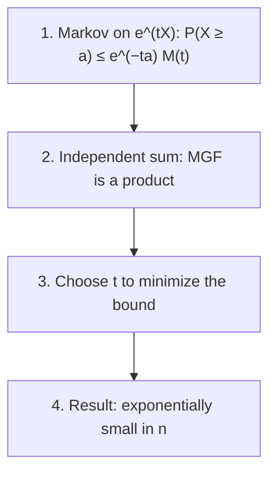

## Beyond Chebyshev

Chebyshev's inequality turned the law of large numbers into a guarantee: for a sample proportion,
$P(|\hat p_n - p| \ge \varepsilon) \le 1/(4n\varepsilon^2)$. That bound is honest but slow. It shrinks only like $1/n$,
so asking for ten times more confidence costs ten times more data. The Central Limit Theorem
suggests the truth is far better: normal tails fall off like $e^{-z^2/2}$, and $z$ grows like $\sqrt n$, so
the true tail probability should fall *exponentially* in $n$.

This lesson proves exponential bounds that are still guarantees (no approximation, valid for every
$n$). They are called **concentration inequalities**: statements that a sum or average of many
independent pieces is concentrated near its mean. They are the workhorse of modern probability,
randomized algorithms and machine learning theory, where a guarantee is needed and "approximately
normal for large $n$" is not good enough.

## The Chernoff method

The trick is to apply Markov's inequality not to $X$ but to $e^{tX}$. For any $t > 0$, the function
$x \mapsto e^{tx}$ is positive and increasing, so $X \ge a$ exactly when $e^{tX} \ge e^{ta}$. Markov gives

$$P(X \ge a) = P\big(e^{tX} \ge e^{ta}\big) \le \frac{E[e^{tX}]}{e^{ta}} = e^{-ta}M_X(t).$$

This holds for every $t > 0$ at which the MGF is finite, so we may choose the best one:

$$P(X \ge a) \le \min_{t > 0}\; e^{-ta}M_X(t).$$

This is the **Chernoff bound**, named for Herman Chernoff, who used it in a 1952 paper on
hypothesis tests; the same exponential-moment idea appears earlier in work of Sergei Bernstein in
the 1920s. Why does it beat Chebyshev? Chebyshev uses one moment, the variance. The MGF packs in
*every* moment at once, and the free parameter $t$ lets us weight them to suit the cutoff $a$.

For a sum of independent terms the MGF factors, $M_{S_n}(t) = \prod M_{X_i}(t)$, and that is what makes the
method so useful: the bound for $n$ terms is a single-term quantity raised to the power $n$, which
is where the exponential decay comes from.



### Example 1: Chernoff for the normal

Let $X \sim N(\mu, \sigma^2)$, with $M_X(t) = e^{\mu t + \sigma^2t^2/2}$. For $a = \mu + z\sigma$ with $z > 0$:

1. The bound is $e^{-ta}M_X(t) = \exp\big(-t(\mu + z\sigma) + \mu t + \sigma^2t^2/2\big) = \exp\big(-tz\sigma + \sigma^2t^2/2\big)$.
2. The exponent is a parabola in $t$, smallest at $t = z/\sigma$, where it equals $-z^2 + z^2/2 = -z^2/2$.
3. So $P(X \ge \mu + z\sigma) \le e^{-z^2/2}$.

At $z = 3$: the bound is $e^{-4.5} \approx 0.0111$, the exact tail is $0.00135$, and Chebyshev gives only
$1/9 \approx 0.111$ (its sharper one-sided form, Cantelli's inequality, gives $1/10$). The Chernoff bound
is off by a factor of about 8 here, but it has the right *exponential rate*; the exact tail is
about $e^{-z^2/2}/(z\sqrt{2\pi})$, so the bound loses only the factor $1/(z\sqrt{2\pi})$.

### Example 2: Chernoff for a binomial

A fair coin is flipped 100 times. Bound $P(S \ge 70)$, where $S \sim \text{Bin}(100, 0.5)$.

1. $M_S(t) = (1 - p + pe^t)^n = (0.5 + 0.5e^t)^{100}$, so $P(S \ge 70) \le e^{-70t}(0.5 + 0.5e^t)^{100}$.
2. Minimize the log, $-70t + 100\ln(0.5 + 0.5e^t)$. The derivative is $-70 + 100\,\dfrac{e^t}{1 + e^t} = 0$, so
   $e^t/(1 + e^t) = 0.7$, giving $e^t = 7/3$ and $t = \ln(7/3) \approx 0.847$.
3. Substitute: $(3/7)^{70}(0.5 + 0.5 \cdot 7/3)^{100} = (3/7)^{70}(5/3)^{100}$. Its log is
   $70\ln(3/7) + 100\ln(5/3) \approx -59.311 + 51.083 = -8.228$, so the bound is $e^{-8.228} \approx 2.7 \times 10^{-4}$.

Compare: Markov gives $50/70 \approx 0.71$, Chebyshev $25/400 \approx 0.063$, and the exact value is
$3.9 \times 10^{-5}$. A careless choice of $t$ still gives a valid bound (with $t = 0.5$ it is about
$1.0 \times 10^{-3}$), just a weaker one; that is the advantage of a method with a free parameter.

In general, for $S \sim \text{Bin}(n, p)$ and a proportion $a > p$, the same steps give

$$P(S \ge na) \le e^{-n\,D(a\,\|\,p)}, \qquad D(a\,\|\,p) = a\ln\frac{a}{p} + (1 - a)\ln\frac{1 - a}{1 - p}.$$

The exponent $D(a\,\|\,p)$ is the **Kullback–Leibler divergence** between a coin with success
probability $a$ and one with $p$: a measure of how distinguishable the two coins are. Here
$D(0.7\,\|\,0.5) \approx 0.0823$, and $e^{-100(0.0823)}$ matches step 3.

## Hoeffding's inequality

The Chernoff method needs the MGF. Often we know only that each term is *bounded*: a test answer
is right or wrong, a sensor reads between 0 and 5 volts. Hoeffding handled that case in 1963.

**Hoeffding's lemma** (stated without proof): if $a \le X \le b$, then for every real $s$,

$$E\big[e^{s(X - E[X])}\big] \le e^{s^2(b - a)^2/8}.$$

So a bounded variable's centered MGF is no bigger than that of a normal with variance $(b - a)^2/4$.
Feed this into the Chernoff method for $S_n = X_1 + \cdots + X_n$, independent with $a_i \le X_i \le b_i$, and
write $c = \sum (b_i - a_i)^2$. For $u > 0$ and any $s > 0$,
$P(S_n - E[S_n] \ge u) \le \exp(-su + s^2c/8)$. The exponent is smallest at $s = 4u/c$, where it equals
$-4u^2/c + 2u^2/c = -2u^2/c$. This is **Hoeffding's inequality**:

$$P\big(S_n - E[S_n] \ge u\big) \le \exp\!\left(-\frac{2u^2}{\sum_{i}(b_i - a_i)^2}\right).$$

For the mean of $n$ iid values in $[a, b]$, put $u = n\varepsilon$:

$$P(\bar X_n - \mu \ge \varepsilon) \le e^{-2n\varepsilon^2/(b - a)^2}, \qquad P(|\bar X_n - \mu| \ge \varepsilon) \le 2e^{-2n\varepsilon^2/(b - a)^2}.$$

The second form adds the two tails (apply the first to $-X_i$ as well). Two features stand out. The
bound needs no variance and no MGF, only the range. And it costs only $\ln(1/\delta)$ in the sample
size to drive the error probability to $\delta$, instead of Chebyshev's $1/\delta$.

For the coin of Example 2, Hoeffding gives $P(S \ge 70) \le e^{-2(100)(0.2)^2} = e^{-8} \approx 3.4 \times 10^{-4}$, slightly
weaker than Chernoff's $2.7 \times 10^{-4}$. That is no accident: for Bernoulli terms one can show
$D(a\,\|\,p) \ge 2(a - p)^2$, so the exact-MGF Chernoff bound is always at least as good.

### Example 3: how big a poll?

Find $n$ so that a sample proportion is within 0.05 of $p$ except with probability at most
$\delta = 0.10$, for every $p$.

1. Chebyshev (previous lesson): $1/(4n\varepsilon^2) \le \delta$ gives $n \ge 0.25/(0.0025 \times 0.10) = 1000$.
2. Hoeffding with range $[0, 1]$: $2e^{-2n(0.05)^2} \le 0.10$, so $e^{-0.005n} \le 0.05$, $n \ge \ln(20)/0.005 \approx 599.1$, so $n = 600$.
3. CLT approximation, worst case $p = \tfrac12$: $1.645 \times 0.5/\sqrt n \le 0.05$ gives $n \ge 270.6$, so $n = 271$.

Now tighten the requirement:

| $\delta$ | Chebyshev | Hoeffding | CLT (approximate) |
|---|---|---|---|
| 0.10 | 1,000 | 600 | 271 |
| 0.01 | 10,000 | 1,060 | 664 |
| 0.001 | 100,000 | 1,521 | 1,083 |

Each tenfold drop in $\delta$ multiplies Chebyshev's $n$ by 10 but adds only about 460 to Hoeffding's.
The CLT figure is the smallest, but it is an approximation; Hoeffding's is a guarantee that holds
for every $p$ and every $n$.

```plot
{"x": [0, 1500], "y": [0, 0.5], "xLabel": "sample size n", "yLabel": "bound on P(|p̂ − p| ≥ 0.05)", "functions": [{"f": "100/x", "from": 200, "to": 1500, "label": "Chebyshev"}, {"f": "2*exp(-0.005*x)", "from": 280, "to": 1500, "label": "Hoeffding"}, {"f": "2*(1 - normcdf(0.1*sqrt(x)))", "from": 25, "to": 1500, "dashed": true, "label": "CLT approx."}], "caption": "Tail bounds for a sample proportion with ε = 0.05: Chebyshev decays like 1/n, Hoeffding exponentially; the dashed CLT value (worst case p = 0.5) is an approximation, not a bound"}
```

### Example 4: checking a classifier

A spam filter is tested on $n$ fresh, independently drawn emails; each is classified right (1) or
wrong (0), and the observed error rate estimates the true one. How many test emails guarantee the
estimate is within 0.02 of the truth with probability at least 0.99?

1. Each term lies in $[0, 1]$, so Hoeffding gives $P(|\hat e - e| \ge 0.02) \le 2e^{-2n(0.02)^2} = 2e^{-0.0008n}$.
2. Require $2e^{-0.0008n} \le 0.01$: $n \ge \ln(200)/0.0008 \approx 6622.9$, so $n = 6623$.

The same calculation is why machine learning practice insists on a held-out test set that was not
used in training: Hoeffding needs the test outcomes to be independent of how the filter was chosen.

## Why exponential is the right rate

Chernoff's bound is not just convenient; its exponent is the true one. **Cramér's theorem**
(Harald Cramér, 1938), stated here without proof and under the assumption that the MGF is finite
near 0: for iid $X_i$ with mean $\mu$ and $a > \mu$,

$$\frac{1}{n}\ln P(\bar X_n \ge a) \longrightarrow -I(a), \qquad I(a) = \sup_{t}\,\big[ta - \ln M_X(t)\big].$$

The function $I$ is the **rate function**, and the Chernoff bound for the mean is exactly
$e^{-nI(a)}$. So the Chernoff bound can be loose by factors that grow more slowly than exponentially
(like the $1/(z\sqrt{2\pi})$ in Example 1), but never in the exponent. For coin flips, $I(a) = D(a\,\|\,p)$.
This "large deviations" view complements the CLT: the CLT describes deviations of size $1/\sqrt n$, the
rate function describes the far rarer deviations of fixed size.

## Common mistakes

- *Using Hoeffding for unbounded variables.* It needs every term in a known interval; an exponential
  or normal variable has no such interval (use Chernoff with the MGF instead).
- *Forgetting the factor 2 for two-sided statements.* $e^{-2n\varepsilon^2}$ bounds one tail; $|\bar X - \mu| \ge \varepsilon$ needs
  $2e^{-2n\varepsilon^2}$ (for range 1).
- *Dropping the range.* For values in $[a, b]$ the exponent is $-2n\varepsilon^2/(b - a)^2$; with range 10 the
  bound is far weaker than with range 1.
- *Taking $t \le 0$ for an upper tail.* For $t < 0$, $e^{tx}$ is decreasing and the argument fails; for
  $t = 0$ the bound is just 1.
- *Treating a bound as an approximation.* $2.7 \times 10^{-4}$ in Example 2 is a guarantee; the true value is
  seven times smaller.
- *Ignoring independence.* All of these bounds use the product rule for MGFs.

## Key points

- Chernoff: $P(X \ge a) \le \min_{t > 0} e^{-ta}M_X(t)$; Markov applied to $e^{tX}$.
- Normal: $P(X \ge \mu + z\sigma) \le e^{-z^2/2}$. Binomial: $P(S \ge na) \le e^{-nD(a\|p)}$ for $a > p$.
- Hoeffding: terms in $[a_i, b_i]$ give $P(S_n - E[S_n] \ge u) \le \exp\big(-2u^2/\sum(b_i - a_i)^2\big)$; for a mean of
  values in $[0, 1]$, $P(|\bar X - \mu| \ge \varepsilon) \le 2e^{-2n\varepsilon^2}$.
- Sample size from Hoeffding: $n \ge \dfrac{(b - a)^2\ln(2/\delta)}{2\varepsilon^2}$, growing only like $\ln(1/\delta)$.
- Cramér's theorem: the Chernoff exponent is the true exponential rate.
