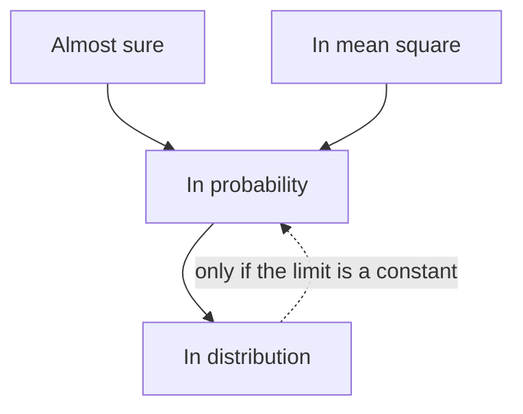

## Two kinds of "close" are not enough

The core lessons of this module used two meanings of "a sequence of random variables settles down".
The law of large numbers used **convergence in probability**: $P(|Y_n - c| \ge \varepsilon) \to 0$. The Central
Limit Theorem used **convergence in distribution**: the cdfs converge. This lesson adds two more
modes, shows exactly how all four relate, and then proves the tool statisticians use every day
without naming it: **Slutsky's theorem**, which explains why you may replace an unknown $\sigma$ by the
sample SD $S$ in a large-sample interval and still use the normal table.

## Almost sure convergence

$Y_n$ converges **almost surely** to $Y$ (written $Y_n \xrightarrow{a.s.} Y$) if

$$P\Big(\lim_{n \to \infty} Y_n = Y\Big) = 1.$$

This is a statement about whole *sequences*. Picture flipping a coin forever and recording the running
proportion of heads: each infinite run of flips gives one sequence of numbers $\hat p_1, \hat p_2, \dots$. Almost
sure convergence says that, apart from a set of runs with total probability zero, every run's sequence
converges in the ordinary calculus sense. The **strong law of large numbers** says exactly this for
sample means: if the $X_i$ are iid with a finite mean $\mu$, then $\bar X_n \xrightarrow{a.s.} \mu$ (proved in this
generality by Kolmogorov; the proof is beyond this course).

Convergence in probability is weaker. It says that for each *fixed* large $n$, being far from the limit
is unlikely. It does not forbid every run from straying far away now and then, forever, as long as
the strays become rarer.

## Convergence in mean square

$Y_n$ converges **in mean square** to $c$ if $E\big[(Y_n - c)^2\big] \to 0$. For an estimator $\hat\theta_n$ of $\theta$, that
quantity is the mean squared error, so "MSE goes to 0" is mean-square convergence. It implies
convergence in probability by Markov's inequality applied to $(Y_n - c)^2$:

$$P(|Y_n - c| \ge \varepsilon) = P\big((Y_n - c)^2 \ge \varepsilon^2\big) \le \frac{E[(Y_n - c)^2]}{\varepsilon^2} \to 0.$$

That is the WLLN proof of the core lesson in disguise: $E[(\bar X_n - \mu)^2] = \sigma^2/n \to 0$.

## How the modes relate



The arrows are theorems; the missing arrows are not, and each has a simple counterexample. The
last arrow is easy to prove: if $Y_n \xrightarrow{d} c$, the limit cdf jumps from 0 to 1 at $c$, so
$P(Y_n \le c - \varepsilon) \to 0$ and $P(Y_n \le c + \varepsilon/2) \to 1$; then
$P(|Y_n - c| \ge \varepsilon) \le P(Y_n \le c - \varepsilon) + 1 - P(Y_n \le c + \varepsilon/2) \to 0$.

The counterexamples need one more tool. The **Borel–Cantelli lemma** has two halves. Let $A_1, A_2, \dots$
be events.

- First half: if $\sum P(A_n) < \infty$, then with probability 1 only finitely many $A_n$ occur. (*Why:* the
  expected number that occur is $\sum P(A_n)$, which is finite, so the number that occur is finite with
  probability 1.)
- Second half: if the $A_n$ are *independent* and $\sum P(A_n) = \infty$, then with probability 1 infinitely
  many occur (stated without proof).

### Example 1: in probability but not almost surely

Let $Y_1, Y_2, \dots$ be independent with $Y_n = 1$ with probability $1/n$ and $Y_n = 0$ otherwise.

1. In probability: for $0 < \varepsilon < 1$, $P(|Y_n - 0| \ge \varepsilon) = P(Y_n = 1) = 1/n \to 0$. So $Y_n \xrightarrow{P} 0$.
2. Almost surely? The events $\{Y_n = 1\}$ are independent and $\sum 1/n = \infty$ (the harmonic series), so by
   the second half of Borel–Cantelli, with probability 1, $Y_n = 1$ for infinitely many $n$. A sequence of
   0s and 1s with infinitely many 1s does not converge to 0, and it cannot converge to anything else
   either, since it is 0 most of the time. So $Y_n$ does *not* converge almost surely.
3. Change the probability to $1/n^2$. Now $\sum 1/n^2 = \pi^2/6 < \infty$, so by the first half only finitely
   many 1s occur, and after the last one the sequence is 0 forever: $Y_n \xrightarrow{a.s.} 0$.

```plot
{"x": [0, 2000], "y": [0, 1.3], "xLabel": "n", "yLabel": "Y_n", "segments": [{"from": [1, 0], "to": [1, 1]}, {"from": [3, 0], "to": [3, 1]}, {"from": [10, 0], "to": [10, 1]}, {"from": [62, 0], "to": [62, 1]}, {"from": [94, 0], "to": [94, 1]}, {"from": [324, 0], "to": [324, 1]}, {"from": [459, 0], "to": [459, 1]}, {"from": [1330, 0], "to": [1330, 1]}], "caption": "One simulated run of independent Y_n with P(Y_n = 1) = 1/n: the 1s (spikes) at n = 1, 3, 10, 62, 94, 324, 459 and 1330 become rarer, but Borel–Cantelli says they never stop"}
```

The expected number of spikes up to $N$ is $\sum_{n \le N} 1/n \approx \ln N + 0.577$, about 8.2 for $N = 2000$; it grows
without bound, only very slowly.

### Example 2: in probability but not in mean

Let $Y_n = n$ with probability $1/n$ and $Y_n = 0$ otherwise.

1. $P(|Y_n| \ge \varepsilon) \le 1/n \to 0$, so $Y_n \xrightarrow{P} 0$.
2. But $E[Y_n] = n \cdot \tfrac1n = 1$ for every $n$, and $E[Y_n^2] = n^2 \cdot \tfrac1n = n \to \infty$. Neither the mean nor the
   mean square goes to 0.

Lesson: convergence in probability says nothing about expectations. A rare but huge value keeps the
mean up. (This is why a consistent estimator can still have a bias or MSE that does not vanish.)

### Example 3: in distribution but not in probability

Let $Z \sim N(0, 1)$ and set $Y_n = -Z$ for every $n$. Since $-Z$ is also $N(0, 1)$, every $Y_n$ has exactly the
distribution of $Z$, so $Y_n \xrightarrow{d} Z$ trivially. But $|Y_n - Z| = 2|Z|$, which does not shrink at all:
$P(|Y_n - Z| \ge 1) = P(|Z| \ge 0.5) \approx 0.62$ for every $n$. Convergence in distribution compares
probabilities, not values.

## Continuous functions and Slutsky's theorem

Two theorems let us combine limits.

The **continuous mapping theorem**: if $Y_n \xrightarrow{P} c$ and $g$ is continuous at $c$, then $g(Y_n) \xrightarrow{P} g(c)$; and if
$Y_n \xrightarrow{d} Y$ and $g$ is continuous, then $g(Y_n) \xrightarrow{d} g(Y)$. (The first half is almost the definition of
continuity: near $c$, $g$ moves little.) For example, $S^2 \xrightarrow{P} \sigma^2$ gives $S \xrightarrow{P} \sigma$ and $\sigma/S \xrightarrow{P} 1$.

**Slutsky's theorem** (Eugen Slutsky, 1925): if $X_n \xrightarrow{d} X$ and $Y_n \xrightarrow{P} c$ for a *constant* $c$, then

$$X_n + Y_n \xrightarrow{d} X + c, \qquad X_nY_n \xrightarrow{d} cX, \qquad X_n/Y_n \xrightarrow{d} X/c \ \ (c \ne 0).$$

The idea: $Y_n$ is eventually almost exactly $c$, so it acts like the constant $c$. The constant matters;
if $Y_n$ only converged in distribution to a random limit, nothing could be said about $X_n + Y_n$
without knowing how $X_n$ and $Y_n$ depend on each other.

### Example 4: the large-sample $t$ statistic

Let $X_1, \dots, X_n$ be iid with mean $\mu$ and finite variance $\sigma^2$ (any shape; finite fourth moment not
needed). Show that $T_n = (\bar X - \mu)/(S/\sqrt n) \xrightarrow{d} N(0, 1)$.

1. Write $T_n = \dfrac{\bar X - \mu}{\sigma/\sqrt n} \cdot \dfrac{\sigma}{S}$. The first factor $\xrightarrow{d} N(0, 1)$ by the CLT.
2. $S^2 = \dfrac{n}{n - 1}\Big(\dfrac1n\sum X_i^2 - \bar X^2\Big)$. By the WLLN (applied to the $X_i^2$, which have the finite
   mean $\sigma^2 + \mu^2$) and to $\bar X$, plus continuous mapping, $S^2 \xrightarrow{P} (\sigma^2 + \mu^2) - \mu^2 = \sigma^2$.
3. Continuous mapping again: $\sigma/S \xrightarrow{P} 1$.
4. Slutsky (product, $c = 1$): $T_n \xrightarrow{d} N(0, 1)$.

So for large $n$, $\bar X \pm 1.96\,S/\sqrt n$ is an approximate 95% interval for $\mu$ whatever the population.
With $n = 64$ incomes, $\bar x = 52.3$ and $s = 18.4$ (thousands of dollars): $52.3 \pm 1.96(18.4/8) = 52.3 \pm 4.508$,
or $(47.79, 56.81)$. Step 2 used the WLLN for the $X_i^2$, which needs only their finite mean; that is
why no assumption beyond a finite variance is required. For a proportion the same argument gives
$(\hat p - p)/\sqrt{\hat p(1 - \hat p)/n} \xrightarrow{d} N(0, 1)$, the basis of the Wald interval $\hat p \pm 1.96\sqrt{\hat p(1 - \hat p)/n}$;
with $n = 400$ and $\hat p = 0.3$, that is $0.3 \pm 0.045$, or $(0.255, 0.345)$. (Slutsky makes the Wald interval valid only as $n \to \infty$; for small $n$ or $\hat p$ near 0 or 1 its actual coverage can fall well below 95%.)

### Example 5: why the delta method works

The estimation module's delta method says $g(\bar X) \approx N\big(g(\mu), g'(\mu)^2\sigma^2/n\big)$. Slutsky makes this precise.
Suppose $g'$ is continuous at $\mu$.

1. Mean value theorem: $g(\bar X) - g(\mu) = g'(\xi_n)(\bar X - \mu)$ for some $\xi_n$ between $\bar X$ and $\mu$.
2. Multiply by $\sqrt n$: $\sqrt n\,\big(g(\bar X) - g(\mu)\big) = g'(\xi_n) \cdot \sqrt n(\bar X - \mu)$.
3. $\sqrt n(\bar X - \mu) \xrightarrow{d} N(0, \sigma^2)$ by the CLT. Since $\xi_n$ is trapped between $\bar X$ and $\mu$ and $\bar X \xrightarrow{P} \mu$,
   $\xi_n \xrightarrow{P} \mu$, so $g'(\xi_n) \xrightarrow{P} g'(\mu)$ by continuous mapping.
4. Slutsky: $\sqrt n\,\big(g(\bar X) - g(\mu)\big) \xrightarrow{d} N\big(0, g'(\mu)^2\sigma^2\big)$.

Numbers: waiting times are exponential with mean $\mu$, and the rate $\lambda = 1/\mu$ is estimated by $1/\bar X$.
Here $g(x) = 1/x$, $g'(\mu) = -1/\mu^2$ and $\sigma^2 = \mu^2$, so the asymptotic variance of $1/\bar X$ is
$\mu^2/(\mu^4 n) = \lambda^2/n$. With $n = 100$ and $\bar x = 2.2$: $\hat\lambda = 0.4545$, estimated SE $= \hat\lambda/\sqrt{100} = 0.0455$
(plugging $\hat\lambda$ in for $\lambda$ is one more use of Slutsky), and an approximate 95% interval is
$0.4545 \pm 0.0891$, or $(0.365, 0.544)$.

## Common mistakes

- *Using Slutsky with a random limit.* $Y_n$ must converge in probability to a *constant*.
- *Adding limits in distribution.* $X_n \xrightarrow{d} X$ and $Y_n \xrightarrow{d} Y$ say nothing about $X_n + Y_n$ on their own (take $X_n = Z$
  and $Y_n = -Z$: each converges in distribution to $N(0, 1)$, yet the sum is always 0, not the $N(0, 2)$ that independent limits would give).
- *Reading convergence in distribution as "values get close".* Example 3.
- *Assuming convergence in probability controls the mean.* Example 2.
- *Confusing the strong and weak laws.* Both say $\bar X_n \to \mu$; the strong law says it about almost every
  whole sequence, the weak law about each large $n$ separately.
- *Forgetting independence in the second half of Borel–Cantelli.* The first half needs none.

## Key points

- Almost sure: $P(\lim Y_n = Y) = 1$. Mean square: $E[(Y_n - c)^2] \to 0$.
- Almost sure $\Rightarrow$ in probability $\Rightarrow$ in distribution; mean square $\Rightarrow$ in probability; in distribution to a
  constant $\Rightarrow$ in probability. No other implications hold in general.
- Borel–Cantelli: $\sum P(A_n) < \infty$ means finitely many occur; independent with $\sum P(A_n) = \infty$ means infinitely many occur.
- Continuous mapping: continuous functions preserve convergence.
- Slutsky: $X_n \xrightarrow{d} X$, $Y_n \xrightarrow{P} c$ give $X_n + Y_n \to X + c$, $X_nY_n \to cX$, $X_n/Y_n \to X/c$ in distribution.
- Consequences: $(\bar X - \mu)/(S/\sqrt n) \xrightarrow{d} N(0, 1)$ for any finite-variance population; the delta method.
