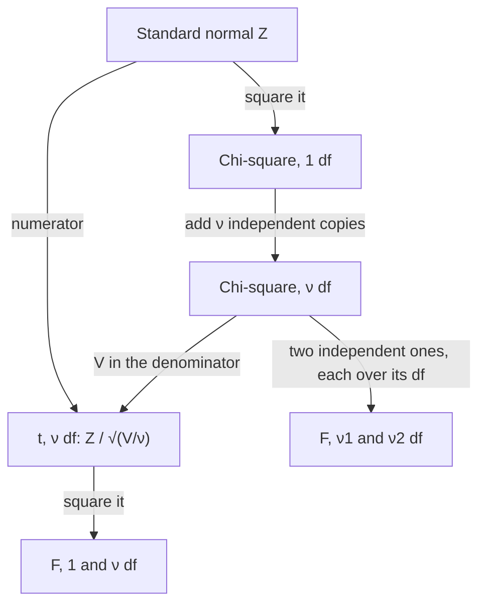

## Statistics are random variables

Statistical inference starts from a sample $X_1, \dots, X_n$, modeled as iid from a population
distribution with unknown parameters. Any function of the sample, such as $\bar X$ or the
**sample variance**

$$S^2 = \frac{1}{n-1}\sum_{i=1}^n (X_i - \bar X)^2,$$

is a **statistic**: it can be computed from data alone, and it varies from sample to sample. Its
probability distribution is its **sampling distribution**. The CLT gives approximate sampling
distributions for means of almost any population. When the population is *normal*, we can do
much better: the sampling distributions of $\bar X$, $S^2$ and several ratios are known exactly,
for every $n$. Three new families appear, chi-square, $t$ and $F$, and they power the
confidence intervals and tests in the rest of the course.

Throughout, $X_1, \dots, X_n$ are iid $N(\mu, \sigma^2)$ (second parameter = variance).

## The sample mean

A linear combination of independent normals is normal, so exactly

$$\bar X \sim N\!\left(\mu, \frac{\sigma^2}{n}\right), \qquad \frac{\bar X - \mu}{\sigma/\sqrt n} \sim N(0, 1).$$

The trouble is that $\sigma$ is rarely known. Replacing it by $S$ changes the distribution, and to
see how we need the distribution of $S^2$.

## The chi-square distribution

If $Z_1, \dots, Z_\nu$ are iid standard normal, the distribution of $Z_1^2 + \cdots + Z_\nu^2$ is the
**chi-square distribution** with $\nu$ **degrees of freedom**, written $\chi^2_\nu$.

*Where its formula comes from.* For one term, $P(Z^2 \le w) = P(-\sqrt w \le Z \le \sqrt w) = 2\Phi(\sqrt w) - 1$.
Differentiating, the density of $Z^2$ is $\phi(\sqrt w)\,w^{-1/2} = \frac{1}{\sqrt{2\pi}}\,w^{-1/2}e^{-w/2}$ for $w > 0$, a
gamma density with shape $\tfrac12$ and scale 2, whose MGF is $(1 - 2t)^{-1/2}$. Multiplying $\nu$ such MGFs gives
$(1 - 2t)^{-\nu/2}$: so $\chi^2_\nu$ is the gamma distribution with shape $\nu/2$ and scale 2. From the gamma
formulas,

$$E[\chi^2_\nu] = \nu, \qquad \operatorname{Var}(\chi^2_\nu) = 2\nu.$$

It is right-skewed, lives on $(0, \infty)$, and by the CLT looks more normal as $\nu$ grows.
Independent chi-squares add: $\chi^2_a + \chi^2_b = \chi^2_{a+b}$ (multiply the MGFs).

## The distribution of $S^2$

*Theorem.* For a normal sample,

$$\frac{(n-1)S^2}{\sigma^2} \sim \chi^2_{n-1}, \qquad\text{and } \bar X \text{ and } S^2 \text{ are independent.}$$

The independence is special to normal populations (for any other population $\bar X$ and $S^2$ are
dependent). A full proof uses the fact that $\bar X$ and the deviations $X_i - \bar X$ are jointly normal
and uncorrelated ($\operatorname{Cov}(\bar X, X_i - \bar X) = \sigma^2/n - \sigma^2/n = 0$), hence independent. Granting independence,
the chi-square part follows from an algebraic identity. Adding and subtracting $\bar X$,

$$\sum_{i=1}^n (X_i - \mu)^2 = \sum_{i=1}^n (X_i - \bar X)^2 + n(\bar X - \mu)^2,$$

because the cross term $2(\bar X - \mu)\sum(X_i - \bar X)$ is zero. Divide by $\sigma^2$:

$$\underbrace{\sum \Big(\frac{X_i - \mu}{\sigma}\Big)^2}_{\chi^2_n} = \frac{(n-1)S^2}{\sigma^2} + \underbrace{\Big(\frac{\bar X - \mu}{\sigma/\sqrt n}\Big)^2}_{\chi^2_1}.$$

The two pieces on the right are independent, so MGFs multiply:
$(1 - 2t)^{-n/2} = M(t)\,(1 - 2t)^{-1/2}$, giving $M(t) = (1 - 2t)^{-(n-1)/2}$, the $\chi^2_{n-1}$ MGF.

One degree of freedom is "used up" by estimating $\mu$ with $\bar X$: the $n$ deviations $X_i - \bar X$
must sum to zero, so only $n - 1$ of them are free. This is also why $S^2$ divides by $n - 1$. Since
$E[\chi^2_{n-1}] = n - 1$, we get $E[S^2] = \sigma^2$; and $\operatorname{Var}(S^2) = \frac{\sigma^4}{(n-1)^2}\cdot 2(n-1) = \frac{2\sigma^4}{n-1}$.

```plot
{"x": [0, 20], "y": [0, 0.17], "xLabel": "5S²/σ²", "yLabel": "density", "bars": [{"x": 0.5, "height": 0.0383, "width": 1}, {"x": 1.5, "height": 0.1167, "width": 1}, {"x": 2.5, "height": 0.147, "width": 1}, {"x": 3.5, "height": 0.149, "width": 1}, {"x": 4.5, "height": 0.1367, "width": 1}, {"x": 5.5, "height": 0.118, "width": 1}, {"x": 6.5, "height": 0.0803, "width": 1}, {"x": 7.5, "height": 0.0577, "width": 1}, {"x": 8.5, "height": 0.048, "width": 1}, {"x": 9.5, "height": 0.0353, "width": 1}, {"x": 10.5, "height": 0.0203, "width": 1}, {"x": 11.5, "height": 0.0177, "width": 1}, {"x": 12.5, "height": 0.0097, "width": 1}, {"x": 13.5, "height": 0.0087, "width": 1}, {"x": 14.5, "height": 0.0053, "width": 1}, {"x": 15.5, "height": 0.0047, "width": 1}, {"x": 16.5, "height": 0.002, "width": 1}, {"x": 17.5, "height": 0.002, "width": 1}, {"x": 18.5, "height": 0.0007, "width": 1}, {"x": 19.5, "height": 0.0007, "width": 1}], "functions": [{"f": "chi2pdf(x, 5)"}], "caption": "3000 simulated samples of size 6 from a normal population: the histogram of 5S²/σ² matches the chi-square density with 5 df"}
```

### Example 1

A gauge measures rail width with normally distributed errors, $\sigma^2 = 4$ mm². For a sample of
$n = 10$ measurements, find $P(S^2 > 6.5)$.

1. Convert to the pivot: $(n-1)S^2/\sigma^2 = 9S^2/4 \sim \chi^2_9$.
2. $S^2 > 6.5 \iff 9S^2/4 > 9(6.5)/4 = 14.625$.
3. $P(\chi^2_9 > 14.625) \approx 0.102$ (software or a table: the 0.90 quantile of $\chi^2_9$ is 14.68).

So about 1 sample in 10 will show a variance more than 60% above the true value: sample
variances from small samples are very noisy.

## Student's $t$ distribution

If $Z \sim N(0, 1)$ and $V \sim \chi^2_\nu$ are independent, then

$$T = \frac{Z}{\sqrt{V/\nu}}$$

has the **t distribution** with $\nu$ degrees of freedom, $t_\nu$. Its density is proportional to
$(1 + t^2/\nu)^{-(\nu+1)/2}$: symmetric about 0 and bell-shaped, but with heavier tails than the normal,
because the random denominator is sometimes small. As $\nu \to \infty$, $V/\nu \to 1$ (law of large numbers)
and $t_\nu \to N(0, 1)$. For $\nu > 2$ its variance is $\nu/(\nu - 2) > 1$.

For a normal sample, take $Z = (\bar X - \mu)/(\sigma/\sqrt n)$ and $V = (n-1)S^2/\sigma^2$, which are independent by
the theorem. The unknown $\sigma$ cancels:

$$\frac{(\bar X - \mu)/(\sigma/\sqrt n)}{\sqrt{S^2/\sigma^2}} = \frac{\bar X - \mu}{S/\sqrt n} \sim t_{n-1}.$$

This is the result W. S. Gosset published in 1908 under the pen name "Student", and it makes
exact small-sample inference about $\mu$ possible.

```plot
{"x": [-4.5, 4.5], "y": [0, 0.43], "xLabel": "t", "yLabel": "density", "functions": [{"f": "tpdf(x, 2)"}, {"f": "tpdf(x, 5)"}, {"f": "normpdf(x)", "dashed": true}], "caption": "t densities with 2 df (lowest peak, heaviest tails) and 5 df, and the dashed standard normal: t has heavier tails and approaches N(0, 1) as the df grow"}
```

### Example 2

For a normal sample of size 16, find the probability that $\bar X$ exceeds $\mu$ by more than half a
sample standard deviation, $P(\bar X - \mu > 0.5S)$.

1. Rewrite in terms of $T$: $\bar X - \mu > 0.5S \iff \dfrac{\bar X - \mu}{S/\sqrt{16}} > \dfrac{0.5S}{S/4} = 2$.
2. $T \sim t_{15}$, so the probability is $P(t_{15} > 2) \approx 0.032$.

With a known $\sigma$ the analogous probability would be $P(Z > 2) \approx 0.023$; the heavier $t$ tail
reflects the extra uncertainty from estimating $\sigma$.

## The $F$ distribution

If $U \sim \chi^2_{\nu_1}$ and $V \sim \chi^2_{\nu_2}$ are independent, then

$$F = \frac{U/\nu_1}{V/\nu_2}$$

has the **F distribution** with $\nu_1$ numerator and $\nu_2$ denominator degrees of freedom. It is
right-skewed on $(0, \infty)$, and two facts follow straight from the definition: $1/F \sim F_{\nu_2, \nu_1}$, and
$T^2 \sim F_{1, \nu}$ when $T \sim t_\nu$ (since $Z^2 \sim \chi^2_1$).

Its main use is comparing variances of two independent normal samples (sizes $n_1, n_2$):

$$\frac{S_1^2/\sigma_1^2}{S_2^2/\sigma_2^2} \sim F_{n_1 - 1,\; n_2 - 1}.$$

### Example 3

Two independent normal samples of sizes 11 and 8 come from populations with equal variances.
How likely is the first sample variance to be more than three times the second?
With $\sigma_1 = \sigma_2$ the ratio $S_1^2/S_2^2 \sim F_{10, 7}$, and $P(F_{10,7} > 3) \approx 0.079$. A threefold ratio is
not rare with samples this small, which is why variance comparisons need large samples to
detect modest differences.

## How the families fit together

All three new families are built from independent standard normals, as the chart traces.



Their shapes are worth knowing at sight: chi-square and $F$ live on the positive axis and are
right-skewed (chi-square centered near its df, $F$ near 1), while $t$ is a symmetric bell with a lower
peak and heavier tails than the standard normal.


## Common mistakes

- *Using $n$ degrees of freedom for $S^2$.* It is $n - 1$ for $(n-1)S^2/\sigma^2$ and for the $t$ statistic.
- *Applying these exact results to non-normal data.* The chi-square result for $S^2$ is
  especially sensitive to non-normality; the $t$ result is fairly robust for moderate $n$.
- *Forgetting to convert.* Probabilities about $S^2$ must be rewritten in terms of $(n-1)S^2/\sigma^2$
  before using a chi-square table.
- *Mixing up the $F$ degrees of freedom.* Numerator df first; swapping them inverts the ratio.

## Key points

- Normal sample: $\bar X \sim N(\mu, \sigma^2/n)$ and $(n-1)S^2/\sigma^2 \sim \chi^2_{n-1}$, independent.
- $\chi^2_\nu$ = sum of $\nu$ squared standard normals = gamma(shape $\nu/2$, scale 2); mean $\nu$, variance $2\nu$.
- $T = Z/\sqrt{V/\nu} \sim t_\nu$; $(\bar X - \mu)/(S/\sqrt n) \sim t_{n-1}$.
- $F = (U/\nu_1)/(V/\nu_2)$; $(S_1^2/\sigma_1^2)/(S_2^2/\sigma_2^2) \sim F_{n_1-1, n_2-1}$.
- $E[S^2] = \sigma^2$ and $\operatorname{Var}(S^2) = 2\sigma^4/(n-1)$ for normal data.
