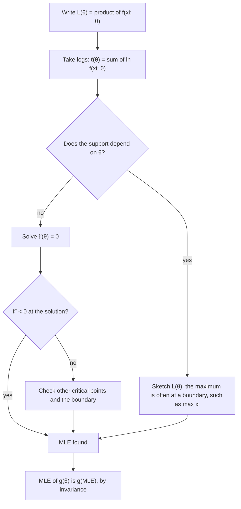

## Where do estimators come from?

The last lesson judged estimators that were handed to us. This one shows how to *construct*
them for any model. The method of moments is quick and intuitive. Maximum likelihood is the
workhorse of modern statistics: it applies to almost any model, and its estimators are
consistent and, for large samples, as efficient as possible. Both turn "a model with unknown
parameters + data" into numbers.

Throughout, $x_1, \dots, x_n$ are the observed values of an iid sample from a density or pmf
$f(x; \theta)$.

## The method of moments

The $k$th population moment is $\mu_k(\theta) = E[X^k]$, a function of the parameters. The $k$th **sample moment** is $m_k = \frac1n\sum x_i^k$. By the law of large numbers $m_k \to \mu_k$, so it is natural to choose the
parameter values that make them agree. The **method of moments** (MoM): with $p$ unknown
parameters, solve

$$\mu_k(\theta) = m_k, \qquad k = 1, \dots, p.$$

- *Exponential with rate $\lambda$*: $E[X] = 1/\lambda = \bar x$, so $\tilde\lambda = 1/\bar x$.
- *Normal$(\mu, \sigma^2)$*: $\mu = \bar x$ and $\sigma^2 + \mu^2 = m_2$, so $\tilde\mu = \bar x$ and
  $\tilde\sigma^2 = m_2 - \bar x^2 = \frac1n\sum(x_i - \bar x)^2$.
- *Uniform$(0, \theta)$*: $E[X] = \theta/2 = \bar x$, so $\tilde\theta = 2\bar x$.

MoM estimators are usually consistent (sample moments converge, and the solution is a
continuous function of them), but they can be inefficient and can even give impossible
answers. For the uniform data $0.4, 1.1, 0.7, 4.6, 0.9$ we get $\tilde\theta = 2(1.54) = 3.08$, yet one
observation is 4.6, so $\theta$ must be at least 4.6.

## The likelihood function

Once the data are observed, the joint density $\prod f(x_i; \theta)$ can be read as a function of $\theta$
with the data held fixed. That is the **likelihood function**

$$L(\theta) = \prod_{i=1}^n f(x_i; \theta).$$

For discrete data, $L(\theta)$ is the probability of getting exactly the observed sample if the
parameter were $\theta$. The **maximum likelihood estimate** (**MLE**) $\hat\theta$ is the value of $\theta$ that
maximizes $L$: the parameter value under which the observed data were most probable.

Products are awkward to differentiate, so we maximize the **log-likelihood**
$\ell(\theta) = \ln L(\theta) = \sum \ln f(x_i; \theta)$ instead; since $\ln$ is increasing, it has the same maximizer.
Typically we solve $\ell'(\theta) = 0$ and check that it is a maximum (for instance $\ell'' < 0$).

The chart collects the whole procedure, including the case where calculus fails (the uniform
example below).



### Example 1: Bernoulli

With $x_i \in \{0, 1\}$ and $s = \sum x_i$ successes,
$L(p) = \prod p^{x_i}(1-p)^{1 - x_i} = p^s(1-p)^{n-s}$ and $\ell(p) = s\ln p + (n - s)\ln(1-p)$.

$$\ell'(p) = \frac{s}{p} - \frac{n - s}{1 - p} = 0 \;\Longrightarrow\; s(1 - p) = (n - s)p \;\Longrightarrow\; \hat p = \frac{s}{n} = \bar x.$$

$\ell''(p) = -s/p^2 - (n-s)/(1-p)^2 < 0$, so this is a maximum. The MLE is the sample proportion.

### Example 2: Poisson

Signal faults on six days: $2, 0, 3, 1, 4, 2$. Model: iid Poisson($\lambda$).

1. $\ell(\lambda) = \sum\big(x_i\ln\lambda - \lambda - \ln x_i!\big) = \Big(\sum x_i\Big)\ln\lambda - n\lambda - \text{const}$.
2. $\ell'(\lambda) = \sum x_i/\lambda - n = 0$ gives $\hat\lambda = \bar x$.
3. Here $\sum x_i = 12$, $n = 6$, so $\hat\lambda = 2$ faults per day.

The log-likelihood has its peak in the same place as the likelihood: its tangent is horizontal at
$\lambda = 2$.

```plot
{"x": [0.3, 5], "y": [-10, 2], "xLabel": "λ", "yLabel": "log-likelihood (constant dropped)", "functions": [{"f": "12 ln(x) - 6x"}], "segments": [{"from": [1, -3.68], "to": [3, -3.68], "dashed": true}], "points": [{"at": [2, -3.68], "label": "λ̂ = 2"}], "caption": "Poisson log-likelihood 12 ln λ − 6λ for the six counts: concave, with a horizontal tangent at the MLE"}
```

```plot
{"x": [0, 5], "y": [0, 1.1], "xLabel": "λ", "yLabel": "relative likelihood", "functions": [{"f": "(x/2)^12 e^(-6(x - 2))"}], "points": [{"at": [2, 1], "label": "MLE λ̂ = 2"}], "caption": "Poisson likelihood for the six counts, scaled so its maximum is 1"}
```

### Example 3: exponential

Component lifetimes (hours): $120, 45, 300, 80, 155$, modeled as exponential with rate $\lambda$.

1. $\ell(\lambda) = \sum(\ln\lambda - \lambda x_i) = n\ln\lambda - \lambda\sum x_i$.
2. $\ell'(\lambda) = n/\lambda - \sum x_i = 0$ gives $\hat\lambda = n/\sum x_i = 1/\bar x$; $\ell'' = -n/\lambda^2 < 0$.
3. $\bar x = 700/5 = 140$, so $\hat\lambda = 1/140 \approx 0.00714$ per hour.

## Invariance

If $\hat\theta$ is the MLE of $\theta$, then for any function $g$ the MLE of $g(\theta)$ is $g(\hat\theta)$. This **invariance property** is easy to see for one-to-one $g$: reparametrizing doesn't change which model makes
the data most probable, it only relabels it. (The result is also used for general $g$.)

In Example 3, the MLE of the mean lifetime $1/\lambda$ is $1/\hat\lambda = 140$ hours, and the MLE of the
reliability $P(X > 200) = e^{-200\lambda}$ is $e^{-200/140} \approx 0.240$. In Example 2, the MLE of the chance of a
fault-free day, $e^{-\lambda}$, is $e^{-2} \approx 0.135$. Note that invariance does *not* preserve unbiasedness:
$1/\bar x$ is a biased estimator of $\lambda$ even though $\bar x$ is unbiased for $1/\lambda$.

### Example 4: normal, two parameters

With both $\mu$ and $\sigma^2$ unknown, $\ell(\mu, \sigma^2) = -\frac n2\ln(2\pi\sigma^2) - \frac{1}{2\sigma^2}\sum(x_i - \mu)^2$. Set both partial
derivatives to zero:

$$\frac{\partial\ell}{\partial\mu} = \frac{1}{\sigma^2}\sum(x_i - \mu) = 0 \Rightarrow \hat\mu = \bar x; \qquad \frac{\partial\ell}{\partial\sigma^2} = -\frac{n}{2\sigma^2} + \frac{\sum(x_i - \mu)^2}{2\sigma^4} = 0 \Rightarrow \hat\sigma^2 = \frac1n\sum(x_i - \bar x)^2.$$

The variance MLE divides by $n$, not $n - 1$, so it is slightly biased (but consistent). For the
gauge readings $9.8, 10.4, 10.1, 9.6, 10.6$: $\hat\mu = 10.1$, the squared deviations are
$0.09, 0.09, 0, 0.25, 0.25$, so $\hat\sigma^2 = 0.68/5 = 0.136$ and, by invariance, $\hat\sigma = \sqrt{0.136} \approx 0.369$.

## When calculus fails: Uniform$(0, \theta)$

Each density is $1/\theta$ on $(0, \theta)$, so

$$L(\theta) = \begin{cases} \theta^{-n} & \text{if } \theta \ge \max x_i, \\ 0 & \text{otherwise,} \end{cases}$$

because if any $x_i$ exceeded $\theta$, that observation would be impossible. On $[\max x_i, \infty)$, $\theta^{-n}$ is
*decreasing*, so the maximum is at the left endpoint: $\hat\theta = \max x_i = X_{(n)}$. Setting $L'(\theta) = 0$ finds
nothing; the maximum is at a boundary where $L$ jumps.

```plot
{"x": [0, 9], "y": [0, 1.1], "xLabel": "θ", "yLabel": "relative likelihood", "functions": [{"f": "0", "from": 0, "to": 4.6}, {"f": "(4.6/x)^5", "from": 4.6, "to": 9}], "points": [{"at": [4.6, 1], "label": "MLE = max = 4.6"}, {"at": [4.6, 0], "open": true}, {"at": [3.08, 0], "label": "MoM 3.08"}], "caption": "Uniform(0, θ) likelihood for the five readings: zero below the largest value, then decreasing"}
```

For the data $0.4, 1.1, 0.7, 4.6, 0.9$ the MLE is 4.6. It is biased low (from the order statistics
lesson, $E[X_{(n)}] = \frac{n}{n+1}\theta$), and the unbiased version $\frac{n+1}{n}X_{(n)} = 5.52$ is the
estimator that beat $2\bar X$ so decisively last lesson.

## Large-sample behavior of the MLE

Under regularity conditions (the same ones as for the Cramér–Rao bound), the MLE is consistent
and approximately normal for large $n$:

$$\hat\theta \approx N\!\left(\theta,\; \frac{1}{nI(\theta)}\right).$$

Asymptotically it is unbiased and attains the Cramér–Rao bound, which is why maximum
likelihood is the default method. The approximation also gives a standard error,
$1/\sqrt{nI(\hat\theta)}$, used for large-sample confidence intervals.

The same idea gives standard errors for a function of the parameter. If $\hat\theta \approx N(\theta, v)$ and $g$
is differentiable with $g'(\theta) \ne 0$, the first-order Taylor expansion
$g(\hat\theta) \approx g(\theta) + g'(\theta)(\hat\theta - \theta)$ gives the **delta method**:

$$g(\hat\theta) \approx N\!\big(g(\theta),\; [g'(\theta)]^2\,v\big).$$

In Example 3, $I(\lambda) = 1/\lambda^2$, so $\hat\lambda \approx N(\lambda, \lambda^2/n)$. The mean lifetime $g(\lambda) = 1/\lambda$ has
$g'(\lambda) = -1/\lambda^2$, so its MLE $1/\hat\lambda = \bar x$ has standard error about $\frac{1}{\lambda^2}\cdot\frac{\lambda}{\sqrt n} = \frac{1}{\lambda\sqrt n}$,
estimated by $140/\sqrt 5 \approx 62.6$ hours.

## Sufficient statistics

In every example above the likelihood depended on the data only through a summary: $\sum x_i$
for the Bernoulli, Poisson and exponential models, the pair $(\sum x_i, \sum x_i^2)$ for the normal,
and $\max x_i$ for the uniform. A statistic $T$ is a **sufficient statistic** for $\theta$ if the
conditional distribution of the sample given $T$ does not depend on $\theta$: once $T$ is known, the
rest of the data says nothing more about $\theta$. The **factorization theorem** gives a quick test:
$T = u(X_1, \dots, X_n)$ is sufficient if and only if the joint pmf or pdf can be written

$$f(x_1, \dots, x_n; \theta) = \phi\big(u(x_1, \dots, x_n);\, \theta\big)\; h(x_1, \dots, x_n),$$

where $h$ does not involve $\theta$. For Poisson data,
$\prod e^{-\lambda}\lambda^{x_i}/x_i! = \big(e^{-n\lambda}\lambda^{\sum x_i}\big)\cdot\big(1/\prod x_i!\big)$, so $\sum X_i$
(equivalently $\bar X$) is sufficient. Because $h$ plays no part in maximizing over $\theta$, a unique
MLE depends on the data only through a sufficient statistic. The next lesson shows that the best
unbiased estimators also depend on the data only through a sufficient statistic (the Rao–Blackwell
theorem), and how to find them.

## Common mistakes

- *Maximizing over the data instead of the parameter.* In $L(\theta)$ the data are fixed numbers.
- *Skipping the check.* A zero derivative might be a minimum, and the maximum might be on a
  boundary (as for the uniform).
- *Setting $L'(\theta) = 0$ for the uniform.* It has no solution; reason from the shape of $L$.
- *Using $n - 1$ in the normal MLE.* The MLE of $\sigma^2$ divides by $n$.
- *Expecting invariance to keep unbiasedness.* $\hat\sigma = \sqrt{\hat\sigma^2}$ is the MLE of $\sigma$ but is biased.

## Key points

- MoM: set $E[X^k] = \frac1n\sum x_i^k$ for $k = 1, \dots, p$ and solve.
- $L(\theta) = \prod f(x_i; \theta)$; maximize $\ell = \ln L$, usually via $\ell'(\theta) = 0$.
- MLEs: Bernoulli $\hat p = \bar x$; Poisson $\hat\lambda = \bar x$; exponential $\hat\lambda = 1/\bar x$; normal
  $\hat\mu = \bar x$, $\hat\sigma^2 = \frac1n\sum(x_i - \bar x)^2$; Uniform$(0, \theta)$: $\hat\theta = \max x_i$.
- Invariance: the MLE of $g(\theta)$ is $g(\hat\theta)$.
- Large $n$: $\hat\theta \approx N(\theta, 1/(nI(\theta)))$; delta method: $\operatorname{SE}(g(\hat\theta)) \approx |g'(\theta)|\operatorname{SE}(\hat\theta)$.
- Factorization: $T$ is sufficient iff $f(\mathbf x; \theta) = \phi(T; \theta)\,h(\mathbf x)$; a unique MLE is a function of $T$.
