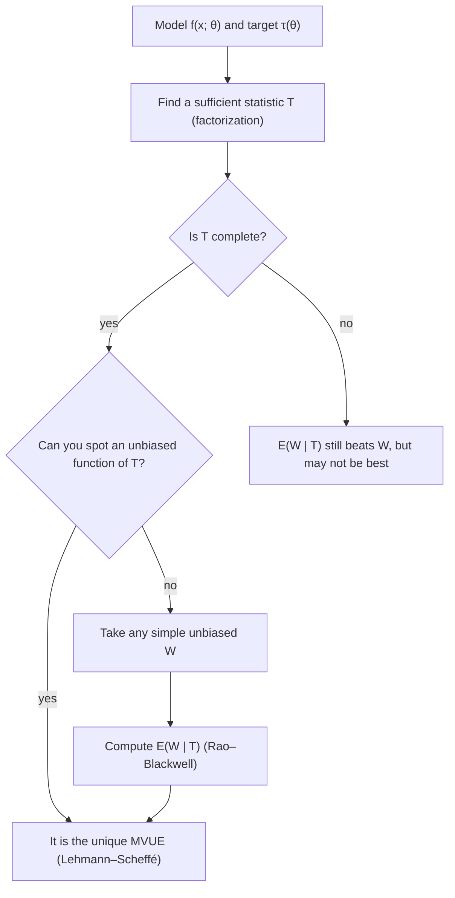

## The best unbiased estimator

Two lessons ago we compared unbiased estimators by their variances, and the Cramér–Rao bound
told us how small a variance could possibly be. That settles the question only when some
estimator actually attains the bound, which happens for $\bar X$ in a few families and fails in
many others: the bound does not apply to Uniform$(0, \theta)$, and for most functions of a parameter
(such as $e^{-\lambda}$ or $p^2$) no unbiased estimator reaches it. This lesson gives a different route to
the best unbiased estimator, built on the sufficient statistics of the last lesson.

An unbiased estimator $W$ of $\tau(\theta)$ is a **minimum-variance unbiased estimator** (MVUE, or UMVUE,
with U for "uniformly") if $\operatorname{Var}_\theta(W) \le \operatorname{Var}_\theta(W')$ for every other unbiased estimator $W'$ *and every*
$\theta$. Two theorems find it: Rao–Blackwell improves any unbiased estimator, and Lehmann–Scheffé says
when the improvement is the best possible.

## Rao–Blackwell: condition on a sufficient statistic

Recall that $T$ is sufficient for $\theta$ when the conditional distribution of the data given $T$ is
free of $\theta$. Start with any unbiased estimator $W$ of $\tau(\theta)$, however crude, and define

$$\phi(T) = E[W \mid T].$$

The **Rao–Blackwell theorem** says that $\phi(T)$ is an estimator, it is unbiased for $\tau(\theta)$, and
$\operatorname{Var}_\theta(\phi(T)) \le \operatorname{Var}_\theta(W)$ for every $\theta$. Replacing $W$ by $\phi(T)$ is called **Rao–Blackwellization**.

*Why each part holds.*

1. *It is a statistic.* $E[W \mid T]$ is computed from the conditional distribution of the data given
   $T$, which by sufficiency does not involve $\theta$. Without sufficiency the "estimator" would depend
   on the unknown parameter and could not be computed.
2. *Unbiased.* By the law of total expectation, $E[\phi(T)] = E\big[E[W \mid T]\big] = E[W] = \tau(\theta)$.
3. *Smaller variance.* By the law of total variance,
   $\operatorname{Var}(W) = E\big[\operatorname{Var}(W \mid T)\big] + \operatorname{Var}\big(E[W \mid T]\big) \ge \operatorname{Var}(\phi(T)),$
   since the first term is nonnegative. Equality needs $\operatorname{Var}(W \mid T) = 0$, that is, $W$ was already a function of $T$.

Averaging $W$ over all the data sets that share the same value of $T$ removes noise that carries no
information about $\theta$.

### Example 1: Bernoulli trials

Let $X_1, \dots, X_n$ be iid Bernoulli$(p)$ and $T = \sum X_i$, which is sufficient. Given $T = t$, every
arrangement of the $t$ ones among the $n$ positions is equally likely (each has probability
$p^t(1-p)^{n-t}$ before conditioning), so the conditional distribution is free of $p$.

1. *Estimating $p$.* $W = X_1$ is unbiased but uses one observation. Given $T = t$, the first position is a
   one with probability $t/n$, so $\phi(T) = E[X_1 \mid T] = T/n = \bar X$.
2. *Estimating $p^2$.* $W = X_1X_2$ is unbiased, since $E[X_1X_2] = p \cdot p$. Given $T = t$, both of the first two
   positions are ones with probability $\binom{n-2}{t-2}\big/\binom{n}{t} = \dfrac{t(t-1)}{n(n-1)}$, so
   $\phi(T) = \dfrac{T(T-1)}{n(n-1)}.$ The same argument with $W = X_1(1 - X_2)$ gives $\dfrac{T(n-T)}{n(n-1)}$ for $p(1-p)$.
3. *Numbers.* In 10 inspections, 4 parts fail. The improved estimate of $p^2$ is $\dfrac{4 \cdot 3}{10 \cdot 9} = 0.133$, while
   the plug-in $\hat p^2 = 0.16$ is biased upward: $E[\bar X^2] = p^2 + p(1-p)/n$.

### Example 2: the chance of a fault-free day

Daily signal faults are iid Poisson$(\lambda)$, and we want $\tau(\lambda) = P(X = 0) = e^{-\lambda}$. A crude unbiased estimator is
the indicator $W = 1\{X_1 = 0\}$. The sufficient statistic is $T = \sum X_i$.

1. *Conditional distribution.* For $0 \le k \le t$,
   $$P(X_1 = k \mid T = t) = \frac{\dfrac{e^{-\lambda}\lambda^k}{k!}\cdot\dfrac{e^{-(n-1)\lambda}((n-1)\lambda)^{t-k}}{(t-k)!}}{\dfrac{e^{-n\lambda}(n\lambda)^t}{t!}} = \binom{t}{k}\Big(\frac1n\Big)^k\Big(1 - \frac1n\Big)^{t-k},$$
   using that $X_2 + \cdots + X_n \sim$ Poisson$((n-1)\lambda)$ independently of $X_1$. Every $\lambda$ cancels: given the total, $X_1$ is
   Binomial$(t, 1/n)$.
2. *Rao–Blackwellize.* $\phi(T) = P(X_1 = 0 \mid T) = (1 - 1/n)^T$.
3. *Numbers.* For the counts $2, 0, 3, 1, 4, 2$ from the last lesson, $n = 6$ and $t = 12$: $\phi = (5/6)^{12} \approx 0.112$.
   The MLE $e^{-\bar x} = e^{-2} \approx 0.135$ is close but biased. For large $n$ the two agree, because
   $(1 - 1/n)^{n\bar x} \to e^{-\bar x}$.

The improvement is dramatic. Here $\operatorname{Var}(W) = e^{-\lambda}(1 - e^{-\lambda})$, while the Poisson MGF gives
$E\big[(1-1/n)^{2T}\big] = e^{n\lambda[(1-1/n)^2 - 1]}$, so $\operatorname{Var}(\phi) = e^{-2\lambda}\big(e^{\lambda/n} - 1\big)$.

```plot
{"x": [0, 4], "y": [0, 0.27], "xLabel": "λ", "yLabel": "variance", "functions": [{"f": "e^(-x)(1 - e^(-x))"}, {"f": "e^(-2x)(e^(x/6) - 1)"}, {"f": "x e^(-2x)/6", "dashed": true}], "labels": [{"at": [2.95, 0.14], "text": "crude: indicator of X₁ = 0"}, {"at": [1.75, 0.055], "text": "Rao–Blackwell: (5/6)ᵀ"}], "caption": "Estimating e^(−λ) from n = 6 Poisson counts: variance of the indicator of X₁ = 0, of its Rao–Blackwellized version (5/6)ᵀ, and the Cramér–Rao bound (dashed), which nothing unbiased attains"}
```

## Completeness and Lehmann–Scheffé

Rao–Blackwell improves an estimator, but different starting points $W$ might lead to different
functions of $T$. Completeness rules that out. A statistic $T$ is **complete** if the only function of
$T$ with mean zero for every $\theta$ is the zero function:

$$E_\theta[g(T)] = 0 \text{ for all } \theta \quad\Longrightarrow\quad P_\theta(g(T) = 0) = 1 \text{ for all } \theta.$$

Then two unbiased estimators $\phi_1(T)$ and $\phi_2(T)$ of the same $\tau(\theta)$ must be equal, because
$g = \phi_1 - \phi_2$ has mean zero. A complete statistic contains no "noise" that averages to zero.

*Poisson.* $T = \sum X_i \sim$ Poisson$(n\lambda)$, so $E[g(T)] = e^{-n\lambda}\sum_{t \ge 0} g(t)\dfrac{n^t}{t!}\lambda^t$. If this is 0 for all $\lambda > 0$, the
power series in $\lambda$ is identically zero, so every coefficient $g(t)n^t/t!$ is zero. *Bernoulli* works
the same way with a polynomial: $E[g(T)] = (1-p)^n\sum_t g(t)\binom nt r^t$ with $r = p/(1-p)$.

*Not complete.* For two observations, the whole sample $(X_1, X_2)$ is sufficient, but $g = X_1 - X_2$ has
mean zero without being zero. That is why Rao–Blackwellizing on the full data changes nothing.

The **Lehmann–Scheffé theorem**: if $T$ is a complete sufficient statistic and $\phi(T)$ is unbiased for $\tau(\theta)$,
then $\phi(T)$ is the unique MVUE of $\tau(\theta)$. *Proof:* take any unbiased $W$. Its Rao–Blackwellization
$E[W \mid T]$ is an unbiased function of $T$, so by completeness it equals $\phi(T)$, and therefore
$\operatorname{Var}(\phi(T)) \le \operatorname{Var}(W)$.

So the recipe is: *find a complete sufficient statistic, then find any unbiased function of it*,
either by guessing from $E[T]$, $E[T^2]$, … or by Rao–Blackwellizing a simple unbiased estimator. Examples
1 and 2 therefore produced the MVUEs of $p$, $p^2$ and $e^{-\lambda}$.

The chart puts the recipe in order.



## Where complete sufficient statistics come from

A one-parameter **exponential family** has a density or pmf of the form

$$f(x; \theta) = h(x)\,c(\theta)\exp\big(w(\theta)\,t(x)\big),$$

with a support that does not depend on $\theta$. By the factorization theorem $T = \sum t(X_i)$ is sufficient,
and when the values of $w(\theta)$ (the natural parameter) fill an interval, $T$ is also complete. Bernoulli
($t(x) = x$, $w = \ln\frac{p}{1-p}$), Poisson ($t(x) = x$, $w = \ln\lambda$), exponential and normal with known variance are all of this
form, so $\sum X_i$ is complete sufficient for each. For the exponential rate, $T = \sum X_i \sim$ Gamma(shape $n$,
scale $1/\lambda$) has $E[1/T] = \lambda/(n-1)$, so the MLE $n/T$ is biased upward and $(n-1)/T$ is the MVUE of $\lambda$ (for $n \ge 2$). For $N(\mu, \sigma^2)$ with both unknown, the pair
$(\sum X_i, \sum X_i^2)$, equivalently $(\bar X, S^2)$, is complete sufficient.

The uniform is not an exponential family, but its maximum still works. $X_{(n)}$ has density $nm^{n-1}/\theta^n$ on
$(0, \theta)$; if $\int_0^\theta g(m)\,m^{n-1}\,dm = 0$ for every $\theta$, differentiating in $\theta$ gives $g(\theta)\theta^{n-1} = 0$. So $X_{(n)}$ is complete
sufficient, and $\frac{n+1}{n}X_{(n)}$ from the point-estimators lesson is the MVUE of $\theta$.

### Example 3: normal data

For gauge readings $9.8, 10.4, 10.1, 9.6, 10.6$ assumed $N(\mu, \sigma^2)$, both unknown: $\bar x = 10.1$, $s^2 = 0.17$.

1. $\bar X$ and $S^2$ are unbiased functions of the complete sufficient $(\bar X, S^2)$, so they are the
   MVUEs of $\mu$ and $\sigma^2$: estimates 10.1 and 0.17. The MLE $\hat\sigma^2 = 0.136$ is not unbiased.
2. *Estimating $\mu^2$.* $E[\bar X^2] = \mu^2 + \sigma^2/n$, so subtract an unbiased estimate of $\sigma^2/n$: $\bar X^2 - S^2/n$
   is unbiased and is the MVUE. The estimate is $102.01 - 0.17/5 = 101.976$.
3. *The bound is not reached.* $\operatorname{Var}(S^2) = 2\sigma^4/(n-1)$, while the Cramér–Rao bound for $\sigma^2$ is $2\sigma^4/n$
   ($I(\sigma^2) = 1/(2\sigma^4)$). No unbiased estimator does better than $S^2$, yet none attains the bound.

## Common mistakes

- *Conditioning on a statistic that is not sufficient.* Then $E[W \mid T]$ depends on $\theta$ and is not an
  estimator at all.
- *Assuming the MVUE attains the Cramér–Rao bound.* The bound is a floor, not a guarantee; $S^2$ and $(1-1/n)^T$ sit above it.
- *Treating "MVUE" as "best".* It is best among unbiased estimators only; a biased estimator such as
  $e^{-\bar X}$ or $\hat\sigma^2$ can have smaller MSE.
- *Plugging in.* $\bar X^2$ is not unbiased for $\mu^2$ or $p^2$; correct the bias with a function of $T$.
- *Forgetting the conditions.* Lehmann–Scheffé needs $T$ complete as well as sufficient.

Unbiasedness can even force absurd answers. With a single Poisson count $X$, the only unbiased
estimator of $e^{-2\lambda}$ is $(-1)^X$, since $E[(-1)^X] = e^{-\lambda}\sum(-\lambda)^x/x! = e^{-2\lambda}$. It estimates a probability by $\pm 1$.

## Key points

- MVUE (UMVUE): unbiased, with the smallest variance among unbiased estimators for every $\theta$.
- Rao–Blackwell: if $W$ is unbiased and $T$ sufficient, $E[W \mid T]$ is unbiased with variance at most $\operatorname{Var}(W)$.
- Complete: $E_\theta[g(T)] = 0$ for all $\theta$ forces $g(T) = 0$.
- Lehmann–Scheffé: an unbiased function of a complete sufficient statistic is the unique MVUE.
- Exponential families: $\sum t(X_i)$ is complete sufficient. MVUEs: $\bar X$ for $p$, $\lambda$ and $\mu$; $S^2$ for $\sigma^2$;
  $T(T-1)/(n(n-1))$ for $p^2$; $(n-1)/T$ for an exponential rate; $(1 - 1/n)^T$ for $e^{-\lambda}$; $\frac{n+1}{n}X_{(n)}$ for a uniform $\theta$.
