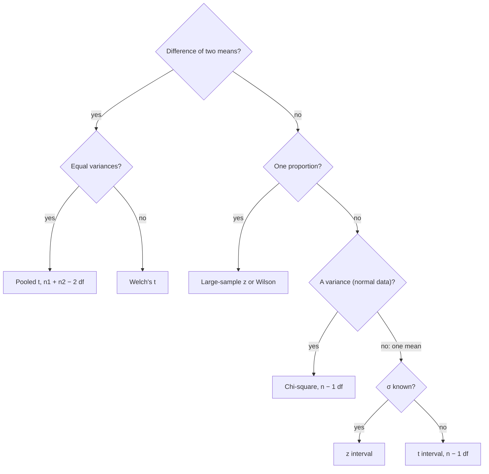

## From a point to a range

A point estimate gives one number with no indication of how far off it might be. A confidence
interval gives a range of plausible values together with a guarantee about the *procedure*:
over repeated samples, intervals built this way capture the true parameter a stated fraction
of the time. This lesson shows a single recipe, the pivotal quantity, that produces every
standard interval, using the sampling distributions of the chi-square, $t$ and $F$ lesson. When no
pivot is available, the bootstrap of the next lesson builds intervals by computation instead.

## Pivots and the recipe

A **pivotal quantity** (pivot) is a function $Q(X_1, \dots, X_n; \theta)$ of the data *and* the parameter
whose distribution is completely known: it does not depend on $\theta$ or any other unknown. For
a normal sample with known $\sigma$, $Q = (\bar X - \mu)/(\sigma/\sqrt n) \sim N(0, 1)$ is a pivot for $\mu$.

The recipe:

1. Find a pivot $Q$.
2. From its known distribution, pick $a < b$ with $P(a \le Q \le b) = 1 - \alpha$ (usually cutting $\alpha/2$
   from each tail).
3. Rearrange the inequalities $a \le Q \le b$ into the form $L \le \theta \le U$, where $L$ and $U$ depend only on
   the data.

Then $P(L \le \theta \le U) = 1 - \alpha$, and $[L, U]$ is a $100(1-\alpha)\%$ **confidence interval** with
**confidence level** $1 - \alpha$.

Notation: $z_{\alpha/2}$ is the value with area $\alpha/2$ to its right under $N(0, 1)$ (1.960 for $\alpha = 0.05$), and
$t_{\alpha/2,\,\nu}$ the same for $t_\nu$.

The picture shows step 2 for the $t$ pivot: the two cutoffs leave area $\alpha/2$ in each tail, so the
pivot falls between them with probability $1 - \alpha$.


## Normal mean, $\sigma$ known

Start from $-z_{\alpha/2} \le \dfrac{\bar X - \mu}{\sigma/\sqrt n} \le z_{\alpha/2}$. Multiply by $\sigma/\sqrt n$, subtract $\bar X$, and multiply by $-1$
(which flips the inequalities):

$$\bar X - z_{\alpha/2}\frac{\sigma}{\sqrt n} \le \mu \le \bar X + z_{\alpha/2}\frac{\sigma}{\sqrt n}.$$

The half-width $E = z_{\alpha/2}\sigma/\sqrt n$ is the **margin of error**. Solving for $n$ gives the sample size for
a desired margin: $n = (z_{\alpha/2}\sigma/E)^2$, rounded up. With $\sigma = 8$, 95% confidence and $E = 2$:
$n = (1.96 \times 8/2)^2 = 61.5$, so 62 observations.

## Normal mean, $\sigma$ unknown

Replace $\sigma$ by $S$ and use the $t$ pivot $\dfrac{\bar X - \mu}{S/\sqrt n} \sim t_{n-1}$. The same algebra gives

$$\bar X \pm t_{\alpha/2,\,n-1}\frac{S}{\sqrt n}.$$

Because $t$ quantiles exceed $z$ quantiles, the interval is wider, the price of estimating $\sigma$.
For large $n$, or non-normal data with large $n$ (by the CLT), $t$ and $z$ intervals nearly coincide.

### Example 1

Twelve brake-pad tests give $\bar x = 48.3$ mm of wear and $s = 4.1$ mm. Assuming normality, find a
95% interval for the mean wear $\mu$.

1. df $= 11$; $t_{0.025,\,11} \approx 2.201$.
2. Margin: $2.201 \times 4.1/\sqrt{12} \approx 2.201 \times 1.1836 \approx 2.605$.
3. Interval: $48.3 \pm 2.605$, that is $(45.69,\; 50.91)$ mm.

## What "95% confidence" means

The parameter $\mu$ is fixed; the interval is random. Before sampling,
$P(L \le \mu \le U) = 0.95$. After sampling, $(45.69, 50.91)$ either contains $\mu$ or it does not, and we
don't know which. The 95% describes the long-run success rate of the method: if many teams
each took a sample and built an interval this way, about 95% of their intervals would cover $\mu$.

```plot
{"x": [42, 58], "y": [0, 27], "xLabel": "value", "yLabel": "sample number", "segments": [{"from": [47.63, 1], "to": [53.22, 1]}, {"from": [44.47, 2], "to": [51.02, 2]}, {"from": [47.36, 3], "to": [52.66, 3]}, {"from": [48.03, 4], "to": [53.2, 4]}, {"from": [50.75, 5], "to": [58.12, 5], "color": "#d9534f", "dashed": true}, {"from": [46.17, 6], "to": [52.02, 6]}, {"from": [46.0, 7], "to": [55.05, 7]}, {"from": [48.08, 8], "to": [55.87, 8]}, {"from": [46.5, 9], "to": [53.75, 9]}, {"from": [45.69, 10], "to": [52.54, 10]}, {"from": [45.09, 11], "to": [52.8, 11]}, {"from": [49.3, 12], "to": [54.45, 12]}, {"from": [45.31, 13], "to": [51.3, 13]}, {"from": [47.31, 14], "to": [56.04, 14]}, {"from": [46.89, 15], "to": [52.85, 15]}, {"from": [43.76, 16], "to": [49.78, 16], "color": "#d9534f", "dashed": true}, {"from": [47.57, 17], "to": [54.81, 17]}, {"from": [46.44, 18], "to": [53.8, 18]}, {"from": [47.49, 19], "to": [52.55, 19]}, {"from": [44.68, 20], "to": [52.71, 20]}, {"from": [45.56, 21], "to": [52.39, 21]}, {"from": [47.45, 22], "to": [56.79, 22]}, {"from": [45.51, 23], "to": [52.66, 23]}, {"from": [40.7, 24], "to": [50.5, 24]}, {"from": [47.71, 25], "to": [56.19, 25]}, {"from": [50, 0], "to": [50, 26.5], "dashed": true}], "points": [[50.42, 1], [47.74, 2], [50.01, 3], [50.61, 4], [54.43, 5], [49.09, 6], [50.52, 7], [51.97, 8], [50.12, 9], [49.12, 10], [48.95, 11], [51.87, 12], [48.31, 13], [51.68, 14], [49.87, 15], [46.77, 16], [51.19, 17], [50.12, 18], [50.02, 19], [48.69, 20], [48.98, 21], [52.12, 22], [49.08, 23], [45.6, 24], [51.95, 25]], "labels": [{"at": [51.3, 26.3], "text": "μ = 50"}], "caption": "25 simulated 95% t intervals (n = 10) for a mean of 50: the dashed intervals miss it"}
```

## Normal variance

The pivot is $\dfrac{(n-1)S^2}{\sigma^2} \sim \chi^2_{n-1}$. Let $\chi^2_L$ and $\chi^2_U$ be the lower and upper $\alpha/2$ quantiles of $\chi^2_{n-1}$, so
$P(\chi^2_L \le \chi^2_{n-1} \le \chi^2_U) = 1 - \alpha$. Take reciprocals of $\chi^2_L \le (n-1)S^2/\sigma^2 \le \chi^2_U$ (which reverses
the inequalities) and multiply by $(n-1)S^2$:

$$\frac{(n-1)S^2}{\chi^2_U} \le \sigma^2 \le \frac{(n-1)S^2}{\chi^2_L}.$$

The *upper* quantile produces the *lower* endpoint. For $\sigma$, take square roots of both ends.
The interval is not symmetric about $s^2$, because the chi-square distribution is skewed.

### Example 2

For the twelve tests, $s^2 = 16.81$. For 95%, the $\chi^2_{11}$ quantiles are $\chi^2_L \approx 3.816$ and
$\chi^2_U \approx 21.920$. Then $(n-1)s^2 = 184.91$, and

$$\frac{184.91}{21.920} \approx 8.44 \le \sigma^2 \le \frac{184.91}{3.816} \approx 48.46.$$

For $\sigma$: $(2.90,\; 6.96)$ mm. Note how wide this is with $n = 12$: variances are hard to pin
down. The interval also relies heavily on normality.

## Pivots beyond the normal: an exponential rate

For iid exponential lifetimes with rate $\lambda$, each $2\lambda X_i$ is exponential with mean 2, which is $\chi^2_2$
(gamma with shape 1 and scale 2). Summing, $Q = 2\lambda\sum X_i \sim \chi^2_{2n}$, an exact pivot. Ten
lifetimes totaling 52 hours give $Q = 104\lambda$; with $\chi^2_{20}$ quantiles 9.591 and 34.170,

$$\frac{9.591}{104} \le \lambda \le \frac{34.170}{104}, \quad\text{that is}\quad 0.092 \le \lambda \le 0.329 \text{ per hour.}$$

## Proportions (large samples)

For a proportion there is no exact pivot, but the CLT supplies an approximate one:
$(\hat p - p)/\sqrt{p(1-p)/n} \approx N(0, 1)$. Replacing $p$ under the root by $\hat p$ gives

$$\hat p \pm z_{\alpha/2}\sqrt{\frac{\hat p(1 - \hat p)}{n}}.$$

It needs roughly $n\hat p \ge 10$ and $n(1 - \hat p) \ge 10$; for small samples or $\hat p$ near 0 or 1 its real coverage
falls below the nominal level, and improved versions (such as the Wilson interval, which solves
the pivot inequality for $p$ without the substitution) are preferred. With 248 of 400 riders
satisfied, $\hat p = 0.62$ and the 95% interval is $0.62 \pm 0.048$.

## Two samples

For independent samples, differences of estimators give pivots.

- *Means, variances known:* $(\bar X_1 - \bar X_2) \pm z_{\alpha/2}\sqrt{\sigma_1^2/n_1 + \sigma_2^2/n_2}$.
- *Normal means, equal unknown variances:* pool the variances,
  $S_p^2 = \dfrac{(n_1 - 1)S_1^2 + (n_2 - 1)S_2^2}{n_1 + n_2 - 2}$; then
  $\dfrac{(\bar X_1 - \bar X_2) - (\mu_1 - \mu_2)}{S_p\sqrt{1/n_1 + 1/n_2}} \sim t_{n_1 + n_2 - 2}$, giving
  $(\bar X_1 - \bar X_2) \pm t_{\alpha/2,\,n_1+n_2-2}\,S_p\sqrt{1/n_1 + 1/n_2}$. (Without equal variances, Welch's
  approximate $t$ is used instead.)
- *Proportions, large samples:* $(\hat p_1 - \hat p_2) \pm z_{\alpha/2}\sqrt{\hat p_1(1-\hat p_1)/n_1 + \hat p_2(1-\hat p_2)/n_2}$.

### Example 3

Ten pads from supplier A average 84.2 (SD 6.1) thousand km; twelve from B average 78.9 (SD 5.4).
Assume normal populations with equal variances. Find a 95% interval for $\mu_A - \mu_B$.

1. $s_p^2 = \dfrac{9(6.1^2) + 11(5.4^2)}{20} = \dfrac{334.89 + 320.76}{20} \approx 32.78$, so $s_p \approx 5.726$.
2. SE $= 5.726\sqrt{1/10 + 1/12} \approx 2.452$; df $= 20$; $t_{0.025,\,20} \approx 2.086$.
3. $5.3 \pm 2.086 \times 2.452 = 5.3 \pm 5.11$: the interval is $(0.19,\; 10.41)$.

The interval lies entirely above 0, so the data favor supplier A, though the size of the
advantage is poorly determined.

## Choosing the interval

The chart summarizes which pivot to use. When none fits, the bootstrap of the next lesson takes over.



## Common mistakes

- *"There is a 95% probability that $\mu$ is in (45.69, 50.91)."* In the frequentist framework $\mu$ is
  fixed; the 95% refers to the procedure. (Bayesian credible intervals, two lessons on, do allow
  that statement.)
- *Using $z$ with a small sample and unknown $\sigma$*: use $t_{n-1}$.
- *Swapping chi-square quantiles* in the variance interval, or making it symmetric about $s^2$.
- *Wrong df*: $n - 1$ for one sample, $n_1 + n_2 - 2$ for the pooled interval.
- *Forgetting that higher confidence means a wider interval.* To narrow it without losing
  confidence, increase $n$.

## Key points

- Pivot: known distribution, involves $\theta$; invert $P(a \le Q \le b) = 1 - \alpha$.
- $\bar X \pm z_{\alpha/2}\sigma/\sqrt n$ ($\sigma$ known); $\bar X \pm t_{\alpha/2,n-1}S/\sqrt n$ ($\sigma$ unknown).
- $\sigma^2$: $\big[(n-1)S^2/\chi^2_U,\; (n-1)S^2/\chi^2_L\big]$.
- Proportion: $\hat p \pm z_{\alpha/2}\sqrt{\hat p(1-\hat p)/n}$ for large $n$.
- Pooled two-sample $t$ uses $S_p^2$ and $n_1 + n_2 - 2$ df.
- Confidence describes the method's long-run coverage, not one interval.
