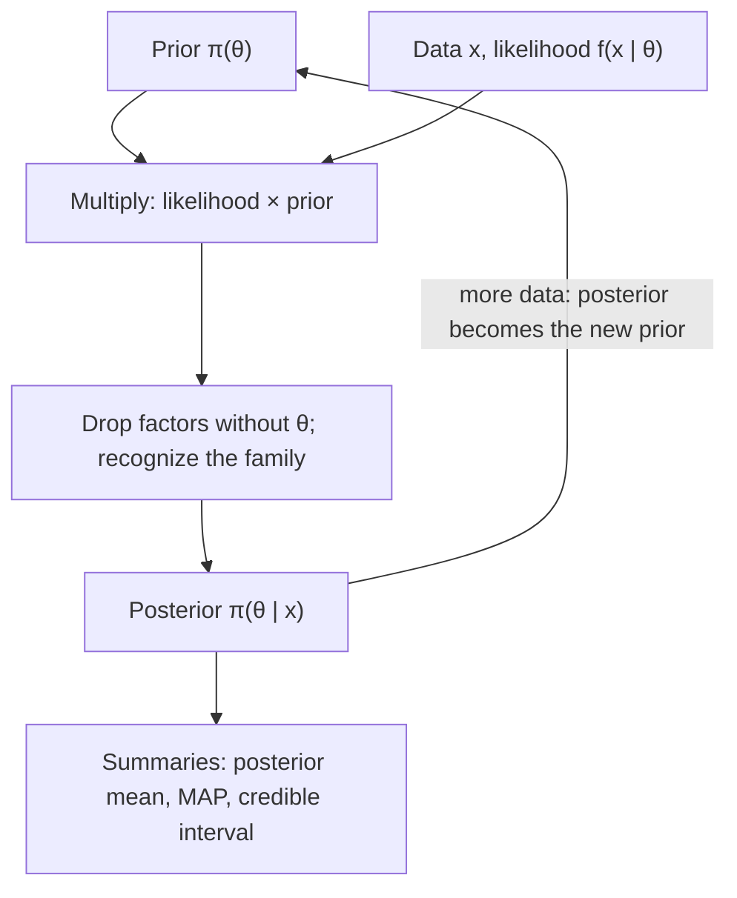

## A different way to treat the unknown

So far the parameter $\theta$ has been a fixed unknown constant, and probability described only
the data. **Bayesian inference** takes another view: uncertainty about $\theta$ is itself described
by a probability distribution. Before seeing data we hold a **prior distribution**; the data
update it, through Bayes' theorem, to a **posterior distribution**, which summarizes everything
we then believe about $\theta$. This lesson develops the idea, works through the two classic
"conjugate" models where the update has a closed form, and compares credible intervals with
the confidence intervals of two lessons ago.

## Bayes' theorem for parameters

Let $\pi(\theta)$ be the prior density and $f(x \mid \theta)$ the model for the data given $\theta$; viewed as a
function of $\theta$, the latter is the likelihood $L(\theta)$. Treating $(\theta, X)$ as a joint pair, the
multiplication rule and the definition of a conditional density give

$$\pi(\theta \mid x) = \frac{f(x \mid \theta)\,\pi(\theta)}{\int f(x \mid t)\,\pi(t)\,dt}.$$

The denominator does not depend on $\theta$; it only makes the posterior integrate to 1. So the
working rule is

$$\text{posterior} \;\propto\; \text{likelihood} \times \text{prior}.$$

In practice: multiply, drop every factor not involving $\theta$, and recognize the shape of a known
density. A prior family is **conjugate** to a model when the posterior stays in the same family;
then updating just means updating parameters.

The cycle below is the whole method. Its loop is a practical strength: today's posterior is
tomorrow's prior, so data can be absorbed batch by batch.



## The beta–binomial model

Let $\theta$ be a success probability with a beta distribution prior, Beta$(a, b)$:
$\pi(\theta) \propto \theta^{a-1}(1-\theta)^{b-1}$ on $(0, 1)$, mean $a/(a+b)$. Observe $x$ successes in $n$ independent trials, so
$L(\theta) \propto \theta^x(1-\theta)^{n-x}$. Multiply:

$$\pi(\theta \mid x) \propto \theta^{a + x - 1}(1 - \theta)^{b + n - x - 1},$$

which is Beta$(a + x,\; b + n - x)$. The update is bookkeeping: add successes to $a$ and failures to
$b$. That is why $a$ and $b$ are often read as "prior successes and failures": a Beta(2, 8) prior is
worth about 10 observations.

The **posterior mean** is

$$E[\theta \mid x] = \frac{a + x}{a + b + n} = \underbrace{\frac{a + b}{a + b + n}}_{\text{prior weight}}\cdot\frac{a}{a + b} + \underbrace{\frac{n}{a + b + n}}_{\text{data weight}}\cdot\frac{x}{n},$$

a weighted average of the prior mean and the sample proportion. As $n$ grows, the data weight
goes to 1 and the prior washes out.

The plot shows this with two analysts who start far apart: one with a Beta(2, 8) prior (mean 0.2),
the other with Beta(8, 2) (mean 0.8). After both see 30 successes in 100 trials, their posteriors,
Beta(32, 78) and Beta(38, 72), have means 0.291 and 0.345 and overlap heavily.

```plot
{"x": [0, 1], "y": [0, 10], "xLabel": "θ", "yLabel": "density", "functions": [{"f": "72 x (1 - x)^7", "dashed": true}, {"f": "72 x^7 (1 - x)", "dashed": true}, {"f": "exp(lgamma(110) - lgamma(32) - lgamma(78) + 31 ln(x) + 77 ln(1 - x))"}, {"f": "exp(lgamma(110) - lgamma(38) - lgamma(72) + 37 ln(x) + 71 ln(1 - x))"}], "labels": [{"at": [0.1, 4.9], "text": "prior"}, {"at": [0.1, 4.2], "text": "Beta(2, 8)"}, {"at": [0.86, 4.1], "text": "prior Beta(8, 2)"}, {"at": [0.5, 9.3], "text": "posteriors after 30 of 100"}], "caption": "Two very different priors (dashed) lead to similar posteriors (solid) once 100 observations are in"}
```

### Example 1

A maintenance team believes the defect rate $\theta$ of a new fastener is around 20%, and encodes this
as a Beta(2, 8) prior (mean 0.2). Inspecting 20 fasteners finds 3 defective.

1. Posterior: $\text{Beta}(2 + 3,\; 8 + 17) = \text{Beta}(5, 25)$.
2. Posterior mean: $5/30 \approx 0.167$, between the prior mean 0.20 (weight $10/30$) and the sample
   proportion 0.15 (weight $20/30$).
3. A 95% **credible interval**, cutting 2.5% of posterior probability from each tail, is found from
   beta quantiles with software: about $(0.058,\; 0.317)$.

```plot
{"x": [0, 0.7], "y": [0, 7], "xLabel": "θ", "yLabel": "density", "functions": [{"f": "72 x (1 - x)^7"}, {"f": "23940 x^3 (1 - x)^17", "dashed": true}, {"f": "593775 x^4 (1 - x)^24"}], "caption": "Prior Beta(2, 8) (the lowest, widest curve), scaled likelihood (dashed) and posterior Beta(5, 25) (the tallest curve): the posterior combines the prior and the likelihood and is narrower than either"}
```

## The normal–normal model

Measurements are $N(\theta, \sigma^2)$ with known $\sigma^2$, and the prior is $\theta \sim N(\mu_0, \tau_0^2)$. With $n$ observations
the likelihood depends on the data only through $\bar x$, and is proportional to
$\exp\!\big(-\frac{n}{2\sigma^2}(\theta - \bar x)^2\big)$. Multiplying by the prior gives the exponential of a quadratic in $\theta$;
completing the square shows the posterior is normal. The result is easiest to state with
**precision** (1/variance):

$$\frac{1}{\tau_n^2} = \frac{1}{\tau_0^2} + \frac{n}{\sigma^2}, \qquad \mu_n = \tau_n^2\left(\frac{\mu_0}{\tau_0^2} + \frac{n\bar x}{\sigma^2}\right), \qquad \theta \mid \text{data} \sim N(\mu_n, \tau_n^2).$$

Precisions add, and the posterior mean is a precision-weighted average of the prior mean and
$\bar x$. The posterior variance is smaller than both the prior variance and $\sigma^2/n$.

### Example 2

A track sensor's true offset $\theta$ has prior $N(100, 4^2)$ from the manufacturer's spec. Nine readings,
each with error SD $\sigma = 6$, average $\bar x = 103.2$.

1. Precisions: prior $1/16 = 0.0625$; data $n/\sigma^2 = 9/36 = 0.25$. Total $0.3125$, so $\tau_n^2 = 3.2$ and
   $\tau_n \approx 1.789$.
2. Posterior mean: $\mu_n = (0.0625 \times 100 + 0.25 \times 103.2)/0.3125 = 32.05/0.3125 = 102.56$. The data get
   weight $0.25/0.3125 = 0.8$.
3. 95% credible interval: $102.56 \pm 1.96 \times 1.789 = (99.05,\; 106.07)$.
4. Posterior probability that the offset exceeds 100: $P(Z > (100 - 102.56)/1.789) = P(Z > -1.43) \approx 0.924$.

The last line is a direct probability statement about the parameter, which frequentist methods
do not provide.

## Other conjugate pairs

| Model for data | Prior | Posterior |
|---|---|---|
| $x$ successes in $n$ Bernoulli$(\theta)$ trials | Beta$(a, b)$ | Beta$(a + x,\; b + n - x)$ |
| $n$ Poisson$(\lambda)$ counts, total $\sum x_i$ | Gamma$(\alpha, \beta)$ (shape $\alpha$, rate $\beta$, so scale $1/\beta$) | Gamma$(\alpha + \sum x_i,\; \beta + n)$ |
| $n$ $N(\theta, \sigma^2)$ readings, $\sigma$ known | $N(\mu_0, \tau_0^2)$ | $N(\mu_n, \tau_n^2)$ as above |

For the gamma–Poisson pair, the posterior mean $(\alpha + \sum x_i)/(\beta + n)$ again blends the prior mean $\alpha/\beta$
with $\bar x$.

## Summarizing the posterior

- *Point estimates.* The posterior mean minimizes expected squared error under the posterior.
  The posterior mode, the **MAP estimate** (maximum a posteriori), maximizes likelihood ×
  prior; with a flat prior it equals the MLE. For Beta$(\alpha', \beta')$ with both above 1 the mode is
  $(\alpha' - 1)/(\alpha' + \beta' - 2)$, which is $4/28 \approx 0.143$ in Example 1.
- *Credible intervals.* Any interval with posterior probability $1 - \alpha$. The equal-tailed
  version uses the $\alpha/2$ and $1 - \alpha/2$ posterior quantiles.

*Credible versus confidence.* A 95% credible interval means: given the data and the prior,
$P(\theta \in \text{interval}) = 0.95$. A 95% confidence interval means: the procedure covers the fixed $\theta$ in
95% of repeated samples. The numbers are often similar (with a weak prior and lots of data they
nearly coincide: with $\tau_0 \to \infty$ the normal–normal interval becomes $\bar x \pm 1.96\sigma/\sqrt n$), but the
interpretations differ. The price of the Bayesian statement is the prior, which must be chosen
and defended; a sensible practice is to check how much the conclusions change under other
reasonable priors.

## Common mistakes

- *Adding $n$ instead of $n - x$ to $b$.* Beta updates add successes to $a$ and *failures* to $b$.
- *Averaging means with equal weights.* The posterior mean weights by precision (or by $a + b$
  versus $n$), not 50–50.
- *Adding variances instead of precisions.* $1/\tau_n^2 = 1/\tau_0^2 + n/\sigma^2$; the posterior is narrower than the
  prior.
- *Reading a confidence interval as a credible interval*, or vice versa.
- *Keeping the normalizing constant.* Work with "posterior ∝ likelihood × prior" and identify the
  family at the end.

## Key points

- Posterior ∝ likelihood × prior; the prior expresses beliefs about $\theta$ before the data.
- Beta$(a, b)$ prior + $x$ of $n$ successes → Beta$(a + x, b + n - x)$; posterior mean $(a + x)/(a + b + n)$.
- Normal–normal: precisions add; $\mu_n$ is the precision-weighted average of $\mu_0$ and $\bar x$.
- Gamma$(\alpha, \beta)$ prior + Poisson counts → Gamma$(\alpha + \sum x_i, \beta + n)$.
- Credible intervals are probability statements about $\theta$ given the data.
