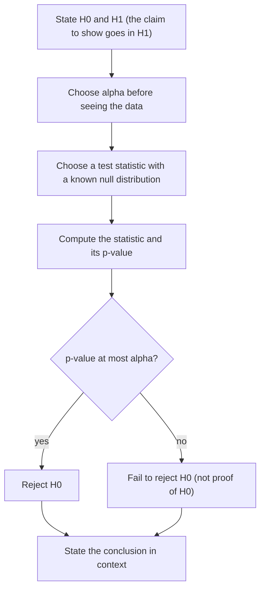

## From estimating to deciding

A confidence interval answers "what values of $\theta$ are plausible?" Many questions are
instead yes-or-no: has a new grinding schedule changed the mean rail-wear rate? Is a supplier's
defect rate above 10%? A **hypothesis test** is a rule that looks at the data and either
rejects a stated claim about a parameter or does not. This lesson sets up the general
machinery; the rest of the module builds specific tests on it.

## Hypotheses

Let the data $X_1, \dots, X_n$ have a distribution indexed by a parameter $\theta$ in a
parameter space $\Omega$. Split $\Omega$ into two disjoint pieces:

$$H_0: \theta \in \Omega_0 \qquad \text{versus} \qquad H_1: \theta \in \Omega_1.$$

The **null hypothesis** $H_0$ is the status quo or "no effect" claim; the **alternative
hypothesis** $H_1$ (also written $H_a$) is what the investigator would like evidence for.
A hypothesis that pins down the distribution completely, such as $\mu = 50$ with $\sigma$
known, is a **simple hypothesis**; one that allows a range, such as $\mu > 50$, is a
**composite hypothesis**. An alternative like $\mu > 50$ is one-sided; $\mu \ne 50$ is
two-sided.

The two hypotheses are not treated symmetrically. We control the chance of wrongly rejecting
$H_0$ and then try to make the test as sensitive as possible to $H_1$. That is why the claim
needing proof goes in $H_1$.

## Test statistics and rejection regions

A test is specified by a **test statistic** $T = T(X_1, \dots, X_n)$ and a **rejection
region** (or critical region) $C$: reject $H_0$ when $T \in C$, otherwise fail to reject. For
an upper-tailed test the region has the form $T \ge c$, and the boundary $c$ is the **critical
value**.

## Two kinds of error

| | $H_0$ true | $H_1$ true |
|---|---|---|
| Reject $H_0$ | **Type I error** | correct |
| Fail to reject $H_0$ | correct | **Type II error** |

The picture shows both errors for a one-sided test whose statistic is normal under each
hypothesis. Everything to the right of the critical value is the rejection region. The area there
under the null curve is the Type I error probability $\alpha$; the area to the left under the
alternative curve is the Type II error probability $\beta$; the rest of the alternative curve is the
power. Sliding $c$ to the right shrinks $\alpha$ and grows $\beta$.


Everything about a test's error behavior is packed into one function. The **power function**
of a test is

$$\pi(\theta) = P_\theta(\text{reject } H_0) = P_\theta(T \in C), \qquad \theta \in \Omega.$$

- For $\theta \in \Omega_0$, $\pi(\theta)$ is a Type I error probability. The **size** of the test
  is the worst case, $\alpha = \sup_{\theta \in \Omega_0} \pi(\theta)$. A test whose size is at
  most a chosen **significance level** $\alpha$ is called a level-$\alpha$ test.
- For $\theta \in \Omega_1$, $\pi(\theta)$ is the **power** at $\theta$, and the Type II error
  probability is $\beta(\theta) = 1 - \pi(\theta)$.

An ideal test would have $\pi = 0$ on $\Omega_0$ and $\pi = 1$ on $\Omega_1$. With finite data
that's impossible: moving $c$ to reduce one error increases the other. The standard compromise
fixes $\alpha$ (often 0.05 or 0.01) and then makes power as large as possible.

### Example 1: a binomial test

A supplier claims at most 10% of its rail clips are defective. You inspect $n = 20$ clips and
count defectives $X \sim \text{Bin}(20, p)$. Test $H_0: p \le 0.10$ versus $H_1: p > 0.10$ with the
rule "reject if $X \ge 5$."

1. *Power function.* $\pi(p) = P_p(X \ge 5) = 1 - \sum_{x=0}^{4}\binom{20}{x}p^x(1-p)^{20-x}$. More
   defectives are likelier when $p$ is bigger, so $\pi$ increases in $p$.
2. *Size.* Because $\pi$ is increasing, its largest value on $\Omega_0 = [0, 0.10]$ is at
   $p = 0.10$: $\alpha = 1 - P(X \le 4 \mid p = 0.1) \approx 0.0432$.
3. *Power.* If the true rate is 20%, $\pi(0.2) \approx 0.370$; if it is 30%,
   $\pi(0.3) \approx 0.762$. A supplier shipping 20% defectives escapes detection 63% of the time.

Notice that no rule of the form $X \ge c$ has size exactly 0.05: $X \ge 4$ gives size 0.133,
$X \ge 5$ gives 0.043. With discrete data you pick the largest size not exceeding $\alpha$.

```plot
{"x": [0, 0.6], "y": [-0.08, 1.08], "xLabel": "true defect rate p", "yLabel": "π(p)", "functions": [{"f": "1 - binomcdf(20, x, 4)", "from": 0.001, "to": 0.6}], "segments": [{"from": [0.1, 0], "to": [0.1, 1], "dashed": true}, {"from": [0, 0.0432], "to": [0.1, 0.0432], "dashed": true}], "points": [{"at": [0.1, 0.0432], "label": "size 0.043"}, {"at": [0.3, 0.762], "label": "(0.3, 0.762)"}], "labels": [{"at": [0.05, 0.6], "text": "H₀"}, {"at": [0.2, 0.95], "text": "H₁"}], "caption": "Power function of the rule X ≥ 5: small on H₀ (left of 0.1), rising toward 1 under H₁"}
```

### Example 2: a normal mean with known $\sigma$

Wear measurements are $N(\mu, 4^2)$; with $n = 16$ we test $H_0: \mu \le 50$ versus $H_1: \mu > 50$
at $\alpha = 0.05$, rejecting when $\bar X \ge c$.

1. *Power function.* $\bar X \sim N(\mu, 1)$ since $\sigma/\sqrt{n} = 4/4 = 1$, so
   $$\pi(\mu) = P_\mu(\bar X \ge c) = 1 - \Phi\!\left(\frac{c - \mu}{1}\right) = \Phi(\mu - c).$$
2. *Critical value.* $\pi$ is increasing, so the size is $\pi(50)$. Setting
   $\pi(50) = 0.05$ gives $c - 50 = z_{0.05} = 1.645$, so $c = 51.645$. In standardized form: reject
   when $Z = (\bar X - 50)/1 \ge 1.645$.
3. *Power.* $\pi(52) = \Phi(0.355) \approx 0.639$ and $\pi(53) = \Phi(1.355) \approx 0.912$.

```plot
{"x": [46, 57], "y": [-0.06, 0.46], "grid": false, "functions": [{"f": "normpdf(x, 50, 1)"}, {"f": "normpdf(x, 53, 1)", "dashed": true}], "shade": [{"f": "normpdf(x, 53, 1)", "from": 51.645, "to": 57, "color": "#9bbbd9"}, {"f": "normpdf(x, 50, 1)", "from": 51.645, "to": 57, "color": "#c2570c"}], "segments": [{"from": [46, 0], "to": [57, 0]}, {"from": [51.645, 0], "to": [51.645, 0.44], "dashed": true}], "labels": [{"at": [50, -0.035], "text": "50"}, {"at": [53, -0.035], "text": "53"}, {"at": [51.645, 0.455], "text": "c = 51.645"}, {"at": [48.6, 0.42], "text": "μ = 50"}, {"at": [54.5, 0.42], "text": "μ = 53"}, {"at": [54.3, 0.2], "text": "power 0.912"}, {"at": [52.9, 0.035], "text": "α"}], "caption": "Rejection region x̄ ≥ 51.645: area α under the null curve, area π(53) under the alternative"}
```

Taking more data steepens the power curve. With $n = 64$ the critical value is
$50 + 1.645(0.5) = 50.82$ and $\pi(52) \approx 0.991$.

```plot
{"x": [49, 54], "y": [-0.05, 1.05], "xLabel": "true mean μ", "yLabel": "π(μ)", "functions": [{"f": "normcdf(x - 51.645)"}, {"f": "normcdf((x - 50.822)*2)", "dashed": true}], "segments": [{"from": [49, 0.05], "to": [50.5, 0.05], "dashed": true}], "labels": [{"at": [50.45, 0.8], "text": "n = 64"}, {"at": [52.75, 0.6], "text": "n = 16"}, {"at": [49.6, 0.12], "text": "0.05"}], "caption": "Both tests have size 0.05 at μ = 50; the larger sample has much higher power just above 50"}
```

### Choosing $n$

The same algebra tells you how much data you need. For an upper-tailed $z$ test, power
$1 - \beta$ at $\mu_1 = \mu_0 + \delta$ requires $\mu_0 + z_\alpha\sigma/\sqrt n \le \mu_1 - z_\beta \sigma/\sqrt n$, i.e.

$$n \ge \left(\frac{(z_\alpha + z_\beta)\,\sigma}{\delta}\right)^2.$$

For power 0.90 at $\mu = 52$ above: $n \ge \big((1.645 + 1.282)(4)/2\big)^2 = 34.3$, so $n = 35$.

## p-values

Fixing $\alpha$ in advance produces only "reject" or "don't." The **p-value** reports more: it
is the smallest significance level at which the observed data would lead to rejection.
Equivalently, it is the probability, computed under $H_0$ (at the boundary value $\theta_0$),
of a test statistic at least as extreme as the one observed. For an upper-tailed test with
observed value $t$,

$$p = P_{\theta_0}(T \ge t).$$

For a two-sided test with a symmetric null distribution, double the one-tail area. You reject at
level $\alpha$ exactly when $p \le \alpha$.

In Example 2, suppose $\bar x = 52.1$. Then $z = 2.1$ and $p = 1 - \Phi(2.1) \approx 0.018$: reject
at 5%, not at 1%.

**Why a p-value is uniform under $H_0$.** Let $T$ be continuous with null CDF $F$, and
$p = 1 - F(T)$. Since $F(T) \sim \text{Uniform}(0, 1)$ (the probability integral transform),
$P(p \le u) = P(F(T) \ge 1 - u) = u$. So under $H_0$ the p-value is $\text{Uniform}(0,1)$, and
"reject when $p \le \alpha$" has size exactly $\alpha$. It also shows what a p-value is *not*:
it is not $P(H_0 \text{ true} \mid \text{data})$. It is a tail probability computed assuming $H_0$.

## Tests and confidence intervals

A level-$\alpha$ two-sided test of $H_0: \theta = \theta_0$ and a $1 - \alpha$ confidence interval
are two views of one object: the test rejects exactly when $\theta_0$ lies outside the interval
(for the usual $z$ and $t$ procedures). The interval is the set of null values the data would
not reject.

## The procedure in one picture

Every test in this module follows the same steps, in this order. The order matters: the
hypotheses and $\alpha$ are fixed before the data are examined.



## Common mistakes

- Reading the p-value as the probability that $H_0$ is true, or $1 - p$ as the probability $H_1$ is true.
- Treating "fail to reject" as "accept $H_0$ as proved." A low-power test fails to reject often even when $H_0$ is false.
- Computing the size at an arbitrary point of a composite null instead of taking the supremum (usually at the boundary).
- Putting the claim you hope to show in $H_0$.
- Confusing $\beta$ with power: power is $1 - \beta$.
- Choosing a one-sided alternative after seeing which way the data point, which secretly doubles the Type I error rate.

## Key points

- A test is a statistic $T$ and a rejection region $C$; $\pi(\theta) = P_\theta(T \in C)$ is its power function.
- Size $= \sup_{\Omega_0}\pi$; power at $\theta \in \Omega_1$ is $\pi(\theta)$; $\beta(\theta) = 1 - \pi(\theta)$.
- Fix $\alpha$, then maximize power; power grows with $n$ and with distance from $H_0$.
- $z$ test sample size: $n \ge \big((z_\alpha + z_\beta)\sigma/\delta\big)^2$.
- The p-value is the null probability of a result at least as extreme as observed; under $H_0$ it is uniform.
