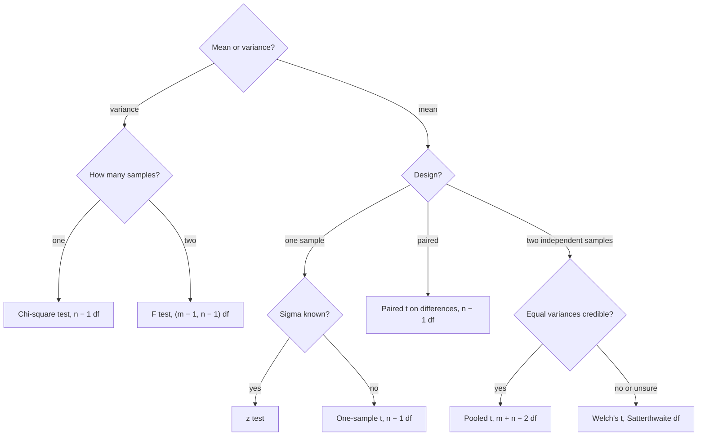

## The workhorse tests

The previous lesson built the general framework. Here we fill it with the tests used most
often for normal data. Each one comes from a pivotal quantity you met with confidence
intervals: a function of the data and the parameter whose distribution is known exactly.
Replace the parameter by its null value and the pivot becomes a test statistic with a known
null distribution.

Throughout, $X_1, \dots, X_n$ is a random sample from $N(\mu, \sigma^2)$ with sample mean
$\bar X$ and sample variance $S^2$. Recall that $\bar X$ and $S^2$ are independent, that
$(n-1)S^2/\sigma^2 \sim \chi^2_{n-1}$, and that $Z/\sqrt{V/\nu} \sim t_\nu$ when $Z \sim N(0,1)$ and
$V \sim \chi^2_\nu$ are independent.

## One-sample tests for $\mu$

**Known $\sigma$ ($z$ test).** Under $H_0: \mu = \mu_0$, $Z = \dfrac{\bar X - \mu_0}{\sigma/\sqrt n} \sim N(0,1)$.

**Unknown $\sigma$ ($t$ test).** Replacing $\sigma$ by $S$ gives

$$T = \frac{\bar X - \mu_0}{S/\sqrt n} = \frac{(\bar X - \mu_0)/(\sigma/\sqrt n)}{\sqrt{\dfrac{(n-1)S^2/\sigma^2}{n-1}}} \sim t_{n-1} \quad \text{under } H_0,$$

because the numerator is $N(0,1)$, the quantity under the root is $\chi^2_{n-1}$ divided by its
degrees of freedom, and the two are independent. This is the **one-sample t test**. The
rejection region matches the alternative:

| $H_1$ | Reject $H_0$ when | p-value |
|---|---|---|
| $\mu > \mu_0$ | $T \ge t_{\alpha, n-1}$ | $P(t_{n-1} \ge t)$ |
| $\mu < \mu_0$ | $T \le -t_{\alpha, n-1}$ | $P(t_{n-1} \le t)$ |
| $\mu \ne \mu_0$ | $\lvert T\rvert \ge t_{\alpha/2, n-1}$ | $2P(t_{n-1} \ge \lvert t\rvert)$ |

Here $t_{\alpha,\nu}$ is the upper-$\alpha$ point of $t_\nu$. For a one-sided composite null such as
$\mu \le \mu_0$, the power function is increasing in $\mu$, so the size is attained at $\mu_0$ and the
same critical value works.

### Example 1: one-sample t test

A specification calls for a mean weld hardness of 248. Ten welds give $\bar x = 251.8$ and
$s = 4.2$. Test $H_0: \mu = 248$ against $H_1: \mu \ne 248$ at $\alpha = 0.05$.

1. *Statistic.* $t = \dfrac{251.8 - 248}{4.2/\sqrt{10}} = \dfrac{3.8}{1.328} = 2.861$, with 9 degrees of freedom.
2. *Rejection region.* $\lvert t\rvert \ge t_{0.025, 9} = 2.262$. Since $2.861 > 2.262$, reject.
3. *p-value.* $2P(t_9 \ge 2.861) \approx 0.019$.

The welds' mean hardness differs from the specification.

```plot
{"x": [-4.5, 4.5], "y": [-0.06, 0.44], "grid": false, "functions": [{"f": "tpdf(x, 9)"}], "shade": [{"f": "tpdf(x, 9)", "from": -4.5, "to": -2.262, "color": "#c2570c"}, {"f": "tpdf(x, 9)", "from": 2.262, "to": 4.5, "color": "#c2570c"}], "segments": [{"from": [-4.5, 0], "to": [4.5, 0]}, {"from": [2.861, 0], "to": [2.861, 0.2], "color": "#2c5e8f"}], "labels": [{"at": [-2.262, -0.035], "text": "−2.262"}, {"at": [2.262, -0.035], "text": "2.262"}, {"at": [2.95, 0.23], "text": "t = 2.861"}, {"at": [-3.4, 0.07], "text": "0.025"}, {"at": [3.6, 0.07], "text": "0.025"}], "caption": "The t₉ density with the two-sided 5% rejection region; the observed statistic falls inside it"}
```

## Two independent samples

Let $X_1, \dots, X_m \sim N(\mu_1, \sigma_1^2)$ and $Y_1, \dots, Y_n \sim N(\mu_2, \sigma_2^2)$ be independent, and
test $H_0: \mu_1 - \mu_2 = \Delta_0$ (usually $\Delta_0 = 0$).

**Equal variances (pooled t test).** If $\sigma_1 = \sigma_2 = \sigma$, both sample variances estimate
$\sigma^2$, and the best combination weights them by their degrees of freedom:

$$S_p^2 = \frac{(m-1)S_1^2 + (n-1)S_2^2}{m + n - 2}, \qquad \frac{(m+n-2)S_p^2}{\sigma^2} \sim \chi^2_{m+n-2}.$$

This **pooled variance** gives

$$T = \frac{\bar X - \bar Y - \Delta_0}{S_p\sqrt{\dfrac1m + \dfrac1n}} \sim t_{m+n-2} \quad \text{under } H_0.$$

**Unequal variances (Welch's t test).** Without assuming $\sigma_1 = \sigma_2$, use

$$T = \frac{\bar X - \bar Y - \Delta_0}{\sqrt{S_1^2/m + S_2^2/n}}, \qquad \nu \approx \frac{\left(\dfrac{S_1^2}{m} + \dfrac{S_2^2}{n}\right)^2}{\dfrac{(S_1^2/m)^2}{m-1} + \dfrac{(S_2^2/n)^2}{n-1}}.$$

This statistic is not exactly $t$ distributed; **Welch's t test** approximates its null
distribution by $t_\nu$ with the Satterthwaite degrees of freedom above. It is the safer
default, since it loses little when the variances are equal and protects the size when they
are not, especially with unequal sample sizes.

### Example 2: pooled versus Welch

Twelve concrete ties from plant A have mean strength $\bar x = 31.4$ (s.d. 3.1); ten from plant B
have $\bar y = 28.2$ (s.d. 3.6). Test $H_0: \mu_1 = \mu_2$ against $H_1: \mu_1 \ne \mu_2$.

1. *Pooled.* $s_p^2 = \dfrac{11(3.1)^2 + 9(3.6)^2}{20} = \dfrac{105.71 + 116.64}{20} = 11.12$, $s_p = 3.334$.
   $t = \dfrac{3.2}{3.334\sqrt{1/12 + 1/10}} = 2.241$ on 20 df; p-value $\approx 0.037$.
2. *Welch.* Standard error $\sqrt{9.61/12 + 12.96/10} = 1.448$, $t = 2.210$, $\nu \approx 17.95$;
   p-value $\approx 0.040$.

Both reject at 5%. The two methods agree here because the sample variances are similar.

## Paired data

When each observation in one sample is matched with one in the other (the same locomotive
under two treatments, the same segment before and after), the samples are not independent.
Work with the differences $D_i = X_i - Y_i$, which are a single sample from
$N(\mu_D, \sigma_D^2)$, and apply the one-sample $t$ test to them:

$$T = \frac{\bar D - \Delta_0}{S_D/\sqrt n} \sim t_{n-1}.$$

This is the **paired t test**. Pairing pays off because
$\operatorname{Var}(X - Y) = \sigma_1^2 + \sigma_2^2 - 2\rho\sigma_1\sigma_2$: a strong positive correlation
within pairs removes the unit-to-unit variation that would otherwise swamp the difference.

### Example 3: paired t test

Six locomotives run with brake compound A on one side and compound B on the other. Wear (mm):

| Locomotive | 1 | 2 | 3 | 4 | 5 | 6 |
|---|---|---|---|---|---|---|
| A | 5.2 | 4.8 | 6.1 | 5.5 | 4.9 | 5.8 |
| B | 4.7 | 4.6 | 5.4 | 5.2 | 4.8 | 5.1 |
| $d = A - B$ | 0.5 | 0.2 | 0.7 | 0.3 | 0.1 | 0.7 |

Test $H_0: \mu_D = 0$ against $H_1: \mu_D > 0$ (A wears faster).

1. $\bar d = 2.5/6 = 0.4167$ and $s_d = 0.2563$.
2. $t = \dfrac{0.4167}{0.2563/\sqrt 6} = 3.983$ on 5 df. Critical value $t_{0.05,5} = 2.015$: reject.
3. p-value $= P(t_5 \ge 3.983) \approx 0.005$.

Had we wrongly treated the columns as independent samples, the two-sample $t$ would be 1.70 with
one-sided p-value about 0.06. The locomotives differ a lot from each other (6.1 versus 4.8 under
A), and only pairing removes that variation.

The plot makes this visible. Each line joins one locomotive's two wear values. The lines are
spread far apart (locomotives differ), yet almost every one slopes the same way, down from A to B.
The paired test looks only at those slopes.

```plot
{"x": [0.5, 2.5], "y": [4.4, 6.3], "yLabel": "wear (mm)", "grid": false, "segments": [{"from": [1, 5.2], "to": [2, 4.7]}, {"from": [1, 4.8], "to": [2, 4.6]}, {"from": [1, 6.1], "to": [2, 5.4]}, {"from": [1, 5.5], "to": [2, 5.2]}, {"from": [1, 4.9], "to": [2, 4.8]}, {"from": [1, 5.8], "to": [2, 5.1]}], "points": [{"at": [1, 5.2]}, {"at": [1, 4.8]}, {"at": [1, 6.1]}, {"at": [1, 5.5]}, {"at": [1, 4.9]}, {"at": [1, 5.8]}, {"at": [2, 4.7]}, {"at": [2, 4.6]}, {"at": [2, 5.4]}, {"at": [2, 5.2]}, {"at": [2, 4.8]}, {"at": [2, 5.1]}], "labels": [{"at": [1, 4.5], "text": "compound A"}, {"at": [2, 4.5], "text": "compound B"}], "caption": "Each line is one locomotive: wear varies a lot between locomotives, but every line falls from A to B"}
```

## Tests for variances

**One variance.** Under $H_0: \sigma^2 = \sigma_0^2$,

$$\chi^2 = \frac{(n-1)S^2}{\sigma_0^2} \sim \chi^2_{n-1}.$$

For $H_1: \sigma^2 > \sigma_0^2$ reject when $\chi^2 \ge \chi^2_{\alpha, n-1}$ (the upper-$\alpha$ point). For a
two-sided test use both tails, $\chi^2 \le \chi^2_{1-\alpha/2, n-1}$ or $\chi^2 \ge \chi^2_{\alpha/2, n-1}$; the
distribution is skewed, so the two critical values are not symmetric about the center.

### Example 4: chi-square test for a variance

A gauge is acceptable if its measurement s.d. is at most 0.5 mm. Fifteen repeat measurements give
$s = 0.62$. Test $H_0: \sigma = 0.5$ against $H_1: \sigma > 0.5$ at 5%.

1. $\chi^2 = \dfrac{14(0.62)^2}{0.5^2} = \dfrac{5.3816}{0.25} = 21.53$, with 14 df.
2. $\chi^2_{0.05, 14} = 23.68$. Since $21.53 < 23.68$, do not reject.
3. p-value $= P(\chi^2_{14} \ge 21.53) \approx 0.089$.

A sample s.d. 24% above the limit is not convincing evidence with only 15 readings.

```plot
{"x": [0, 40], "y": [-0.015, 0.1], "grid": false, "functions": [{"f": "chi2pdf(x, 14)"}], "shade": [{"f": "chi2pdf(x, 14)", "from": 23.685, "to": 40, "color": "#c2570c"}], "segments": [{"from": [0, 0], "to": [40, 0]}, {"from": [21.53, 0], "to": [21.53, 0.045], "color": "#2c5e8f"}], "labels": [{"at": [24.4, -0.008], "text": "23.68"}, {"at": [25.2, 0.05], "text": "χ² = 21.53"}, {"at": [27.5, 0.018], "text": "α = 0.05"}, {"at": [14, -0.008], "text": "14"}], "caption": "The χ² distribution with 14 df: the observed statistic falls short of the upper 5% critical value"}
```

**Two variances.** For independent normal samples, under $H_0: \sigma_1^2 = \sigma_2^2$,

$$F = \frac{S_1^2}{S_2^2} \sim F_{m-1,\, n-1},$$

since each $S_i^2/\sigma_i^2$ is a scaled chi-square and the $\sigma$'s cancel under $H_0$. Large values
favor $\sigma_1 > \sigma_2$. For a two-sided test, reject when $F \ge F_{\alpha/2, m-1, n-1}$ or
$F \le F_{1-\alpha/2, m-1, n-1} = 1/F_{\alpha/2, n-1, m-1}$. For example, with $s_1 = 0.62$ ($m = 15$) and
$s_2 = 0.41$ ($n = 13$), $F = 2.287$ on (14, 12) df; the two-sided p-value is about 0.16.

**A warning about robustness.** The $t$ tests are fairly robust: by the Central Limit Theorem,
moderate non-normality barely changes their size once $n$ is around 30. The $\chi^2$ and $F$
tests for variances are not. Their null distributions depend on the fourth moment of the
population, so heavy tails can make the true size several times the nominal $\alpha$ even for
large samples. Use them only when normality is credible.

## Choosing the test

The chart sums up the lesson: first decide whether the question is about a mean or a variance,
then how the data were collected.



## Common mistakes

- Using $z$ critical values with $S$ in place of $\sigma$ in a small sample; the $t$ distribution's heavier tails are the price of estimating $\sigma$.
- Analyzing paired data with a two-sample test, which throws away the pairing and usually the power.
- Pooling variances when the sample s.d.'s are very different and the sample sizes unequal.
- Using symmetric critical values $\pm c$ for a chi-square test.
- Getting the F degrees of freedom backward: numerator df belongs to the variance on top.
- Trusting the variance tests with clearly non-normal data.

## Key points

- One sample: $T = (\bar X - \mu_0)/(S/\sqrt n) \sim t_{n-1}$; known $\sigma$ gives the $z$ test.
- Two samples: pooled $t$ on $m + n - 2$ df if $\sigma_1 = \sigma_2$; Welch's $t$ with Satterthwaite df otherwise.
- Paired data: one-sample $t$ on the differences, $n - 1$ df.
- One variance: $(n-1)S^2/\sigma_0^2 \sim \chi^2_{n-1}$. Two variances: $S_1^2/S_2^2 \sim F_{m-1,n-1}$.
- Mean tests are robust to mild non-normality; variance tests are not.
