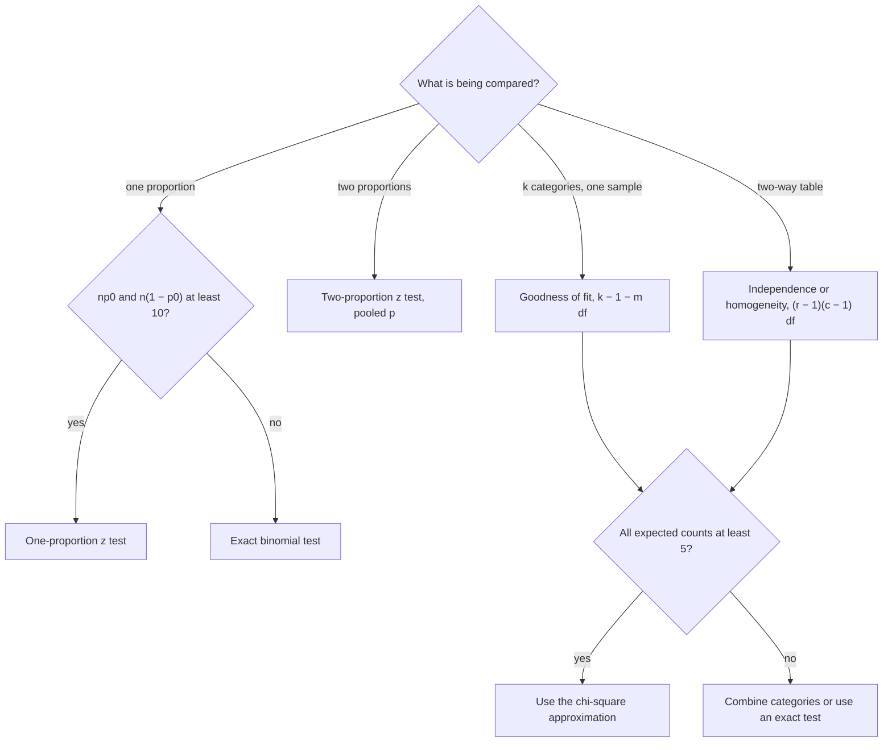

## Counting data

Many questions are about categories: the fraction of inspections that find a crack, whether
defect types occur in the historical mix, whether severity depends on the shift that found
the defect. This lesson builds tests for binomial and multinomial counts. All of them rest on
the normal approximation to counts, and the chi-square tests turn out to be likelihood ratio
tests in disguise.

## One proportion

Let $X \sim \text{Bin}(n, p)$ and $\hat p = X/n$. Under $H_0: p = p_0$, $E(\hat p) = p_0$ and
$\operatorname{Var}(\hat p) = p_0(1 - p_0)/n$, so by the Central Limit Theorem

$$Z = \frac{\hat p - p_0}{\sqrt{p_0(1 - p_0)/n}} \approx N(0, 1).$$

This is the **one-proportion z test**. The standard error uses $p_0$, not $\hat p$: the
null distribution is computed assuming $H_0$, which tells us the variance exactly. (Confidence
intervals use $\hat p$ because no $p_0$ is available.) The approximation is reasonable when
$np_0 \ge 10$ and $n(1 - p_0) \ge 10$; otherwise use the exact binomial tail
$P_{p_0}(X \ge x)$ as in the first lesson of this module.

### Example 1: one-proportion z test

Historically 10% of weld inspections find a defect. After a supplier change, 52 of 400 inspections
do. Test $H_0: p = 0.10$ against $H_1: p > 0.10$.

1. $\hat p = 52/400 = 0.13$; standard error $\sqrt{0.1(0.9)/400} = 0.015$.
2. $z = (0.13 - 0.10)/0.015 = 2.00$; p-value $= P(Z \ge 2) \approx 0.023$. Reject at 5%.
3. The exact binomial p-value $P(X \ge 52 \mid p = 0.1)$ is 0.031. The normal approximation is
   a little optimistic here; a continuity correction ($x = 51.5$) brings it closer.

## Two proportions

For independent $X_1 \sim \text{Bin}(n_1, p_1)$ and $X_2 \sim \text{Bin}(n_2, p_2)$, test
$H_0: p_1 = p_2$. Under $H_0$ the common value $p$ is estimated from both samples together by
the **pooled proportion** $\hat p = (X_1 + X_2)/(n_1 + n_2)$, and

$$Z = \frac{\hat p_1 - \hat p_2}{\sqrt{\hat p(1 - \hat p)\left(\dfrac{1}{n_1} + \dfrac{1}{n_2}\right)}} \approx N(0, 1).$$

### Example 2: two-proportion z test

Crew A's welds fail inspection 38 times in 250; crew B's 22 times in 240. Do the failure rates differ?

1. $\hat p_1 = 0.152$, $\hat p_2 = 0.0917$, pooled $\hat p = 60/490 = 0.1224$.
2. Standard error $\sqrt{0.1224(0.8776)(1/250 + 1/240)} = 0.0296$.
3. $z = (0.152 - 0.0917)/0.0296 = 2.04$; two-sided p-value $\approx 0.042$. Reject at 5%, barely.

## Goodness of fit

Now suppose each of $n$ independent observations falls in one of $k$ categories with
probabilities $p_1, \dots, p_k$. The counts $(O_1, \dots, O_k)$ then have the
**multinomial distribution**, the $k$-category version of the binomial:

$$P(O_1 = o_1, \dots, O_k = o_k) = \frac{n!}{o_1!\cdots o_k!}\,p_1^{o_1}\cdots p_k^{o_k}, \qquad o_1 + \cdots + o_k = n.$$

The multinomial coefficient counts the orders in which the categories can occur, and each order has
probability $p_1^{o_1}\cdots p_k^{o_k}$. Each count alone is $\text{Bin}(n, p_i)$, so $E(O_i) = np_i$ and
$\operatorname{Var}(O_i) = np_i(1 - p_i)$; two different counts compete for the same $n$ trials, and
$\operatorname{Cov}(O_i, O_j) = -np_ip_j$. To test
$H_0: p_i = p_{i0}$ for all $i$, compare observed counts with **expected counts**
$E_i = np_{i0}$ through **Pearson's chi-square statistic**

$$X^2 = \sum_{i=1}^k \frac{(O_i - E_i)^2}{E_i} \;\approx\; \chi^2_{k-1} \quad \text{under } H_0.$$

Reject for large $X^2$. This is the **goodness-of-fit test**. If the null probabilities depend on
$m$ parameters estimated from the same data (say, a Poisson mean), the degrees of freedom drop to
$k - 1 - m$.

### Why chi-square with $k - 1$ df?

*Two categories.* With $O_1 = X$, $O_2 = n - X$, and $E_1 = np_0$, $E_2 = n(1 - p_0)$, both numerators
equal $(X - np_0)^2$, so

$$X^2 = (X - np_0)^2\left[\frac{1}{np_0} + \frac{1}{n(1-p_0)}\right] = \frac{(X - np_0)^2}{np_0(1 - p_0)} = Z^2.$$

The square of an approximately standard normal variable is approximately $\chi^2_1$.

*In general.* The standardized counts $(O_i - E_i)/\sqrt{E_i}$ are approximately jointly normal,
but they are tied together by one linear constraint, $\sum(O_i - E_i) = 0$. Their sum of squares
therefore behaves like a sum of $k - 1$ independent squared standard normals, not $k$: one degree
of freedom is used up by the fixed total.

*As a likelihood ratio test.* The multinomial LRT gives
$-2\ln\Lambda = G^2 = 2\sum O_i\ln(O_i/E_i)$. Expanding $O\ln(O/E)$ to second order around $O = E$
gives $G^2 \approx X^2$, and Wilks' theorem supplies $\chi^2_{k-1}$ because $H_0$ fixes $k - 1$ free
probabilities.

### Example 3: goodness of fit

Historically, track defects split 40% gauge, 30% surface, 20% joint and 10% other. This year's
200 defects are 92, 48, 36 and 24.

| Type | Gauge | Surface | Joint | Other |
|---|---|---|---|---|
| Observed | 92 | 48 | 36 | 24 |
| Expected | 80 | 60 | 40 | 20 |
| $(O - E)^2/E$ | 1.80 | 2.40 | 0.40 | 0.80 |

1. $X^2 = 1.8 + 2.4 + 0.4 + 0.8 = 5.40$ on $4 - 1 = 3$ df.
2. $\chi^2_{0.05, 3} = 7.81$, so do not reject. The p-value is $P(\chi^2_3 \ge 5.40) \approx 0.145$.
3. The $G^2$ statistic gives 5.46, nearly the same.

```plot
{"x": [0.3, 4.7], "y": [0, 100], "yLabel": "count", "xLabel": "defect type", "bars": [{"x": 0.82, "height": 92, "width": 0.36, "color": "#2c5e8f"}, {"x": 1.18, "height": 80, "width": 0.36, "color": "#c2570c"}, {"x": 1.82, "height": 48, "width": 0.36, "color": "#2c5e8f"}, {"x": 2.18, "height": 60, "width": 0.36, "color": "#c2570c"}, {"x": 2.82, "height": 36, "width": 0.36, "color": "#2c5e8f"}, {"x": 3.18, "height": 40, "width": 0.36, "color": "#c2570c"}, {"x": 3.82, "height": 24, "width": 0.36, "color": "#2c5e8f"}, {"x": 4.18, "height": 20, "width": 0.36, "color": "#c2570c"}], "labels": [{"at": [1, 96], "text": "gauge"}, {"at": [2, 66], "text": "surface"}, {"at": [3, 46], "text": "joint"}, {"at": [4, 30], "text": "other"}], "caption": "Observed counts (blue, left) beside expected counts under H₀ (orange, right)"}
```

## Independence in a two-way table

Classify each of $n$ items by two categorical variables, giving an $r \times c$
**contingency table** of counts $O_{ij}$ with row totals $R_i$ and column totals $C_j$. Test
$H_0$: the variables are independent, i.e. $p_{ij} = p_{i\cdot}\,p_{\cdot j}$ for every cell.

Under $H_0$ the cell probability is estimated by $(R_i/n)(C_j/n)$, so the expected count is

$$E_{ij} = n \cdot \frac{R_i}{n}\cdot\frac{C_j}{n} = \frac{R_i C_j}{n}, \qquad X^2 = \sum_{i,j}\frac{(O_{ij} - E_{ij})^2}{E_{ij}} \approx \chi^2_{(r-1)(c-1)}.$$

The degrees of freedom come from counting parameters: the full model has $rc - 1$ free cell
probabilities; independence has $(r - 1) + (c - 1)$ free marginal probabilities. The difference is
$rc - 1 - (r - 1) - (c - 1) = (r - 1)(c - 1)$. This is the **chi-square test of independence**.
The same arithmetic tests **homogeneity**, where the rows are separate samples (fixed row totals)
and $H_0$ says every row has the same column distribution.

### Example 4: test of independence

Defects found on the day and night shifts, by severity:

| | Minor | Moderate | Severe | Total |
|---|---|---|---|---|
| Day | 60 | 30 | 10 | 100 |
| Night | 40 | 35 | 25 | 100 |
| Total | 100 | 65 | 35 | 200 |

The same table with each expected count in parentheses beside the observed count:


1. *Expected counts.* $E_{11} = 100(100)/200 = 50$; likewise 32.5 and 17.5 in each row.
2. *Contributions.* Minor: $10^2/50 = 2.00$ per row; moderate: $2.5^2/32.5 = 0.192$; severe: $7.5^2/17.5 = 3.214$.
3. $X^2 = 2(2.00 + 0.192 + 3.214) = 10.81$ on $(2-1)(3-1) = 2$ df; p-value $\approx 0.0045$.

Severity is associated with shift. The largest contributions point to where: the night shift
records more severe defects than independence predicts.

```plot
{"x": [0, 14], "y": [-0.03, 0.2], "grid": false, "functions": [{"f": "chi2pdf(x, 2)", "from": 0, "to": 14}], "shade": [{"f": "chi2pdf(x, 2)", "from": 5.991, "to": 14, "color": "#c2570c"}], "segments": [{"from": [0, 0], "to": [14, 0]}, {"from": [10.81, 0], "to": [10.81, 0.05], "color": "#2c5e8f"}], "labels": [{"at": [5.991, -0.017], "text": "5.99"}, {"at": [10.81, 0.06], "text": "X² = 10.81"}, {"at": [7.6, 0.03], "text": "α = 0.05"}], "caption": "χ² with 2 df (its density starts at 0.5, above the view): the 5% critical value is 5.99, and the observed 10.81 is far beyond it"}
```

**When the approximation is trustworthy.** The rule of thumb is that every expected count be at
least 5 (some allow a few cells down to 1 if most are above 5). Combine sparse categories, or use
an exact test (such as Fisher's exact test for $2 \times 2$ tables), when counts are small.

## Choosing the test for counts



## Common mistakes

- Using $\hat p$ instead of $p_0$ in the one-proportion test's standard error.
- Running a chi-square test on percentages or on measurements instead of counts.
- Using $k$ instead of $k - 1$ df, or forgetting to subtract parameters estimated from the data.
- Checking the "at least 5" rule on observed counts rather than expected counts.
- Concluding causation, or the direction of an effect, from a significant $X^2$ alone; look at the cell contributions.
- Reading a large p-value in a goodness-of-fit test as proof that the model is right.

## Key points

- One proportion: $Z = (\hat p - p_0)/\sqrt{p_0(1-p_0)/n}$. Two proportions: pooled $\hat p$ in the standard error.
- Pearson's $X^2 = \sum (O - E)^2/E$; reject for large values.
- Goodness of fit: $E_i = np_{i0}$, df $= k - 1 - (\text{estimated parameters})$.
- Independence or homogeneity: $E_{ij} = R_iC_j/n$, df $= (r-1)(c-1)$.
- $X^2$ is approximately $-2\ln\Lambda$, so it is approximately chi-square by Wilks' theorem; with two categories it is $Z^2$.
