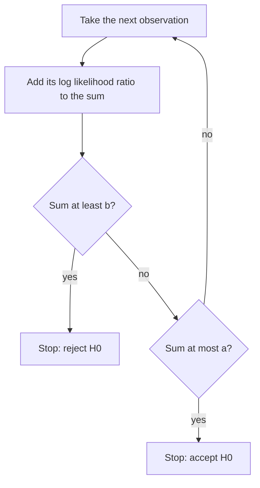

## Why fix the sample size in advance?

Every test in this module so far collects a fixed number $n$ of observations and then decides.
But inspection often happens one item at a time. If the first three rail clips you test are all
defective, do you really need 77 more to conclude the lot is bad? If 40 in a row are fine, is it
worth testing more? A **sequential test** looks at the data as they arrive and, after each
observation, chooses among three actions: reject $H_0$, stop without rejecting, or take another
observation.

The Neyman–Pearson lemma said that for simple hypotheses the likelihood ratio ranks the evidence
best. Abraham Wald's **sequential probability ratio test** (SPRT) applies the same ratio one
observation at a time. Wald developed it in 1943 at Columbia University's Statistical Research
Group, working on wartime acceptance sampling; by W. Allen Wallis's later account the problem was
raised by Wallis and Milton Friedman. The work was classified at first and published in 1945,
then in Wald's book *Sequential Analysis* (1947).

## The test

Test the simple $H_0: \theta = \theta_0$ against the simple $H_1: \theta = \theta_1$ with
independent observations $X_1, X_2, \dots$. After $n$ observations form the log likelihood ratio

$$S_n = \ln\frac{L_n(\theta_1)}{L_n(\theta_0)} = \sum_{i=1}^n Z_i, \qquad Z_i = \ln\frac{f(X_i; \theta_1)}{f(X_i; \theta_0)}.$$

Notice that this is the reciprocal of the Neyman–Pearson ratio: here large values favor $H_1$.
Because the observations are independent, $S_n$ is a running sum: each new observation adds its own
term $Z_i$. Choose two boundaries $a < 0 < b$ and, after each observation,

- if $S_n \ge b$: stop and reject $H_0$;
- if $S_n \le a$: stop and accept $H_0$ (stop without rejecting);
- if $a < S_n < b$: take another observation.

The interval $(a, b)$ is the **continuation region**. Under mild conditions the test stops with
probability 1.

## Wald's boundaries

We want Type I error probability $\alpha$ and Type II error probability $\beta$. Wald found
boundaries that need no distribution theory at all.

Consider every sample path that ends in rejection. On each such path the final likelihood ratio
is at least $e^b$, so its probability under $H_1$ is at least $e^b$ times its probability under
$H_0$. Adding over all rejecting paths,

$$P_1(\text{reject}) \ge e^b\,P_0(\text{reject}), \qquad\text{that is}\qquad 1 - \beta \ge e^b\alpha.$$

The same argument on accepting paths gives $\beta \le e^a(1 - \alpha)$. Wald's choice turns these
inequalities into equalities:

$$a = \ln\frac{\beta}{1 - \alpha}, \qquad b = \ln\frac{1 - \beta}{\alpha}.$$

The equalities would be exact if $S_n$ always stopped exactly on a boundary. In practice it jumps
past, an **overshoot**, so the true error probabilities $\alpha'$ and $\beta'$ differ a little from the
targets. The inequalities still guarantee $\alpha' \le \alpha/(1 - \beta)$, $\beta' \le \beta/(1 - \alpha)$ and,
more usefully, $\alpha' + \beta' \le \alpha + \beta$. In practice both are usually at or below target.

### Example 1: acceptance sampling for defective clips

A lot of rail clips is acceptable at defect rate $p_0 = 0.05$ and should be rejected at
$p_1 = 0.15$. We want $\alpha = 0.05$ and $\beta = 0.10$. Each clip is Bernoulli($p$).

1. *Boundaries.* $a = \ln(0.10/0.95) = -2.2513$ and $b = \ln(0.90/0.05) = \ln 18 = 2.8904$.
2. *Increments.* A defective clip adds $\ln(p_1/p_0) = \ln 3 = 1.0986$; a good one adds
   $\ln\frac{1 - p_1}{1 - p_0} = \ln\frac{0.85}{0.95} = -0.1112$.
3. *In terms of counts.* After $n$ clips with $d$ defectives,
   $S_n = d\ln 3 + (n - d)\ln\frac{0.85}{0.95}$. Solve $S_n \ge b$ and $S_n \le a$ for $d$, dividing by
   $\ln 3 - \ln\frac{0.85}{0.95} = 1.2098$:

$$\text{reject if } d \ge 2.389 + 0.0919\,n, \qquad \text{accept if } d \le -1.861 + 0.0919\,n.$$

The boundaries are two parallel lines with slope $0.0919$, a defect rate between $p_0$ and $p_1$. The
fastest possible decisions: three defectives in the first three clips reject the lot
($3 \ge 2.389 + 0.276$), and 21 good clips in a row accept it ($0 \le -1.861 + 1.931$).

### Example 2: two lots

*Lot A* has defectives at clips 3, 7, 10 and 12. At clip 12, $d = 4$ and the rejection line is at
$2.389 + 0.0919(12) = 3.49$, so the test stops and rejects. (At clip 10, $d = 3$ was still below
$3.31$.) In log-likelihood terms, $S_{12} = 4(1.0986) + 8(-0.1112) = 3.50 \ge 2.89$.

*Lot B* has defectives at clips 5, 8 and 26, and no others. With $d = 3$, acceptance needs
$3 \le -1.861 + 0.0919n$, i.e. $n \ge 52.9$, so the test stops at clip 53 and accepts the lot:
$S_{53} = 3(1.0986) + 50(-0.1112) = -2.265 \le -2.251$, while $S_{52} = -2.154$ was not yet low enough.

## How many observations does it take?

The sample size $N$ of a sequential test is random. Its mean, the **average sample number** (ASN),
follows from **Wald's identity**: for a random sum that stops at a time depending only on the
observations so far, $E(S_N) = E(N)\,E(Z)$ (when $E(N)$ is finite). Ignoring overshoot, $S_N$ equals $b$
when the test rejects and $a$ when it accepts. Under $H_0$ that gives

$$E_0(N) \approx \frac{(1 - \alpha)a + \alpha b}{E_0(Z)}, \qquad E_1(N) \approx \frac{\beta a + (1 - \beta)b}{E_1(Z)}.$$

$E_0(Z)$ is negative and $E_1(Z)$ positive, so both are positive. ($-E_0(Z)$ is the Kullback–Leibler
divergence of $f_1$ from $f_0$: how fast evidence against $H_1$ accumulates per observation when
$H_0$ is true.)

### Example 3: expected sample size for the clips

1. $E_0(Z) = 0.05(1.0986) + 0.95(-0.1112) = -0.0507$ and $E_1(Z) = 0.15(1.0986) + 0.85(-0.1112) = 0.0703$.
2. $E_0(N) \approx \dfrac{0.95(-2.2513) + 0.05(2.8904)}{-0.0507} \approx 39.3$ and
   $E_1(N) \approx \dfrac{0.10(-2.2513) + 0.90(2.8904)}{0.0703} \approx 33.8$.
3. *Fixed-sample comparison.* The smallest fixed-$n$ binomial test with size at most 0.05 and power
   at least 0.90 at $p = 0.15$ needs $n = 77$ (reject if $d \ge 8$; size 0.038, power 0.907).

A simulation of 200,000 lots gives a true $\alpha' \approx 0.034$, $\beta' \approx 0.096$ and average sample
numbers of about 42 under $H_0$ and 39 under $H_1$. Wald's approximations are slightly optimistic
about $N$ (the overshoot adds a few clips) and slightly conservative about the errors, but the
lesson stands: the SPRT needs, on average, roughly half the inspections of the fixed-sample test.
Wald and Wolfowitz proved in 1948 that this is no accident: among all tests (sequential or not) with
error probabilities no larger than the SPRT's, none has a smaller expected sample size under
$H_0$ or under $H_1$.

**Normal data.** For $N(\mu, \sigma^2)$ with $\sigma$ known and $\mu_1 > \mu_0$, the increment is
$Z_i = \dfrac{\mu_1 - \mu_0}{\sigma^2}\left(X_i - \dfrac{\mu_0 + \mu_1}{2}\right)$: each observation pushes
toward $H_1$ when it is above the midpoint and toward $H_0$ when below.

## The danger of peeking

A sequential test is not the same as running a fixed-sample test over and over. Suppose a
researcher computes a two-sided 5% $z$ test after every observation and stops the first time it
rejects. Even if $H_0$ is true, the chance of eventually "rejecting" grows with every look: a
simulation gives about 0.19 with looks after each of the first 10 observations and about 0.37 with
looks after each of 100. The SPRT avoids this because its boundaries were derived for repeated
looks. Clinical trials, which must check the data at interim analyses, use
**group sequential designs** that spend the Type I error across a few planned looks, for example
the Pocock (1977) and O'Brien–Fleming (1979) boundaries.

The SPRT has practical limits too. Its sample size has no upper bound, so real plans usually
truncate it at a maximum $n$. It is built for two simple hypotheses; for composite ones the error
rates at other parameter values must be checked (the test's power function, which here is called
its operating characteristic). And it suits data that truly arrive one at a time.

## Common mistakes

- Using the Neyman–Pearson orientation $L(\theta_0)/L(\theta_1)$ with Wald's boundaries; the SPRT sum uses $\ln[f_1/f_0]$, so large values favor $H_1$.
- Swapping the boundaries: the upper one is $\ln\frac{1-\beta}{\alpha}$ (rejection), the lower one $\ln\frac{\beta}{1-\alpha}$ (acceptance).
- Treating Wald's boundaries as giving exactly $\alpha$ and $\beta$. Overshoot makes the true values differ, usually slightly below the targets.
- Forgetting that the sample size is random; the ASN is an average, and individual runs can be much longer.
- Monitoring a fixed-sample test repeatedly and stopping at the first $p \le 0.05$: the real Type I error rate is far above 5%.

## Key points

- The SPRT adds $Z_i = \ln[f(X_i;\theta_1)/f(X_i;\theta_0)]$ after each observation and stops when the sum leaves $(a, b)$.
- Wald's boundaries: $a = \ln\frac{\beta}{1-\alpha}$, $b = \ln\frac{1-\beta}{\alpha}$; the true errors satisfy $\alpha' + \beta' \le \alpha + \beta$.
- For Bernoulli data the boundaries are parallel lines in the (items, defectives) plane.
- Wald's identity gives the ASN: $E(N) \approx E(S_N)/E(Z)$.
- The SPRT minimizes expected sample size under both hypotheses among tests with the same error rates; repeated peeking at a fixed-sample test inflates the Type I error.
