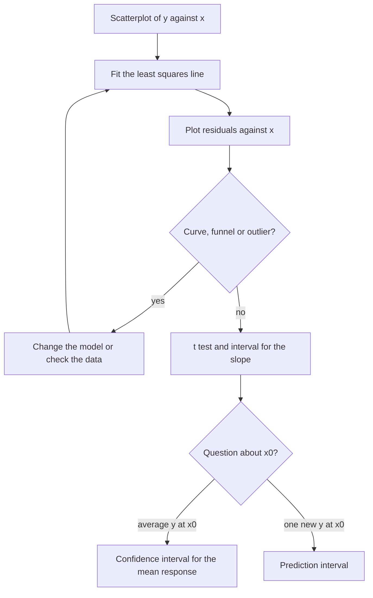

## A model for a mean that changes with $x$

Up to now every observation in a sample had the same distribution. Regression lets the mean
depend on a known quantity $x$: rail wear depends on traffic, stopping distance on speed.
This lesson derives the least squares line, works out the sampling distributions of its
coefficients using what you know about linear combinations of normal variables, and builds
the tests and intervals that follow.

## The model

The **simple linear regression model** says

$$Y_i = \beta_0 + \beta_1 x_i + \varepsilon_i, \qquad i = 1, \dots, n,$$

where the $x_i$ are fixed (not all equal), and the errors $\varepsilon_i$ are independent
$N(0, \sigma^2)$. So $Y_i \sim N(\beta_0 + \beta_1 x_i, \sigma^2)$: a straight-line mean, constant
variance, independence and normality. Three parameters are unknown: $\beta_0$, $\beta_1$ and $\sigma^2$.

Notation used throughout:

$$S_{xx} = \sum(x_i - \bar x)^2, \qquad S_{xy} = \sum(x_i - \bar x)(y_i - \bar y), \qquad S_{yy} = \sum(y_i - \bar y)^2.$$

## Least squares

The method of **least squares** chooses $b_0, b_1$ to minimize
$Q(b_0, b_1) = \sum(y_i - b_0 - b_1 x_i)^2$. Setting the partial derivatives to zero gives the
**normal equations**:

$$\frac{\partial Q}{\partial b_0} = -2\sum(y_i - b_0 - b_1x_i) = 0, \qquad \frac{\partial Q}{\partial b_1} = -2\sum x_i(y_i - b_0 - b_1x_i) = 0.$$

The first says $\bar y = b_0 + b_1\bar x$: the line passes through $(\bar x, \bar y)$. Substituting
$b_0 = \bar y - b_1\bar x$ into the second and simplifying,

$$b_1 = \frac{S_{xy}}{S_{xx}}, \qquad b_0 = \bar y - b_1\bar x.$$

$Q$ is a convex quadratic in $(b_0, b_1)$, so this critical point is the minimum. Under the
normal model the log-likelihood is $-\frac{n}{2}\ln(2\pi\sigma^2) - Q/(2\sigma^2)$, so the least
squares estimates are also the MLEs of $\beta_0$ and $\beta_1$.

The fitted values are $\hat y_i = b_0 + b_1x_i$ and the **residuals** are $e_i = y_i - \hat y_i$. The
normal equations say $\sum e_i = 0$ and $\sum x_ie_i = 0$. The **error sum of squares** is
$\text{SSE} = \sum e_i^2 = S_{yy} - b_1S_{xy}$, and

$$s^2 = \frac{\text{SSE}}{n - 2}$$

estimates $\sigma^2$ without bias. Two degrees of freedom are lost because two coefficients
were estimated, and $\text{SSE}/\sigma^2 \sim \chi^2_{n-2}$, independent of $b_0$ and $b_1$.

The picture below names the pieces on a small made-up data set (fitted line $\hat y = 1.65 + 0.7x$,
$\bar x = 4$, $\bar y = 4.45$). Each residual is a vertical distance, not the perpendicular distance
to the line, because the model puts all the randomness in $y$.


### Example 1: fitting the line

Rail head wear $y$ (mm) against traffic $x$ (tens of millions of gross tons) at six sites:

| $x$ | 2 | 4 | 6 | 8 | 10 | 12 |
|---|---|---|---|---|---|---|
| $y$ | 3.1 | 4.4 | 6.2 | 6.9 | 8.8 | 9.6 |

1. $\bar x = 7$, $\bar y = 6.5$, $S_{xx} = 70$, $S_{xy} = 46.4$, $S_{yy} = 31.12$.
2. $b_1 = 46.4/70 = 0.6629$ mm per unit of traffic; $b_0 = 6.5 - 0.6629(7) = 1.860$.
3. $\text{SSE} = 31.12 - 0.6629(46.4) = 0.3634$, so $s^2 = 0.3634/4 = 0.0909$ and $s = 0.3014$.

```plot
{"x": [0, 14], "y": [0, 12], "xLabel": "traffic x", "yLabel": "wear y (mm)", "points": [{"at": [2, 3.1], "color": "#2c5e8f"}, {"at": [4, 4.4], "color": "#2c5e8f"}, {"at": [6, 6.2], "color": "#2c5e8f"}, {"at": [8, 6.9], "color": "#2c5e8f"}, {"at": [10, 8.8], "color": "#2c5e8f"}, {"at": [12, 9.6], "color": "#2c5e8f"}], "functions": [{"f": "1.86 + 0.662857*x", "color": "#2c5e8f", "from": 0.5, "to": 13.5}, {"f": "1.86 + 0.662857*x + 0.83688*sqrt(1/6 + (x - 7)^2/70)", "dashed": true, "color": "#2c5e8f", "from": 0.5, "to": 13.5}, {"f": "1.86 + 0.662857*x - 0.83688*sqrt(1/6 + (x - 7)^2/70)", "dashed": true, "color": "#2c5e8f", "from": 0.5, "to": 13.5}, {"f": "1.86 + 0.662857*x + 0.83688*sqrt(1 + 1/6 + (x - 7)^2/70)", "dashed": true, "color": "#c2570c", "from": 0.5, "to": 13.5}, {"f": "1.86 + 0.662857*x - 0.83688*sqrt(1 + 1/6 + (x - 7)^2/70)", "dashed": true, "color": "#c2570c", "from": 0.5, "to": 13.5}], "labels": [{"at": [3.2, 9.5], "text": "ŷ = 1.86 + 0.663x"}], "caption": "Fitted line with 95% confidence band for the mean (blue dashed) and wider prediction band (orange dashed); both widen away from x̄ = 7"}
```

## Properties of the estimators

Write $b_1 = \dfrac{\sum(x_i - \bar x)Y_i}{S_{xx}} = \sum c_iY_i$ with $c_i = \dfrac{x_i - \bar x}{S_{xx}}$ (the
$\bar Y$ term drops out because $\sum(x_i - \bar x) = 0$). The weights satisfy $\sum c_i = 0$,
$\sum c_ix_i = 1$ and $\sum c_i^2 = 1/S_{xx}$. Therefore

$$E(b_1) = \sum c_i(\beta_0 + \beta_1x_i) = \beta_1, \qquad \operatorname{Var}(b_1) = \sigma^2\sum c_i^2 = \frac{\sigma^2}{S_{xx}}.$$

Being a linear combination of independent normals, $b_1$ is normal. Similarly $b_0$ is unbiased and
normal with $\operatorname{Var}(b_0) = \sigma^2\left(\dfrac1n + \dfrac{\bar x^2}{S_{xx}}\right)$. Precision in
the slope comes from small $\sigma$, many points, and *widely spread* $x$ values (large $S_{xx}$).
By the Gauss–Markov theorem, $b_0$ and $b_1$ have the smallest variance among all linear unbiased
estimators, even without the normality assumption.

## Inference for the slope

Standardize $b_1$ and replace $\sigma$ by $s$; the chi-square for SSE supplies the $t$:

$$T = \frac{b_1 - \beta_1}{s/\sqrt{S_{xx}}} \sim t_{n-2}.$$

Test $H_0: \beta_1 = 0$ (no linear relationship) with $t = b_1/(s/\sqrt{S_{xx}})$, and estimate the
slope with $b_1 \pm t_{\alpha/2, n-2}\,s/\sqrt{S_{xx}}$.

In Example 1, $\text{SE}(b_1) = 0.3014/\sqrt{70} = 0.0360$, $t = 0.6629/0.0360 = 18.4$ on 4 df, and the
p-value is about $5 \times 10^{-5}$. With $t_{0.025, 4} = 2.776$, a 95% interval for $\beta_1$ is
$0.6629 \pm 0.1000 = (0.563, 0.763)$.

## Estimating a mean versus predicting a value

At a new $x_0$ the point estimate is $\hat y_0 = b_0 + b_1x_0 = \bar Y + b_1(x_0 - \bar x)$. Since
$\bar Y$ and $b_1$ are uncorrelated,

$$\operatorname{Var}(\hat y_0) = \sigma^2\left[\frac1n + \frac{(x_0 - \bar x)^2}{S_{xx}}\right].$$

- A **confidence interval for the mean response** $\beta_0 + \beta_1x_0$:
  $\hat y_0 \pm t_{\alpha/2, n-2}\; s\sqrt{\dfrac1n + \dfrac{(x_0 - \bar x)^2}{S_{xx}}}$.
- A **prediction interval** for a single new observation $Y_0 = \beta_0 + \beta_1x_0 + \varepsilon_0$: the
  error $Y_0 - \hat y_0$ has variance $\sigma^2 + \operatorname{Var}(\hat y_0)$ because the new $\varepsilon_0$ is
  independent of the data, so
  $\hat y_0 \pm t_{\alpha/2, n-2}\; s\sqrt{1 + \dfrac1n + \dfrac{(x_0 - \bar x)^2}{S_{xx}}}$.

The extra 1 is the scatter of an individual point around the line. More data shrinks the
confidence interval toward zero width, but the prediction interval never gets narrower than
about $\pm z_{\alpha/2}\sigma$. Both are narrowest at $x_0 = \bar x$ and widen as $x_0$ moves away;
extrapolating beyond the data adds a risk no formula captures, because the line may not hold there.

### Example 2: intervals at $x_0 = 9$

Continue Example 1, with $t_{0.025, 4} = 2.776$ and $s = 0.3014$.

1. $\hat y_0 = 1.860 + 0.6629(9) = 7.826$.
2. $\sqrt{1/6 + (9 - 7)^2/70} = \sqrt{0.2238} = 0.4731$. Mean response: $7.826 \pm 2.776(0.3014)(0.4731) = 7.826 \pm 0.396$, i.e. $(7.43, 8.22)$.
3. $\sqrt{1 + 0.2238} = 1.1063$. New site: $7.826 \pm 2.776(0.3014)(1.1063) = 7.826 \pm 0.926$, i.e. $(6.90, 8.75)$.

The average wear at $x = 9$ is pinned down to within 0.4 mm; any one site's wear only to within 0.9 mm.

## $r^2$ and the sum of squares decomposition

The **total sum of squares** splits into an explained part and an unexplained part:

$$\underbrace{\sum(y_i - \bar y)^2}_{\text{SST}} = \underbrace{\sum(\hat y_i - \bar y)^2}_{\text{SSR}} + \underbrace{\sum(y_i - \hat y_i)^2}_{\text{SSE}}.$$

The cross term $2\sum(\hat y_i - \bar y)e_i$ vanishes because $\hat y_i - \bar y = b_1(x_i - \bar x)$ and the
normal equations give $\sum e_i = \sum x_ie_i = 0$. The **coefficient of determination**

$$r^2 = \frac{\text{SSR}}{\text{SST}} = 1 - \frac{\text{SSE}}{\text{SST}}$$

is the fraction of the variation in $y$ explained by the line, and it equals the square of the
sample correlation $r = S_{xy}/\sqrt{S_{xx}S_{yy}}$. In Example 1, $r^2 = 1 - 0.3634/31.12 = 0.988$.
The $t$ test of $\beta_1 = 0$ is equivalent to an $F$ test with $F = \text{SSR}/s^2 = t^2$ on (1, $n-2$) df.

## Checking the model with residuals

The inference above assumes a straight-line mean, constant variance, independence and normal
errors. Plot residuals against $x$ (or $\hat y$): you want a patternless horizontal band. A curve
means the mean isn't linear; a funnel means the variance grows with $x$; a single far-off point is
an outlier worth checking.

```plot
{"x": [0, 14], "y": [-0.6, 0.6], "xLabel": "x", "yLabel": "residual", "points": [{"at": [2, -0.086], "color": "#2c5e8f"}, {"at": [4, -0.111], "color": "#2c5e8f"}, {"at": [6, 0.363], "color": "#2c5e8f"}, {"at": [8, -0.263], "color": "#2c5e8f"}, {"at": [10, 0.311], "color": "#2c5e8f"}, {"at": [12, -0.214], "color": "#2c5e8f"}], "segments": [{"from": [0, 0], "to": [14, 0], "dashed": true}], "caption": "Residuals from Example 1: no trend or funnel, consistent with the model"}
```

```plot
{"x": [0, 11], "y": [-5, 5], "xLabel": "x", "yLabel": "residual", "points": [{"at": [1, 0.3], "color": "#2c5e8f"}, {"at": [1.5, -0.4], "color": "#2c5e8f"}, {"at": [2, 0.5], "color": "#2c5e8f"}, {"at": [2.5, -0.2], "color": "#2c5e8f"}, {"at": [3, 0.9], "color": "#2c5e8f"}, {"at": [3.5, -0.8], "color": "#2c5e8f"}, {"at": [4, 1.2], "color": "#2c5e8f"}, {"at": [4.5, -1.1], "color": "#2c5e8f"}, {"at": [5, 0.4], "color": "#2c5e8f"}, {"at": [5.5, 1.6], "color": "#2c5e8f"}, {"at": [6, -1.9], "color": "#2c5e8f"}, {"at": [6.5, 2.2], "color": "#2c5e8f"}, {"at": [7, -1.5], "color": "#2c5e8f"}, {"at": [7.5, 2.8], "color": "#2c5e8f"}, {"at": [8, -2.9], "color": "#2c5e8f"}, {"at": [8.5, 1.1], "color": "#2c5e8f"}, {"at": [9, 3.4], "color": "#2c5e8f"}, {"at": [9.5, -3.6], "color": "#2c5e8f"}, {"at": [10, 4.1], "color": "#2c5e8f"}], "segments": [{"from": [0, 0], "to": [11, 0], "dashed": true}], "caption": "A funnel: spread grows with x, so the constant-variance assumption fails"}
```

A regression analysis follows the same loop every time: fit, look at the residuals, and only
then infer. The last step depends on whether the question is about the average response or one
new observation.



## Common mistakes

- Using $n - 1$ instead of $n - 2$ degrees of freedom for $s^2$ and the $t$ procedures.
- Giving a confidence interval for the mean when the question is about one new observation.
- Reading a large $r^2$ as evidence that the model is correct; a curved pattern can still have high $r^2$.
- Extrapolating the line far beyond the observed $x$ values.
- Forgetting that the $x_i$ need spread: if all $x_i$ are close, $S_{xx}$ is small and the slope is poorly determined.

## Key points

- Model: $Y_i = \beta_0 + \beta_1x_i + \varepsilon_i$, $\varepsilon_i$ i.i.d. $N(0, \sigma^2)$.
- Least squares (= MLE): $b_1 = S_{xy}/S_{xx}$, $b_0 = \bar y - b_1\bar x$; $s^2 = \text{SSE}/(n-2)$.
- $b_1 \sim N(\beta_1, \sigma^2/S_{xx})$; $(b_1 - \beta_1)/(s/\sqrt{S_{xx}}) \sim t_{n-2}$.
- Mean response: $s\sqrt{1/n + (x_0 - \bar x)^2/S_{xx}}$; new observation: add 1 under the root.
- SST = SSR + SSE; $r^2 = \text{SSR}/\text{SST}$; check assumptions with residual plots.
