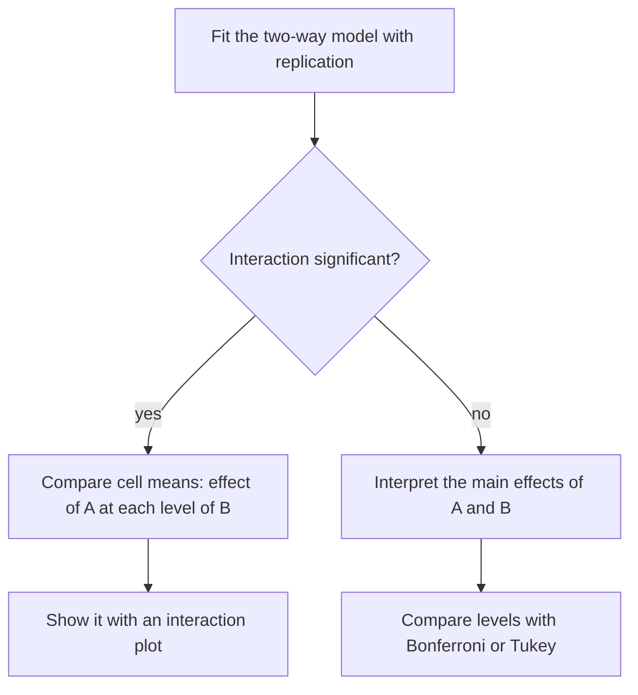

## When one factor is not the whole story

One-way ANOVA compares $k$ group means against the scatter *within* groups. If that scatter is
large, real differences between treatments drown in it. Often much of the scatter has a known
source: sites differ in soil and drainage, days differ in temperature, operators differ in skill.
Two-way ANOVA takes a second factor into account. Used one way, it removes a nuisance source of
variation (**blocking**); used another way, it studies two factors of interest at once and asks
whether they act independently (**factorial design**). Both rest on the same idea as the one-way
analysis: split the total sum of squares into orthogonal pieces and compare mean squares.

Both designs were developed by R. A. Fisher at the Rothamsted agricultural research station in
England in the 1920s. He presented the analysis of variance in *Statistical Methods for Research
Workers* (1925), argued for randomized blocks in the paper "The arrangement of field experiments"
(1926), and set out both designs at length in *The Design of Experiments* (1935). The vocabulary of "blocks" and "plots" comes from those
field trials.

## The randomized block design

Suppose $k$ treatments are to be compared, and the experimental units come in $b$ groups of $k$
similar units, called **blocks**. Within each block, the $k$ treatments are assigned to the units
at random, one unit per treatment. This is a **randomized block design**. Comparisons between
treatments are then made *within* blocks, where units are alike, and block-to-block differences
are removed from the error.


The model, with one observation per treatment-block pair, is the **additive model**

$$Y_{ij} = \mu + \tau_i + \beta_j + \varepsilon_{ij}, \qquad \textstyle\sum_i\tau_i = \sum_j\beta_j = 0, \qquad \varepsilon_{ij} \text{ i.i.d. } N(0, \sigma^2),$$

for treatment $i = 1, \dots, k$ and block $j = 1, \dots, b$. "Additive" means a block shifts every
treatment by the same amount $\beta_j$; there is no treatment-by-block interaction.

*The decomposition.* Write $\bar y_{i\cdot}$ for treatment means, $\bar y_{\cdot j}$ for block means and $\bar y_{\cdot\cdot}$ for the
grand mean. Each deviation splits three ways:

$$y_{ij} - \bar y_{\cdot\cdot} = (\bar y_{i\cdot} - \bar y_{\cdot\cdot}) + (\bar y_{\cdot j} - \bar y_{\cdot\cdot}) + (y_{ij} - \bar y_{i\cdot} - \bar y_{\cdot j} + \bar y_{\cdot\cdot}).$$

Each piece sums to zero across the index it varies over, so after squaring and summing all cross
terms vanish, as in the one-way case:

| Source | df | SS |
|---|---|---|
| Treatments | $k - 1$ | $\text{SSTr} = b\sum_i(\bar y_{i\cdot} - \bar y_{\cdot\cdot})^2$ |
| Blocks | $b - 1$ | $\text{SSB} = k\sum_j(\bar y_{\cdot j} - \bar y_{\cdot\cdot})^2$ |
| Error | $(k - 1)(b - 1)$ | $\text{SSE} = \text{SST} - \text{SSTr} - \text{SSB}$ |
| Total | $kb - 1$ | $\text{SST} = \sum_i\sum_j(y_{ij} - \bar y_{\cdot\cdot})^2$ |

Under $H_0: \tau_1 = \cdots = \tau_k = 0$, $F = \text{MSTr}/\text{MSE} \sim F_{k-1,\,(k-1)(b-1)}$, and
$E(\text{MSTr}) = \sigma^2 + b\sum\tau_i^2/(k - 1)$ exceeds $\sigma^2$ otherwise, exactly as in one-way ANOVA. A ratio
$\text{MSB}/\text{MSE}$ shows whether blocking was worthwhile, though blocks are not usually the object of a test.

### Example 1: three fasteners at four sites

Three rail fastener designs are each installed at four test sites (a randomized block design with
$k = 3$, $b = 4$). The response is a clamping-force score:

| Fastener | Site 1 | Site 2 | Site 3 | Site 4 | Mean |
|---|---|---|---|---|---|
| A | 52 | 61 | 45 | 70 | 57 |
| B | 55 | 65 | 47 | 73 | 60 |
| C | 57 | 64 | 50 | 77 | 62 |
| Site mean | 54.67 | 63.33 | 47.33 | 73.33 | 59.67 |

1. *Totals.* The grand mean is $59.667$ and $\text{SST} = 1190.67$.
2. *Treatments.* $\text{SSTr} = 4[(57 - 59.667)^2 + (60 - 59.667)^2 + (62 - 59.667)^2] = 4(12.667) = 50.67$.
3. *Blocks.* $\text{SSB} = 3[(54.67 - 59.67)^2 + (63.33 - 59.67)^2 + (47.33 - 59.67)^2 + (73.33 - 59.67)^2] = 1132.0$.
4. *Error.* $\text{SSE} = 1190.67 - 50.67 - 1132.0 = 8.0$ on $2 \times 3 = 6$ df, so $\text{MSE} = 1.333$.
5. *Test.* $\text{MSTr} = 50.67/2 = 25.33$, $F = 25.33/1.333 = 19.0$ on (2, 6) df. With $F_{0.05,2,6} = 5.14$,
   reject; $p \approx 0.0025$.

Now ignore the sites and run a one-way ANOVA on the same twelve numbers. The site variation lands
in the error: $\text{SSE} = 1190.67 - 50.67 = 1140$ on 9 df, $\text{MSE} = 126.7$, and $F = 25.33/126.7 = 0.20$,
$p = 0.82$. The treatment differences are the same in both analyses; blocking simply stopped the
huge site-to-site differences from hiding them. A scored lowest at every site, and C highest at three of the four.

*Link to the paired $t$ test.* With $k = 2$ treatments, each block is a pair, and the
randomized block $F$ equals the square of the paired $t$ statistic, just as one-way ANOVA with two
groups reproduces the pooled $t$ test. Blocking is pairing generalized to more than two treatments.

*A price.* Error df fall from $kb - k$ to $(k - 1)(b - 1)$, here from 9 to 6. If blocks do not really
differ, blocking wastes degrees of freedom; when they differ a lot, as here, it is a bargain.

## Two factors of interest: the factorial design

Now let both factors matter: factor A with $a$ levels and factor B with $b$ levels, every
combination (cell) run $r \ge 2$ times. This is a **factorial design**, and its model is

$$Y_{ijl} = \mu + \alpha_i + \beta_j + (\alpha\beta)_{ij} + \varepsilon_{ijl}, \qquad l = 1, \dots, r,$$

with each set of effects summing to zero over each index. The **main effects** $\alpha_i$ and $\beta_j$ are
the average effects of each factor; the **interaction** $(\alpha\beta)_{ij}$ is the extra amount by which
cell $(i, j)$ departs from what the two main effects add up to. No interaction means the effect of
B is the same at every level of A. Replication is what makes this testable: with $r = 1$ there is
no within-cell scatter, so interaction and error cannot be told apart, which is why the block
design has to assume additivity.

For a balanced design (equal $r$ in every cell), with cell means $\bar y_{ij\cdot}$:

| Source | df | SS |
|---|---|---|
| A | $a - 1$ | $br\sum_i(\bar y_{i\cdot\cdot} - \bar y)^2$ |
| B | $b - 1$ | $ar\sum_j(\bar y_{\cdot j\cdot} - \bar y)^2$ |
| AB interaction | $(a - 1)(b - 1)$ | $r\sum_i\sum_j(\bar y_{ij\cdot} - \bar y_{i\cdot\cdot} - \bar y_{\cdot j\cdot} + \bar y)^2$ |
| Error | $ab(r - 1)$ | $\sum_i\sum_j\sum_l(y_{ijl} - \bar y_{ij\cdot})^2$ |
| Total | $abr - 1$ | $\sum(y_{ijl} - \bar y)^2$ |

Each effect is tested with its mean square over MSE. Test the interaction first: if it is
present, a main effect averages over situations in which the factor behaves differently, and it
may describe none of them.

### Example 2: rail grade and lubrication

Wear (in hundredths of a millimeter) for two rail grades and three lubrication levels, two
test sections per cell:

| Grade | None | Low | High |
|---|---|---|---|
| Standard | 20, 22 | 15, 17 | 10, 12 |
| Premium | 13, 15 | 12, 14 | 11, 13 |

1. *Means.* Cell means: standard 21, 16, 11; premium 14, 13, 12. Grade means 16 and 13;
   lubrication means 17.5, 14.5, 11.5; grand mean 14.5.
2. *Main effects.* $\text{SS}_A = 3 \cdot 2[(16 - 14.5)^2 + (13 - 14.5)^2] = 27$; $\text{SS}_B = 2 \cdot 2[3^2 + 0^2 + 3^2] = 72$.
3. *Interaction.* The interaction estimates $\bar y_{ij\cdot} - \bar y_{i\cdot\cdot} - \bar y_{\cdot j\cdot} + \bar y$ are $2, 0, -2$ for
   standard and $-2, 0, 2$ for premium, so $\text{SS}_{AB} = 2(4 + 0 + 4 + 4 + 0 + 4) = 32$.
4. *Error.* Each cell's two values are its mean $\pm 1$, so each cell contributes 2: $\text{SSE} = 12$ on
   $2 \cdot 3 \cdot 1 = 6$ df, $\text{MSE} = 2$. (Check: $\text{SST} = 143 = 27 + 72 + 32 + 12$.)
5. *Tests.* Interaction: $F = (32/2)/2 = 8.0$ on (2, 6) df, $p = 0.020$. Grade: $F = 27/2 = 13.5$ on (1, 6),
   $p = 0.010$. Lubrication: $F = (72/2)/2 = 18.0$ on (2, 6), $p = 0.003$.

The significant interaction is the headline. An **interaction plot** of the cell means shows it:
the lines are far from parallel.

```plot
{"x": [0.5, 3.5], "y": [8, 24], "xLabel": "lubrication (1 = none, 2 = low, 3 = high)", "yLabel": "mean wear", "segments": [{"from": [1, 21], "to": [2, 16], "color": "#2c5e8f"}, {"from": [2, 16], "to": [3, 11], "color": "#2c5e8f"}, {"from": [1, 14], "to": [2, 13], "color": "#c2570c", "dashed": true}, {"from": [2, 13], "to": [3, 12], "color": "#c2570c", "dashed": true}], "points": [{"at": [1, 21], "color": "#2c5e8f"}, {"at": [2, 16], "color": "#2c5e8f"}, {"at": [3, 11], "color": "#2c5e8f"}, {"at": [1, 14], "color": "#c2570c"}, {"at": [2, 13], "color": "#c2570c"}, {"at": [3, 12], "color": "#c2570c"}], "labels": [{"at": [1.45, 21], "text": "standard"}, {"at": [1.35, 12.2], "text": "premium"}], "caption": "Interaction plot: lubrication cuts standard-rail wear by 10 but premium-rail wear by only 2, so the lines are not parallel"}
```

Lubrication cuts wear by 10 on standard rail but only by 2 on premium rail, and with high
lubrication the grades are almost equal (11 versus 12). "Premium rail wears 3 less" (the main
effect) is true only on average; the useful statement is conditional on lubrication.



## Assumptions and design notes

The assumptions are those of one-way ANOVA (independence, normal errors, common variance), plus,
for the block design, additivity. Check residuals $y_{ij} - \bar y_{i\cdot} - \bar y_{\cdot j} + \bar y_{\cdot\cdot}$ (blocks) or
$y_{ijl} - \bar y_{ij\cdot}$ (factorial) against fitted values. The simple formulas above need a balanced
design; with unequal cell counts the sums of squares stop being orthogonal and depend on the order
in which effects are fitted, a genuinely contested area where software offers several "types" of
sums of squares. Randomization within blocks is what justifies treating the leftover variation as
random error.

## Common mistakes

- Analyzing blocked data with a one-way ANOVA, which pushes block variation into the error and can hide real effects.
- Using $kb - k$ error df in a block design; it is $(k - 1)(b - 1)$.
- Interpreting main effects without first checking the interaction.
- Testing interaction with one observation per cell: there is no separate error to test it against.
- Reading parallel-looking lines in an interaction plot as proof of no interaction; the $F$ test accounts for noise.
- Forgetting the multipliers $br$ and $ar$ (the number of observations behind each mean) in the main-effect sums of squares.

## Key points

- Blocking compares treatments within groups of similar units, removing block variation from the error.
- Block design: SST = SSTr + SSB + SSE; error df $(k - 1)(b - 1)$; $F = \text{MSTr}/\text{MSE}$. With $k = 2$ it is the paired $t$ test.
- Factorial design: $\text{SST} = \text{SS}_A + \text{SS}_B + \text{SS}_{AB} + \text{SSE}$; error df $ab(r - 1)$; each effect tested against MSE.
- Interaction means one factor's effect depends on the level of the other; test it first and show it with an interaction plot.
- Balanced designs give orthogonal sums of squares; unbalanced ones need more care.
