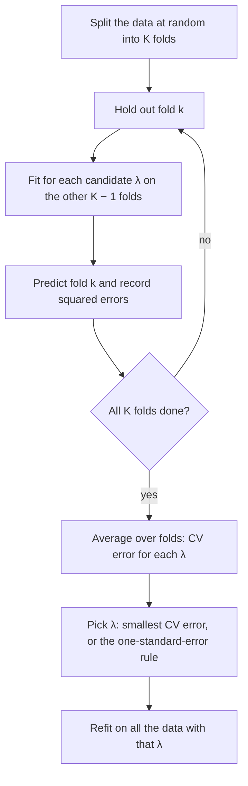

## Too many knobs

Simple linear regression fitted one slope by least squares, and the Gauss–Markov theorem said
that among *unbiased* linear estimators, least squares has the smallest variance. The previous
lesson showed what happens when we drop the word "unbiased": with three or more means, a
little deliberate bias toward a target beats the unbiased estimator. This lesson carries that
idea into regression, where it has become one of the standard tools of modern statistics and
machine learning.

With many predictors, the model is $Y_i = \beta_0 + \beta_1x_{i1} + \dots + \beta_px_{ip} + \varepsilon_i$. Least squares still
minimizes the residual sum of squares, and in matrix form its solution is
$\hat{\boldsymbol\beta} = (\mathbf X^{\mathsf T}\mathbf X)^{-1}\mathbf X^{\mathsf T}\mathbf y$, where $\mathbf X$ holds the predictor values. Two things go wrong as $p$ grows.

- **Variance.** When predictors are strongly correlated, or $p$ is close to $n$, $\mathbf X^{\mathsf T}\mathbf X$ is nearly
  singular and the coefficients swing wildly from sample to sample. When $p > n$ there is no
  unique solution at all: infinitely many coefficient vectors fit the data perfectly.
- **Overfitting.** Every added predictor lowers the residual sum of squares on the data used for
  fitting, even when the predictor is pure noise. A model tuned to the noise of one sample
  predicts new data badly. This is **overfitting**: training error keeps falling while the error
  on new data first falls and then rises.

The cure is **regularization**: add a penalty for large coefficients to the least squares criterion.

## Ridge regression

**Ridge regression** (Hoerl and Kennard, 1970; the same idea appears earlier in numerical analysis
as Tikhonov regularization) minimizes

$$\sum_{i=1}^n\Big(y_i - \beta_0 - \sum_{j=1}^p \beta_jx_{ij}\Big)^2 + \lambda\sum_{j=1}^p\beta_j^2,$$

where $\lambda \ge 0$ is the **tuning parameter**. Two conventions are standard: the predictors are
first standardized (centered and scaled to the same spread), because the penalty treats all
coefficients alike, and the intercept is not penalized (with centered data it is just $\bar y$).

With centered predictors the solution is

$$\hat{\boldsymbol\beta}^{\text{ridge}} = (\mathbf X^{\mathsf T}\mathbf X + \lambda\mathbf I)^{-1}\mathbf X^{\mathsf T}\mathbf y.$$

Adding $\lambda$ to the diagonal makes the matrix invertible for every $\lambda > 0$, even when $p > n$, since
$\mathbf v^{\mathsf T}(\mathbf X^{\mathsf T}\mathbf X + \lambda\mathbf I)\mathbf v = \|\mathbf X\mathbf v\|^2 + \lambda\|\mathbf v\|^2 > 0$ for every $\mathbf v \ne \mathbf 0$. At $\lambda = 0$ it is least squares; as $\lambda \to \infty$ all slopes go to 0.

With a single centered predictor, setting the derivative to zero gives

$$-2S_{xy} + 2bS_{xx} + 2\lambda b = 0 \quad\Longrightarrow\quad b^{\text{ridge}} = \frac{S_{xy}}{S_{xx} + \lambda}.$$

Ridge also has a Bayesian reading: if the errors are $N(0, \sigma^2)$ and each $\beta_j$ has prior
$N(0, \sigma^2/\lambda)$, the posterior mean (and mode) of $\boldsymbol\beta$ is exactly the ridge estimate. The penalty
is a prior belief that coefficients are probably small.

## The bias–variance tradeoff, computed

Take one centered predictor with the true slope $\beta$ and error variance $\sigma^2$. Since $E(S_{xy}) = \beta S_{xx}$
and $\operatorname{Var}(S_{xy}) = \sigma^2S_{xx}$,

$$E(b^{\text{ridge}}) = \frac{S_{xx}}{S_{xx} + \lambda}\beta, \qquad \operatorname{Var}(b^{\text{ridge}}) = \frac{\sigma^2S_{xx}}{(S_{xx} + \lambda)^2}, \qquad \operatorname{MSE}(\lambda) = \frac{\sigma^2S_{xx} + \lambda^2\beta^2}{(S_{xx} + \lambda)^2}.$$

Raising $\lambda$ lowers the variance and raises the squared bias: the **bias–variance tradeoff**.
Differentiating, $\operatorname{MSE}'(\lambda) = 2S_{xx}(\lambda\beta^2 - \sigma^2)/(S_{xx} + \lambda)^3$, which is negative at $\lambda = 0$. So some ridge
penalty *always* beats least squares, and the best one is $\lambda^* = \sigma^2/\beta^2$, giving $\operatorname{MSE}(\lambda^*) = \sigma^2/(S_{xx} + \sigma^2/\beta^2)$.
Like $c^*$ in the James–Stein lesson, $\lambda^*$ depends on the unknown truth, so in practice it must be
chosen from the data.

### Example 1: a noisy slope

Suppose $\beta = 0.5$, $\sigma^2 = 1$ and $S_{xx} = 4$ (a small, noisy experiment).

1. Least squares ($\lambda = 0$): unbiased, $\operatorname{MSE} = \sigma^2/S_{xx} = 0.25$.
2. Best penalty: $\lambda^* = \sigma^2/\beta^2 = 4$.
3. At $\lambda = 4$: variance $= 4/64 = 0.0625$, bias $= -\frac{4}{8}(0.5) = -0.25$, squared bias $= 0.0625$, so $\operatorname{MSE} = 0.125$.

The penalty halves the mean squared error, at the price of an estimator that is centered at
0.25, not 0.5.

```plot
{"x": [0, 20], "y": [0, 0.27], "xLabel": "penalty λ", "yLabel": "error", "functions": [{"f": "(4 + 0.25*x^2)/(4 + x)^2"}, {"f": "4/(4 + x)^2", "dashed": true}, {"f": "0.25*x^2/(4 + x)^2", "dashed": true}], "points": [{"at": [4, 0.125], "label": "λ* = 4"}], "labels": [{"at": [9, 0.165], "text": "MSE"}, {"at": [15, 0.125], "text": "bias²"}, {"at": [8, 0.045], "text": "variance"}], "caption": "Example 1: as λ grows the variance falls and the squared bias rises; their sum, the MSE, is smallest at λ* = σ²/β² = 4"}
```

## The lasso

The **lasso** (least absolute shrinkage and selection operator; Tibshirani, 1996) uses absolute
values in place of squares:

$$\sum_{i=1}^n\Big(y_i - \beta_0 - \sum_j\beta_jx_{ij}\Big)^2 + \lambda\sum_{j=1}^p|\beta_j|.$$

That small change has a large effect: the lasso sets some coefficients *exactly* to zero, so it
selects variables as well as shrinking them. For one centered predictor, minimize
$S_{yy} - 2bS_{xy} + b^2S_{xx} + \lambda|b|$. For $b > 0$ the derivative is zero at $b = (S_{xy} - \lambda/2)/S_{xx}$, which is
positive only if $S_{xy} > \lambda/2$; the case $b < 0$ is symmetric. Otherwise the minimum is at the kink, $b = 0$. So

$$b^{\text{lasso}} = \frac{\operatorname{sign}(S_{xy})\,\max\!\big(|S_{xy}| - \lambda/2,\; 0\big)}{S_{xx}}.$$

This is **soft thresholding**: move the least squares quantity $S_{xy}$ toward zero by $\lambda/2$, and stop
at zero. Ridge, by contrast, divides by $S_{xx} + \lambda$ and never reaches zero.

(Software scales the criterion differently, for example $\frac{1}{2n}\sum(\cdot)^2 + \lambda\sum|\beta_j|$, so a "$\lambda$" from one
package is not comparable with another's. The shape of the answer is the same.)

### Example 2: the rail-wear line, penalized

The rail-wear data of the regression lesson have $S_{xx} = 70$ and $S_{xy} = 46.4$, so least squares gives
$b_1 = 46.4/70 = 0.6629$.

1. Ridge with $\lambda = 10$: $b = 46.4/(70 + 10) = 0.58$.
2. Lasso with $\lambda = 20$: $b = (46.4 - 10)/70 = 0.52$.
3. Lasso with $\lambda = 100$: $\lambda/2 = 50 > 46.4$, so $b = 0$. The lasso drops the predictor entirely.

Any $\lambda \ge 2|S_{xy}| = 92.8$ zeroes this slope.

## Why corners give zeros

The penalized problems are equivalent to constrained ones: minimize the residual sum of squares
subject to $\sum|\beta_j| \le t$ (lasso) or $\sum\beta_j^2 \le t^2$ (ridge), with each $t$ matching some $\lambda$. The
contours of the residual sum of squares are ellipses around the least squares estimate, and the
solution is where the smallest ellipse touches the constraint region.


The diamond has corners on the axes, and an ellipse coming from a typical direction usually hits
a corner first, where some coefficients are exactly 0. The disk has no corners, so the ridge
solution almost never lands on an axis.

## Choosing λ by cross-validation

Training error cannot choose $\lambda$: it is always smallest at $\lambda = 0$. We need an estimate of the
error on *new* data. **Cross-validation** gets one by holding data out.



Common choices are $K = 5$ or $K = 10$. With $K = n$ it is **leave-one-out cross-validation**: each point
is predicted from a fit to the other $n - 1$. For least squares (and ridge at a fixed $\lambda$) this needs
no refitting, since the leave-one-out residual is $e_i/(1 - h_{ii})$, where $h_{ii}$ is the $i$-th diagonal entry
of the matrix that maps $\mathbf y$ to the fitted values.

The CV curve is itself estimated with error. The **one-standard-error rule** picks the largest $\lambda$
(the simplest model) whose CV error is within one standard error of the minimum.

### Example 3: reading a CV table

A ridge fit with 10-fold CV gives these average squared prediction errors (with standard errors
across folds):

| $\lambda$ | 0 | 1 | 3 | 10 | 30 | 100 |
|---|---|---|---|---|---|---|
| CV error | 5.10 | 4.62 | 4.41 | 4.48 | 4.83 | 6.20 |
| SE | 0.30 | 0.27 | 0.25 | 0.26 | 0.28 | 0.35 |

1. The minimum is at $\lambda = 3$ (4.41).
2. One-SE threshold: $4.41 + 0.25 = 4.66$.
3. The largest $\lambda$ with CV error at most 4.66 is $\lambda = 10$ (4.48); $\lambda = 30$ gives 4.83, too high.

The minimum rule picks $\lambda = 3$; the one-SE rule picks the more strongly penalized $\lambda = 10$.

## Common mistakes

- **Not standardizing.** The penalty compares coefficients directly, so a predictor measured in
  millimetres would be penalized differently from the same one in metres.
- **Penalizing the intercept.** That pulls the fitted values toward 0 for no reason; center $y$ instead.
- **Choosing $\lambda$ by training error.** It always prefers $\lambda = 0$. Use cross-validation or a separate test set.
- **Reading a lasso zero as "no effect".** With correlated predictors the lasso often keeps one and
  drops the others somewhat arbitrarily.
- **Quoting ordinary p-values after selection.** Intervals and tests computed as if the selected
  model had been fixed in advance are too optimistic.

## Key points

- Ridge: minimize RSS $+ \lambda\sum\beta_j^2$; solution $(\mathbf X^{\mathsf T}\mathbf X + \lambda\mathbf I)^{-1}\mathbf X^{\mathsf T}\mathbf y$; one predictor $b = S_{xy}/(S_{xx} + \lambda)$.
- Lasso: minimize RSS $+ \lambda\sum|\beta_j|$; one predictor $b = \operatorname{sign}(S_{xy})(|S_{xy}| - \lambda/2)_+/S_{xx}$ (soft thresholding), which can be exactly 0.
- Penalties trade a little bias for less variance; for one slope the best ridge $\lambda$ is $\sigma^2/\beta^2$.
- Ridge is the posterior mean under normal priors on the coefficients.
- Choose $\lambda$ by $K$-fold cross-validation, possibly with the one-standard-error rule, then refit on all the data.
