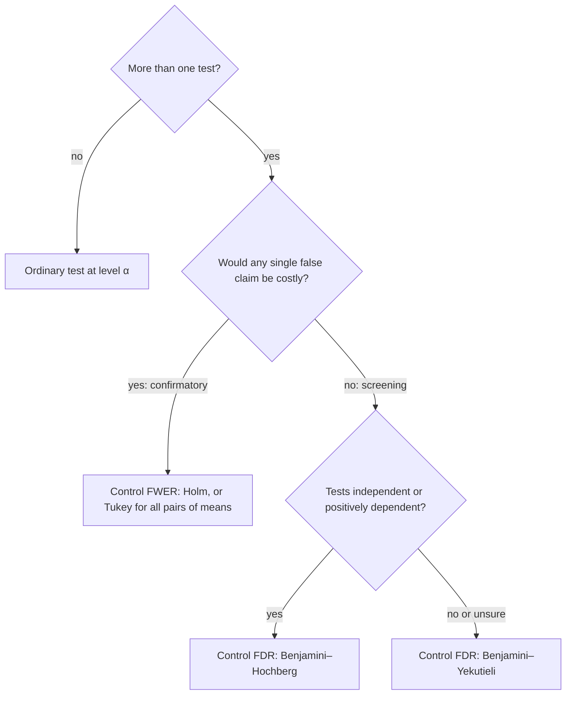

## One test is easy; ten thousand are not

The testing lessons controlled the Type I error of *one* test, and the ANOVA lesson met the first
complication: after a significant $F$ test, comparing every pair of means is several tests at once,
and the familywise error rate grows with the number of comparisons. Bonferroni's fix was to run
each test at level $\alpha/m$.

Modern data push this much further. A gene-expression study tests 20,000 genes; a monitoring
system checks every one of 3,000 track sensors each night for drift; a website runs dozens of
A/B comparisons a week. With thousands of tests, Bonferroni's threshold becomes so strict that
real effects are almost never found. This lesson gives a sharper tool for controlling the
familywise error rate (Holm's method) and a different, more forgiving error rate that suits
large-scale screening: the false discovery rate.

## The size of the problem

If $m$ independent tests all have true null hypotheses and each uses level $\alpha$, then

$$P(\text{at least one false rejection}) = 1 - (1 - \alpha)^m, \qquad E(\text{number of false rejections}) = m\alpha.$$

With $\alpha = 0.05$: $m = 8$ gives 0.337, $m = 20$ gives 0.642, $m = 100$ gives 0.994. Run enough
tests and "significant" results are guaranteed, real or not.

A key fact makes all the procedures below work: *a p-value from a true null is uniform*. If the
test statistic $T$ is continuous with null cdf $F_0$ and large values count against $H_0$, the p-value is
$1 - F_0(T)$, and by the probability integral transform $F_0(T) \sim \text{Uniform}(0, 1)$ under $H_0$. So
$P(p \le u) = u$ for every $u$: under the null, a p-value below 0.01 happens 1% of the time, no more.

## Counting the errors

Suppose $m_0$ of the $m$ null hypotheses are true. After a procedure runs, the outcome looks like this:

| | Not rejected | Rejected | Total |
|---|---|---|---|
| True nulls | $U$ | $V$ | $m_0$ |
| False nulls | $T$ | $S$ | $m - m_0$ |
| Total | $m - R$ | $R$ | $m$ |

$V$ counts false rejections ("false discoveries") and $R$ counts all rejections. Two error rates:

- the familywise error rate, $\text{FWER} = P(V \ge 1)$: the chance of even one false discovery;
- the **false discovery proportion** $\text{FDP} = V/R$ (taken as 0 when $R = 0$), and its average, the
  **false discovery rate** $\text{FDR} = E(\text{FDP})$ (Benjamini and Hochberg, 1995).

FWER control says "probably no false discoveries at all". FDR control says "on average, at most a
fraction $q$ of my discoveries are false". When all nulls are true, $V = R$, so FDP is 1 whenever anything
is rejected and FDR = FWER; otherwise $\text{FDR} \le \text{FWER}$, so controlling FDR is a weaker demand
and leaves room for more power.

## Holm's step-down method

Sort the p-values, $p_{(1)} \le p_{(2)} \le \dots \le p_{(m)}$. **Holm's procedure** (Holm, 1979) compares them with
rising thresholds, starting from the smallest:

$$p_{(1)} \le \frac{\alpha}{m}, \quad p_{(2)} \le \frac{\alpha}{m - 1}, \quad p_{(3)} \le \frac{\alpha}{m - 2}, \quad \dots, \quad p_{(m)} \le \alpha.$$

Reject the hypotheses in order as long as each comparison holds; at the first failure, stop and
retain that one and all larger ones. A procedure that starts at the most significant result and
stops at the first failure is a **step-down procedure**.

*Why it controls FWER at $\alpha$, under any dependence.* Holm can make a false rejection only if it reaches
the smallest true-null p-value. At most $m - m_0$ false nulls can come before it, so it sits at rank
$j \le m - m_0 + 1$, where the threshold is $\alpha/(m - j + 1) \le \alpha/m_0$. A false rejection therefore needs some
true-null p-value $\le \alpha/m_0$, and by the union bound that has probability at most $m_0 \cdot \alpha/m_0 = \alpha$.

Every threshold is at least Bonferroni's $\alpha/m$, so Holm rejects everything Bonferroni rejects and
sometimes more, with the same guarantee. There is no reason to use plain Bonferroni for a list
of p-values.

## The Benjamini–Hochberg procedure

The **Benjamini–Hochberg procedure** controls FDR at a chosen level $q$:

1. Sort the p-values: $p_{(1)} \le \dots \le p_{(m)}$.
2. Find the largest $k$ with $p_{(k)} \le \dfrac{k}{m}q$.
3. Reject the hypotheses with the $k$ smallest p-values (none if no such $k$ exists).

It searches from the largest p-value downward and rejects everything below the last crossing, a
**step-up procedure**: a p-value above its own line can still be rejected if a larger one is
below its line.

**Theorem** (Benjamini and Hochberg, 1995). If the $m$ test statistics are independent and the
true-null p-values are uniform, then $\text{FDR} = \dfrac{m_0}{m}q \le q$. (Benjamini and Hochberg proved the bound $\text{FDR} \le m_0q/m$; that it holds with equality was shown a few years later.) The same bound holds under a common kind
of positive dependence (Benjamini and Yekutieli, 2001). For arbitrary dependence, replacing $q$ by
$q/(1 + \frac12 + \dots + \frac1m)$ restores the guarantee, at a cost in power.

*Where the line comes from.* Reject every p-value below a cutoff $t$. About $m_0t \le mt$ true-null
p-values fall below $t$, because they are uniform, so the false discovery proportion is roughly
$mt/R(t)$, where $R(t)$ counts the p-values below $t$. Choosing the largest $t$ with $mt/R(t) \le q$ and
taking $t = p_{(k)}$, so that $R(t) = k$, gives exactly the condition $p_{(k)} \le kq/m$.

### Example 1: three procedures on one list

Eight track sensors were each tested for drift. Sorted p-values:
0.001, 0.004, 0.008, 0.019, 0.031, 0.044, 0.21, 0.63. Use $\alpha = q = 0.05$ and $m = 8$.

| $k$ | 1 | 2 | 3 | 4 | 5 | 6 | 7 | 8 |
|---|---|---|---|---|---|---|---|---|
| $p_{(k)}$ | 0.001 | 0.004 | 0.008 | 0.019 | 0.031 | 0.044 | 0.21 | 0.63 |
| Holm $0.05/(9 - k)$ | 0.00625 | 0.00714 | 0.00833 | 0.0100 | 0.0125 | 0.0167 | 0.025 | 0.05 |
| BH $0.05k/8$ | 0.00625 | 0.0125 | 0.01875 | 0.025 | 0.03125 | 0.0375 | 0.04375 | 0.05 |

1. **Bonferroni:** threshold $0.05/8 = 0.00625$. Rejects $k = 1, 2$: **2 discoveries**.
2. **Holm:** $0.001 \le 0.00625$, $0.004 \le 0.00714$, $0.008 \le 0.00833$, but $0.019 > 0.0100$: stop. **3 discoveries**.
3. **BH:** working down, $0.63 > 0.05$, $0.21 > 0.04375$, $0.044 > 0.0375$, but $0.031 \le 0.03125$. The largest
   $k$ is 5. **5 discoveries**.

Holm adds one discovery over Bonferroni with the same FWER guarantee; BH adds two more by accepting
that, on average, up to 5% of the discoveries may be false.

## Adjusted p-values

Software usually reports **adjusted p-values**: the smallest level at which a hypothesis would be
rejected by the whole procedure, so that you compare each adjusted value directly with $\alpha$ or $q$.
For BH, $\tilde p_{(k)} = \min_{j \ge k}\, \min\!\big(1, \tfrac{m}{j}p_{(j)}\big)$. In Example 1 the BH-adjusted values are
0.008, 0.016, 0.0213, 0.038, 0.0496, 0.0587, 0.24, 0.63; the first five are at most 0.05, as found above.
The Bonferroni adjustment is simply $\min(1, mp)$.

### Example 2: why per-test α is not enough for screening

A screen runs 1,000 tests. Suppose 900 nulls are true and 100 are false, and each test at $\alpha = 0.05$
has power 0.8 against the real effects.

1. Expected false discoveries: $900 \times 0.05 = 45$.
2. Expected true discoveries: $100 \times 0.8 = 80$.
3. Of about 125 discoveries, roughly $45/125 = 0.36$ are false.

More than a third of the "findings" would be noise even though every single test was valid at 5%.
That proportion is what FDR control targets. (The ratio of expectations only approximates
$E(V/R)$, but with this many tests it is close.)

## Which error rate?

FWER suits a small number of confirmatory claims, such as the primary outcomes of a clinical
trial or a safety certification, where one false claim is costly. FDR suits exploration, where
discoveries will be checked again and a few false leads are an acceptable price for finding more
real ones.

## Common mistakes

- **Reading FDR as the probability that a given discovery is false.** FDR is an average
  proportion over repetitions of the whole study; a particular discovery with $p$ just under
  its line is more likely to be false than one with a tiny p-value.
- **Stopping BH at the first p-value above its line.** BH is step-up: find the *largest* $k$ under
  the line. Stopping at the first failure is how Holm works, not BH.
- **Splitting the family after seeing the results.** Applying a correction to a hand-picked subset,
  or testing many hypotheses and reporting only the best, defeats the correction.
- **Using Bonferroni on a list of p-values when Holm is available.** Holm is never less powerful
  and has the same guarantee.
- **Comparing BH-adjusted p-values with $\alpha/m$.** Adjusted values are compared with $q$ itself.

## Key points

- For $m$ independent true-null tests at level $\alpha$, $P(\text{some false rejection}) = 1 - (1 - \alpha)^m$.
- True-null p-values are Uniform(0, 1), the fact behind every procedure here.
- Holm (step-down): reject while $p_{(k)} \le \alpha/(m - k + 1)$; controls FWER under any dependence and beats Bonferroni.
- Benjamini–Hochberg (step-up): reject the $k$ smallest, $k$ the largest index with $p_{(k)} \le kq/m$; FDR $= m_0q/m \le q$ for independent tests.
- FDR $= E(V/R)$ is a weaker, more powerful target than FWER $= P(V \ge 1)$, suited to large-scale screening.
