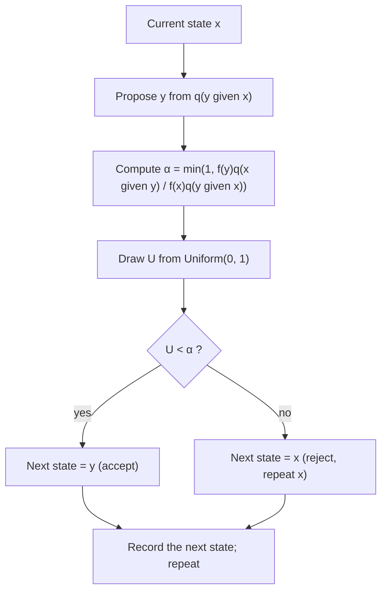

## A posterior you can write but not sample

The Bayesian inference lesson used conjugate pairs (beta–binomial, normal–normal, gamma–Poisson),
where the posterior is a named distribution and every summary has a formula. Change the prior to
something more realistic and that convenience disappears. For example, counts $x_1, \dots, x_n$ from
a Poisson($\lambda$) model with a half-Cauchy prior $p(\lambda) \propto 1/(1 + \lambda^2)$ for $\lambda > 0$ have the posterior

$$p(\lambda \mid \mathbf x) = \frac{1}{Z}\,\lambda^{\sum x_i}e^{-n\lambda}\,\frac{1}{1 + \lambda^2}, \qquad Z = \int_0^\infty \lambda^{\sum x_i}e^{-n\lambda}\frac{d\lambda}{1 + \lambda^2}.$$

We can evaluate the numerator at any $\lambda$, but $Z$ has no closed form. In one dimension numerical
integration works; with 50 parameters (a hierarchical model of 50 track sections, say), grid
integration is hopeless. Yet we only need *draws* from the posterior: with draws, the Monte Carlo
integration of the law of large numbers lesson estimates any posterior mean, probability or
interval by an average.

**Markov chain Monte Carlo** (MCMC) produces such draws without ever computing $Z$. It builds a
random walk whose long-run behavior is the posterior. It is the reason Bayesian methods became
practical for complex models from about 1990 on.

## Markov chains and stationary distributions

A **Markov chain** is a sequence $X_0, X_1, X_2, \dots$ in which the next state depends on the past only
through the present state: $P(X_{t+1} = y \mid X_t = x, X_{t-1}, \dots) = P(x, y)$. For a finite state space, the
transition probabilities form a matrix $P$ whose rows sum to 1.

A distribution $\pi$ is a **stationary distribution** if starting from it keeps you in it: if $X_t \sim \pi$ then
$X_{t+1} \sim \pi$. For a finite chain this says $\sum_x \pi(x)P(x, y) = \pi(y)$ for every $y$, that is, $\pi P = \pi$.

The easiest way to *prove* stationarity is **detailed balance**:

$$\pi(x)P(x, y) = \pi(y)P(y, x) \quad\text{for all } x, y.$$

*Why it suffices:* sum both sides over $x$. The left side is $\sum_x \pi(x)P(x, y)$; the right side is
$\pi(y)\sum_x P(y, x) = \pi(y)$ because each row sums to 1. So $\pi P = \pi$. Detailed balance says that, in
equilibrium, the flow from $x$ to $y$ equals the flow back.

The result that makes MCMC work is the **ergodic theorem** for Markov chains, stated here in simplified form
without proof: if the chain has stationary distribution $\pi$, can get from any state to any other (it is
irreducible) and does not cycle with a fixed period (it is aperiodic), then the distribution of $X_t$
converges to $\pi$ from any starting point, and long-run averages $\frac1N\sum_{t=1}^N g(X_t)$ converge to $E_\pi[g(X)]$. It
is a law of large numbers for dependent draws.

## The Metropolis–Hastings algorithm

Given a target $\pi$ known only up to a constant, $\pi(x) = f(x)/Z$, we need a chain with stationary
distribution $\pi$. The **Metropolis–Hastings algorithm** (Metropolis and coauthors, 1953;
generalized by Hastings, 1970) builds one. Choose a **proposal distribution** $q(y \mid x)$ that is easy to
sample, such as $y = x + \varepsilon$ with a normal step $\varepsilon \sim N(0, s^2)$. From the current state $x$:

1. Propose $y \sim q(y \mid x)$.
2. Compute the **acceptance probability**
   $$\alpha(x, y) = \min\left(1,\; \frac{f(y)\,q(x \mid y)}{f(x)\,q(y \mid x)}\right).$$
3. Draw $U \sim \text{Uniform}(0, 1)$. If $U < \alpha(x, y)$, move to $y$; otherwise stay at $x$ (and record $x$ again).

Only the ratio $f(y)/f(x)$ appears, so $Z$ cancels. When the proposal is symmetric, $q(y \mid x) = q(x \mid y)$
(as for a normal random-walk step), the $q$ terms cancel too and $\alpha = \min(1, f(y)/f(x))$: always move uphill,
and move downhill with probability equal to the ratio. That special case is the original
**Metropolis algorithm**.

*Why it works.* For $x \ne y$ the chain moves from $x$ to $y$ with density $q(y \mid x)\alpha(x, y)$, so

$$\pi(x)q(y \mid x)\alpha(x, y) = \frac1Z\min\big(f(x)q(y \mid x),\; f(y)q(x \mid y)\big).$$

The right side is symmetric in $x$ and $y$, so detailed balance holds and $\pi$ is stationary. Rejections
(staying put) never break detailed balance, since a move from $x$ to $x$ balances itself. With a
proposal that can reach everywhere, the ergodic theorem then applies.

### Example 1: a four-state target

Let the states be 1, 2, 3, 4 with $f = (1, 2, 4, 3)$, so $\pi = (0.1, 0.2, 0.4, 0.3)$. The proposal moves one step
left or right with probability 1/2 each, wrapping around (4 is next to 1); it is symmetric.

From state 3: propose 2 with probability 1/2, accepted with probability $\min(1, 2/4) = 0.5$; propose 4 with
probability 1/2, accepted with probability $\min(1, 3/4) = 0.75$. So $P(3, 2) = 0.25$, $P(3, 4) = 0.375$, and $P(3, 3) = 0.375$.
Doing the same for every state,

$$P = \begin{pmatrix} 0 & 0.5 & 0 & 0.5 \\ 0.25 & 0.25 & 0.5 & 0 \\ 0 & 0.25 & 0.375 & 0.375 \\ 1/6 & 0 & 0.5 & 1/3 \end{pmatrix}.$$

Check detailed balance between 3 and 4: $\pi(3)P(3, 4) = 0.4(0.375) = 0.15$ and $\pi(4)P(4, 3) = 0.3(0.5) = 0.15$.
Check one column of $\pi P$: $0.1(0.5) + 0.2(0.25) + 0.4(0.25) + 0.3(0) = 0.2 = \pi(2)$. The chain never needed $Z = 10$.

### Example 2: three steps on the Poisson posterior

Take the half-Cauchy posterior above with $n = 5$ counts summing to 12:
$f(\lambda) = \lambda^{12}e^{-5\lambda}/(1 + \lambda^2)$. Use a symmetric random-walk proposal, start at $\lambda = 2.0$, and suppose the
proposals and uniforms are as listed.

1. Propose 2.6. Ratio $\dfrac{f(2.6)}{f(2.0)} = 1.3^{12}\,e^{-5(0.6)}\,\dfrac{1 + 4}{1 + 6.76} = 23.30 \times 0.0498 \times 0.644 = 0.747$. $U = 0.62 < 0.747$: **accept**, $\lambda = 2.6$.
2. Propose 3.4. Ratio $\left(\tfrac{3.4}{2.6}\right)^{12}e^{-5(0.8)}\,\dfrac{7.76}{12.56} = 0.283$. $U = 0.41 > 0.283$: **reject**, $\lambda$ stays 2.6 (and 2.6 is recorded again).
3. Propose 2.3. Ratio $= 1.27 > 1$, so $\alpha = 1$: **accept**, $\lambda = 2.3$.

The recorded chain so far is 2.0, 2.6, 2.6, 2.3. Run long enough, its average approaches the posterior
mean, which numerical integration puts at about 2.28.

## Using MCMC in practice

The draws are dependent and the chain starts wherever you put it, so three practical issues arise.
A **trace plot**, the sampled value against iteration number, is the first check of all three.

- **Burn-in.** A chain started far from where the posterior has its mass (here at $\lambda = 9$) takes a while
  to get there. The early iterations, the **burn-in**, reflect the starting point rather than $\pi$ and
  are discarded. Running several chains from scattered starting points and checking that they
  agree (the Gelman–Rubin $\hat R$ statistic compares their within- and between-chain variances) is
  standard practice.
- **Tuning the step size.** Tiny random-walk steps are almost always accepted but crawl; huge steps
  leap into low-density regions and are almost always rejected, leaving long flat stretches. Both
  explore slowly. Theory for idealized high-dimensional targets suggests aiming for an acceptance
  rate near 0.23, and near 0.44 in one dimension (Roberts, Gelman and Gilks, 1997, and related work);
  these are rough guides, not rules.
- **Autocorrelation.** Successive draws are correlated, so $N$ draws carry less information than $N$
  independent ones. The **effective sample size** (ESS) is the number of independent draws that would
  give the same precision for a mean. If the lag-$k$ autocorrelation behaves like $\rho^k$, as for a first-order
  autoregressive process,
  $$\text{ESS} \approx N\,\frac{1 - \rho}{1 + \rho},$$
  and the Monte Carlo standard error of the posterior mean estimate is about $s/\sqrt{\text{ESS}}$, with $s$ the
  posterior standard deviation.

### Example 3: how many draws is that really?

A chain of $N = 10{,}000$ draws has lag-1 autocorrelation $\rho = 0.9$ and sample SD $s = 0.66$.

1. $\text{ESS} \approx 10{,}000 \times 0.1/1.9 = 526$.
2. Monte Carlo standard error of the mean: $0.66/\sqrt{526} = 0.029$.
3. For comparison, 10,000 independent draws would give $0.66/100 = 0.0066$.

The chain is worth about 526 independent draws. To halve the error, run four times as long or
improve the sampler.

A popular alternative to random-walk proposals is the **Gibbs sampler** (named by Geman and Geman,
1984): with several parameters, update each one in turn by drawing it from its conditional
distribution given all the others. It is the special case of Metropolis–Hastings in which every
proposal is accepted, and it is natural when those conditionals are standard distributions, as in
many hierarchical models.

## Common mistakes

- **Treating MCMC draws as independent.** Standard errors computed with $N$ in place of the effective
  sample size are too small.
- **Skipping the rejected values.** When a proposal is rejected, the current state is recorded *again*.
  Dropping repeats biases the sample toward low-density regions.
- **Forgetting the Hastings correction.** With an asymmetric proposal (for example, a log-normal step for a
  positive parameter), the ratio must include $q(x \mid y)/q(y \mid x)$.
- **Trusting one short chain.** A chain stuck in one mode of a two-mode posterior can look perfectly
  settled. Use several chains from different starts, and look at trace plots.
- **Thinking burn-in fixes a bad sampler.** Discarding early draws removes the starting-point bias; it does
  nothing for a chain that mixes slowly.

## Key points

- MCMC draws from a distribution known only up to a constant by running a Markov chain whose stationary distribution is the target.
- Detailed balance, $\pi(x)P(x, y) = \pi(y)P(y, x)$, implies stationarity; the ergodic theorem makes chain averages converge to target expectations.
- Metropolis–Hastings: propose $y \sim q(\cdot \mid x)$, accept with probability $\min\big(1, f(y)q(x \mid y)/(f(x)q(y \mid x))\big)$, otherwise repeat $x$; the normalizing constant cancels.
- Discard burn-in, tune the proposal, and judge precision by the effective sample size, about $N(1 - \rho)/(1 + \rho)$ for AR(1)-type autocorrelation.
- Gibbs sampling updates one parameter at a time from its full conditional distribution.
