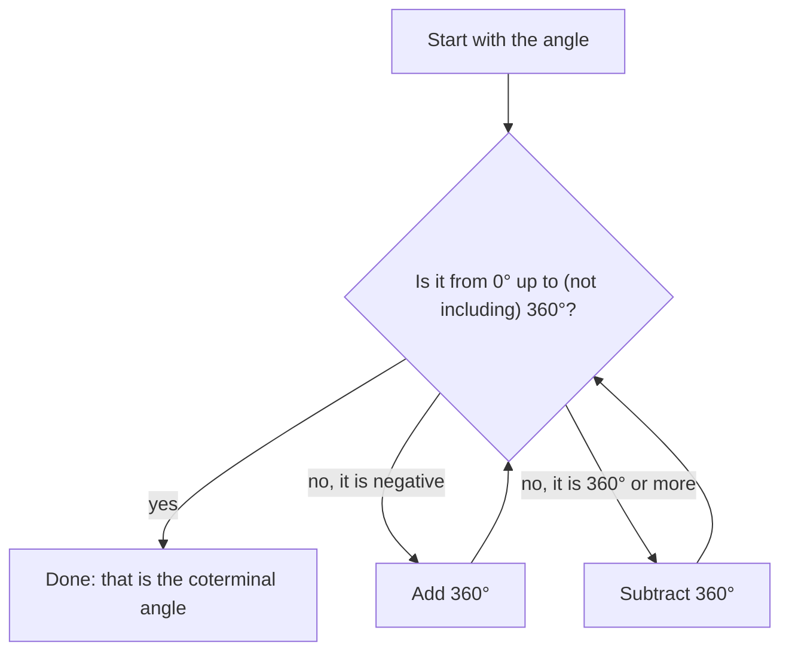

## What trigonometry is about

Trigonometry began as the study of triangles: how the angles of a triangle control the
lengths of its sides. Surveyors, sailors and astronomers needed it to measure distances
they could not walk. Over time it grew into the study of anything that rotates or
repeats: a wheel, a pendulum, a sound wave, an alternating current. Every one of those
starts with the same object, the angle, so that is where this course starts.

In geometry an angle is a static figure made of two rays. In trigonometry we think of an
angle as a **rotation**. That small change of viewpoint is what lets angles be negative,
or bigger than a full turn, and it is what makes the rest of the subject work.

## Angles as rotations

An **angle** is formed by rotating a ray about its endpoint. The ray's starting position
is the **initial side**, its final position is the **terminal side**, and the common
endpoint is the **vertex**. The angle measures how far, and in which direction, the ray
turned.

The picture shows the three parts and the rotation that joins them.


- A counterclockwise rotation gives a **positive angle**.
- A clockwise rotation gives a **negative angle**.

An angle is in **standard position** when its vertex is at the origin of the coordinate
plane and its initial side lies along the positive $x$-axis. Then the terminal side alone
tells you where the angle "points", and we say the angle *lies in* the quadrant that
contains its terminal side.

```plot
{"x": [-3, 3], "y": [-3, 3], "equal": true, "segments": [{"from": [0, 0], "to": [2.6, 0], "arrow": true, "label": "initial side"}, {"from": [0, 0], "to": [-1.3, 2.25], "arrow": true, "label": "terminal side"}], "curves": [{"x": "0.8cos(t)", "y": "0.8sin(t)", "t": [0, 2.0944]}], "labels": [{"at": [0.75, 0.75], "text": "120°"}], "caption": "An angle of 120° in standard position; it lies in quadrant II"}
```

When the terminal side lies on an axis (0°, 90°, 180°, 270°, …) the angle is a
**quadrantal angle** and lies in no quadrant.

## Degree measure

The **degree** divides one full counterclockwise rotation into 360 equal parts, so a full
turn is $360^\circ$, a half turn is $180^\circ$ and a quarter turn is $90^\circ$. The number
360 is a legacy of Babylonian astronomy (it has many divisors, which made fractions of a
turn easy), not anything forced by geometry. The next lesson introduces a measure that
*is* forced by geometry.

Familiar names describe the size of an angle between $0^\circ$ and $180^\circ$:

| Name | Measure |
|---|---|
| **acute angle** | between $0^\circ$ and $90^\circ$ |
| **right angle** | exactly $90^\circ$ |
| **obtuse angle** | between $90^\circ$ and $180^\circ$ |
| **straight angle** | exactly $180^\circ$ |

Two positive angles are **complementary** if they add to $90^\circ$ and **supplementary**
if they add to $180^\circ$. The complement of $35^\circ$ is $55^\circ$; its supplement is
$145^\circ$. An angle of $110^\circ$ has a supplement ($70^\circ$) but no positive complement.

### Minutes and seconds

For finer measurement, a degree is split into 60 **minutes** and a minute into 60
**seconds**: $1^\circ = 60'$ and $1' = 60''$, so $1^\circ = 3600''$. This
**degrees–minutes–seconds (DMS)** notation is still used in navigation, surveying and
astronomy. Converting is just a change of units.

$$\theta = D^\circ\,M'\,S'' \quad\Longleftrightarrow\quad \theta = D + \frac{M}{60} + \frac{S}{3600}\ \text{degrees}$$

### Example 1

Convert $47^\circ 21' 36''$ to decimal degrees, and convert $18.715^\circ$ to DMS.

**Step 1 (DMS to decimal).** Each minute is $\tfrac1{60}$ of a degree and each second is
$\tfrac1{3600}$ of a degree:
$$47 + \frac{21}{60} + \frac{36}{3600} = 47 + 0.35 + 0.01 = 47.36^\circ.$$

**Step 2 (decimal to DMS).** Keep the whole part, $18^\circ$. Multiply the leftover
fraction by 60 to get minutes: $0.715 \times 60 = 42.9'$. Keep $42'$ and multiply the new
leftover by 60 to get seconds: $0.9 \times 60 = 54''$. So $18.715^\circ = 18^\circ 42' 54''$.

## Coterminal angles

Rotating an extra full turn, in either direction, brings the terminal side back to the
same place. Angles in standard position with the same terminal side are **coterminal
angles**. Because a full turn is $360^\circ$,

$$\theta \text{ and } \theta + 360^\circ k \text{ are coterminal for every integer } k.$$

Coterminal angles will turn out to have identical trigonometric values, so a standard
move in this course is to replace an angle by the coterminal angle in $[0^\circ, 360^\circ)$.
To find it, add or subtract $360^\circ$ until you land in that interval. For large
angles, divide by 360 to see how many full turns to remove.

The procedure is a short loop:



```plot
{"x": [-3, 3], "y": [-3, 3], "equal": true, "segments": [{"from": [0, 0], "to": [2.6, 0], "arrow": true}, {"from": [0, 0], "to": [1.84, -1.84], "arrow": true}], "curves": [{"x": "0.7cos(t)", "y": "0.7sin(t)", "t": [0, 5.4978]}, {"x": "1.2cos(t)", "y": "1.2sin(t)", "t": [-0.7854, 0]}], "labels": [{"at": [-1.1, 0.9], "text": "315°"}, {"at": [1.7, -0.45], "text": "−45°"}], "caption": "315° and −45° share a terminal side, so they are coterminal"}
```

### Example 2

Find the angle in $[0^\circ, 360^\circ)$ coterminal with (a) $-250^\circ$ and (b) $1000^\circ$,
and name the quadrant of each.

**(a)** $-250^\circ$ is negative, so add one full turn: $-250^\circ + 360^\circ = 110^\circ$.
That is between $90^\circ$ and $180^\circ$, so the angle lies in **quadrant II**.

**(b)** $1000 \div 360 \approx 2.78$, so two full turns can be removed:
$1000^\circ - 2(360^\circ) = 280^\circ$. That is between $270^\circ$ and $360^\circ$: **quadrant IV**.

A quick check: $280 + 720 = 1000$. ✓

### Example 3

A Ferris wheel car starts at the far right of the wheel and the wheel turns clockwise
through $2\tfrac14$ revolutions. What angle in standard position describes the rotation,
and what positive angle less than $360^\circ$ is coterminal with it?

Clockwise means negative: $-2.25 \times 360^\circ = -810^\circ$. Add $360^\circ$ three
times: $-810^\circ + 1080^\circ = 270^\circ$. The car ends straight below the center,
which matches a quadrantal angle of $270^\circ$.

## Common mistakes

- **Mixing up the sign convention.** Counterclockwise is positive. A clockwise quarter
  turn is $-90^\circ$, which is coterminal with $270^\circ$, not $90^\circ$.
- **Treating minutes as decimals.** $25^\circ 30'$ is $25.5^\circ$, not $25.3^\circ$:
  30 minutes is half a degree.
- **Stopping too early with coterminal angles.** $-400^\circ + 360^\circ = -40^\circ$
  is still negative; add another $360^\circ$ to get $320^\circ$.
- **Confusing complement and supplement.** "C" comes before "S", and 90 comes before 180.

## Key points

- An angle is a rotation from an initial side to a terminal side; counterclockwise is
  positive.
- Standard position: vertex at the origin, initial side on the positive $x$-axis.
- $360^\circ$ is one full turn; $1^\circ = 60'$ and $1' = 60''$.
- Coterminal angles differ by a whole number of full turns: $\theta + 360^\circ k$.
- To find the coterminal angle in $[0^\circ, 360^\circ)$, add or subtract $360^\circ$
  until you land in the interval.
