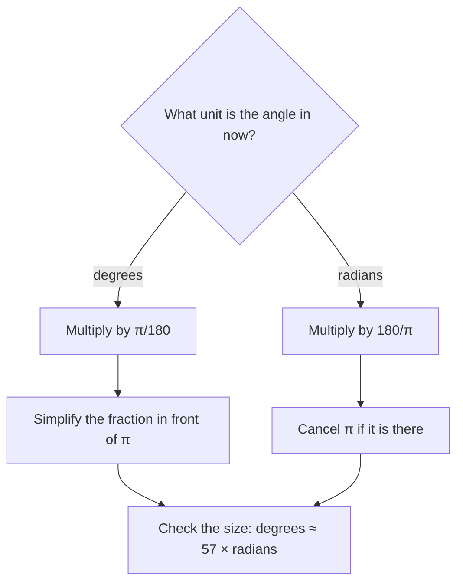

## Why a second unit?

Degrees are convenient for everyday angles, but the number 360 is arbitrary. Calculus,
physics and the formulas later in this course all become simpler when angles are
measured in a unit that comes from the circle itself. That unit is the radian. After this
lesson you should be able to move between degrees and radians without hesitation, and
you should start to *think* in radians for the common angles.

## What a radian is

Draw a circle of radius $r$ and put the vertex of an angle at its center. An angle whose
vertex is at the center of a circle is a **central angle**, and the piece of the circle
between its sides is the arc it *subtends*. One **radian** is the central angle that
subtends an arc exactly as long as the radius.

```plot
{"x": [-1.6, 1.6], "y": [-1.4, 1.6], "equal": true, "circles": [{"center": [0, 0], "r": 1}], "segments": [{"from": [0, 0], "to": [1, 0], "label": "r"}, {"from": [0, 0], "to": [0.5403, 0.8415], "label": "r"}], "curves": [{"x": "1.0cos(t)", "y": "1.0sin(t)", "t": [0, 1], "color": "#d9480f"}, {"x": "0.3cos(t)", "y": "0.3sin(t)", "t": [0, 1]}], "labels": [{"at": [1.2, 0.6], "text": "arc = r"}, {"at": [0.45, 0.2], "text": "1 rad"}], "caption": "One radian: the arc is as long as the radius"}
```

Because the definition compares two lengths, the radian measure of an angle is
$$\theta = \frac{\text{arc length}}{\text{radius}} = \frac{s}{r},$$
a pure number with no units. That is why "radians" is often left off: if an angle is
written with no degree sign, it is in radians. $\sin 2$ means the sine of 2 radians, not
2 degrees.

The radian measure of an angle doesn't depend on the size of the circle: doubling the
radius doubles the arc as well, and the ratio stays the same.

## The conversion factor

A full turn subtends the whole circumference, $2\pi r$. Dividing by $r$:

$$\text{one full turn} = 2\pi \text{ radians} = 360^\circ, \qquad \pi \text{ radians} = 180^\circ.$$

Everything else follows from $\pi = 180^\circ$. Multiply by a form of 1:

$$\text{degrees} \to \text{radians: multiply by } \frac{\pi}{180^\circ}, \qquad \text{radians} \to \text{degrees: multiply by } \frac{180^\circ}{\pi}.$$

Which factor to use depends only on the direction you are converting:



One radian is $\tfrac{180^\circ}{\pi} \approx 57.296^\circ$, a bit less than $60^\circ$.
That's a useful sanity check: $2$ radians is about $115^\circ$, $3$ radians is a bit less
than a half turn, and $6.28$ radians is about one full turn.

Laying radius-length arcs around a circle shows the same thing: six of them fit, with a gap of
about $0.28$ radian left before the starting point.

```plot
{"x": [-1.7, 1.7], "y": [-1.5, 1.5], "equal": true, "circles": [{"center": [0, 0], "r": 1}], "segments": [{"from": [0, 0], "to": [1, 0]}, {"from": [0, 0], "to": [0.5403, 0.8415], "dashed": true}, {"from": [0, 0], "to": [-0.4161, 0.9093], "dashed": true}, {"from": [0, 0], "to": [-0.99, 0.1411], "dashed": true}, {"from": [0, 0], "to": [-0.6536, -0.7568], "dashed": true}, {"from": [0, 0], "to": [0.2837, -0.9589], "dashed": true}, {"from": [0, 0], "to": [0.9602, -0.2794], "dashed": true}], "points": [[1.0000, 0.0000], [0.5403, 0.8415], [-0.4161, 0.9093], [-0.9900, 0.1411], [-0.6536, -0.7568], [0.2837, -0.9589], [0.9602, -0.2794]], "labels": [{"at": [0.675, 1.002], "text": "1 rad"}, {"at": [-0.520, 1.087], "text": "2 rad"}, {"at": [-1.237, 0.126], "text": "3 rad"}, {"at": [-0.817, -0.996], "text": "4 rad"}, {"at": [0.355, -1.249], "text": "5 rad"}, {"at": [1.200, -0.399], "text": "6 rad"}], "caption": "Marking off arcs one radius long: six fit around the circle with a little left over, because a full turn is 2π ≈ 6.28 radians"}
```

### Example 1

Convert $135^\circ$ and $-210^\circ$ to radians. Give exact answers.

$$135^\circ \cdot \frac{\pi}{180^\circ} = \frac{135\pi}{180} = \frac{3\pi}{4}.$$
To simplify $\tfrac{135}{180}$, divide top and bottom by 45.

$$-210^\circ \cdot \frac{\pi}{180^\circ} = -\frac{210\pi}{180} = -\frac{7\pi}{6}.$$

Exact answers keep $\pi$ as a symbol. $\tfrac{3\pi}{4} \approx 2.356$ is a decimal
approximation, useful for a calculator but not the exact value.

### Example 2

Convert $\dfrac{5\pi}{3}$ and $2.5$ radians to degrees.

$$\frac{5\pi}{3}\cdot\frac{180^\circ}{\pi} = \frac{5 \cdot 180^\circ}{3} = 300^\circ.$$
The $\pi$ cancels, which is what you expect when the radian measure is a multiple of $\pi$.

$$2.5 \cdot \frac{180^\circ}{\pi} = \frac{450^\circ}{\pi} \approx 143.24^\circ.$$
Here no $\pi$ cancels, so the answer is a decimal.

## Thinking in radians

The angles you'll meet constantly are fractions of $\pi$. It pays to learn them as
fractions of a half turn rather than converting every time:

| Degrees | 0° | 30° | 45° | 60° | 90° | 120° | 135° | 150° | 180° | 270° | 360° |
|---|---|---|---|---|---|---|---|---|---|---|---|
| Radians | $0$ | $\frac{\pi}{6}$ | $\frac{\pi}{4}$ | $\frac{\pi}{3}$ | $\frac{\pi}{2}$ | $\frac{2\pi}{3}$ | $\frac{3\pi}{4}$ | $\frac{5\pi}{6}$ | $\pi$ | $\frac{3\pi}{2}$ | $2\pi$ |

A good habit: read $\tfrac{5\pi}{6}$ as "five sixths of a half turn", which is
$5 \times 30^\circ = 150^\circ$. The denominator tells you the step size
($\pi/6 = 30^\circ$, $\pi/4 = 45^\circ$, $\pi/3 = 60^\circ$) and the numerator counts steps.

### Coterminal angles in radians

A full turn is $2\pi$, so $\theta$ and $\theta + 2\pi k$ are coterminal. To find the
coterminal angle in $[0, 2\pi)$, add or subtract multiples of $2\pi$.

### Example 3

Find the angle in $[0, 2\pi)$ coterminal with $\dfrac{17\pi}{4}$, and with $-\dfrac{5\pi}{6}$.

$2\pi = \tfrac{8\pi}{4}$, so subtract it twice: $\tfrac{17\pi}{4} - \tfrac{16\pi}{4} = \tfrac{\pi}{4}$.

For the negative angle, add $2\pi = \tfrac{12\pi}{6}$: $-\tfrac{5\pi}{6} + \tfrac{12\pi}{6} = \tfrac{7\pi}{6}$,
which is in quadrant III (between $\pi$ and $\tfrac{3\pi}{2}$).

```plot
{"x": [-1.5, 1.5], "y": [-1.5, 1.5], "equal": true, "circles": [{"center": [0, 0], "r": 1}], "segments": [{"from": [0, 0], "to": [1.2, 0]}, {"from": [0, 0], "to": [-0.866, -0.5], "arrow": true}], "curves": [{"x": "0.5cos(t)", "y": "0.5sin(t)", "t": [-2.618, 0]}], "labels": [{"at": [0.25, -0.65], "text": "−5π/6"}, {"at": [-1.15, -0.65], "text": "7π/6"}], "caption": "−5π/6 and 7π/6 end on the same ray in quadrant III"}
```

## Quadrants in radians

| Quadrant | Degrees | Radians |
|---|---|---|
| I | $0^\circ < \theta < 90^\circ$ | $0 < \theta < \frac{\pi}{2}$ |
| II | $90^\circ < \theta < 180^\circ$ | $\frac{\pi}{2} < \theta < \pi$ |
| III | $180^\circ < \theta < 270^\circ$ | $\pi < \theta < \frac{3\pi}{2}$ |
| IV | $270^\circ < \theta < 360^\circ$ | $\frac{3\pi}{2} < \theta < 2\pi$ |

For an angle like $4$ radians, compare with $\pi \approx 3.14$ and
$\tfrac{3\pi}{2} \approx 4.71$: since $3.14 < 4 < 4.71$, the angle lies in quadrant III.

## A note on calculators and software

Spreadsheets and programming languages always work in radians, and a calculator works in
whichever mode it is set to (many default to radians). In a spreadsheet, `SIN(30)` is the sine of 30 radians; you would write
`SIN(RADIANS(30))` for $30^\circ$. Graphing tools label the $x$-axis in radians for the same
reason. Getting comfortable with radians now saves a lot of confusion later, when trig
functions are graphed and when calculus formulas such as "the derivative of $\sin x$ is
$\cos x$" turn out to be true only in radians.

## Common mistakes

- **Using the wrong conversion factor.** Going to radians, $\pi$ goes on top. A check:
  degrees are "big numbers", radians are "small numbers", so $90^\circ$ should become
  something near 1.6, not near 5000.
- **Forgetting that a bare number is radians.** $\sin 30$ on a calculator in radian mode
  is $\sin(30 \text{ rad})$, about $-0.988$, not $\tfrac12$. Check the mode.
- **Not reducing fractions.** $\tfrac{150\pi}{180}$ should be written $\tfrac{5\pi}{6}$.
- **Thinking $\pi$ means $180$ as a number.** $\pi$ radians is an angle *equal to*
  $180^\circ$; the number $\pi$ itself is still $3.14159\ldots$

## Key points

- One radian subtends an arc equal to the radius; $\theta = s/r$ has no units.
- $\pi \text{ rad} = 180^\circ$ and $2\pi \text{ rad} = 360^\circ$.
- Degrees to radians: multiply by $\pi/180$. Radians to degrees: multiply by $180/\pi$.
- $1 \text{ rad} \approx 57.3^\circ$.
- An angle written with no units is in radians; coterminal angles differ by $2\pi k$.
