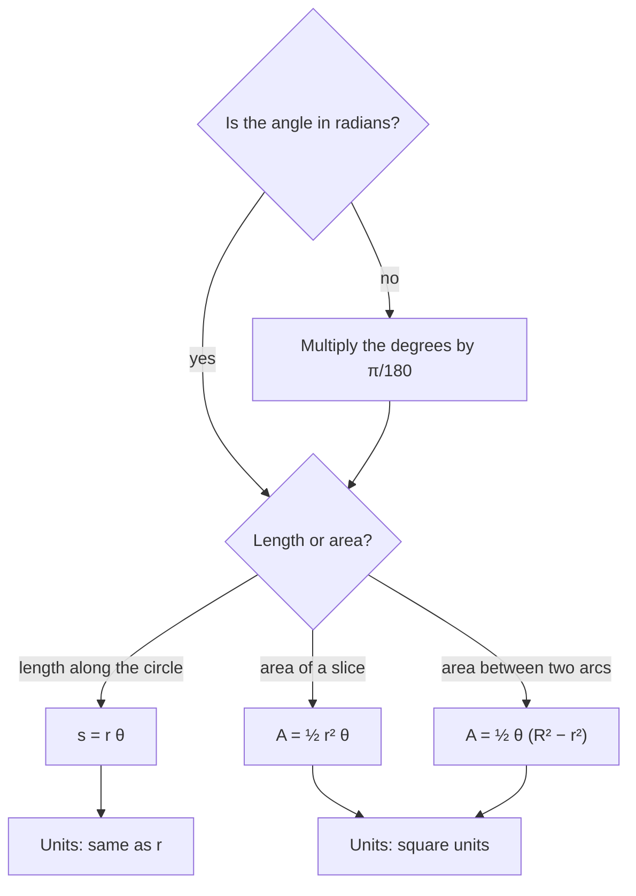

## From the definition of a radian to two formulas

The last lesson defined radian measure as a ratio: $\theta = s/r$. Read backward, that
definition is a formula for the length of an arc, and a short proportion turns it into a
formula for the area of a pie-shaped slice. Both formulas are *only* this simple in
radians, which is the first concrete payoff for learning the new unit.

## The parts of a circle you need

This lesson keeps returning to the same few pieces of a circle, so here they are in one picture.
The chord and the sector are defined later in the lesson.


## Arc length

An **arc** is the part of a circle between two points on it. If a central angle of
$\theta$ radians subtends an arc on a circle of radius $r$, the **arc length** is

$$s = r\theta \qquad (\theta \text{ in radians}).$$

**Why:** by definition $\theta = s/r$; multiply both sides by $r$. Another way to see it:
the full circumference $2\pi r$ belongs to the full angle $2\pi$, so each radian of angle
"buys" $r$ units of arc.

If the angle is given in degrees, convert it first. Equivalently, the arc is the fraction
$\tfrac{\theta^\circ}{360^\circ}$ of the whole circumference:
$s = \tfrac{\theta^\circ}{360^\circ}\cdot 2\pi r$, which is the same formula in disguise.

```plot
{"x": [-1.3, 1.5], "y": [-0.4, 1.4], "equal": true, "segments": [{"from": [0, 0], "to": [1.2, 0], "label": "r"}, {"from": [0, 0], "to": [-0.3106, 1.1591], "label": "r"}], "curves": [{"x": "1.2cos(t)", "y": "1.2sin(t)", "t": [0, 1.8326], "color": "#d9480f"}, {"x": "0.3cos(t)", "y": "0.3sin(t)", "t": [0, 1.8326]}], "labels": [{"at": [1.15, 0.85], "text": "s = rθ"}, {"at": [0.35, 0.35], "text": "θ"}], "caption": "The arc subtended by a central angle θ"}
```

### Example 1

A circle has radius 8 cm. Find the length of the arc subtended by a central angle of
$135^\circ$.

**Step 1: convert to radians.** $135^\circ \cdot \tfrac{\pi}{180^\circ} = \tfrac{3\pi}{4}$.

**Step 2: apply $s = r\theta$.** $s = 8 \cdot \tfrac{3\pi}{4} = 6\pi \approx 18.85$ cm.

**Check:** $135^\circ$ is $\tfrac{3}{8}$ of a full turn, and the full circumference is
$16\pi$; $\tfrac38 \cdot 16\pi = 6\pi$. ✓

### Example 2

Two towns lie on the same north–south line (meridian), at latitudes $40^\circ 15'$ N and
$32^\circ 45'$ N. Treating Earth as a sphere of radius 3960 miles, how far apart are they
along the surface?

The central angle between them is the difference in latitude:
$40^\circ 15' - 32^\circ 45' = 7^\circ 30' = 7.5^\circ$.

In radians: $7.5 \cdot \tfrac{\pi}{180} = \tfrac{\pi}{24}$.

$s = r\theta = 3960 \cdot \tfrac{\pi}{24} = 165\pi \approx 518.4$ miles.

## Finding the angle or the radius

The same formula solves for any one of the three quantities:
$$\theta = \frac{s}{r}, \qquad r = \frac{s}{\theta}.$$
If an arc of 15 m sits on a circle of radius 6 m, the angle is $\theta = 15/6 = 2.5$ radians,
which is about $143.2^\circ$.

## Sector area

A **sector** is the pie-slice region bounded by two radii and the arc between them. Its
area is a fraction of the whole disk's area $\pi r^2$, and that fraction is
$\tfrac{\theta}{2\pi}$:

$$A = \frac{\theta}{2\pi}\cdot \pi r^2 = \frac12 r^2\theta \qquad (\theta \text{ in radians}).$$

In degrees the same idea reads $A = \tfrac{\theta^\circ}{360^\circ}\,\pi r^2$.

Notice that $A = \tfrac12 r^2\theta = \tfrac12 r \cdot (r\theta) = \tfrac12 r s$. A thin sector
looks like a triangle with base $s$ and height $r$, and the formula matches
$\tfrac12 \cdot \text{base} \cdot \text{height}$.

### Example 3

A lawn sprinkler sprays water 18 ft and sweeps back and forth through $110^\circ$. What
area does it water?

**Step 1:** $110^\circ = \tfrac{110\pi}{180} = \tfrac{11\pi}{18}$ radians.

**Step 2:** $A = \tfrac12 (18)^2 \cdot \tfrac{11\pi}{18} = \tfrac12 \cdot 324 \cdot \tfrac{11\pi}{18} = 99\pi \approx 311.0 \text{ ft}^2.$

**Check with degrees:** $\tfrac{110}{360}\cdot \pi \cdot 324 = 99\pi$. ✓

```plot
{"x": [-1.4, 1.4], "y": [-0.5, 1.4], "equal": true, "polygons": [{"points": [[0, 0], [1.2, 0], [1.1276, 0.4104], [0.9192, 0.7713], [0.6, 1.0392], [0.2084, 1.1818], [-0.2084, 1.1818], [-0.4104, 1.1276], [0, 0]], "fill": true}], "labels": [{"at": [0.3, 0.45], "text": "sector"}], "caption": "A sector: the region between two radii and their arc (here about 110°)"}
```

## Units

Before using either formula, run through the same few checks:



- In $s = r\theta$, $s$ has the units of $r$ (radians carry no units).
- In $A = \tfrac12 r^2\theta$, $A$ has the units of $r^2$.
- The angle must be in radians. Plugging in degrees is the single most common error with
  these formulas, and it gives answers about 57 times too big.

### Example 4: an area between two arcs

A car's windshield wiper is 22 in long from the pivot to its tip, but the rubber blade only
covers the part from 6 in to 22 in out. The arm sweeps through $120^\circ$. What area does the blade
clean?

The cleaned region is a big sector (radius 22) minus a small sector (radius 6), both with
$\theta = \tfrac{2\pi}{3}$:
$$A = \tfrac12(22)^2\cdot\tfrac{2\pi}{3} - \tfrac12(6)^2\cdot\tfrac{2\pi}{3} = \tfrac{\pi}{3}(484 - 36) = \tfrac{448\pi}{3} \approx 469.1 \text{ in}^2.$$
Factoring out $\tfrac12\theta$ first, $A = \tfrac12\theta(R^2 - r^2)$, saves a step whenever two sectors share
an angle.

## Arc length versus chord length

The arc is the curved path along the circle; the **chord** is the straight segment joining its
endpoints. The chord is always shorter. For a $60^\circ$ angle on a circle of radius 10, the arc is
$10\cdot\tfrac{\pi}{3} \approx 10.47$, while the chord (a side of an equilateral triangle) is exactly 10. For
small angles the two are nearly equal, which is why a short stretch of a huge circle, like a
mile of Earth's surface, looks straight.

## Common mistakes

- **Degrees in a radian formula.** $s = 8 \cdot 135$ is not an arc length. Convert first.
- **Using diameter for radius.** A 20-inch wheel usually means the diameter; $r = 10$ in.
- **Mixing up $s = r\theta$ and $A = \tfrac12 r^2\theta$.** Area involves $r^2$ and the
  factor $\tfrac12$; length involves $r$ alone.
- **Forgetting latitude differences in DMS.** $7^\circ 30'$ is $7.5^\circ$, not $7.3^\circ$.

## Key points

- Arc length: $s = r\theta$ with $\theta$ in radians.
- Sector area: $A = \tfrac12 r^2\theta = \tfrac12 rs$ with $\theta$ in radians.
- In degrees, use the fraction of a full turn: $\tfrac{\theta}{360}$ of the circumference
  or of the area.
- Solve the same formulas for $\theta$ or $r$ when those are unknown.
