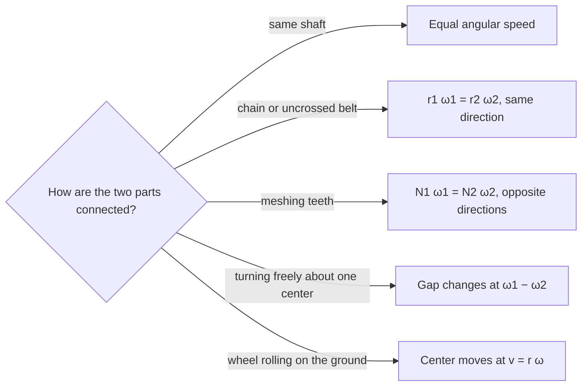

## When more than one thing turns

Lesson 4 followed one spinning object at a time, plus the simplest link between two: a belt,
which forces both rims to share a linear speed, so $r_1\omega_1 = r_2\omega_2$. Real machines and
the real sky are busier. A clock has two hands turning at different rates. A gearbox has wheels
pushing directly on each other. A car wheel spins *and* moves forward. The Earth spins while it
circles the Sun. Each of these needs one extra idea on top of $v = r\omega$, and this lesson
gives you all of them, with one rule of thumb to choose between them at the end.

## Relative angular speed

Suppose two pointers turn about the same center in the same direction, at angular speeds
$\omega_1 > \omega_2$. Every minute, the faster one gains $\omega_1 - \omega_2$ on the slower one.
So the angle *between* them changes at the **relative angular speed**

$$\omega_{\text{rel}} = \omega_1 - \omega_2 .$$

(If they turned in opposite directions, the gap would close at $\omega_1 + \omega_2$ instead.) The
faster pointer laps the slower one each time it gains a full turn, $360^\circ$ or $2\pi$, so the
time between meetings is

$$T_{\text{meet}} = \frac{360^\circ}{\omega_1 - \omega_2}.$$

### The hands of a clock

The minute hand turns $360^\circ$ in 60 minutes: $6^\circ$ per minute. The hour hand turns
$360^\circ$ in 12 hours, which is $30^\circ$ per hour or $0.5^\circ$ per minute. So the minute hand
gains on the hour hand at $6 - 0.5 = 5.5^\circ$ per minute.

To find the angle between the hands at any time, measure each hand's angle clockwise from 12.
At $h$ hours and $m$ minutes:

- minute hand: $6m$ degrees;
- hour hand: $30h + 0.5m$ degrees (it has moved part of the way toward the next hour).

The angle between them is the difference, and if that is more than $180^\circ$, the smaller angle
is $360^\circ$ minus it.

### Example 1: the angle at 3:40

**Minute hand:** $6 \times 40 = 240^\circ$.

**Hour hand:** $30 \times 3 + 0.5 \times 40 = 90 + 20 = 110^\circ$. The common slip is to put it at
exactly $90^\circ$, on the 3; by 3:40 it is two thirds of the way to the 4.

**Difference:** $240 - 110 = 130^\circ$. That is less than $180^\circ$, so the hands are $130^\circ$
apart.

### Example 2: when do the hands overlap?

At 3:00 the minute hand is at $0^\circ$ and the hour hand at $90^\circ$. The minute hand closes that
$90^\circ$ gap at $5.5^\circ$ per minute, so they overlap after
$$t = \frac{90}{5.5} = \frac{180}{11} = 16\tfrac{4}{11} \text{ min} \approx 16 \text{ min } 22 \text{ s},$$
at about 3:16:22, not 3:15.

After that they overlap every $\tfrac{360}{5.5} = \tfrac{720}{11} \approx 65.45$ minutes, which is
65 minutes and about 27 seconds. In 12 hours that happens exactly $\tfrac{720}{720/11} = 11$ times,
not 12: the minute hand makes 12 turns while the hour hand makes 1, so it laps it $12 - 1 = 11$ times.

## The sidereal day: the Earth as a clock hand

The same reasoning explains a fact that surprises most people: the Earth turns once relative to
the stars in about 23 hours 56 minutes, not 24 hours.

A **solar day** is the time from one noon to the next, when the Sun returns to the same place in
the sky; its average is what we call 24 hours. A **sidereal day** is the time for one full
rotation relative to the distant stars. They differ because the Earth also moves around the Sun,
in the *same* direction as it spins, about $\tfrac{360^\circ}{365.24} \approx 0.986^\circ$ per day.
Think of the spin as the minute hand and the direction to the Sun as the hour hand: the Sun
returns to noon only when the spin has gained a full turn on the orbit.

Over one year, the Earth spins about 365.24 times relative to the Sun, but the orbit itself adds
one more full turn relative to the stars, so it spins about 366.24 times relative to the stars.
Then

$$\text{sidereal day} = 24 \text{ h} \times \frac{365.24}{366.24} \approx 23.934 \text{ h} \approx 23 \text{ h } 56 \text{ min } 4 \text{ s}.$$

That is why a given star rises about 3 minutes 56 seconds earlier each night, and the night sky
slowly shifts through the seasons. (This uses averages. The Earth's orbit is slightly elliptical
and its axis is tilted, so individual solar days differ from 24 hours by up to about half a
minute; the 24-hour day is a mean.)

### Example 3: the Moon's phases

The Moon orbits the Earth, relative to the stars, once every 27.32 days. Why is the cycle of
phases (new Moon to new Moon) about 29.5 days?

A new Moon happens when the Moon lines up with the Sun. Measured from the Earth, the Moon moves
around the sky at $\tfrac{360^\circ}{27.32}$ per day, and the Sun's direction moves the same way at
$\tfrac{360^\circ}{365.24}$ per day. The Moon must gain a full $360^\circ$ on the Sun:

$$T = \frac{360^\circ}{\dfrac{360^\circ}{27.32} - \dfrac{360^\circ}{365.24}} = \frac{1}{\dfrac{1}{27.32} - \dfrac{1}{365.24}} \approx 29.53 \text{ days}.$$

The 29.5-day cycle is the **synodic period** of the Moon. Notice how the $360^\circ$ cancels: for
periods, the relative-speed rule becomes $\tfrac{1}{T_{\text{rel}}} = \tfrac{1}{T_1} - \tfrac{1}{T_2}$.

## Gear trains

When two gears mesh, their teeth push each other directly at the contact point. For the teeth
to fit, both gears must have teeth of the same size, so a gear's number of teeth $N$ is
proportional to its radius. The rims share a linear speed at the contact point, just as with a
belt, so $r_1\omega_1 = r_2\omega_2$, and since $r$ is proportional to $N$,

$$N_1\omega_1 = N_2\omega_2 .$$

Counting teeth is easier than measuring radii, and it explains the rule directly: every tooth of
the first gear that passes the contact point pushes one tooth of the second gear past it.

The difference from a belt is *direction*: meshing gears turn in *opposite* directions (a chain, or an ordinary
uncrossed belt, keeps the same direction; a belt crossed into a figure eight reverses it). A chain of meshing gears is a **gear train**, and three kinds
of link appear in one:

- **Meshing gears:** $N_1\omega_1 = N_2\omega_2$, and the direction reverses.
- An **idler gear** sits between two others. It cancels out of the speed ratio (whatever its size,
  the teeth passing in equal the teeth passing out), but it adds one reversal, so it lets the
  driver and the driven gear turn the same way.
- **Compound gears:** two gears fixed on one shaft turn together with the *same* angular speed.


In the picture, the 12-tooth driver turns the 30-tooth gear at $\tfrac{12}{30}$ of its own speed,
exactly as if the 20-tooth idler weren't there: $12\,\omega_1 = 20\,\omega_2 = 30\,\omega_3$. The
idler only makes the driven gear turn clockwise, the same way as the driver.

### Example 4: a two-stage gearbox

A motor turns at 1200 rpm. Its 12-tooth gear meshes with a 48-tooth gear. On the same shaft as
the 48-tooth gear is a 15-tooth gear, which meshes with a 60-tooth output gear. Find the output
speed and direction.

**Stage 1:** $12 \times 1200 = 48\,\omega$, so the middle shaft turns at $\tfrac{12}{48}\times 1200 = 300$
rpm, in the opposite direction to the motor.

**Shaft:** the 15-tooth gear is on the same shaft, so it also turns at 300 rpm.

**Stage 2:** $15 \times 300 = 60\,\omega$, so the output turns at $\tfrac{15}{60}\times 300 = 75$ rpm,
reversed again.

**Result:** 75 rpm, in the *same* direction as the motor (two reversals). The overall ratio is
$\tfrac{12}{48}\cdot\tfrac{15}{60} = \tfrac{1}{16}$: multiply the stage ratios. Slowing down this way
also multiplies the turning force (torque) by about 16, minus friction losses, which is why motors
drive wheels and winches through gearboxes.

## Rolling without slipping

When a wheel of radius $r$ rolls along the ground without slipping, every bit of the rim touches
the ground exactly once per turn. So after it turns through an angle $\theta$, the wheel has moved
forward exactly the arc length that touched the ground:

$$\text{distance moved} = r\theta, \qquad \text{speed of the center} = r\omega .$$

That is the link Lesson 4 used for car tires. But not every point on the wheel moves at that
speed. Each point's motion is the forward motion of the center *plus* its spin around the center:

- the center moves forward at $v = r\omega$;
- the top of the rim spins forward at $r\omega$ relative to the center, so it moves at $2v$;
- the point touching the ground spins *backward* at $r\omega$, cancelling the forward motion, so
  for that instant it is at rest. That is exactly what "not slipping" means.

```shape
{"segments": [{"from": [-1.6, 0], "to": [6.8, 0]}, {"from": [0, 2], "to": [2, 2], "arrow": true}, {"from": [0, 1], "to": [1, 1], "arrow": true}], "circles": [{"center": [0, 1], "r": 1}], "curves": [{"x": "t - sin(t)", "y": "1 - cos(t)", "t": [0, 6.2832], "dashed": true}], "points": [[0, 0], [0, 1], [0, 2]], "labels": [{"at": [2.35, 2.05], "text": "2v"}, {"at": [1.3, 1.05], "text": "v"}, {"at": [0.6, -0.5], "text": "speed 0"}, {"at": [4.9, 2.2], "text": "path of a rim point"}], "caption": "A rolling wheel: the top moves at twice the center's speed and the contact point is momentarily at rest. A point on the rim traces the dashed arch (a cycloid)."}
```

A point on the rim traces a series of arches called a **cycloid**, touching the ground once per
turn. You can see this effect in photos of moving bicycles: the spokes at the top look blurred
while those near the ground look sharp.

### Example 5: bigger tires and a wrong speedometer

A car's speedometer and odometer work by counting how fast the wheels turn, and they are set up
for tires 63.5 cm in diameter. The owner fits tires 66 cm in diameter. When the speedometer reads
100 km/h, how fast is the car really going, and by what percent does the odometer under-read?

**Step 1: what the instrument measures.** It measures $\omega$ and assumes $r = 31.75$ cm. For a
reading of 100 km/h, $\omega$ is whatever makes $31.75\,\omega$ equal 100 km/h.

**Step 2: the true speed.** The real radius is 33 cm, and $v = r\omega$ with the same $\omega$, so
the true speed is larger by the ratio of radii (or diameters):
$$v = 100 \times \frac{66}{63.5} \approx 103.9 \text{ km/h}.$$

**Step 3: the odometer.** It counts turns the same way, so it records $\tfrac{63.5}{66} \approx 0.962$
of the true distance: it under-reads by about $3.8\%$. (Note that $3.9\%$ fast and $3.8\%$ short are
not quite the same number, because the two percentages are measured from different bases.)

## Choosing the right link



## Common mistakes

- **Freezing the hour hand on the hour.** At 3:40 it is at $110^\circ$, not $90^\circ$; it moves
  $0.5^\circ$ every minute.
- **Adding speeds that should be subtracted.** Clock hands and the Earth's spin and orbit turn the
  same way, so the gap changes at the *difference* of their angular speeds.
- **Using radii and tooth counts upside down.** The small gear turns faster: $\omega_2 = \omega_1\cdot\tfrac{N_1}{N_2}$.
- **Forgetting direction.** Each mesh reverses the direction; a chain, an uncrossed belt or a shared
  shaft does not.
- **Thinking an idler changes the speed ratio.** It only changes the direction.
- **Assuming every point of a rolling wheel moves at the car's speed.** Only the center does; the
  top moves at twice that speed and the contact point is momentarily still.

## Key points

- Two rotations about one center in the same direction: the angle between them changes at
  $\omega_1 - \omega_2$, and they meet every $360^\circ/(\omega_1 - \omega_2)$.
- Clock hands: $6^\circ$ and $0.5^\circ$ per minute; they overlap every $\tfrac{720}{11}$ minutes, 11
  times in 12 hours.
- The sidereal day (about 23 h 56 min) is shorter than the 24-hour mean solar day because the
  Earth orbits the Sun in the same direction that it spins; the Moon's 29.5-day synodic period
  comes from the same rule, $\tfrac1{T_{\text{rel}}} = \tfrac1{T_1} - \tfrac1{T_2}$.
- Meshing gears: $N_1\omega_1 = N_2\omega_2$ with a direction reversal at each mesh; gears on one
  shaft share $\omega$; an idler changes only the direction.
- Rolling without slipping: distance $= r\theta$ and center speed $= r\omega$; the top of the
  wheel moves at $2v$ and the contact point is momentarily at rest.
