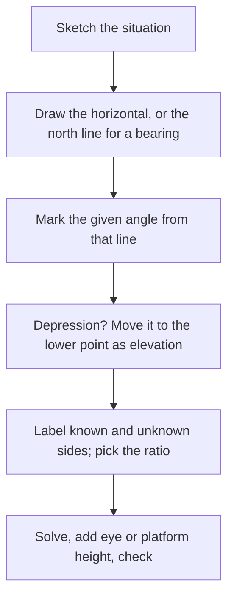

## Measuring what you can't reach

Trigonometry was invented for exactly this: finding the height of a tower, the width of a
river, or the distance to a ship without going there. The method is always the same:
spot a right triangle in the situation, decide which parts you know, and solve it as in
the last lesson. What's new here is the vocabulary used to describe the angles.

## Angles of elevation and depression

Imagine looking at an object. The straight path from your eye to it is the
**line of sight**.

- If the object is above you, the angle between the horizontal and your line of sight is
  the **angle of elevation**.
- If the object is below you, the angle between the horizontal and your line of sight is
  the **angle of depression**.

Both are measured *from the horizontal*, never from the vertical.

```plot
{"x": [-1, 11], "y": [-1, 7], "equal": true, "segments": [{"from": [0, 0], "to": [10, 0], "dashed": true}, {"from": [0, 0], "to": [10, 6]}, {"from": [10, 6], "to": [0, 6], "dashed": true}, {"from": [10, 0], "to": [10, 6]}], "labels": [{"at": [3.2, 0.9], "text": "elevation"}, {"at": [7.6, 5.5], "text": "depression"}, {"at": [5, -0.5], "text": "horizontal"}, {"at": [5, 6.4], "text": "horizontal"}], "points": [{"at": [0, 0], "label": "observer"}, {"at": [10, 6], "label": "top"}], "caption": "Horizontal lines are parallel, so the angle of elevation from below equals the angle of depression from above"}
```

The two horizontal lines are parallel and the line of sight cuts across both, so the
angle of depression from the top equals the angle of elevation from the bottom (they are
alternate interior angles). That lets you move the angle into the right triangle where
you need it.

Every problem in this lesson follows the same steps:



### Example 1

From a point 50 m from the base of a tree, on level ground, the angle of elevation to the
top is $38^\circ$. The observer's eyes are 1.6 m above the ground. How tall is the tree?

The right triangle has its right angle at eye height on the trunk. The horizontal leg is
50 m (adjacent to $38^\circ$); the vertical leg $h$ is the part of the tree above eye level
(opposite). Tangent links them:
$$\tan 38^\circ = \frac{h}{50} \quad\Rightarrow\quad h = 50\tan 38^\circ \approx 39.06 \text{ m}.$$
Add the eye height: the tree is about $39.06 + 1.6 \approx 40.7$ m tall.

### Example 2

A lighthouse keeper 120 ft above the water sees a boat at an angle of depression of
$9^\circ$. How far is the boat from the base of the lighthouse?

Move the $9^\circ$ to the boat's end as an angle of elevation. Then the 120 ft height is
opposite it and the unknown distance $d$ is adjacent:
$$\tan 9^\circ = \frac{120}{d} \quad\Rightarrow\quad d = \frac{120}{\tan 9^\circ} \approx 757.7 \text{ ft}.$$
The unknown is in the denominator, so it ends up dividing.

### Example 3: two observations

From a point on level ground, the angle of elevation to a mountain peak is $28^\circ$.
After walking 1000 m straight toward the mountain, the angle is $35^\circ$. How high is
the peak above the ground?

Let $h$ be the height and $x$ the remaining horizontal distance from the second point.
There are two right triangles sharing the side $h$:
$$h = x\tan 35^\circ \quad\text{and}\quad h = (x + 1000)\tan 28^\circ.$$
Set them equal and solve for $x$:
$$x\tan 35^\circ = x\tan 28^\circ + 1000\tan 28^\circ \;\Rightarrow\; x = \frac{1000\tan 28^\circ}{\tan 35^\circ - \tan 28^\circ} \approx 3155.6 \text{ m}.$$
Then $h = x\tan 35^\circ \approx 2209.6$ m. Neither triangle alone has enough
information; the shared height ties them together.

```plot
{"x": [-500, 4600], "y": [-300, 2700], "segments": [{"from": [0, 0], "to": [4155.6, 0]}, {"from": [4155.6, 0], "to": [4155.6, 2209.6]}, {"from": [0, 0], "to": [4155.6, 2209.6]}, {"from": [1000, 0], "to": [4155.6, 2209.6]}], "labels": [{"at": [550, 120], "text": "28°"}, {"at": [1500, 120], "text": "35°"}, {"at": [500, -200], "text": "1000 m"}, {"at": [4400, 1100], "text": "h"}], "caption": "Two angles of elevation to the same peak"}
```

## Bearings

Navigators describe directions with **bearings**. Two notations are common.

- **Three-digit (true) bearing:** the angle measured *clockwise from north*, written with
  three digits. North is $000^\circ$, east $090^\circ$, south $180^\circ$, west $270^\circ$.
- **Quadrant (compass) bearing:** start from north or south, then turn the stated acute
  angle toward east or west. N $35^\circ$ E means "face north, turn $35^\circ$ toward east";
  S $20^\circ$ W means "face south, turn $20^\circ$ toward west".

So N $35^\circ$ E is $035^\circ$, S $20^\circ$ E is $160^\circ$, S $20^\circ$ W is $200^\circ$,
and N $70^\circ$ W is $290^\circ$. Note that bearings are measured from north and turn
clockwise, unlike angles in standard position, which start from east and turn
counterclockwise.

### Example 4

A plane flies 200 mi on a bearing of $040^\circ$, then turns and flies 150 mi on a bearing
of $130^\circ$. How far is it from its starting point, and on what bearing?

The two headings differ by $130^\circ - 40^\circ = 90^\circ$, so the path makes a right
angle at the turn. The legs are 200 and 150:

Distance: $\sqrt{200^2 + 150^2} = 250$ mi.

The angle at the start between the first leg and the line back to the plane is
$\tan^{-1}\!\left(\tfrac{150}{200}\right) \approx 36.87^\circ$, turned clockwise from the first
heading. The bearing is $40^\circ + 36.87^\circ \approx 076.9^\circ$.

### Example 5

A ship sails 40 mi on a course of N $52^\circ$ E. How far north and how far east of its
starting point is it?

The $52^\circ$ is measured from north, so north is the adjacent side:
north $= 40\cos 52^\circ \approx 24.6$ mi and east $= 40\sin 52^\circ \approx 31.5$ mi.
Because the reference direction is north, not east, the roles of sine and cosine are the
reverse of what you might expect.

## Common mistakes

- **Measuring elevation or depression from the vertical.** Both start at the horizontal.
- **Putting the angle of depression at the wrong vertex.** Transfer it to the lower
  object as an equal angle of elevation.
- **Forgetting eye height or platform height** when the question asks for total height.
- **Treating bearings like standard-position angles.** Bearings start at north and go
  clockwise.

## Key points

- Angle of elevation: up from horizontal. Angle of depression: down from horizontal. They
  are equal for the same line of sight.
- Draw the right triangle, label known parts, and solve with the matching ratio.
- With two observation points, write an equation for the shared side in each triangle
  and solve the system.
- Bearing $\theta$ (clockwise from north): north component $= d\cos\theta$, east component
  $= d\sin\theta$.
