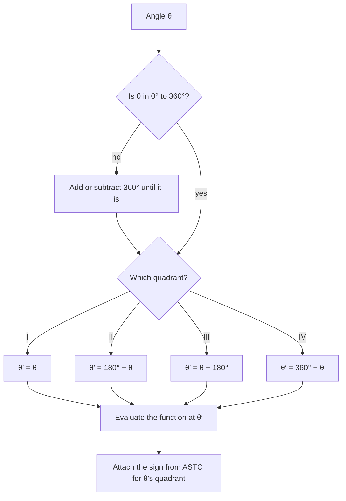

## Reducing every angle to an acute one

The last lesson defined the trig functions for every angle, but evaluating, say,
$\cos 210^\circ$ exactly still needs a shortcut. The shortcut is the reference angle: every
angle's trig values are the same, up to sign, as those of an acute angle. Combined with
the special triangles and the ASTC sign rule, it gives exact values for a huge family of
angles.

## Definition

The **reference angle** of $\theta$ is the acute angle $\theta'$ between the terminal side
of $\theta$ and the $x$-axis (never the $y$-axis). It is always between $0^\circ$ and
$90^\circ$ (or between $0$ and $\tfrac{\pi}{2}$).

First reduce $\theta$ to the coterminal angle in $[0^\circ, 360^\circ)$, then:

| Quadrant of $\theta$ | Reference angle $\theta'$ (degrees) | (radians) |
|---|---|---|
| I | $\theta$ | $\theta$ |
| II | $180^\circ - \theta$ | $\pi - \theta$ |
| III | $\theta - 180^\circ$ | $\theta - \pi$ |
| IV | $360^\circ - \theta$ | $2\pi - \theta$ |

In every case you measure the shortest way back to the $x$-axis.

The picture shows one angle in each quadrant, with its reference angle shaded.


```plot
{"x": [-1.5, 1.5], "y": [-1.5, 1.5], "equal": true, "segments": [{"from": [0, 0], "to": [1.3, 0]}, {"from": [0, 0], "to": [-1.0392, -0.6], "arrow": true}], "curves": [{"x": "0.35cos(t)", "y": "0.35sin(t)", "t": [0, 3.6652]}, {"x": "0.75cos(t)", "y": "0.75sin(t)", "t": [3.1416, 3.6652], "color": "#d9480f"}], "labels": [{"at": [0.35, 0.45], "text": "210°"}, {"at": [-0.95, -0.22], "text": "30°"}], "caption": "The reference angle of 210° is 210° − 180° = 30°"}
```

## Why it works

Let $P = (x, y)$ be the point at distance 1 on the terminal side of $\theta$, and $Q$ the
point at distance 1 on the terminal side of $\theta'$ (in quadrant I). The terminal side of
$\theta$ is the reflection of the terminal side of $\theta'$ across the $x$-axis, the
$y$-axis, or both. Reflections only flip signs of coordinates, so $P$ and $Q$ have the same
coordinates *up to sign*. Every trig function is built from those coordinates, so

$$\text{trig}(\theta) = \pm\,\text{trig}(\theta'),$$

where the sign is decided by the quadrant of $\theta$ (ASTC).

## The three-step method

1. Find the reference angle $\theta'$.
2. Evaluate the function at $\theta'$ (a special triangle, or a calculator).
3. Attach the sign the function has in $\theta$'s quadrant.

As a flowchart, with the reduction step included:



### Example 1

Find the reference angle of (a) $150^\circ$, (b) $225^\circ$, (c) $-130^\circ$,
(d) $\tfrac{5\pi}{3}$, (e) 4 radians.

**(a)** Quadrant II: $180^\circ - 150^\circ = 30^\circ$.

**(b)** Quadrant III: $225^\circ - 180^\circ = 45^\circ$.

**(c)** First $-130^\circ + 360^\circ = 230^\circ$, quadrant III: $230^\circ - 180^\circ = 50^\circ$.

**(d)** $\tfrac{5\pi}{3}$ is between $\tfrac{3\pi}{2}$ and $2\pi$, quadrant IV:
$2\pi - \tfrac{5\pi}{3} = \tfrac{\pi}{3}$.

**(e)** $\pi \approx 3.14 < 4 < 4.71 \approx \tfrac{3\pi}{2}$, quadrant III:
$4 - \pi \approx 0.858$ radians.

### Example 2

Find exact values of $\cos 210^\circ$, $\tan(-300^\circ)$ and $\sec\tfrac{5\pi}{4}$.

**$\cos 210^\circ$.** Reference angle $30^\circ$; $\cos 30^\circ = \tfrac{\sqrt3}{2}$.
Quadrant III, where cosine is negative: $\cos 210^\circ = -\tfrac{\sqrt3}{2}$.

**$\tan(-300^\circ)$.** Coterminal with $60^\circ$, which is in quadrant I and is its own
reference angle. So $\tan(-300^\circ) = \tan 60^\circ = \sqrt3$. (Positive, even though the
original angle was negative: what matters is where the terminal side lands.)

**$\sec\tfrac{5\pi}{4}$.** Reference angle $\tfrac{\pi}{4}$; $\sec\tfrac{\pi}{4} = \sqrt2$.
Quadrant III, where secant (like cosine) is negative: $\sec\tfrac{5\pi}{4} = -\sqrt2$.

### Example 3

Without a calculator's help for the sign, express $\sin 155^\circ$ and $\cos 155^\circ$ in
terms of an acute angle and approximate them.

Reference angle $25^\circ$, quadrant II. Sine is positive there and cosine negative:
$$\sin 155^\circ = \sin 25^\circ \approx 0.4226, \qquad \cos 155^\circ = -\cos 25^\circ \approx -0.9063.$$

### Example 4: working backward

Find all $\theta$ in $[0^\circ, 360^\circ)$ with $\sin\theta = -\tfrac12$.

$\sin\theta' = \tfrac12$ gives the reference angle $30^\circ$. Sine is negative in
quadrants III and IV, so
$$\theta = 180^\circ + 30^\circ = 210^\circ \quad\text{or}\quad \theta = 360^\circ - 30^\circ = 330^\circ.$$
This reverse use of reference angles is the heart of solving trig equations (Module 5).

### Example 5: radians and reciprocal functions

Find $\csc\left(-\tfrac{5\pi}{6}\right)$ and $\cot\tfrac{11\pi}{4}$ exactly.

**$\csc\left(-\tfrac{5\pi}{6}\right)$.** Add $2\pi$: the angle is coterminal with $\tfrac{7\pi}{6}$, in quadrant III. Reference
angle $\tfrac{\pi}{6}$, and $\sin\tfrac{\pi}{6} = \tfrac12$. Sine (and so cosecant) is negative in quadrant III:
$\sin\left(-\tfrac{5\pi}{6}\right) = -\tfrac12$ and $\csc\left(-\tfrac{5\pi}{6}\right) = -2$.

**$\cot\tfrac{11\pi}{4}$.** Subtract $2\pi = \tfrac{8\pi}{4}$: coterminal with $\tfrac{3\pi}{4}$, in quadrant II. Reference angle $\tfrac{\pi}{4}$
with $\cot\tfrac{\pi}{4} = 1$; cotangent is negative in quadrant II, so $\cot\tfrac{11\pi}{4} = -1$.

## Why bother when calculators exist?

A calculator returns $\cos 210^\circ \approx -0.8660$ instantly, but it can't tell you that this is exactly
$-\tfrac{\sqrt3}{2}$, and it can't run the problem backward to list *every* angle with that cosine.
Reference angles do both. They also catch calculator errors: if a calculator says
$\sin 155^\circ$ is negative, you know at once the mode is wrong.

## The reference angle as a picture

A good habit is to sketch the angle before computing. Draw the terminal side roughly where
it belongs, then shade the thin wedge between it and the nearest part of the $x$-axis. That
wedge *is* the reference angle, and the quadrant the terminal side sits in gives the sign.
The whole method takes a few seconds once the sketch is automatic.

## Common mistakes

- **Measuring to the $y$-axis.** The reference angle of $120^\circ$ is $60^\circ$ (to the
  negative $x$-axis), not $30^\circ$.
- **Forgetting to reduce first.** For $-130^\circ$ or $480^\circ$, find the coterminal angle in
  $[0^\circ, 360^\circ)$ before applying the table.
- **Losing the sign.** The reference angle gives the size of the value; the quadrant gives
  the sign. $\cos 210^\circ$ is $-\tfrac{\sqrt3}{2}$, not $\tfrac{\sqrt3}{2}$.
- **Mixing units.** In radians, subtract from $\pi$ or $2\pi$, not from $180$ or $360$.

## Key points

- The reference angle is the acute angle to the nearest part of the $x$-axis.
- QII: $180^\circ - \theta$; QIII: $\theta - 180^\circ$; QIV: $360^\circ - \theta$
  (or $\pi - \theta$, $\theta - \pi$, $2\pi - \theta$).
- $\text{trig}(\theta) = \pm\,\text{trig}(\theta')$ with the sign from ASTC.
- Running the method backward finds every angle with a given trig value.
