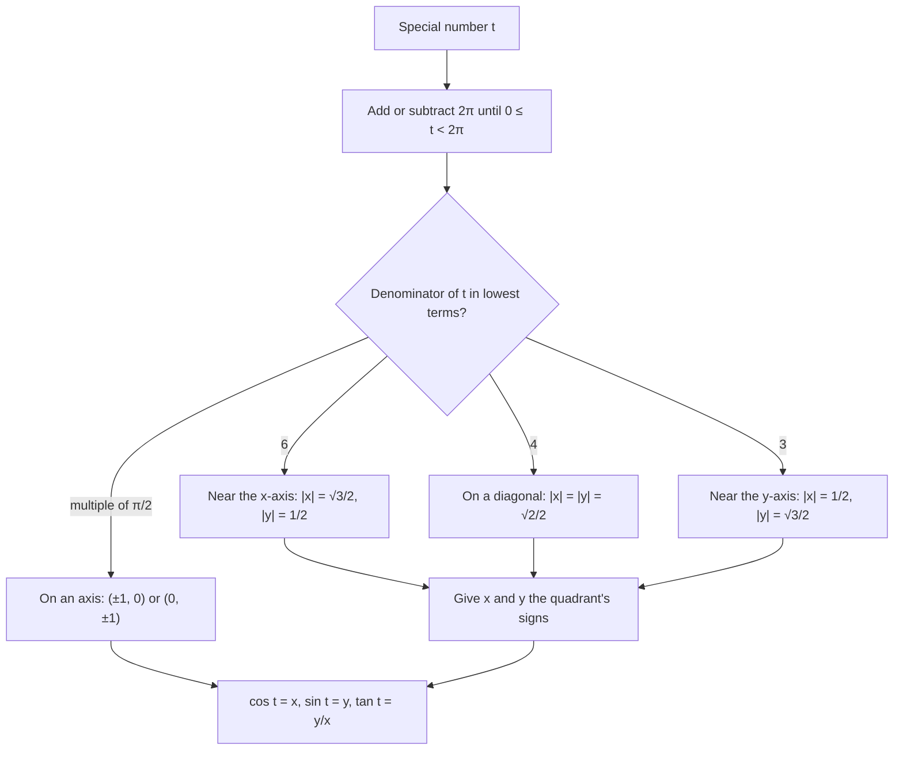

## One circle that holds every value

The definition $\sin\theta = y/r$ works with any point on the terminal side. Choosing the
point at distance $r = 1$ removes the denominator completely: the coordinates of that
point *are* the cosine and sine. The set of all such points is the unit circle, and it is
the single most useful picture in trigonometry. It also turns sine and cosine into
functions of a real number, which is what graphs (next module), calculus and physics need.

## The unit circle and its points

The **unit circle** is the circle of radius 1 centered at the origin:
$$x^2 + y^2 = 1.$$
If the terminal side of $\theta$ meets the unit circle at $(x, y)$, then $r = 1$ and

$$\cos\theta = x, \qquad \sin\theta = y, \qquad \tan\theta = \frac{y}{x}.$$

So **cosine is the $x$-coordinate and sine is the $y$-coordinate** of the point on the
unit circle. Since the point is on the circle, $x^2 + y^2 = 1$ becomes
$\cos^2\theta + \sin^2\theta = 1$, the most important identity in the subject (Module 6
builds on it).

Both coordinates of a point on the unit circle lie between $-1$ and $1$, which shows at a
glance that $-1 \le \sin\theta \le 1$ and $-1 \le \cos\theta \le 1$.

## Angles as real numbers

On the unit circle, a central angle of $t$ radians subtends an arc of length
$s = r t = t$. So the radian measure of the angle equals the arc length walked along the
circle from $(1, 0)$. This lets us define sine and cosine of any real number $t$: walk a
distance $t$ around the unit circle (counterclockwise if $t > 0$, clockwise if $t < 0$),
and read off the point's coordinates. Defined this way, sine and cosine are sometimes
called **circular functions**; the point you land on is the **terminal point** of $t$.

## Filling in the circle

The special triangles give the quadrant I points:

- $t = \tfrac{\pi}{6}$ ($30^\circ$): $\left(\tfrac{\sqrt3}{2}, \tfrac12\right)$
- $t = \tfrac{\pi}{4}$ ($45^\circ$): $\left(\tfrac{\sqrt2}{2}, \tfrac{\sqrt2}{2}\right)$
- $t = \tfrac{\pi}{3}$ ($60^\circ$): $\left(\tfrac12, \tfrac{\sqrt3}{2}\right)$

Every other special point is a reflection of one of these, with signs set by the
quadrant. That is the reference-angle idea from the last lesson, now as a picture.

The same sixteen points labeled with their angles, in radians outside the circle and degrees inside:


```plot
{"x": [-1.6, 1.6], "y": [-1.6, 1.6], "equal": true, "circles": [{"center": [0, 0], "r": 1}], "points": [{"at": [0.866, 0.5], "label": "(√3/2, 1/2)"}, {"at": [0.7071, 0.7071]}, {"at": [0.5, 0.866], "label": "(1/2, √3/2)"}, {"at": [-0.866, 0.5], "label": "(−√3/2, 1/2)"}, {"at": [-0.7071, 0.7071]}, {"at": [-0.5, 0.866]}, {"at": [-0.866, -0.5], "label": "(−√3/2, −1/2)"}, {"at": [-0.7071, -0.7071]}, {"at": [-0.5, -0.866]}, {"at": [0.866, -0.5], "label": "(√3/2, −1/2)"}, {"at": [0.7071, -0.7071]}, {"at": [0.5, -0.866]}, {"at": [1, 0]}, {"at": [0, 1]}, {"at": [-1, 0]}, {"at": [0, -1]}], "caption": "Special points on the unit circle; each quadrant mirrors quadrant I"}
```

The full table with all sixteen points is on the reference sheet. Rather than memorizing
48 numbers, notice:

- Points with denominator 6 ($\tfrac{\pi}{6}, \tfrac{5\pi}{6}, \tfrac{7\pi}{6}, \tfrac{11\pi}{6}$)
  are close to the $x$-axis, so $|x| = \tfrac{\sqrt3}{2}$ (big) and $|y| = \tfrac12$ (small).
- Points with denominator 3 are close to the $y$-axis: $|x| = \tfrac12$, $|y| = \tfrac{\sqrt3}{2}$.
- Points with denominator 4 sit on the diagonals: $|x| = |y| = \tfrac{\sqrt2}{2}$.
- The signs come from the quadrant.

Put together, reading any special value takes four steps:



### Example 1

Find the terminal point on the unit circle for $t = \tfrac{7\pi}{6}$ and for
$t = \tfrac{3\pi}{4}$.

$\tfrac{7\pi}{6} = \pi + \tfrac{\pi}{6}$ is a sixth of a half turn past $\pi$: quadrant III,
near the negative $x$-axis. So the point is $\left(-\tfrac{\sqrt3}{2}, -\tfrac12\right)$.

$\tfrac{3\pi}{4} = \pi - \tfrac{\pi}{4}$: quadrant II, on the diagonal. The point is
$\left(-\tfrac{\sqrt2}{2}, \tfrac{\sqrt2}{2}\right)$.

### Example 2

Evaluate $\sin\tfrac{11\pi}{6}$, $\cos\left(-\tfrac{2\pi}{3}\right)$ and $\tan\tfrac{5\pi}{3}$.

**$\sin\tfrac{11\pi}{6}$:** $\tfrac{11\pi}{6} = 2\pi - \tfrac{\pi}{6}$, quadrant IV, near the
$x$-axis: point $\left(\tfrac{\sqrt3}{2}, -\tfrac12\right)$. Sine is the $y$-coordinate: $-\tfrac12$.

**$\cos\left(-\tfrac{2\pi}{3}\right)$:** walking $\tfrac{2\pi}{3}$ clockwise lands in quadrant III
(coterminal with $\tfrac{4\pi}{3}$), near the $y$-axis: point $\left(-\tfrac12, -\tfrac{\sqrt3}{2}\right)$.
Cosine is the $x$-coordinate: $-\tfrac12$.

**$\tan\tfrac{5\pi}{3}$:** quadrant IV near the $y$-axis: $\left(\tfrac12, -\tfrac{\sqrt3}{2}\right)$.
$\tan = \tfrac{y}{x} = \tfrac{-\sqrt3/2}{1/2} = -\sqrt3$.

### Example 3

The point $\left(-\tfrac35, y\right)$ is on the unit circle in quadrant III, and is the
terminal point of $t$. Find $\sin t$ and $\tan t$.

From $x^2 + y^2 = 1$: $y^2 = 1 - \tfrac{9}{25} = \tfrac{16}{25}$, so $y = \pm\tfrac45$. In
quadrant III, $y < 0$: $y = -\tfrac45$. Then $\sin t = -\tfrac45$ and
$\tan t = \tfrac{-4/5}{-3/5} = \tfrac43$.

## Reading the other functions off the circle

With $(x, y)$ on the unit circle: $\tan t = \tfrac{y}{x}$, $\cot t = \tfrac{x}{y}$,
$\sec t = \tfrac1x$, $\csc t = \tfrac1y$. Tangent is also the slope of the terminal side,
since the line through the origin and $(x, y)$ has slope $y/x$. That's a quick way to see
why $\tan t$ is undefined at $\tfrac{\pi}{2}$ (a vertical line has no slope) and why
$\tan\tfrac{\pi}{4} = 1$ (the diagonal has slope 1).

### Example 4: reading the circle backward

Find every $t$ in $[0, 2\pi)$ whose terminal point has $y$-coordinate $\tfrac{\sqrt3}{2}$.

The horizontal line $y = \tfrac{\sqrt3}{2}$ meets the unit circle twice, at points near the $y$-axis (since
$\tfrac{\sqrt3}{2}$ is the big value): $\left(\tfrac12, \tfrac{\sqrt3}{2}\right)$ at $t = \tfrac{\pi}{3}$ and $\left(-\tfrac12, \tfrac{\sqrt3}{2}\right)$ at $t = \tfrac{2\pi}{3}$.

## Common mistakes

- **Swapping sine and cosine.** Cosine is $x$ (first coordinate), sine is $y$. Alphabetical
  order helps: $c$ before $s$, $x$ before $y$.
- **Swapping the $\tfrac12$ and $\tfrac{\sqrt3}{2}$.** At $\tfrac{\pi}{6}$ the point is close to the
  $x$-axis, so its $y$-coordinate (the sine) is the small one, $\tfrac12$.
- **Wrong sign from the quadrant.** Picture where the point is before writing it.
- **Forgetting that $t$ can be any real number.** $\sin(-\tfrac{\pi}{2})$ and $\cos(5\pi)$ make
  perfect sense: walk around the circle.

## Key points

- Unit circle: $x^2 + y^2 = 1$. The point for angle $t$ is $(\cos t, \sin t)$.
- Radian measure on the unit circle equals arc length, so sine and cosine are functions
  of any real number.
- Quadrant I points: $\left(\tfrac{\sqrt3}{2}, \tfrac12\right)$, $\left(\tfrac{\sqrt2}{2}, \tfrac{\sqrt2}{2}\right)$,
  $\left(\tfrac12, \tfrac{\sqrt3}{2}\right)$; reflect them for the other quadrants.
- $\tan t = y/x$ is the slope of the terminal side.
