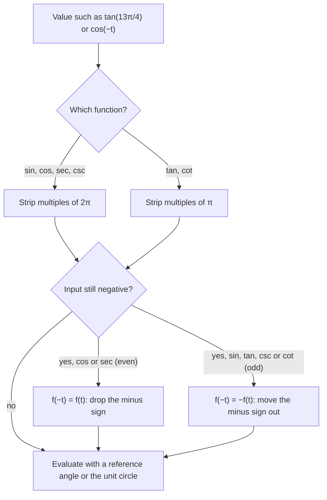

## Reading properties off the unit circle

Now that sine and cosine are functions of any real number, we can ask the usual function
questions: what inputs are allowed, what outputs are possible, and what symmetry the
function has. Every answer can be read from the unit circle, and these properties are
exactly what shape the graphs in the next module. They also give fast ways to evaluate
expressions like $\sin\tfrac{25\pi}{6}$ or $\cos(-t)$.

## Domain and range

Every real number $t$ gives a point $(\cos t, \sin t)$ on the unit circle, so sine and
cosine have **domain** all real numbers. The coordinates of points on the unit circle
take every value from $-1$ to $1$ and no others, so their **range** is $[-1, 1]$.

The other four functions are quotients, and are undefined where the denominator is zero:

- $\tan t = \tfrac{\sin t}{\cos t}$ and $\sec t = \tfrac{1}{\cos t}$ fail where $\cos t = 0$, that is
  at $t = \tfrac{\pi}{2} + k\pi$ for integers $k$ (the top and bottom of the circle).
- $\cot t = \tfrac{\cos t}{\sin t}$ and $\csc t = \tfrac{1}{\sin t}$ fail where $\sin t = 0$, at
  $t = k\pi$.

Ranges: tangent and cotangent take every real value. Secant and cosecant are reciprocals
of numbers between $-1$ and $1$, so their absolute value is at least 1: the range is
$(-\infty, -1] \cup [1, \infty)$.

| Function | Domain | Range |
|---|---|---|
| $\sin t$, $\cos t$ | all reals | $[-1, 1]$ |
| $\tan t$, $\sec t$ | $t \ne \tfrac{\pi}{2} + k\pi$ | all reals; $\lvert\sec t\rvert \ge 1$ |
| $\cot t$, $\csc t$ | $t \ne k\pi$ | all reals; $\lvert\csc t\rvert \ge 1$ |

## Periodicity

Walking an extra $2\pi$ around the unit circle returns you to the same point, so
$$\sin(t + 2\pi) = \sin t, \qquad \cos(t + 2\pi) = \cos t.$$

A function $f$ is **periodic** if there is a positive number $p$ with $f(t + p) = f(t)$
for every $t$ in its domain. The smallest such $p$ is the **period**. Sine, cosine,
secant and cosecant have period $2\pi$.

Tangent and cotangent repeat twice as fast. Walking half a turn ($\pi$) takes $(x, y)$ to
the opposite point $(-x, -y)$, and
$$\tan(t + \pi) = \frac{-y}{-x} = \frac{y}{x} = \tan t.$$
So tangent and cotangent have period $\pi$.

```plot
{"x": [-1.5, 1.5], "y": [-1.5, 1.5], "equal": true, "circles": [{"center": [0, 0], "r": 1}], "segments": [{"from": [-0.6, -0.8], "to": [0.6, 0.8], "dashed": true}], "points": [{"at": [0.6, 0.8], "label": "(x, y): t"}, [-0.6, -0.8], [0, 0]], "labels": [{"at": [-0.85, -1.2], "text": "(−x, −y): t + π"}], "caption": "t and t + π give opposite points on one line through the origin, so y/x (the tangent, the slope of that line) is the same"}
```

Periodicity lets you strip whole periods from an angle before evaluating.

### Example 1

Evaluate $\sin\tfrac{25\pi}{6}$, $\cos(-7\pi)$ and $\tan\tfrac{13\pi}{4}$.

**$\sin\tfrac{25\pi}{6}$:** $\tfrac{25\pi}{6} = 4\pi + \tfrac{\pi}{6}$. Remove two full periods:
$\sin\tfrac{\pi}{6} = \tfrac12$.

**$\cos(-7\pi)$:** $-7\pi = -8\pi + \pi$, so $\cos(-7\pi) = \cos\pi = -1$.

**$\tan\tfrac{13\pi}{4}$:** tangent's period is $\pi$, and $\tfrac{13\pi}{4} = 3\pi + \tfrac{\pi}{4}$:
$\tan\tfrac{\pi}{4} = 1$.

## Even and odd

Compare $t$ and $-t$. Walking the same distance in opposite directions from $(1, 0)$ gives
two points that are mirror images across the $x$-axis: $(x, y)$ and $(x, -y)$.

```plot
{"x": [-1.5, 1.5], "y": [-1.5, 1.5], "equal": true, "circles": [{"center": [0, 0], "r": 1}], "segments": [{"from": [0, 0], "to": [0.6, 0.8]}, {"from": [0, 0], "to": [0.6, -0.8]}, {"from": [0.6, 0.8], "to": [0.6, -0.8], "dashed": true}], "points": [{"at": [0.6, 0.8], "label": "(x, y): t"}, {"at": [0.6, -0.8], "label": "(x, −y): −t"}], "caption": "t and −t: same x-coordinate, opposite y-coordinates"}
```

So
$$\cos(-t) = \cos t, \qquad \sin(-t) = -\sin t, \qquad \tan(-t) = -\tan t.$$

A function with $f(-t) = f(t)$ is an **even function** (its graph is symmetric about the
$y$-axis); one with $f(-t) = -f(t)$ is an **odd function** (symmetric about the origin).
Cosine is even; sine and tangent are odd. The reciprocals inherit the property: secant is
even, cosecant and cotangent are odd. Only the "cos" pair (cosine and secant) is even.

### Example 2

Given $\sin t = 0.3$ and $\cos t = -0.954$ (rounded), find $\sin(-t)$, $\cos(-t)$,
$\tan(-t)$ and $\cos(t + 2\pi)$.

$\sin(-t) = -\sin t = -0.3$. $\cos(-t) = \cos t = -0.954$.
$\tan(-t) = -\tan t = -\tfrac{0.3}{-0.954} \approx 0.314$. $\cos(t + 2\pi) = \cos t = -0.954$.

### Example 3

Is $f(x) = x\sin x$ even, odd or neither? What about $g(x) = \sin x + \cos x$?

$f(-x) = (-x)\sin(-x) = (-x)(-\sin x) = x\sin x = f(x)$: **even**.

$g(-x) = \sin(-x) + \cos(-x) = -\sin x + \cos x$. That is neither $g(x)$ nor $-g(x)$ (try
$x = \tfrac{\pi}{4}$: $g = \sqrt2$, $g(-x) = 0$), so $g$ is **neither**.

### Example 4

Simplify $\sin(-t)\csc t + \cos(-t)\sec t$.

$\sin(-t)\csc t = -\sin t\cdot\tfrac{1}{\sin t} = -1$ and $\cos(-t)\sec t = \cos t\cdot\tfrac{1}{\cos t} = 1$.
The sum is $0$ (wherever both terms are defined).

### Example 5: combining the properties

$\tan t = -\tfrac34$ with $t$ in quadrant II. Find $\tan(-t)$, $\tan(t + \pi)$ and $\sec(-t)$.

$\tan(-t) = -\tan t = \tfrac34$ (odd). $\tan(t + \pi) = \tan t = -\tfrac34$ (period $\pi$).
For secant, use a point in quadrant II: $x = -4$, $y = 3$, $r = 5$, so $\sec t = -\tfrac54$, and since
secant is even, $\sec(-t) = -\tfrac54$.

## Putting the properties to work

Periodicity and symmetry combine into one routine for any input, however large or negative:



## Common mistakes

- **Assuming every trig function has period $2\pi$.** Tangent and cotangent have period $\pi$.
- **Pulling the minus sign out of cosine.** $\cos(-t) = \cos t$, not $-\cos t$.
- **Forgetting domain restrictions.** $\tan\tfrac{3\pi}{2}$ is undefined, so "simplify"
  answers hold only where every piece is defined.
- **Saying the range of secant is all reals.** Secant never takes values strictly between
  $-1$ and $1$.

## Key points

- Sine and cosine: domain all reals, range $[-1, 1]$, period $2\pi$.
- Tangent and cotangent: period $\pi$; tangent undefined at $\tfrac{\pi}{2} + k\pi$.
- Secant and cosecant: range $(-\infty, -1] \cup [1, \infty)$, period $2\pi$.
- Cosine and secant are even; sine, tangent, cosecant and cotangent are odd.
- Strip whole periods, then use symmetry and reference angles to evaluate.
