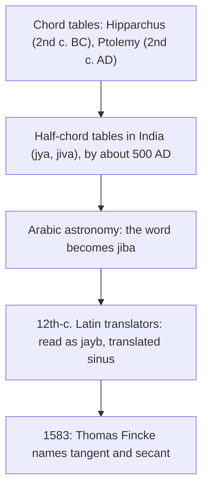

## Six numbers, six segments

The unit-circle lesson showed that the point at angle $\theta$ on the unit circle is
$(\cos\theta, \sin\theta)$: cosine and sine are *lengths* you can point to. The other four functions
were defined as quotients, which hides the fact that they are lengths too. With two extra lines
added to the unit circle, all six functions appear as segments in a single picture. That picture
is older than the word "function": astronomers drew it for centuries, and it is where the names
*tangent*, *secant* and *cotangent* come from. It also gives the Pythagorean identities with no algebra
at all, and it makes the signs and the "undefined" values easy to see.

## The picture

Take $\theta$ between $0^\circ$ and $90^\circ$ and draw:

- the unit circle, with $O$ the origin, $A = (1, 0)$ and $B = (0, 1)$;
- the point $P = (\cos\theta, \sin\theta)$ on the circle, and $M = (\cos\theta, 0)$ directly below it;
- the vertical line $x = 1$, which touches the circle only at $A$, and the horizontal line $y = 1$,
  which touches it only at $B$. A line that touches a circle at exactly one point is a
  **tangent line**; a line that cuts through a circle at two points is a **secant line**;
- the ray from $O$ through $P$, extended until it meets $x = 1$ at $T$ and $y = 1$ at $C$.

Then the six functions are the six lengths

| Segment | Length | Lies on |
|---|---|---|
| $MP$ | $\sin\theta$ | the vertical through $P$ |
| $OM$ | $\cos\theta$ | the $x$-axis |
| $AT$ | $\tan\theta$ | the tangent line $x = 1$ |
| $OT$ | $\sec\theta$ | the secant line $OT$ |
| $BC$ | $\cot\theta$ | the tangent line $y = 1$ |
| $OC$ | $\csc\theta$ | the secant line $OC$ |

## Why each length is right

All three right triangles in the picture share the angle $\theta$, so they are similar.

**Triangle $OMP$** has hypotenuse $OP = 1$, so its legs are $OM = \cos\theta$ and $MP = \sin\theta$.

**Triangle $OAT$** has a right angle at $A$, the angle $\theta$ at $O$, and $OA = 1$. Opposite over
adjacent gives $AT = \tan\theta \cdot OA = \tan\theta$, and adjacent over hypotenuse gives
$\cos\theta = OA/OT = 1/OT$, so $OT = \sec\theta$.

**Triangle $OBC$** has a right angle at $B$ and $OB = 1$. Because $BC$ is parallel to the $x$-axis,
the angle at $C$ equals $\theta$ (alternate angles), so the angle at $O$ is $90^\circ - \theta$. Then
$\tan\theta = OB/BC = 1/BC$, so $BC = \cot\theta$; and $\sin\theta = OB/OC = 1/OC$, so
$OC = \csc\theta$.

### Where the names come from

The segment $AT$ lies on a tangent line, so its length is called the tangent; $OT$ lies on a line
that cuts the circle, so it is the secant (Latin *secare*, "to cut"). The two names were introduced
by the Danish mathematician Thomas Fincke in his book *Geometria rotundi* (1583). The "co-" names mean
"of the complement": in triangle $OBC$ the angle at $O$ is $90^\circ - \theta$, and $BC$ is the side
opposite it, so $\cot\theta = \tan(90^\circ - \theta)$. The cotangent is the tangent construction with
the roles of the two axes swapped. This is the cofunction rule from Module 2, seen as a picture.

## Identities you can see

Apply the Pythagorean theorem to each right triangle:

$$OM^2 + MP^2 = OP^2: \quad \cos^2\theta + \sin^2\theta = 1,$$
$$OA^2 + AT^2 = OT^2: \quad 1 + \tan^2\theta = \sec^2\theta,$$
$$OB^2 + BC^2 = OC^2: \quad 1 + \cot^2\theta = \csc^2\theta.$$

Module 6 proves these three identities algebraically and for every angle; the picture shows why
they have the form they do. Comparing lengths in the picture also gives inequalities that hold for
every $\theta$ strictly between $0^\circ$ and $90^\circ$: $\sin\theta < \tan\theta$ (triangle $OAT$ is a
larger copy of $OMP$, scaled by $1/\cos\theta > 1$), and $\cos\theta < 1 < \sec\theta$.

The picture also explains what happens near $90^\circ$. As $\theta$ grows toward $90^\circ$ the ray
gets steeper, and $T$ climbs the line $x = 1$ without limit: $\tan\theta$ and $\sec\theta$ grow without
bound. At exactly $90^\circ$ the ray is vertical, parallel to $x = 1$, and never meets it. That is the
geometric meaning of "$\tan 90^\circ$ is undefined".

### Example 1

Find all six segment lengths for $\theta = 60^\circ$, the coordinates of $T$ and $C$, and check two
of the identities.

**Step 1: the triangle $OMP$.** $OM = \cos 60^\circ = \tfrac12$ and $MP = \sin 60^\circ = \tfrac{\sqrt3}{2}$.

**Step 2: the tangent line $x = 1$.** $AT = \tan 60^\circ = \sqrt3 \approx 1.732$, so $T = (1, \sqrt3)$, and
$OT = \sec 60^\circ = 2$.

**Step 3: the tangent line $y = 1$.** $BC = \cot 60^\circ = \tfrac{\sqrt3}{3} \approx 0.577$, so
$C = \left(\tfrac{\sqrt3}{3}, 1\right)$, and $OC = \csc 60^\circ = \tfrac{2\sqrt3}{3} \approx 1.155$.

**Check:** $1 + (\sqrt3)^2 = 4 = 2^2$, and $1 + \tfrac13 = \tfrac43 = \left(\tfrac{2}{\sqrt3}\right)^2$.
Note the order along the ray: $OP = 1 < OC \approx 1.155 < OT = 2$, so $C$ comes before $T$. For
angles below $45^\circ$ the order of $C$ and $T$ is reversed.

### Example 2

In the picture, $AT = \tfrac{5}{12}$. Find the other five lengths.

**Step 1:** $\tan\theta = \tfrac{5}{12}$, and triangle $OAT$ has legs $1$ and $\tfrac{5}{12}$, so
$OT = \sqrt{1 + \tfrac{25}{144}} = \sqrt{\tfrac{169}{144}} = \tfrac{13}{12}$. That is $\sec\theta$.

**Step 2:** $\cos\theta = \tfrac{1}{\sec\theta} = \tfrac{12}{13}$. Triangle $OMP$ is triangle $OAT$ shrunk by the
factor $\tfrac{1}{OT} = \tfrac{12}{13}$, so $MP = \tfrac{5}{12}\cdot\tfrac{12}{13} = \tfrac{5}{13}$.

**Step 3:** $BC = \cot\theta = \tfrac{12}{5}$ and $OC = \csc\theta = \tfrac{13}{5}$. Check with triangle
$OBC$: $1 + \tfrac{144}{25} = \tfrac{169}{25} = \left(\tfrac{13}{5}\right)^2$.

## Beyond the first quadrant: directed lengths

Every point on the line through $O$ and $P$ is a multiple $s\,P = (s\cos\theta, s\sin\theta)$. The one
on the line $x = 1$ has $s\cos\theta = 1$, so $s = \sec\theta$ and its height is
$s\sin\theta = \tan\theta$. In other words

$$T = (1, \tan\theta) = \sec\theta \cdot P, \qquad C = (\cot\theta, 1) = \csc\theta \cdot P.$$

This works in every quadrant if the lengths are read as **directed lengths**: a signed length that
is positive in one direction and negative in the other. $\tan\theta$ is positive when $T$ is above $A$
and negative when it is below; $\sec\theta$ is positive when $T$ lies on the same side of $O$ as $P$
and negative when it lies on the opposite side, on the ray extended backward through $O$. When
$\cos\theta = 0$ the line is vertical and never meets $x = 1$, so $\tan\theta$ and $\sec\theta$ do not
exist, exactly as in the earlier lessons.

### Example 3

Locate $T$ and $C$ for $\theta = 150^\circ$ and read off the signs.

$P = \left(-\tfrac{\sqrt3}{2}, \tfrac12\right)$, in quadrant II. The line through $O$ and $P$ falls to the right,
so it meets $x = 1$ below the axis: $T = (1, \tan 150^\circ) = \left(1, -\tfrac{\sqrt3}{3}\right) \approx (1, -0.577)$.
$T$ is on the opposite side of $O$ from $P$, so $\sec 150^\circ = -\tfrac{2\sqrt3}{3}$ is negative. Going the
other way, the ray through $P$ meets $y = 1$ at $C = \csc 150^\circ \cdot P = 2P = (-\sqrt3, 1)$: $\cot 150^\circ = -\sqrt3$
(left of $B$) and $\csc 150^\circ = 2$ (same side as $P$). The signs agree with ASTC: in quadrant II only
sine and cosecant are positive.

## The older functions: chords, versines and secants

The first trigonometric tables were not tables of sines. The Greek astronomer Hipparchus (2nd century
BC) is usually credited with the first table of chords, and Ptolemy's *Almagest* (2nd century AD)
contains a chord table in half-degree steps for a circle of radius 60. In a circle of radius 1, the
chord cut off by a central angle $\theta$ splits into two equal halves by the bisector of $\theta$, each the
side opposite an angle $\tfrac{\theta}{2}$ in a right triangle with hypotenuse 1. So

$$\text{crd}\,\theta = 2\sin\tfrac{\theta}{2}, \qquad \text{and in a circle of radius } R,\ \text{chord} = 2R\sin\tfrac{\theta}{2}.$$

Indian astronomers (by about 500 AD, in works such as Aryabhata's) tabulated the half-chord instead.
Its Sanskrit name *jyā* or *jīvā* ("bowstring") passed into Arabic as *jība*. The usual account is that
12th-century Latin translators read the unvoweled Arabic word as *jayb* ("fold" or "bosom") and
translated it as *sinus*, which became "sine"; exactly which translator first did so is disputed.

Two more lengths in the picture had names that survive in older books. The **versine** is
$\text{versin}\,\theta = 1 - \cos\theta$, the segment $MA$ from the foot of the sine to the circle. One
Sanskrit name for it, *śara*, means "arrow": with the chord as a bowstring, it is the part of the arrow
between string and bow. The **exsecant** is $\text{exsec}\,\theta = \sec\theta - 1$, the segment $PT$ of the secant line that
lies outside the circle. Half the versine, the *haversine*, survives in the haversine formula, a
standard way to compute distances along the surface of a sphere.

### Example 4

**(a)** Ptolemy's table uses radius 60, so its chord of $2x$ is $120\sin x$. What does it give for a
central angle of $90^\circ$? **(b)** A circular arch has radius 5 m and spans a central angle of $40^\circ$.
Find the width of the opening (the chord), the length of the arch, and its rise above the chord.

**(a)** $\text{crd}\,90^\circ = 120\sin 45^\circ = 60\sqrt2 \approx 84.8528$. In Ptolemy's base-60 notation
that is $84 + \tfrac{51}{60} + \tfrac{10}{3600}$, written 84;51,10. Reading the table backward,
$\sin 45^\circ = \tfrac{84.8528}{120} \approx 0.7071$.

**(b)** Chord: $2R\sin\tfrac{\theta}{2} = 10\sin 20^\circ \approx 3.420$ m. Arch (arc length, with the angle in
radians): $5\cdot\tfrac{40\pi}{180} \approx 3.491$ m, a little longer than the chord, as it must be. The rise is
the radius minus the distance from the center to the chord: $5 - 5\cos 20^\circ = 5\,\text{versin}\,20^\circ \approx 0.302$ m.
It is the "arrow" from the bowstring to the bow.

## Common mistakes

- **Putting the tangent segment on the wrong line.** $\tan\theta$ is the length $AT$ on the vertical
  line $x = 1$ (the tangent line at $A$), not the slanted segment $OT$, which is the secant.
- **Mixing up $OT$ and $OC$.** Both lie on the same ray. $OT$ ends on $x = 1$ and is $\sec\theta$; $OC$
  ends on $y = 1$ and is $\csc\theta$. The "co-" functions belong to the line $y = 1$.
- **Using $2\sin\theta$ for the chord.** The chord of $\theta$ is $2\sin\tfrac{\theta}{2}$: the half-chord goes
  with the half-angle.
- **Forgetting directions outside quadrant I.** If $T$ lands on the backward extension of the ray,
  $\sec\theta$ is negative even though the segment has a positive length.

## Key points

- On the unit circle: $\sin\theta = MP$, $\cos\theta = OM$, $\tan\theta = AT$ and $\sec\theta = OT$ (with
  the tangent line $x = 1$), $\cot\theta = BC$ and $\csc\theta = OC$ (with the tangent line $y = 1$).
- Similar right triangles give the lengths; the Pythagorean theorem on the three triangles gives
  $\cos^2\theta + \sin^2\theta = 1$, $1 + \tan^2\theta = \sec^2\theta$ and $1 + \cot^2\theta = \csc^2\theta$.
- $T = \sec\theta\cdot P = (1, \tan\theta)$ and $C = \csc\theta\cdot P = (\cot\theta, 1)$ in every quadrant,
  with signed lengths.
- Chord of $\theta$ in radius $R$: $2R\sin\tfrac{\theta}{2}$. Versine $1 - \cos\theta$, exsecant $\sec\theta - 1$.
- "Sine" comes from the Sanskrit half-chord, through Arabic and Latin; Fincke named tangent and secant in 1583.
