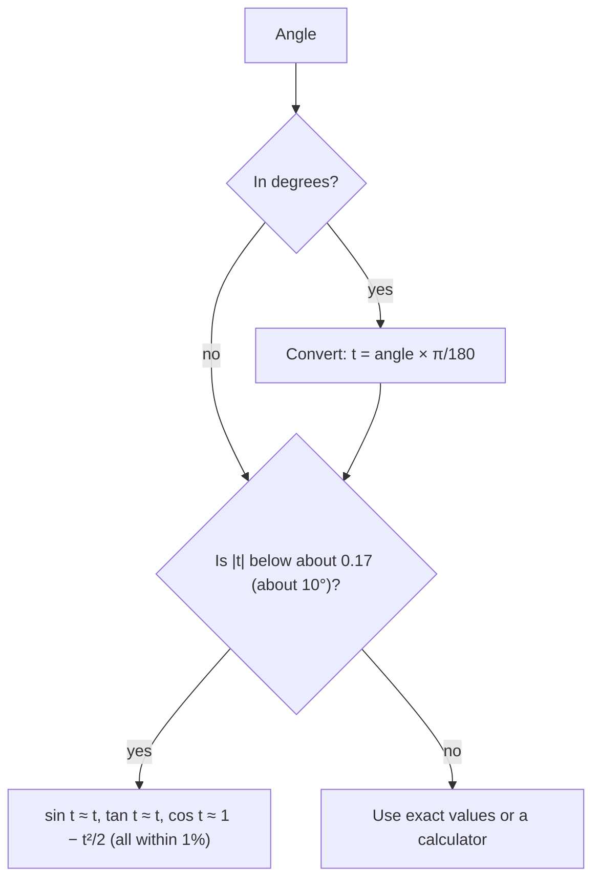

## Three lengths that almost agree

The unit-circle lesson made the radian measure of an angle into a length: walking $t$ units
around the unit circle from $(1, 0)$ lands on the point $(\cos t, \sin t)$. For a small positive $t$
there are now three lengths in the picture that are nearly equal: the height $\sin t$ of the point,
the arc $t$ itself, and the tangent $\tan t$. This lesson proves that they always come in the same
order, $\sin t < t < \tan t$, and squeezes out the most important consequence: $\tfrac{\sin t}{t}$ gets as
close to 1 as you like when $t$ is small. That fact is why scientists replace $\sin t$ with $t$ for
small angles, why calculus is done in radians, and it is the starting point for the derivative of
sine in calculus. (An honors lesson in Module 1 uses the same approximation to find angular sizes
in the sky; here the focus is on proving it and measuring how good it is.)

## The key inequality

**Claim.** For every $t$ with $0 < t < \tfrac{\pi}{2}$,
$$\sin t < t < \tan t.$$

**Proof by areas.** Let $O$ be the origin, $A = (1, 0)$, $P = (\cos t, \sin t)$ and $T = (1, \tan t)$, the
point where the ray $OP$ meets the vertical line $x = 1$. Three regions are nested inside each other:

- triangle $OAP$, with base $OA = 1$ and height $\sin t$: area $\tfrac12\sin t$;
- the sector $OAP$ of the unit circle with angle $t$: area $\tfrac12 r^2 t = \tfrac12 t$ (Module 1);
- triangle $OAT$, with legs $1$ and $\tan t$: area $\tfrac12\tan t$.

The triangle $OAP$ lies inside the sector, which lies inside triangle $OAT$, and each region is
strictly bigger than the one before. So $\tfrac12\sin t < \tfrac12 t < \tfrac12\tan t$, and doubling gives the
claim.

```plot
{"x": [-0.2, 1.4], "y": [-0.2, 1.1], "equal": true, "curves": [{"x": "cos(t)", "y": "sin(t)", "t": [0, 1.5708]}], "polygons": [{"points": [[0, 0], [1, 0], [0.7648, 0.6442]]}, {"points": [[0, 0], [1, 0], [1, 0.8423]]}], "segments": [{"from": [0.7648, 0.6442], "to": [0.7648, 0], "dashed": true, "label": "sin t"}], "points": [[0, 0], {"at": [1, 0], "label": "A"}, [0.7648, 0.6442], {"at": [1, 0.8423], "label": "T"}], "labels": [{"at": [-0.08, 0.07], "text": "O"}, {"at": [0.72, 0.76], "text": "P"}], "caption": "t = 0.7: triangle OAP (area ½ sin t) sits inside the sector OAP (area ½ t), which sits inside triangle OAT (area ½ tan t)"}
```

The same order holds for the lengths themselves: the height $\sin t$ is shorter than the arc $t$ that
reaches the same height, and the arc is shorter than the tangent segment $AT = \tan t$. The area
argument is the one that is easy to make airtight, which is why textbooks use it.

## Squeezing the ratio sin t / t

Divide all three parts of $\sin t < t < \tan t$ by $\sin t$ (positive for $0 < t < \tfrac{\pi}{2}$):
$$1 < \frac{t}{\sin t} < \frac{1}{\cos t}.$$
Taking reciprocals reverses the inequalities:
$$\cos t < \frac{\sin t}{t} < 1.$$

As $t$ shrinks toward 0, the point $(\cos t, \sin t)$ slides toward $(1, 0)$, so $\cos t$ gets as close
to 1 as you like. The ratio $\tfrac{\sin t}{t}$ is trapped between $\cos t$ and 1, so it is forced toward
1 as well. The general principle, that a quantity trapped between two others that approach the same
number must approach that number too, is the **squeeze theorem**. In calculus notation:
$$\lim_{t \to 0} \frac{\sin t}{t} = 1.$$

| $t$ | $0.5$ | $0.2$ | $0.1$ | $0.05$ | $0.01$ |
|---|---|---|---|---|---|
| $\cos t$ | $0.8776$ | $0.9801$ | $0.9950$ | $0.9988$ | $0.99995$ |
| $\tfrac{\sin t}{t}$ | $0.9589$ | $0.9933$ | $0.9983$ | $0.9996$ | $0.99998$ |

Negative $t$ give the same values: $\sin t$ and $t$ are both odd, so
$\tfrac{\sin(-t)}{-t} = \tfrac{-\sin t}{-t} = \tfrac{\sin t}{t}$. The ratio is an even function.

**Radians are essential.** The proof used the sector area $\tfrac12 t$, which is true only when $t$ is
in radians. In degrees, $\sin x^\circ = \sin\tfrac{\pi x}{180}$, so $\tfrac{\sin x^\circ}{x}$ approaches
$\tfrac{\pi}{180} \approx 0.01745$, not 1. On a graph, the fact $\tfrac{\sin t}{t} \to 1$ says that the curve
$y = \sin t$ leaves the origin with slope exactly 1, hugging the line $y = t$. That clean slope is the
main reason calculus measures angles in radians.

```plot
{"x": [-1.5, 1.5], "y": [-1.6, 1.6], "equal": true, "functions": [{"f": "sin(x)", "label": "y = sin t"}, {"f": "x", "label": "y = t", "dashed": true}, {"f": "tan(x)", "label": "y = tan t", "from": -1.0, "to": 1.0}], "caption": "Near 0 the graphs of sin t, t and tan t are almost indistinguishable; farther out sin t falls below the line and tan t rises above it"}
```

## Approximations and how good they are

For small $|t|$ (in radians) the inequality and the squeeze give
$$\sin t \approx t, \qquad \tan t \approx t.$$
Replacing a curve near a point by a straight line like this is a **linear approximation**.
Cosine needs one more term, because $\cos t \approx 1$ throws away all the information. The chord from
$A$ to $P$ gives it: its length squared is $(1 - \cos t)^2 + \sin^2 t = 2 - 2\cos t$, and the chord of
angle $t$ is $2\sin\tfrac{t}{2}$ (the half-chord is a sine). So
$$1 - \cos t = 2\sin^2\tfrac{t}{2} \approx 2\left(\tfrac{t}{2}\right)^2 = \tfrac{t^2}{2}, \qquad\text{that is,}\qquad \cos t \approx 1 - \frac{t^2}{2}.$$
Because $\left|\sin\tfrac{t}{2}\right| < \left|\tfrac{t}{2}\right|$ for $t \ne 0$, this estimate is always a little too low: $\cos t > 1 - \tfrac{t^2}{2}$ for $t \ne 0$.

To judge an approximation, use its **relative error**: the size of the error divided by the size of
the true value, $\dfrac{|\text{approximation} - \text{true value}|}{|\text{true value}|}$, often written as a percent.

| $t$ (radians) | $\sin t$ | error of $\sin t \approx t$ | $\tan t$ | error of $\tan t \approx t$ |
|---|---|---|---|---|
| $0.5$ | $0.4794$ | $4.29\%$ | $0.5463$ | $8.48\%$ |
| $0.2$ | $0.1987$ | $0.67\%$ | $0.2027$ | $1.34\%$ |
| $0.1$ | $0.0998$ | $0.17\%$ | $0.1003$ | $0.33\%$ |
| $0.05$ | $0.04998$ | $0.04\%$ | $0.05004$ | $0.08\%$ |

The errors shrink fast: halving $t$ cuts them to about a quarter. Calculus explains the pattern (and
we state it here without proof): the error of $\sin t \approx t$ is about $\tfrac{t^3}{6}$, of $\tan t \approx t$
about $\tfrac{t^3}{3}$, and of $\cos t \approx 1 - \tfrac{t^2}{2}$ about $\tfrac{t^4}{24}$. Dividing by $t$, the relative
errors are about $\tfrac{t^2}{6}$ and $\tfrac{t^2}{3}$. Solving numerically, $\sin t \approx t$ is within 1% for
$|t| < 0.244$ (about $14^\circ$), and $\tan t \approx t$ for $|t| < 0.173$ (about $9.9^\circ$).



### Example 1

Check the inequality and the areas at $t = 0.5$.

$\sin 0.5 \approx 0.4794$ and $\tan 0.5 \approx 0.5463$, so $0.4794 < 0.5 < 0.5463$. The three areas are
$\tfrac12(0.4794) \approx 0.2397$, $\tfrac12(0.5) = 0.25$ and $\tfrac12(0.5463) \approx 0.2732$, nested as claimed. The
squeeze: $\cos 0.5 \approx 0.8776 < \tfrac{0.4794}{0.5} \approx 0.9589 < 1$.

### Example 2

Estimate $\sin 0.05$, $\tan 0.05$ and $\cos 0.05$ without a calculator, then compare.

$\sin 0.05 \approx 0.05$, $\tan 0.05 \approx 0.05$ and $\cos 0.05 \approx 1 - \tfrac{0.0025}{2} = 0.99875$. The true values are
$0.049979$, $0.050042$ and $0.998750$ (to six decimals). The first two are off by about $0.00002$ and
$0.00004$; the cosine estimate matches to six decimals, since its error is about $\tfrac{0.05^4}{24} \approx 3\times10^{-7}$.

### Example 3

Estimate $\sin 2^\circ$ and $\cos 2^\circ$.

**Step 1: convert.** $t = 2\cdot\tfrac{\pi}{180} = \tfrac{\pi}{90} \approx 0.034907$. (Using 2 itself would claim $\sin 2^\circ \approx 2$,
which is impossible.)

**Step 2: approximate.** $\sin 2^\circ \approx 0.034907$; the true value is $0.034900$ (to six decimals). And
$\cos 2^\circ \approx 1 - \tfrac{0.034907^2}{2} \approx 0.999391$, matching the true value $0.999391$ to six decimals.

### Example 4

Is $\tan t \approx t$ good to 1% at $10^\circ$? Is $\sin t \approx t$?

$t = \tfrac{10\pi}{180} \approx 0.174533$. $\tan 10^\circ \approx 0.176327$, so the relative error is
$\tfrac{0.176327 - 0.174533}{0.176327} \approx 1.02\%$: just over 1%. $\sin 10^\circ \approx 0.173648$, error
$\tfrac{0.174533 - 0.173648}{0.173648} \approx 0.51\%$: comfortably within 1%. The rule of thumb $\tfrac{t^2}{3} \approx 1.02\%$
and $\tfrac{t^2}{6} \approx 0.51\%$ predicts both.

### Example 5

Find $\tfrac{\sin(-0.2)}{-0.2}$ from the table, and estimate $1 - \cos 0.2$.

The ratio is even, so it equals $\tfrac{\sin 0.2}{0.2} \approx 0.9933$. And $1 - \cos 0.2 \approx \tfrac{0.2^2}{2} = 0.02$;
the true value is $0.019933$.

## Beyond small angles

Two of the facts extend to every real number. Since $|\sin t| \le 1 < \tfrac{\pi}{2}$, the inequality
$|\sin t| \le |t|$ holds for all $t$ (with equality only at $t = 0$): for $|t| \ge \tfrac{\pi}{2}$ it is automatic,
and for smaller $|t|$ it is the claim above together with oddness. And $\cos t \ge 1 - \tfrac{t^2}{2}$ for all $t$,
because the chord argument used no restriction on $t$. The other inequalities do not extend: $\sin t < t$
fails for negative $t$ (for example $\sin(-1) \approx -0.841 > -1$), and $\tan t > t$ fails past $\tfrac{\pi}{2}$
(for example $\tan 2 \approx -2.185$).

## Common mistakes

- **Using degrees.** $\sin 3^\circ$ is about $0.0524$, not 3. Convert to radians before approximating.
- **Approximating $\cos t$ by $1 - t$.** The correction to $\cos t \approx 1$ is $\tfrac{t^2}{2}$, a square,
  because cosine is even.
- **Using the approximation where it is poor.** At $t = 0.5$, $\tan t \approx t$ is already off by more
  than 8%. Check the size of $t$ (or the error rule) first.
- **Dropping the restriction.** $\sin t < t < \tan t$ is proved for $0 < t < \tfrac{\pi}{2}$; outside that
  interval only $|\sin t| \le |t|$ survives.

## Key points

- For $0 < t < \tfrac{\pi}{2}$: $\sin t < t < \tan t$, proved by nesting two triangles around a sector.
- Squeeze: $\cos t < \tfrac{\sin t}{t} < 1$, so $\tfrac{\sin t}{t} \to 1$ as $t \to 0$ (radians only).
- Small-angle approximations: $\sin t \approx t$, $\tan t \approx t$, $\cos t \approx 1 - \tfrac{t^2}{2}$.
- Relative errors are about $\tfrac{t^2}{6}$ for sine and $\tfrac{t^2}{3}$ for tangent; under 1% up to about $14^\circ$
  and $10^\circ$.
- $|\sin t| \le |t|$ and $\cos t \ge 1 - \tfrac{t^2}{2}$ for every real $t$.
