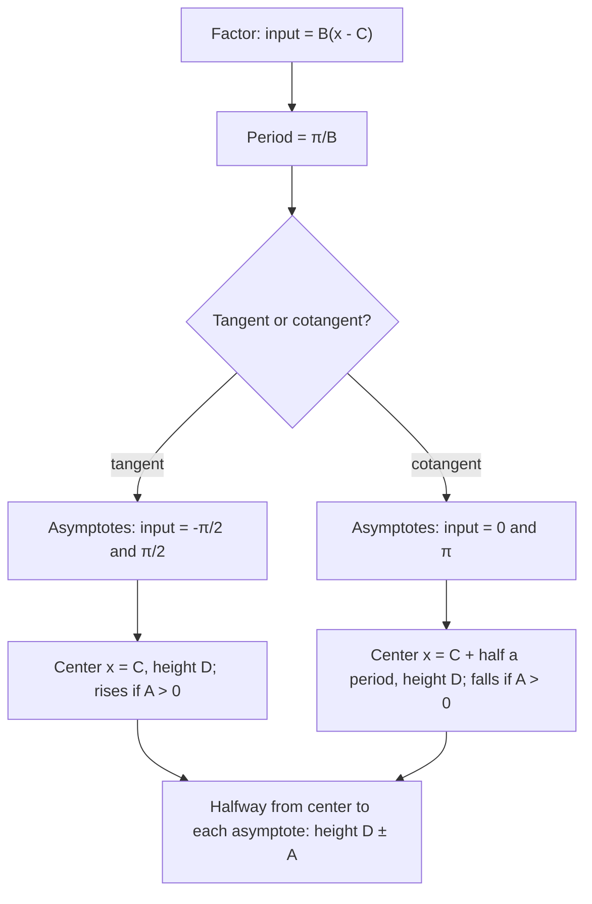

## A different kind of periodic graph

Sine and cosine are smooth waves that never leave $[-1, 1]$. Tangent behaves very
differently: it has no maximum or minimum, its graph breaks apart where it is undefined,
and it repeats every $\pi$ instead of every $2\pi$. All three facts follow from
$\tan x = \tfrac{\sin x}{\cos x}$, so the graph can be predicted from what you already know.

## Building $y = \tan x$

**Where it is undefined.** $\tan x$ is undefined where $\cos x = 0$: at
$x = \pm\tfrac{\pi}{2}, \pm\tfrac{3\pi}{2}, \ldots$ Near those $x$-values the denominator is tiny,
so the quotient is huge. As $x$ approaches $\tfrac{\pi}{2}$ from the left, $\sin x \to 1$ and
$\cos x \to 0^+$, so $\tan x \to +\infty$; from the right, $\cos x$ is a small negative
number and $\tan x \to -\infty$. The graph has a **vertical asymptote**, a vertical line it
approaches but never touches, at each of these points.

**Zeros.** $\tan x = 0$ where $\sin x = 0$: at $x = k\pi$.

**Some values.** $\tan\left(\pm\tfrac{\pi}{4}\right) = \pm 1$, $\tan\left(\pm\tfrac{\pi}{3}\right) = \pm\sqrt3 \approx \pm1.73$.

**Period $\pi$.** One full branch lives between consecutive asymptotes, from
$-\tfrac{\pi}{2}$ to $\tfrac{\pi}{2}$, and the branches repeat every $\pi$.

```plot
{"x": [-4.8, 4.8], "y": [-4, 4], "functions": [{"f": "tan(x)", "label": "y = tan x"}], "segments": [{"from": [-4.7124, -4], "to": [-4.7124, 4], "dashed": true}, {"from": [-1.5708, -4], "to": [-1.5708, 4], "dashed": true}, {"from": [1.5708, -4], "to": [1.5708, 4], "dashed": true}, {"from": [4.7124, -4], "to": [4.7124, 4], "dashed": true}], "points": [{"at": [0.7854, 1], "label": "(π/4, 1)"}, {"at": [-0.7854, -1], "label": "(−π/4, −1)"}, {"at": [0, 0]}], "caption": "y = tan x with asymptotes at x = ±π/2, ±3π/2"}
```

Features of $y = \tan x$:

- domain: $x \ne \tfrac{\pi}{2} + k\pi$; range: all real numbers;
- period $\pi$; zeros at $k\pi$; asymptotes at $\tfrac{\pi}{2} + k\pi$;
- increasing on every branch; symmetric about the origin (tangent is odd).

The three points $\left(-\tfrac{\pi}{4}, -1\right)$, $(0, 0)$, $\left(\tfrac{\pi}{4}, 1\right)$ together with the two
asymptotes are the "key points" for sketching one branch.


## The graph of $y = \cot x$

$\cot x = \tfrac{\cos x}{\sin x}$ is undefined where $\sin x = 0$, at $x = k\pi$, so its
asymptotes are there. Its zeros are where $\cos x = 0$, at $\tfrac{\pi}{2} + k\pi$. One branch runs
from $0$ to $\pi$, passing through $\left(\tfrac{\pi}{4}, 1\right)$, $\left(\tfrac{\pi}{2}, 0\right)$ and
$\left(\tfrac{3\pi}{4}, -1\right)$. Cotangent is *decreasing* on each branch. Period $\pi$.

```plot
{"x": [-3.5, 6.6], "y": [-4, 4], "functions": [{"f": "1/tan(x)", "label": "y = cot x"}], "segments": [{"from": [-3.1416, -4], "to": [-3.1416, 4], "dashed": true}, {"from": [0, -4], "to": [0, 4], "dashed": true}, {"from": [3.1416, -4], "to": [3.1416, 4], "dashed": true}, {"from": [6.2832, -4], "to": [6.2832, 4], "dashed": true}], "points": [{"at": [0.7854, 1]}, {"at": [1.5708, 0]}, {"at": [2.3562, -1]}], "caption": "y = cot x: asymptotes at multiples of π, decreasing branches"}
```

## Transformations

The constants work as for sine, with one change: the basic period is $\pi$, so

$$y = A\tan\big(B(x - C)\big) + D \quad\text{has period } \frac{\pi}{B}.$$

There is no amplitude (the graph is unbounded), but $A$ still stretches vertically: the
points where the basic tangent is $\pm1$ now sit at height $D \pm A$. For a branch of
tangent, the asymptotes are where $B(x - C) = \pm\tfrac{\pi}{2}$, and the center of the branch,
where $y = D$, is at $x = C$.

The flowchart collects the steps for both functions. (For cotangent, the branch between the
asymptotes where the input is 0 and $\pi$ is centered where the input is $\tfrac{\pi}{2}$, half a
period after $x = C$.)



### Example 1

Graph one branch of $y = 2\tan\tfrac{x}{2}$.

$B = \tfrac12$, so the period is $\tfrac{\pi}{1/2} = 2\pi$.
Asymptotes: $\tfrac{x}{2} = \pm\tfrac{\pi}{2}$ gives $x = \pm\pi$.
The branch passes through $(0, 0)$, and halfway to each asymptote ($x = \pm\tfrac{\pi}{2}$) it
reaches $y = 2\tan\left(\pm\tfrac{\pi}{4}\right) = \pm 2$.

### Example 2

Find the period and the asymptotes of $y = \tan\!\left(2x - \tfrac{\pi}{2}\right)$.

Factor: $\tan\!\left(2\left(x - \tfrac{\pi}{4}\right)\right)$. Period $\tfrac{\pi}{2}$, branch centered at
$x = \tfrac{\pi}{4}$. Asymptotes where $2x - \tfrac{\pi}{2} = \tfrac{\pi}{2} + k\pi$:
$x = \tfrac{\pi}{2} + \tfrac{k\pi}{2}$, i.e. at every multiple of $\tfrac{\pi}{2}$ ($x = 0, \pm\tfrac{\pi}{2}, \pm\pi, \ldots$).

```plot
{"x": [-1.8, 3.4], "y": [-4, 4], "functions": [{"f": "tan(2x - pi/2)", "label": "y = tan(2x − π/2)"}], "segments": [{"from": [0, -4], "to": [0, 4], "dashed": true}, {"from": [1.5708, -4], "to": [1.5708, 4], "dashed": true}, {"from": [3.1416, -4], "to": [3.1416, 4], "dashed": true}, {"from": [-1.5708, -4], "to": [-1.5708, 4], "dashed": true}], "points": [{"at": [0.7854, 0], "label": "(π/4, 0)"}], "caption": "Period π/2; asymptotes at multiples of π/2"}
```

### Example 3

Find the period, asymptotes and zeros of $y = 3\cot(\pi x)$.

Period $\tfrac{\pi}{\pi} = 1$. Cotangent's asymptotes are where its input is a multiple of
$\pi$: $\pi x = k\pi$, so $x = k$ (every integer). Zeros where $\pi x = \tfrac{\pi}{2} + k\pi$:
$x = \tfrac12 + k$. Between $x = 0$ and $x = 1$ the branch falls from $+\infty$ to $-\infty$,
passing through $\left(\tfrac14, 3\right)$, $\left(\tfrac12, 0\right)$ and $\left(\tfrac34, -3\right)$.

### Example 4: a reflected, shifted tangent

Describe $y = -\tan\left(x + \tfrac{\pi}{4}\right)$.

The period is $\pi$ ($B = 1$). The branch is centered where $x + \tfrac{\pi}{4} = 0$, at $x = -\tfrac{\pi}{4}$, which is
a zero. Asymptotes: $x + \tfrac{\pi}{4} = \pm\tfrac{\pi}{2}$, so $x = \tfrac{\pi}{4}$ and $x = -\tfrac{3\pi}{4}$ (then every $\pi$). The
minus sign flips the branch, so it *decreases* from $+\infty$ to $-\infty$, like cotangent.

## How fast tangent grows

Near an asymptote tangent grows explosively: $\tan 1.5 \approx 14.1$, while $\tan 1.57 \approx 1256$, and
$\tfrac{\pi}{2} \approx 1.5708$. On a sketch, the branch looks nearly vertical well before it reaches the
asymptote. That's also why a small error in an angle near $90^\circ$ makes a big error in its
tangent, something surveyors avoid by not sighting at steep angles.

## Tangent as a slope

Recall from the unit circle that $\tan\theta$ is the slope of the terminal side. As $\theta$ climbs
toward $\tfrac{\pi}{2}$ the ray tilts toward vertical and its slope grows without bound; just past
$\tfrac{\pi}{2}$ the ray points up and to the left, with a large negative slope. The asymptote in the
graph is the moment the ray is exactly vertical.

## Common mistakes

- **Using $\tfrac{2\pi}{B}$ for the period of tangent or cotangent.** Their period is $\tfrac{\pi}{B}$.
- **Calling $A$ an amplitude.** Tangent has no maximum, so it has no amplitude; $A$ is just
  a vertical stretch.
- **Drawing the graph across an asymptote.** Each branch heads off to $\pm\infty$ and the next
  one comes back from the other end.
- **Mixing up tangent and cotangent asymptotes.** Tangent: where cosine is 0. Cotangent:
  where sine is 0.

## Key points

- $y = \tan x$: period $\pi$, asymptotes $x = \tfrac{\pi}{2} + k\pi$, zeros $x = k\pi$, increasing.
- $y = \cot x$: period $\pi$, asymptotes $x = k\pi$, zeros $x = \tfrac{\pi}{2} + k\pi$, decreasing.
- $y = A\tan(B(x - C)) + D$ has period $\tfrac{\pi}{B}$; find asymptotes by setting the input
  equal to $\pm\tfrac{\pi}{2}$ (tangent) or $0$ and $\pi$ (cotangent).
- Range of both is all real numbers; there is no amplitude.
